# jinfer-mellum — class architecture

Package `com.qxotic.jinfer.models.mellum` (4 classes, ~1090 lines). It is the `jinfer-<model>` provider for GGUF
architecture `mellum` (JetBrains Mellum 2): a **text-only mixture-of-experts decoder** with grouped-query attention,
per-head Q/K RMS-norm, NeoX rotary, and a 3:1 mix of sliding-window and full-attention layers. Every block routes
softmax top-k over its experts (k weights renormalised); there is no dense or shared expert. There is no vision, audio
or speculative subsystem: `Batch.Input.Embeddings` and `Batch.Input.Sequences` are rejected.

Format: **Mermaid**. Legend: `..|>` implements; `--|>` extends; `-->` holds/uses; `..>` creates/depends;
classes marked `<<external>>` live outside this package.

1. [Position in the stack](#1-position-in-the-jinfer-stack)
2. [Class diagrams](#2-class-diagrams) — 2a contracts, 2b model internals, 2c chat template
3. [Loading sequence](#3-loading-sequence)
4. [Forward pass](#4-forward-pass) — 4.0 global, 4a `ingest`, 4b `decoderBlock`
5. [Layer kinds: sliding window vs full](#5-layer-kinds-sliding-window-vs-full)
6. [State and checkpoint layout](#6-state-and-checkpoint-layout)
7. [Chat template flow](#7-chat-template-flow)

| Class | Role |
|---|---|
| `Mellum` | The model: `LanguageModel` impl with nested `Configuration`, `LayerWeights`, `Weights`, `State`; GGUF loading and the whole forward pass (`attention` + `moe` per layer) |
| `MellumProvider` | `ModelProvider` SPI for architecture `mellum`: builds the `LoadedModel` (stops, seed, chat template, sampling defaults 0.6 / 0.95 / 20) |
| `MellumChatTemplate` | `ChatTemplate`: ChatML + Hermes JSON tool calls, token-exact with the GGUF Jinja; Instruct vs Thinking checkpoints |
| `MellumCheckpointCodec` | `CheckpointCodec<State>`: serialises FP16 K/V rows only (linear for full layers, ring slots for window layers) |

---

## 1. Position in the jinfer stack

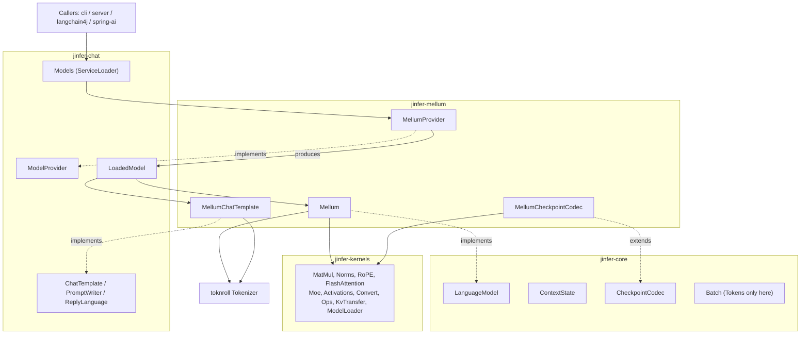

---

## 2. Class diagrams

### 2a. Contracts and relations

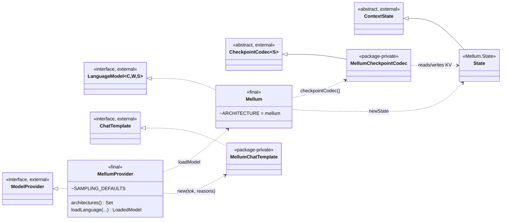

### 2b. Model internals — `Mellum` and its nested types

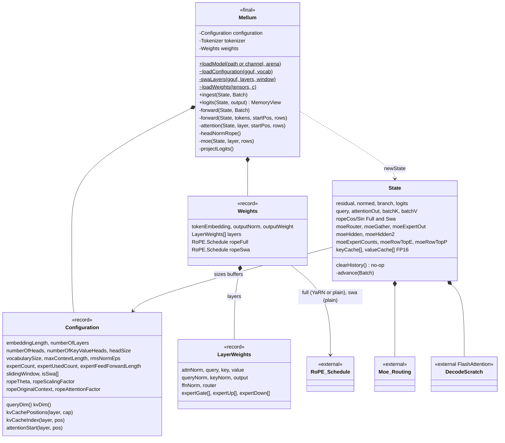

### 2c. Chat template internals

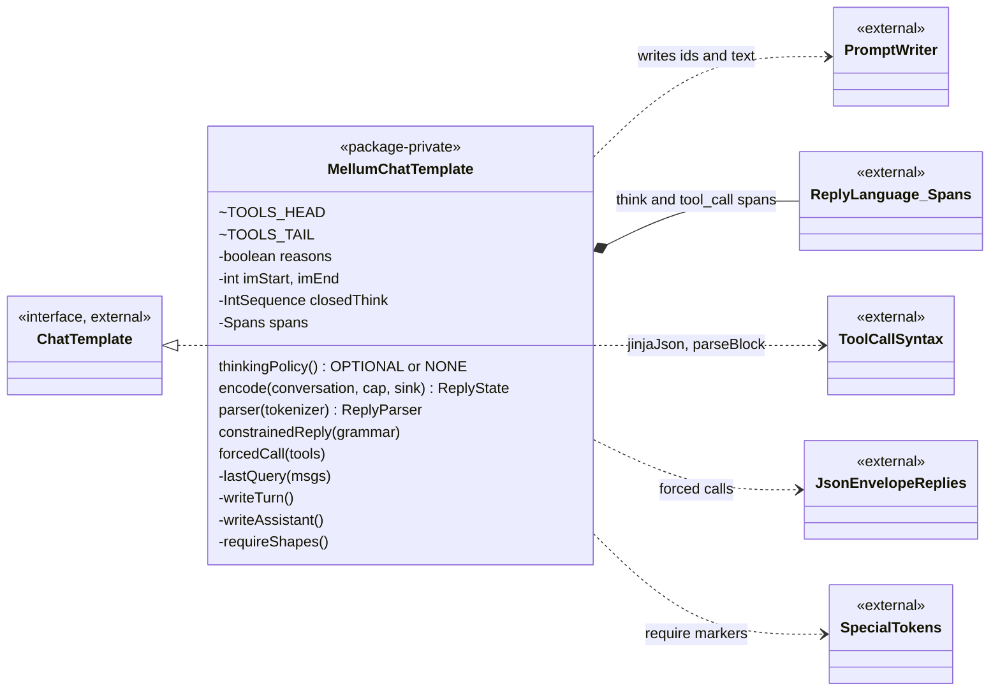

---

## 3. Loading sequence

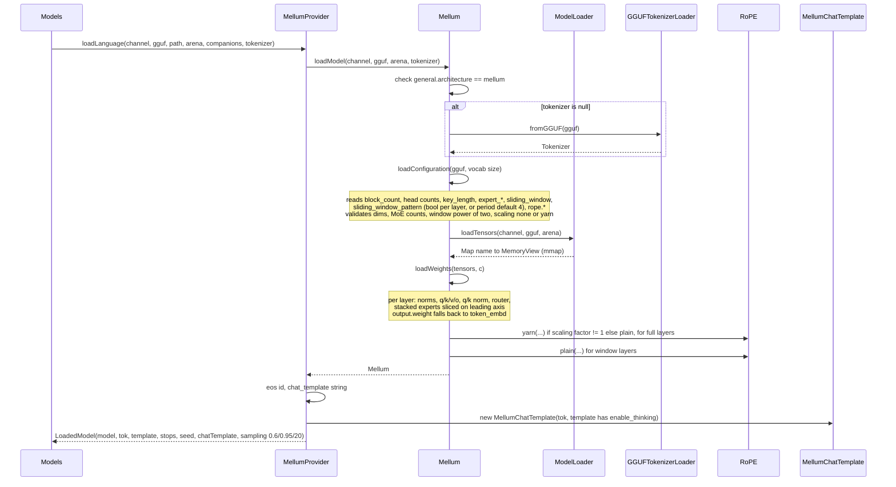

---

## 4. Forward pass

### 4.0 Global architecture

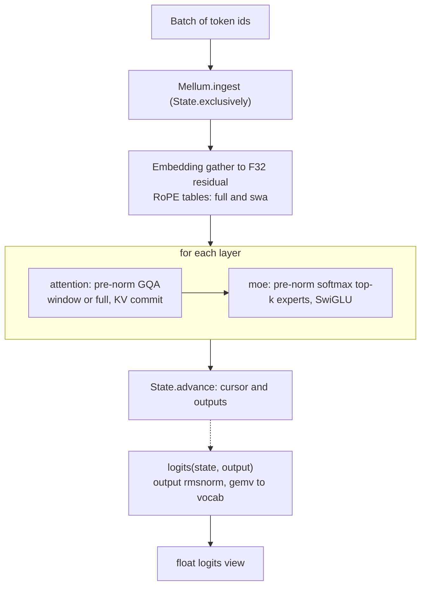

### 4a. `ingest` — batch validation to advance

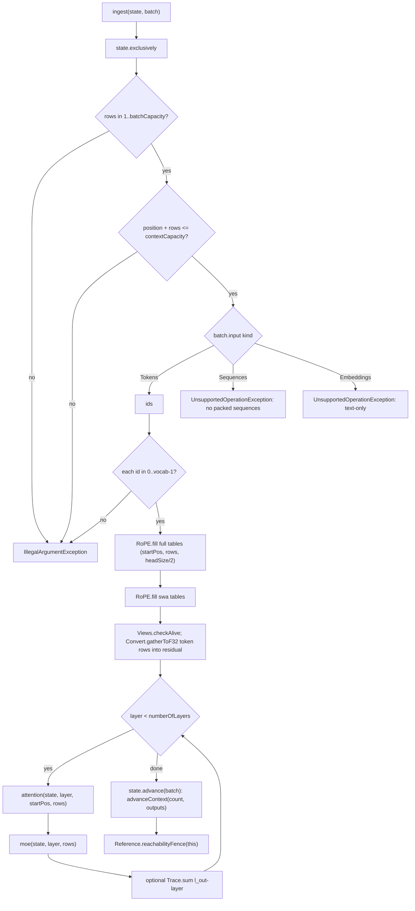

### 4b. `decoderBlock` — one layer (attention then MoE)

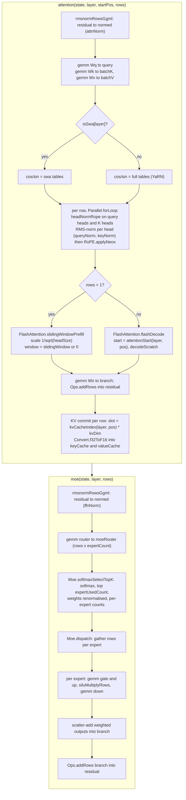

Notes: KV is committed inside the layer because `batchK` / `batchV` are reused by every layer. All layers are the same kind
of block (attention then MoE); they differ only in window, cache size and RoPE schedule (section 5).

---

## 5. Layer kinds: sliding window vs full

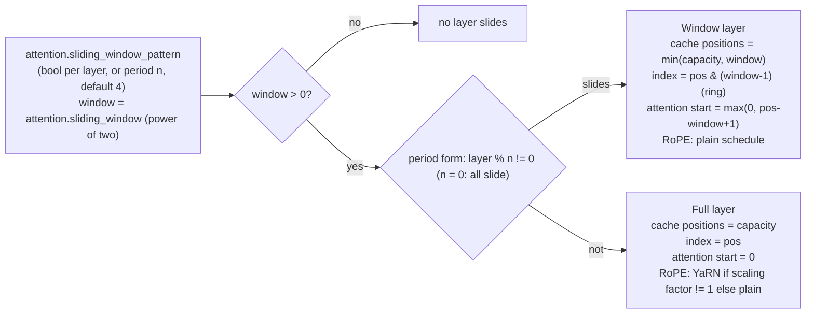

---

## 6. State and checkpoint layout

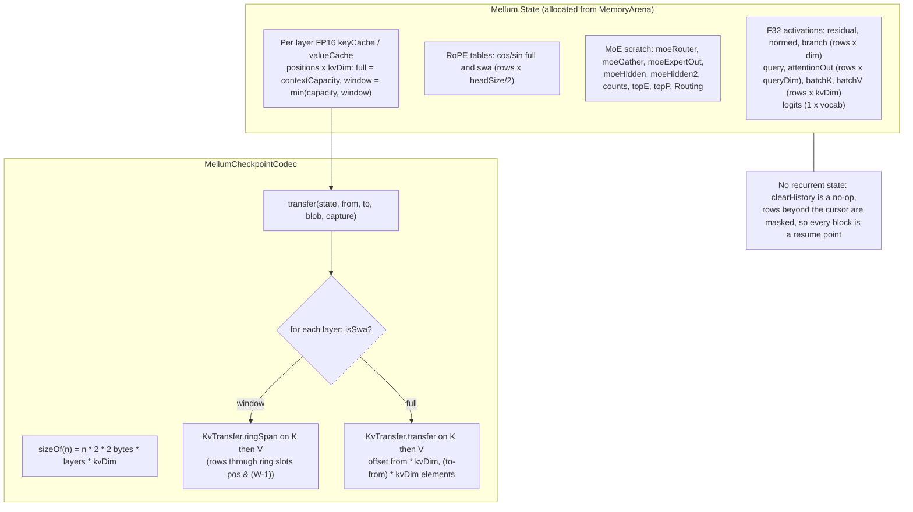

The checkpoint blob layout is, per layer in order, the K span followed by the V span; `capture = true` copies cache to blob,
`false` restores blob to cache. `newState(ctx, batch)` makes its own cross-thread arena (and closes it if allocation
fails); `newState(ctx, batch, arena)` borrows the caller's. `contextCapacity` must be in `(0, maxContextLength]`.

---

## 7. Chat template flow

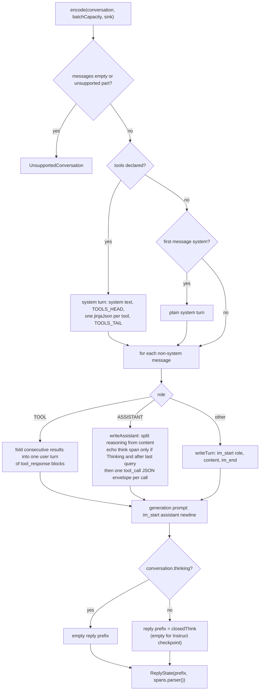

Policy: `thinkingPolicy()` is `OPTIONAL` for the Thinking checkpoint (template contains `enable_thinking`), else `NONE`.
Reply parsing, grammar-constrained replies and forced calls (`JsonEnvelopeReplies.forced(tools, "<|im_end|>")`) are
delegated to `ReplyLanguage.Spans` / `Selection`. Stop tokens come from the provider: GGUF eos, `<|im_end|>`, `<|endoftext|>`.
