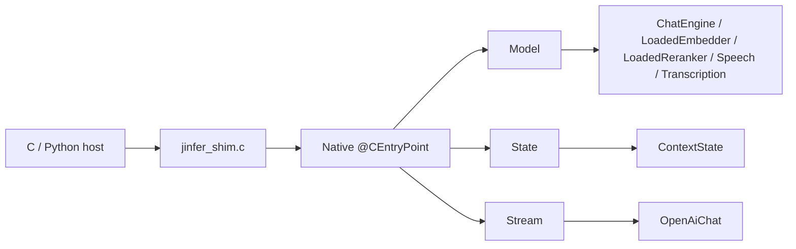

# jinfer-native — architecture summary

**libjinfer**: jinfer packaged as a GraalVM native-image shared library with a plain C API
(`include/jinfer.h`, version 0.4.0). C, C++ and Python (`python/jinfer`) hosts load GGUF models and run chat,
embedding, reranking, speech synthesis, transcription and raw token-level inference without a JVM. The library also
carries the toknroll tokenizer API (`toknroll.h`) and shares one isolate with it.

For class diagrams and detailed flows, see [ARCHITECTURE.md](ARCHITECTURE.md).

## Where it sits

It sits at the top of the stack, next to `jinfer-cli`, `jinfer-server` and the framework adapters. It is a thin binding
over modules that already exist:

- **jinfer-chat**: `ChatEngine` for language models; `Models` / `ModelProvider` to discover the model kind;
  `LoadedEmbedder` and `LoadedReranker`.
- **jinfer-server**: `OpenAiChat` and `ServerConfig`. `jinfer_chat` accepts the same OpenAI `chat.completions`
  JSON as the HTTP server and returns the same completion JSON.
- **jinfer-core**: `ContextModel`, `ContextState`, `LanguageModel`, `EmbeddingModel`, `SpeechSynthesisModel`,
  `TranscriptionModel`, `Arenas`, `RuntimeFlags`.
- **jinfer-hub** (`ModelStore` resolves file paths and hub refs), **jinfer-cache** (`PromptCache`), **gguf**
  (reads header metadata for `jinfer_model_info`).
- **toknroll-native**: the shared isolate and the `toknroll_*` symbols. `jinfer_model_tokenizer` returns a
  toknroll handle.
- Runtime only: `jinfer-models-all` (the model providers) and the `jam-*` kernel backends.

## Main concepts (8 classes, package `com.qxotic.jinfer.libjinfer`)

- **`Native`**: every `jinfer__*` `@CEntryPoint`. Each one clears the last error, resolves `ObjectHandle`s to Java
  objects with a type check, calls into `Model`, `State` or `Stream`, and catches every `Throwable`. An
  exception that leaves an entry point would kill the process.
- **`Model`**: a loaded model of one `Kind` (language, embedding, reranking, speech, transcription). The model
  file decides the kind. Loading tries `ChatEngine` first and falls back to retrieval, then transcription, then
  speech. The model is reference-counted, so its weights live until the last state or stream is gone. It also
  serves `embed` and `rerank` from one reused shared state, plus `property` and `info` (a JSON description).
- **`State`**: the raw door. It wraps one `ContextState`: you ingest token ids, then read logits or an
  embedding. Embedding models ingest one packed bidirectional batch; other models prefill in chunks.
- **`Stream`**: every generation (chat, speech, transcription). A producer thread pushes text or PCM chunks into
  a queue, and the caller pulls one chunk per `jinfer_stream_step`. The stream supports cancellation, a final
  JSON result, and C copies of the current chunk that the caller borrows.
- **`Options`**: a `@CStruct` view of `jinfer_model_options`. The image build compiles it against `jinfer.h`,
  so the struct layout cannot drift from the header.
- **`Errors`**: result codes (`OK`, `DONE`, `EINVAL`, `ENOTFOUND`, `EUNSUPPORTED`, `ECANCELLED`, `EBUSY`,
  `ERROR`). It maps exceptions to codes and keeps the last error per thread, with the message (at most 1 KB) in
  a C TLS buffer.
- **`Exclusive`**: if a second thread calls into the same state or stream at the same time, it gets `EBUSY`
  instead of a race.
- **`Resample`**: Lanczos resampling of transcription input to the rate the model expects.

## Key flows

1. **Load**: `jinfer_model_load(source, options)` → `Options.read` → `ModelStore.resolveAll` → `ChatEngine`,
   or one of the `Models.load*` fallbacks → a global object handle.
2. **Chat**: `jinfer_chat(model, json)` → `OpenAiChat.lower` → the producer runs `ChatEngine.complete` on the
   engine's stream executor and pushes `CONTENT` deltas → the host calls `step` and `text` in a loop → the
   stream ends with `DONE` → `jinfer_stream_result` returns the completion JSON. `jinfer_prepare` only computes
   the prompt into the cache.
3. **Speech / transcription**: the same `Stream` machinery, running on each model's single daemon
   "driver" thread.
4. **Embed / rerank**: synchronous. Size the output first (the snprintf convention: return the needed size,
   write only what fits), then run in the model's shared `ContextState`.
5. **Raw**: `jinfer_state_new` → `ingest` → `logits` or `embedding`.

## Notable design choices

- **No model logic in C.** The shim only attaches a thread through toknroll's isolate and forwards the call.
  `configure`, `log_set` and `last_error` reuse the toknroll helpers.
- **Errors never escape an entry point.** Each failure becomes a code plus a one-line message. An
  out-of-memory error is reported from a pre-built byte array, so reporting it needs no allocation.
- **Explicit GC in the image.** In the native image, arenas are `Arena.ofAuto()`, so off-heap memory is freed
  only by a GC. `Native.collect()` runs `System.gc()` after a model's last release, a state free, or an early
  stream free, and does nothing on the JVM. The shared embed/rerank state exists for the same reason.
- **Ending a stream releases its model.** A stream that has finished but was never freed keeps no weights
  alive. Freeing a stream that is still running cancels it and drains it.
- **Speech output is refused in chat.** A request that asks for audio output gets `EUNSUPPORTED`; the reply
  is not silently dropped.
- No `META-INF/services` files of its own. `native-image.properties` initializes the whole package at run time,
  so C strings, handles and thread-local state are never baked into the image heap.
