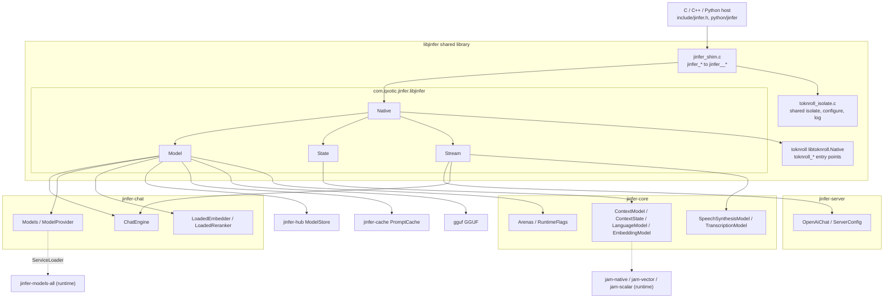
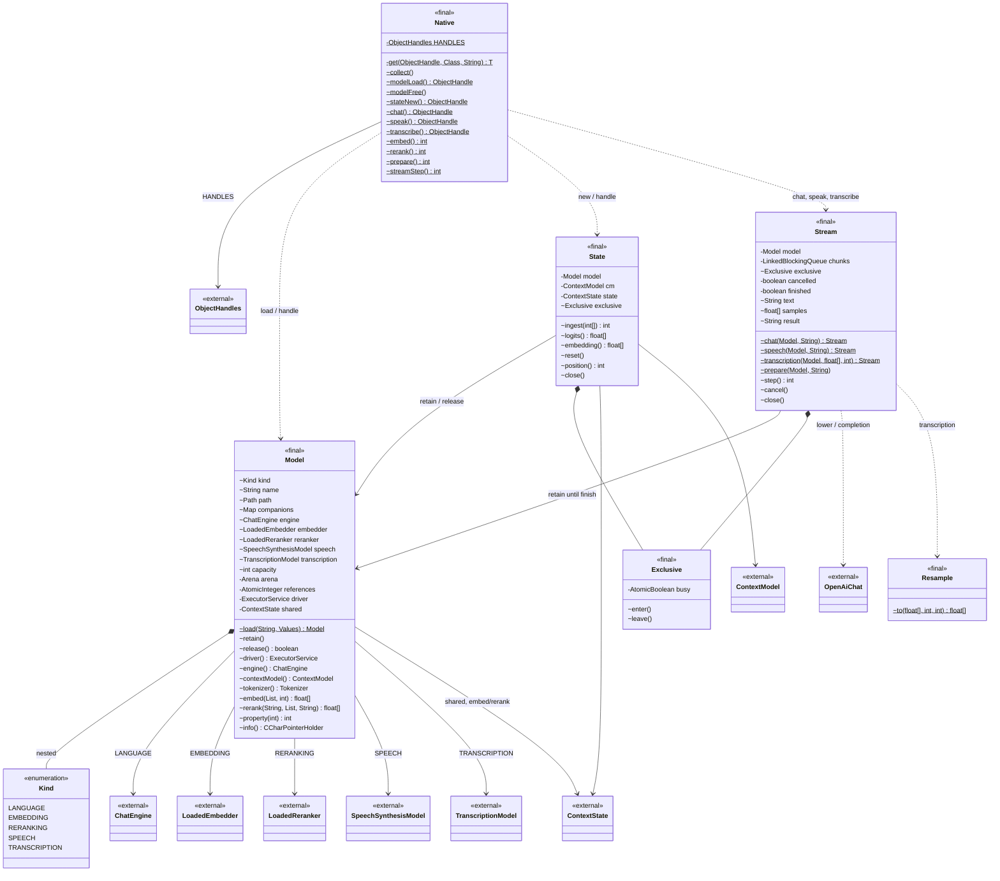
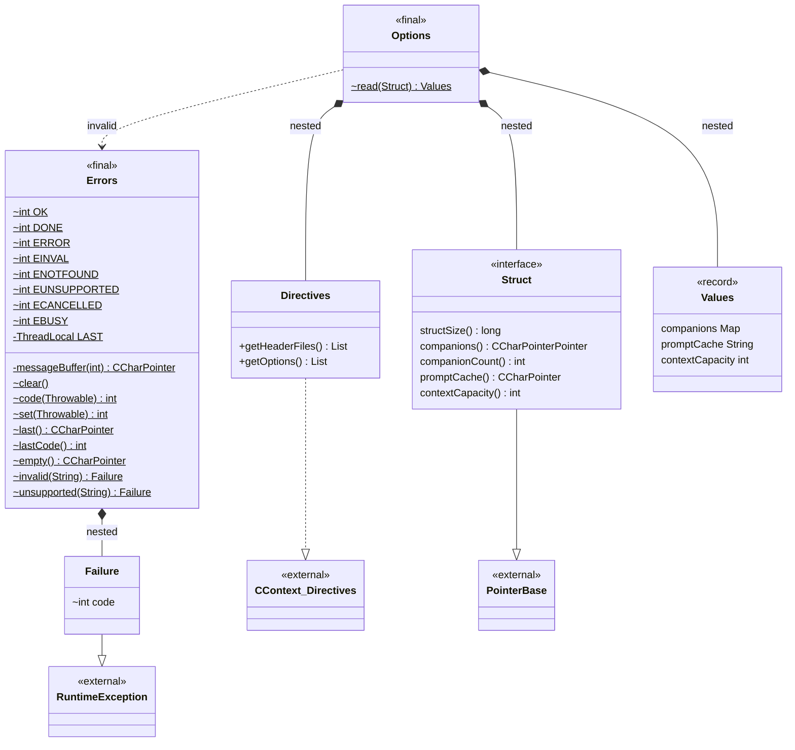
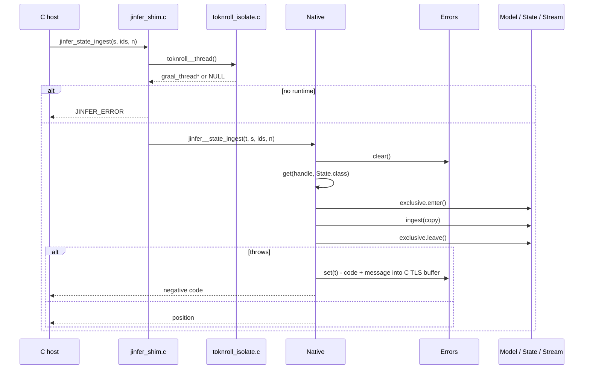
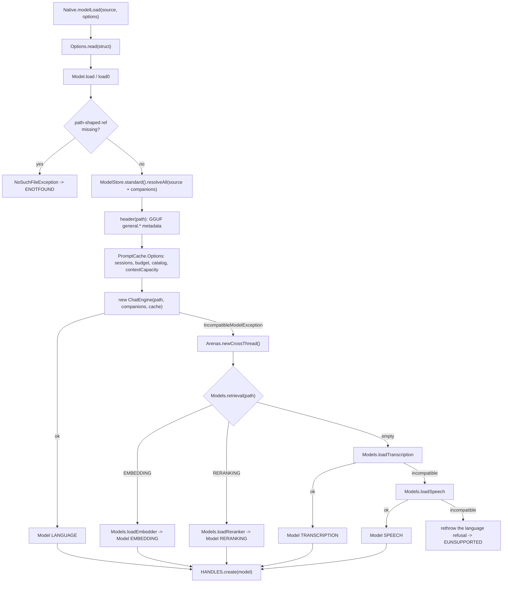
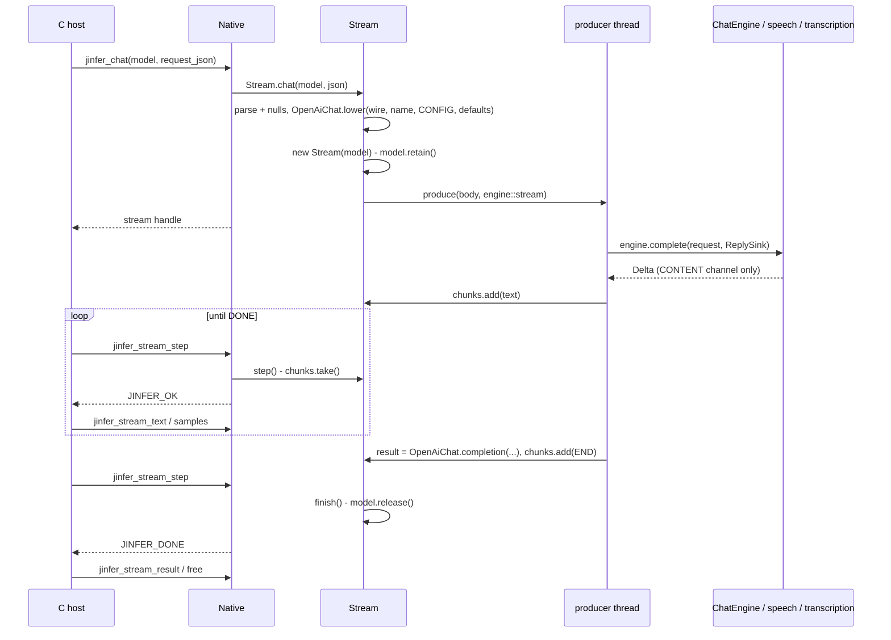
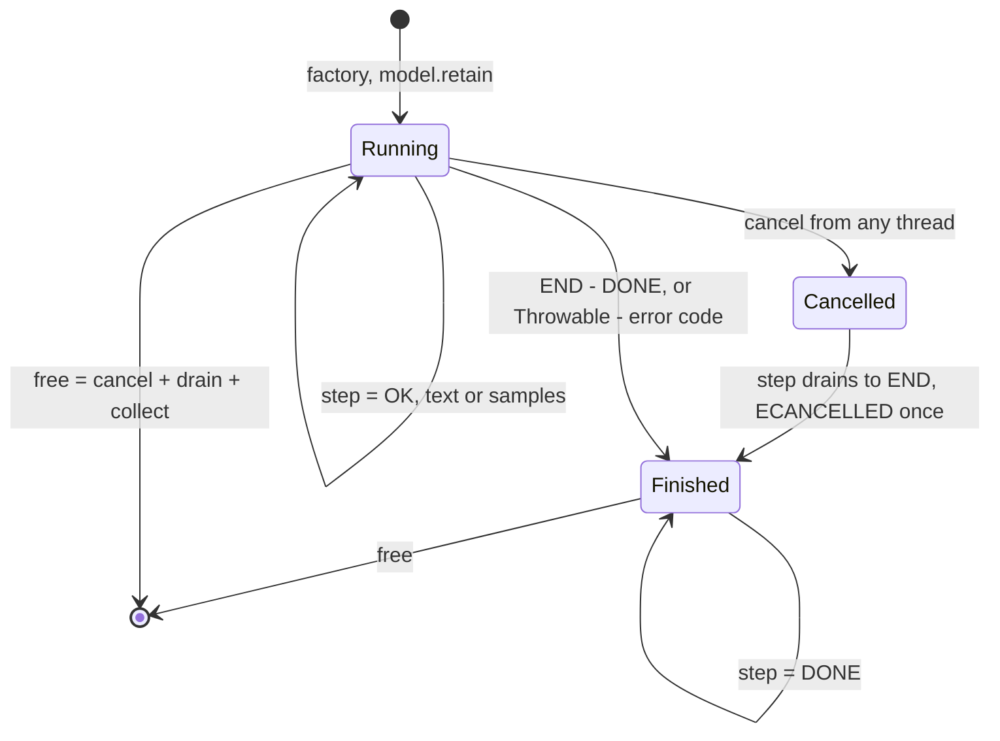
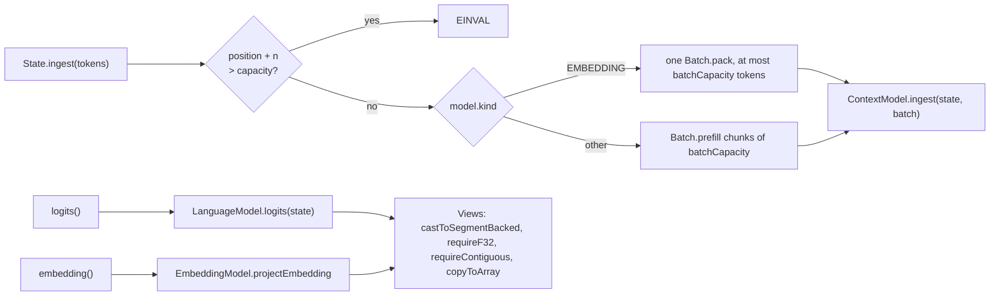
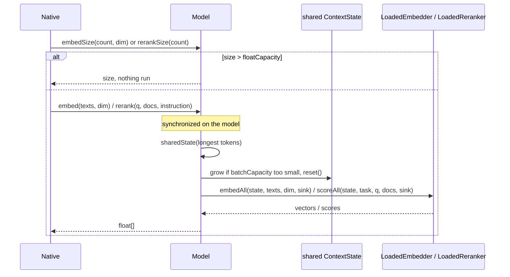
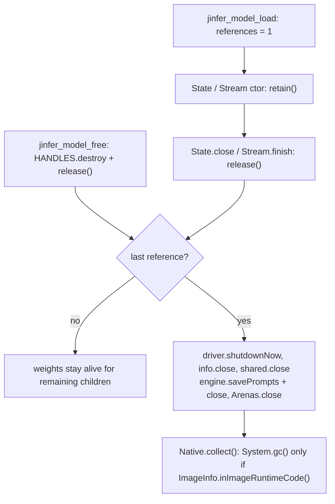

# jinfer-native — class architecture

Package `com.qxotic.jinfer.libjinfer` (8 classes, ~1740 lines of Java) plus one C file
(`src/main/c/jinfer_shim.c`, 77 lines) and the public header `include/jinfer.h`. It builds **libjinfer**: jinfer as a
GraalVM native-image shared library with a C API. The C shim forwards each `jinfer_*` header function to a
`jinfer__*` `@CEntryPoint` in `Native`, which resolves `ObjectHandle`s to Java objects (`Model`, `State`, `Stream`)
and turns every exception into a thread-local last error plus a NULL / negative return. The module has no
`META-INF/services` registrations of its own; model kinds are discovered at run time through jinfer-chat's `Models`
(ServiceLoader over `jinfer-models-all`, a runtime dependency). Its only native-image resource is
`native-image.properties`: `--initialize-at-run-time=com.qxotic.jinfer.libjinfer`.

Format: **Mermaid**. Legend: `..|>` implements; `--|>` extends; `-->` holds/uses; `..>` creates/depends;
classes marked `<<external>>` live outside this package.

1. [Position in the stack](#1-position-in-the-jinfer-stack)
2. [Class diagrams](#2-class-diagrams) — 2a handles and ownership, 2b errors and options
3. [C to Java call path](#3-c-to-java-call-path)
4. [Model loading](#4-model-loading)
5. [Streams: chat, speech, transcription](#5-streams)
6. [Raw state door](#6-raw-state-door)
7. [Embed and rerank](#7-embed-and-rerank)
8. [Lifetime, reference counting and memory](#8-lifetime-reference-counting-and-memory)
9. [Error mapping](#9-error-mapping)

| Class | Role |
|---|---|
| `Native` | `public final`; every `@CEntryPoint` (`jinfer__last_error`, `jinfer__model_*`, `jinfer__state_*`, `jinfer__stream_*`, `jinfer__chat`, `jinfer__speak`, `jinfer__transcribe`, `jinfer__embed`, `jinfer__rerank`, `jinfer__prepare`, `jinfer__error_set`); handle lookup via global `ObjectHandles`; `collect()` forces a GC in the image only |
| `Model` | A loaded model of one `Kind` (`LANGUAGE`, `EMBEDDING`, `RERANKING`, `SPEECH`, `TRANSCRIPTION`); owns a `ChatEngine` or a weights `Arena` + face; reference-counted; embed/rerank over one shared `ContextState`; properties and `info` JSON |
| `State` | The raw door: one `ContextState` over `Model.contextModel()`; `ingest`, `logits`, `embedding`, `reset`, `position` |
| `Stream` | Every generation: producer thread pushes text / PCM chunks into a `LinkedBlockingQueue`, the caller steps; factories `chat`, `speech`, `transcription`, plus `prepare` |
| `Options` | `@CContext` + `@CStruct("jinfer_model_options")` view read through `jinfer.h`; `Values` record (companions, prompt cache, context capacity) |
| `Errors` | Result codes (`OK`, `DONE`, `ERROR`, `EINVAL`, `ENOTFOUND`, `EUNSUPPORTED`, `ECANCELLED`, `EBUSY`), `Failure` exception, thread-local last code, message in a C TLS buffer via `@CFunction jinfer__error_buffer` |
| `Exclusive` | `AtomicBoolean` guard: a concurrent second call on one state/stream is `EBUSY` |
| `Resample` | Lanczos (a = 3) sample-rate conversion for `jinfer_transcribe` input |

---

## 1. Position in the jinfer stack

`pom.xml` compile dependencies: `jinfer-core`, `jinfer-chat`, `jinfer-hub`, `jinfer-codecs`, `jinfer-server`
(for `OpenAiChat`), `jinfer-cache`, `gguf`, `toknroll-core`, `toknroll-native` (libjinfer also carries the
`toknroll_*` API), `json`; `nativeimage` is `provided`; `jinfer-models-all`, `jam-native`, `jam-vector`,
`jam-scalar` are `runtime`; `jinfer-testkit` is `test`.

---

## 2. Class diagrams

### 2a. Handles and ownership

Handles given to C are `ObjectHandles.getGlobal()` words. `Native.get` checks the handle is non-zero and of the
expected class, so passing a state handle where a model is expected is `EINVAL`, not a crash.

### 2b. Errors and options

`Options.Directives` reads `-Djinfer.native.include=<dir of jinfer.h>:<dir of toknroll.h>` at image build time, so
the struct layout is taken from `jinfer.h` itself. `Options.read` returns `Values.DEFAULTS` for a NULL struct,
refuses a `struct_size` smaller than the compiled struct, and parses each companion as `"<capability>=<ref>"`.

---

## 3. C to Java call path

The shim (`jinfer_shim.c`) knows nothing about models: every function attaches through `toknroll__thread()`
(the isolate is shared with the `toknroll_*` symbols in the same library), returns NULL / `""` / `JINFER_ERROR`
when there is no runtime, and never starts the runtime for a NULL free. `jinfer_last_error`, `jinfer_log_set` and
`jinfer_configure` delegate to `toknroll__last_error_of`, `toknroll__log` and `toknroll__configure`, passing
`jinfer__last_error` / `jinfer__error_set` as callbacks. `jinfer_model_options_init` is pure C (zero + `struct_size`).

Float outputs (`logits`, `embedding`, `embed`, `rerank`) follow an snprintf convention (`Native.floats`): write
`min(n, capacity)`, return `n`; `embed` and `rerank` compute the size first (`embedSize`, `rerankSize`) and return it
without running the model when the buffer is too small.

---

## 4. Model loading

The model file selects the face, as the CLI server does. A language model's `capacity` is the engine's resolved
`contextCapacity()`; embedding / reranking models resolve it with `PromptCache.Options.contextCapacity`; speech and
transcription have `capacity = 0` (no token state). On a failure in `loadOther` the arena is closed best-effort.

---

## 5. Streams

- **chat**: the request JSON is the OpenAI `chat.completions` dialect, lowered by jinfer-server's `OpenAiChat`
  with `Model.CONFIG` (`ServerConfig.local(0)` with custom `Limits`, no request deadline). Requests asking for
  `Modality.AUDIO` output are refused (`EUNSUPPORTED`). The producer runs on `ChatEngine::stream`; the result is
  the `chat.completion` JSON.
- **speak**: reads `input` (required) and optional positive `speed`; `SpeechSynthesisModel.speak` pushes
  `float[]` PCM chunks; the result is `{sample_rate, samples, seconds}`. Runs on `Model.driver()`, a single
  daemon thread per model.
- **transcribe**: copies PCM, `Resample.to` the model's rate, `TranscriptionModel.transcribe(Media.Audio)`, one text
  chunk; the result is `{text, words[{text,start,end,confidence}]}`. Also on `Model.driver()`.
- **prepare** (`jinfer_prepare`): lowers the request and calls `ChatEngine.definePrompt` to compute the prompt
  into the cache, no stream.

`step()` is `synchronized` and also guarded by `Exclusive`. `cText`, `cResult` and `cSamples` (malloc'd via
`UnmanagedMemory`) are borrowed C copies owned by the stream and freed on the next call or in `close()`.

---

## 6. Raw state door

`jinfer_state_new(model, capacity)` builds a `State` over `model.contextModel()` (language, embedding or reranking;
speech/transcription are `EUNSUPPORTED`). Capacity follows `PromptCache.Options.contextCapacity` (0 = model's,
-1 = maximum, larger refused).

`jinfer_model_tokenizer` hands out a toknroll handle via `com.qxotic.toknroll.libtoknroll.Native.handle(tokenizer)`,
freed with `toknroll_tokenizer_free`; it is available for language and embedding models.

---

## 7. Embed and rerank

The shared state grows to the longest text seen and never shrinks: in a native image a dropped state is freed only
by a GC (~100 MB each), so one reused state is kept per model. `dimension(0)` means the native dimension;
otherwise it must lie in `minimumDimension()..dimension()`. A null rerank instruction uses
`reranker().defaultInstruction()`.

---

## 8. Lifetime, reference counting and memory

In the native image `Arenas.newCrossThread()` is `Arena.ofAuto()` (GraalVM cannot combine shared arenas with the
Vector API), so off-heap memory is released only by a collection; `Native.collect()` forces one after a last
release, a state free, or a stream freed early/cancelled. On the JVM (tests) it is a no-op. A stream releases its
model at the step that ends it, so a finished-but-unfreed stream keeps no weights alive.

---

## 9. Error mapping

`Errors.set` unwraps `UncheckedIOException` / `ExceptionInInitializerError`, maps the throwable via `Errors.code`,
formats a one-line message bounded to 1024 UTF-8 bytes (renaming `contextCapacity` to `context_capacity`), logs the
full throwable at DEBUG, and writes the message into a C TLS buffer from `jinfer__error_buffer`. An
`OutOfMemoryError` copies a pre-built message without allocating.

| Throwable | Code |
|---|---|
| `Errors.Failure` | its own `code` |
| `ModelProvider.IncompatibleModelException`, `UnsupportedOperationException` | `EUNSUPPORTED` (-4) |
| `ModelNotFoundException` | `ENOTFOUND` (-3) |
| `IllegalArgumentException`, `NullPointerException`, `Json.ParseException`, `EOFException` | `EINVAL` (-2) |
| `NoSuchFileException`, `FileNotFoundException` | `ENOTFOUND` (-3) |
| `CancellationException` | `ECANCELLED` (-5) |
| anything else | `ERROR` (-1) |

`EBUSY` (-6) comes from `Exclusive.enter()`; `DONE` (1) from `Stream.step()`. String-returning entry points return
`Errors.empty()` (`""`, never NULL) on failure.
