# jinfer-nemotronh — class architecture

Package `com.qxotic.jinfer.models.nemotronh` (5 classes, ~1350 lines). It is the `jinfer-<model>`
provider for GGUF architectures `nemotron_h` and `nemotron_h_moe` (hybrid **Mamba2 SSM / attention / MoE**,
text-only). Only the MoE variants run: a dense `nemotron_h` (no experts) and `expert_group_count > 1` are rejected at load.

Format: **Mermaid**. Legend: `..|>` implements; `--|>` extends; `-->` holds/uses; `..>` creates/depends;
classes marked `<<external>>` live outside this package.

1. [Position in the stack](#1-position-in-the-jinfer-stack)
2. [Class diagram](#2-class-diagram)
3. [Loading sequence](#3-loading-sequence)
4. [Forward pass](#4-forward-pass)
5. [MoE layer](#5-moe-layer)
6. [Chat template and tool flow](#6-chat-template-and-tool-flow)
7. [State and checkpoint layout](#7-state-and-checkpoint-layout)

| Class | Role |
|---|---|
| `NemotronH` | The model: `LanguageModel` impl + nested `Configuration`, `Weights`, `State`, `LayerType`, loaders and the three layer kernels' orchestration |
| `NemotronHProvider` | `ModelProvider` SPI entry (ServiceLoader), arch dispatch, builds `LoadedModel` |
| `NemotronHCheckpointCodec` | `CheckpointCodec<State>`: serialises KV rows + SSM conv/recurrent state |
| `NemotronHChatTemplate` | `ChatTemplate`: ChatML framing, think/direct seeds, tool flow, reply grammar (`Dialect` = CASCADE / LIGHTNING) |
| `NemotronToolSyntax` | Pure-text rendering of tool declarations (`<tools>` XML) and `<function=...>` call bodies |

---

## 1. Position in the jinfer stack

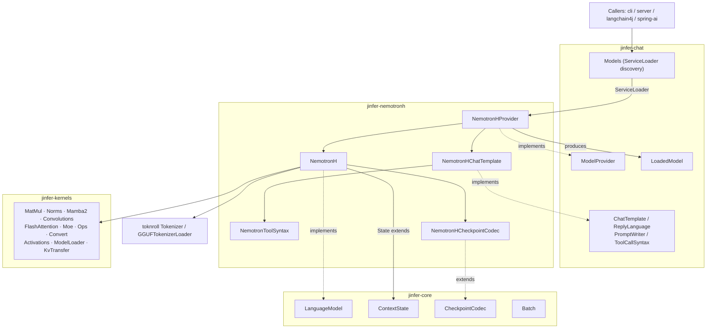

---

## 2. Class diagram

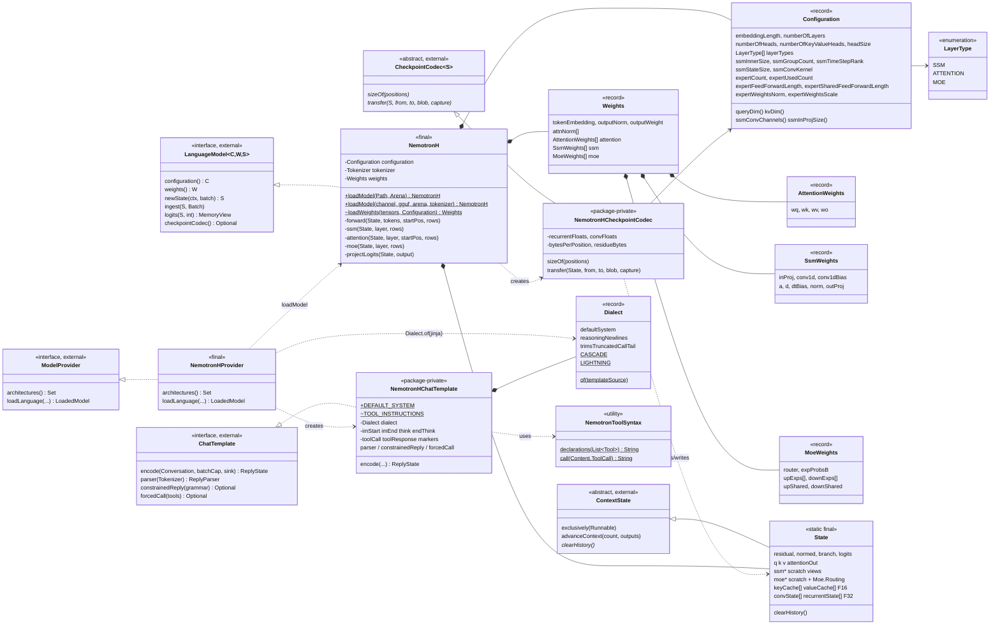

---

## 3. Loading sequence

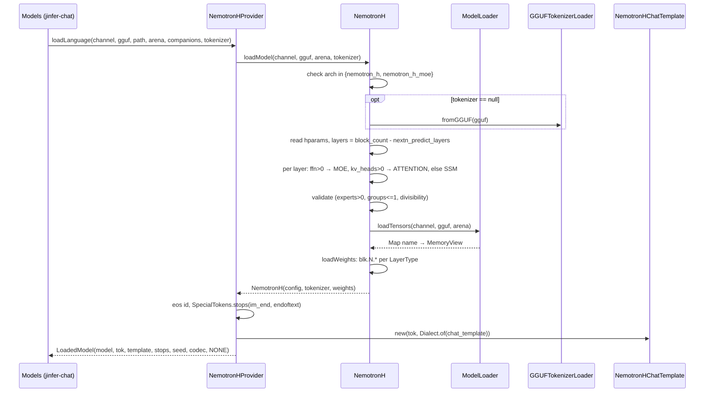

Layer-type inference has no explicit per-layer tag in the GGUF: it derives from the two per-layer arrays
`feed_forward_length` (>0 → MoE) and `attention.head_count_kv` (>0 → attention), with the remainder being Mamba2.

---

## 4. Forward pass

`ingest` → `state.exclusively(forward)` → validates batch (tokens only; no packed sequences, no embeddings),
then runs the hybrid stack. Every layer is a **pre-norm residual block** of exactly one mixer kind.

### 4.0 Global architecture

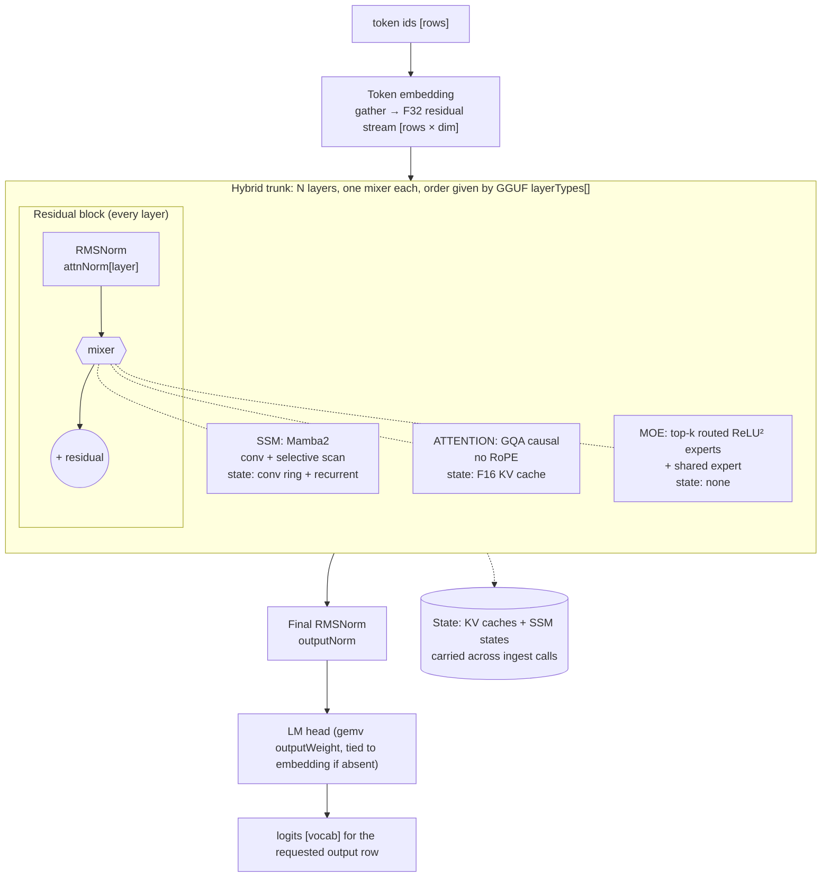

### 4.1 Layer loop

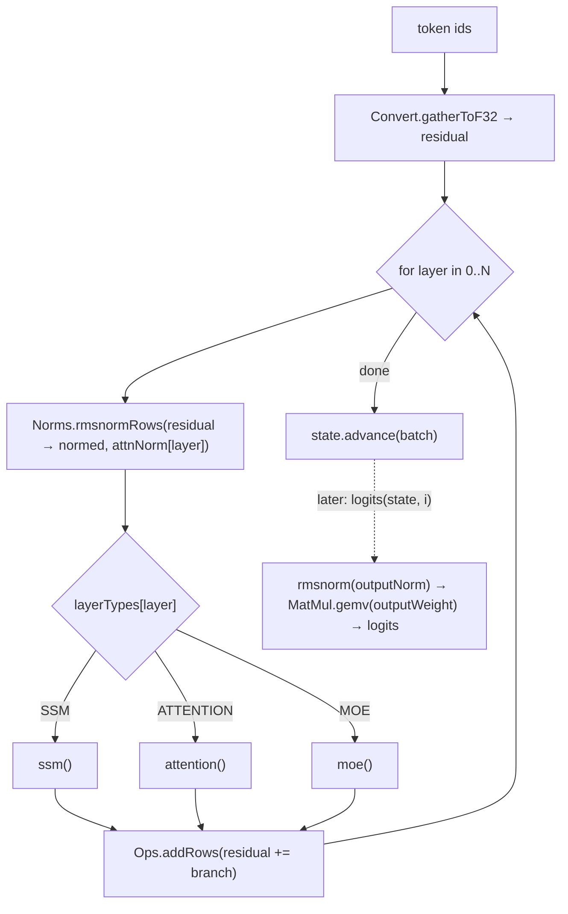

### 4a. SSM layer (Mamba2)

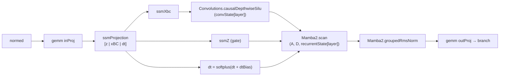

### 4b. Attention layer

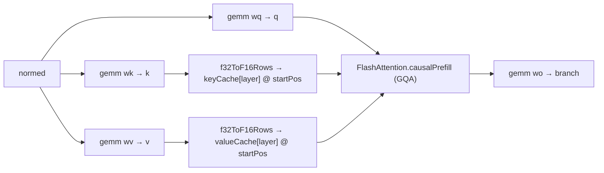

No RoPE or positional embedding is applied in the attention layers; position enters only through the KV cache index and the SSM recurrence.

---

## 5. MoE layer

Routed experts use sigmoid gating, a selection-only bias, and **ReLU²** FFNs (no gate projection: `up → relu² → down`).

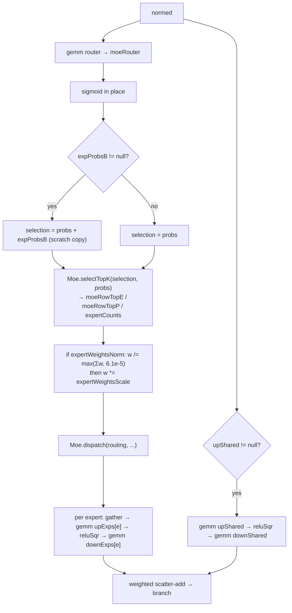

Routed weights stay **unbiased**; `exp_probs_b` only influences which experts are picked (as in llama.cpp `build_moe_ffn`).

---

## 6. Chat template and tool flow

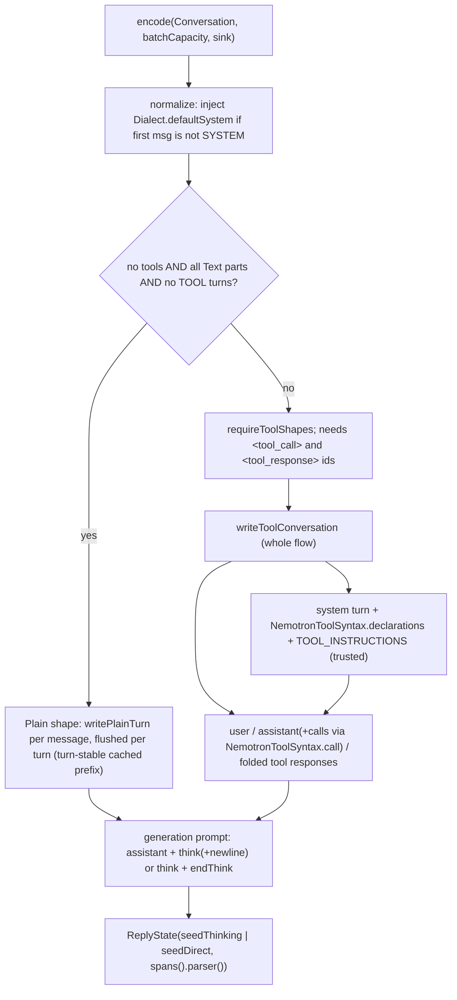

Reply-side faces (all built from one lazily created `ReplyLanguage.Spans`):

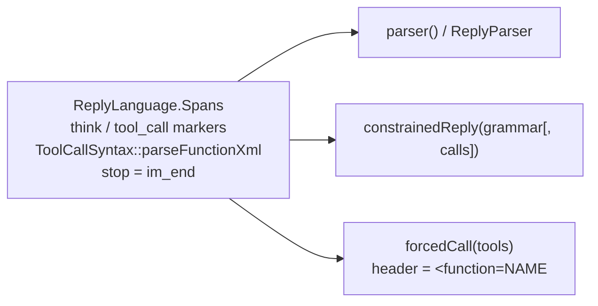

Key rules:

| Concern | Behaviour |
|---|---|
| History thinking | Assistant turns before the last user are truncated to `<think></think>` + text after the last `</think>` |
| Dialect `CASCADE` | Default system injected, reasoning framed `<think>\n{R}\n</think>\n`, truncated call tails trimmed |
| Dialect `LIGHTNING` | Empty system, `<think>\n{R}</think>`, tails kept as-is. Chosen by `Dialect.of(template)` (looks for "You are a helpful and harmless assistant") |
| Injection safety | Tool names/descriptions are plain-encoded via `out.text`; only the fixed `TOOL_INSTRUCTIONS` goes through `PromptWriter.trusted`, and marker ids come from `out.id` |
| Tool results | Consecutive TOOL messages fold into one `user` turn of `<tool_response>` blocks; both `ToolResult` and `Text` parts accepted |

---

## 7. State, memory and checkpoint layout

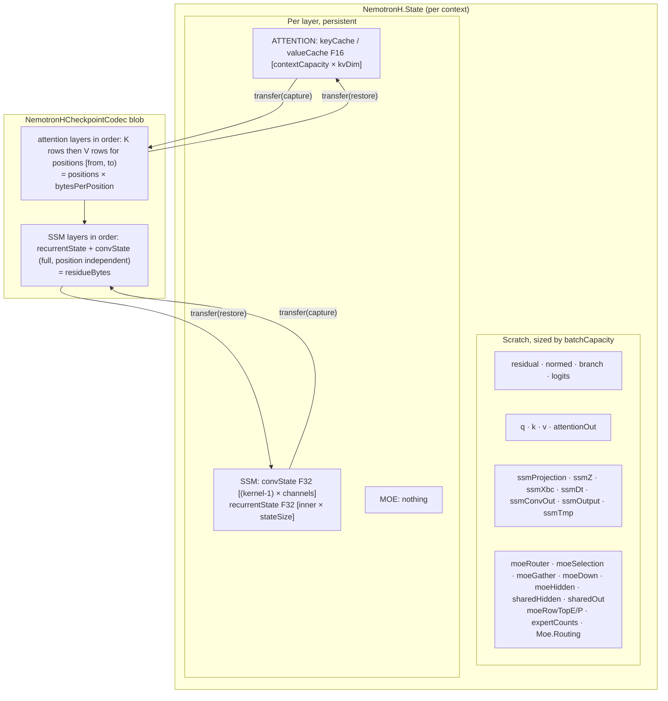

- `sizeOf(positions) = positions × Σ_attention(2 × 2 B × kvDim) + #ssmLayers × (inner×stateSize + (kernel-1)×channels) × 4 B`.
- The SSM share is a **fixed overhead**, independent of position count; restoring a prefix checkpoint therefore always rewrites the full recurrent state. MoE routing is per-token and carries no cross-token state.
- `clearHistory()` zero-fills `convState` and `recurrentState`; KV caches need no clearing (position-indexed, rewritten on ingest).
- `newState(ctx, batch)` creates a cross-thread arena owned by the state; `newState(ctx, batch, arena)` borrows the caller's arena.
