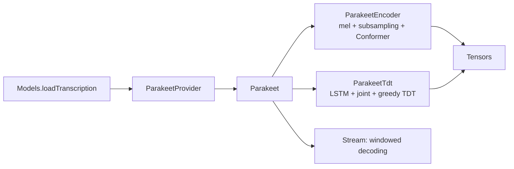

# jinfer-parakeet — architecture summary

**What it is.** The jinfer provider for GGUF architecture `parakeet`: NVIDIA Parakeet speech-to-text, pure Java
(no native code), ported from parakeet.cpp and checked against its fixtures. It is a FastConformer encoder followed by a
TDT (token-and-duration transducer) decoder. It is transcription-only and TDT-only: CTC-only checkpoints are refused.

**Where it sits.** Callers use `Models.loadTranscription(path, arena)` in `jinfer-chat`, which finds
`ParakeetProvider` through `ServiceLoader` (`META-INF/services/com.qxotic.jinfer.chat.ModelProvider`). The model
implements `TranscriptionModel` from `jinfer-core`, and all number crunching goes through `jinfer-kernels`
(`LogMel`, `MatMul`, `Norms`, `Ops`, `Activations`, `Convert`, `ModelLoader`). Weights are `jota-memory`
`MemoryView`s mapped from the GGUF. There is no tokenizer dependency: the vocabulary pieces are a GGUF array
(`parakeet.tokenizer.pieces`).

## Main classes (5)

| Class | What it does |
|---|---|
| `ParakeetProvider` | SPI entry: architecture `parakeet` → `Parakeet.load` |
| `Parakeet` | `TranscriptionModel`: `Configuration`, `Weights(encoder, decoder)`, `State` (owns an arena + `Workspace`), private `Stream` that does all decoding |
| `ParakeetEncoder` | NeMo log-mel features → 8x depthwise-separable conv subsampling (tiled) → macaron Conformer blocks with Transformer-XL relative-position attention |
| `ParakeetTdt` | Stacked-LSTM prediction net, ReLU joint net, greedy token+duration loop with a resumable `Cursor` and a blank watchdog |
| `Tensors` | Named-tensor lookup with shape checks |

## Key flows

1. **Load**: check `general.architecture`, `ModelLoader.loadTensors`, build the encoder (folding BatchNorm and the
   optional depthwise bias into a per-channel affine) and the decoder (folding the two LSTM biases, refusing a checkpoint
   without `parakeet.tdt.durations`).
2. **Transcribe / stream**: both use `Stream`. Audio is buffered and decoded in windows of left context + chunk + right
   context (NeMo streaming). Only tokens inside the chunk become final; the decoder `Cursor` carries LSTM state across
   chunks so words continue. Live streams use 10-2-2 s (text trails audio by ~4 s); offline uses 46 s chunks (~60 s
   windows). `partial()` decodes a copy of the cursor with 3 s of left context and stops 3 frames short of the edge.
   `-Djinfer.parakeet.chunkSeconds` overrides the chunk size.
3. **Per window** (`Stream.decode`): rewind workspace → `encode` → `encProjection` (one GEMM for all frames) →
   greedy TDT `decode` → map pieces to `Transcription.Token`s with absolute times (80 ms frames) and confidence.

## Notable design choices

- **Windowed decoding** because full-context attention is quadratic in length; only the valid block of attention is
  computed and padding rows are masked or zeroed.
- **Allocation-free when warm**: every buffer comes from the state's `Workspace`, rewound each window; subsampling is
  tiled (64 frames) so intermediates stay around 40 MB regardless of window length.
- **Blank watchdog**: greedy TDT only advances the prediction state on emission and can get stuck emitting blanks;
  after 60 silent frames (4.8 s) the span is rescanned, first with the same state, then with a fresh one.
- **Faithful to the reference**: PyTorch LSTM gate order, zero-vector first step, `max_symbols` counting every inner
  iteration and an extra frame advance when it is exhausted, ties to the first index in argmax.
- **Concurrency/resource contract**: `State` extends `RuntimeState`; stream work runs under `state.exclusively`; arenas
  must be cross-thread; `LeakWatch` flags unclosed states.
- **Telemetry**: one `InferenceEvent` per stream, billing compute time only (not time spent waiting for live audio).
- **Parity hooks**: an encoder `layerTap`, `probeSos` and `probeJointLogits` let tests compare against reference
  fixtures.

See [ARCHITECTURE.md](ARCHITECTURE.md) for class diagrams, load and streaming sequences, the encoder block and the TDT
decode loop.
