# jinfer-parakeet — class architecture

Package `com.qxotic.jinfer.models.parakeet` (5 top-level classes, ~1530 lines). It is the `jinfer-<model>` provider for
GGUF architecture `parakeet` — NVIDIA Parakeet **speech recognition** (speech-to-text): a FastConformer encoder plus a
TDT (token-and-duration transducer) decoder, ported from parakeet.cpp. It is transcription-only: the provider overrides
only `loadTranscription`; CTC-only checkpoints (no `parakeet.tdt.durations`) are refused at load.

Format: **Mermaid**. Legend: `..|>` implements; `--|>` extends; `-->` holds/uses; `..>` creates/depends; `*--` owns
(nested/composed); classes marked `<<external>>` live outside this package.

1. [Position in the stack](#1-position-in-the-jinfer-stack)
2. [Class diagrams](#2-class-diagrams) — 2a contracts, 2b encoder internals, 2c decoder internals
3. [Loading sequence](#3-loading-sequence)
4. [Transcription: offline and streaming](#4-transcription-offline-and-streaming)
5. [Encoder forward pass](#5-encoder-forward-pass) — 5a subsampling, 5b Conformer block
6. [TDT greedy decoding](#6-tdt-greedy-decoding)
7. [State and memory](#7-state-and-memory)

| Class | Role |
|---|---|
| `Parakeet` | The model: `TranscriptionModel<Configuration, Weights, State>` with nested records `Configuration`, `Weights`, class `State` (extends `RuntimeState`, owns a `Workspace`) and private inner class `Stream` (`TranscriptionStream`, windowed chunked decoding) |
| `ParakeetProvider` | `ModelProvider` SPI: `architectures() = {"parakeet"}`, `loadTranscription(...)` → `Parakeet.load` |
| `ParakeetEncoder` | FastConformer encoder: NeMo log-mel front end (`LogMel`), 8x depthwise-separable conv subsampling, macaron Conformer blocks with Transformer-XL relative-position attention. Nested records `Config`, `Linear`, `Norm`, `Block`, `Scratch` |
| `ParakeetTdt` | TDT decoder: stacked-LSTM prediction network, ReLU joint network, greedy token+duration loop with a blank watchdog. Nested `Config`, `Emission`, `State` (LSTM h/c), `Cursor` (resumable decode position), `Scratch` |
| `Tensors` | Package-private record over `Map<String, MemoryView>`: `require`, `optional`, `weight` (checks leading extent), `vector` (checks size), `floats` (copies small F32 to heap) |

SPI registration: `src/main/resources/META-INF/services/com.qxotic.jinfer.chat.ModelProvider` contains
`com.qxotic.jinfer.models.parakeet.ParakeetProvider`.

Module dependencies (`pom.xml`): `jota-core`, `jota-memory`, `jinfer-core`, `jinfer-kernels`, `jinfer-chat`, `gguf`;
test-only `jinfer-codecs` (decodes/resamples test clips) and `jinfer-testkit`. No tokenizer dependency: the
SentencePiece pieces come from GGUF key `parakeet.tokenizer.pieces` and are mapped to text directly.

---

## 1. Position in the jinfer stack

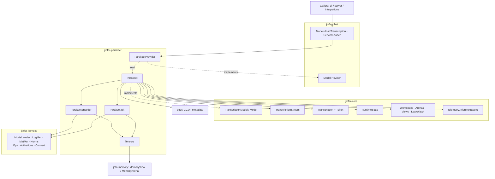

---

## 2. Class diagrams

### 2a. Contracts and top-level relations

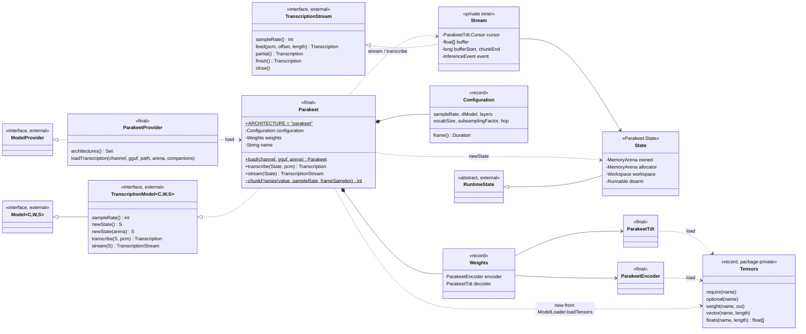

### 2b. Encoder internals — `ParakeetEncoder`

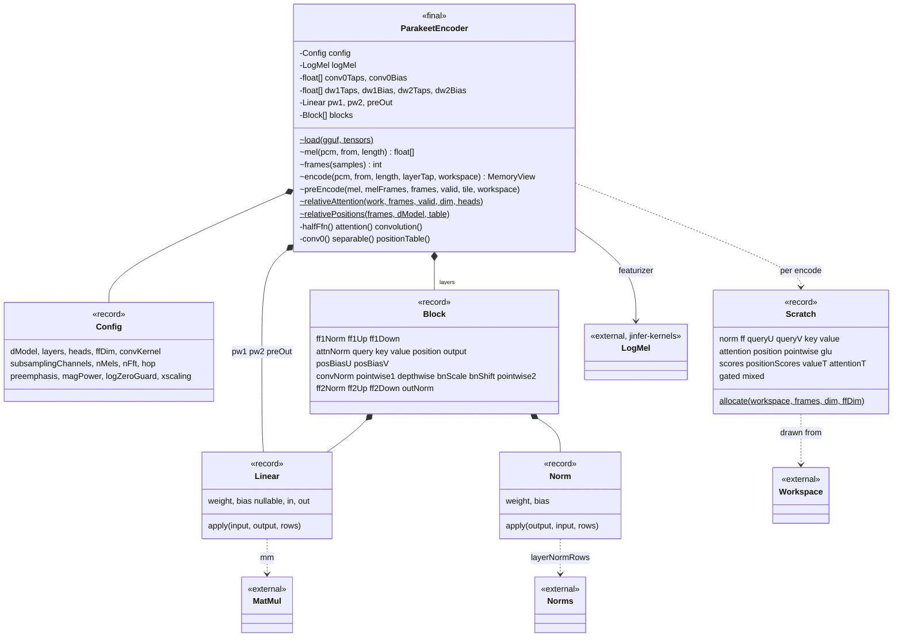

### 2c. Decoder internals — `ParakeetTdt`

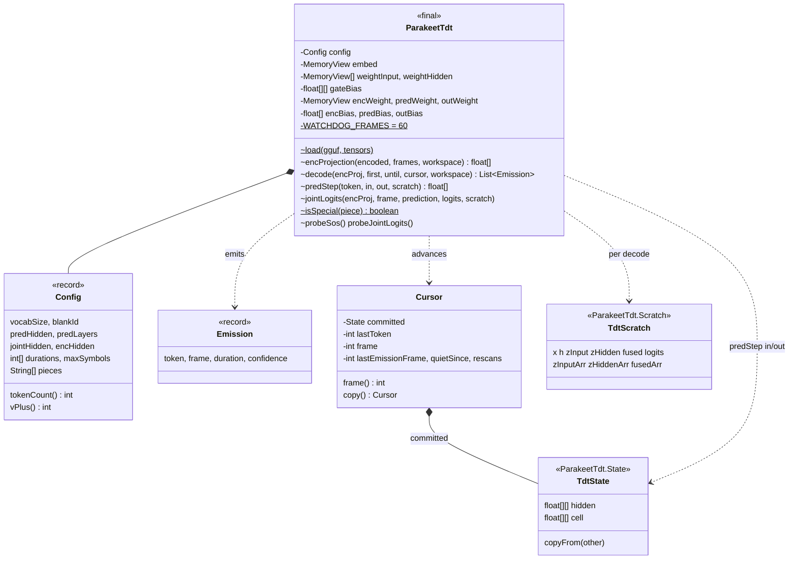

`ParakeetTdt.State` and `ParakeetTdt.Scratch` are shown as `TdtState`/`TdtScratch` to avoid clashing with
`Parakeet.State` and `ParakeetEncoder.Scratch`.

---

## 3. Loading sequence

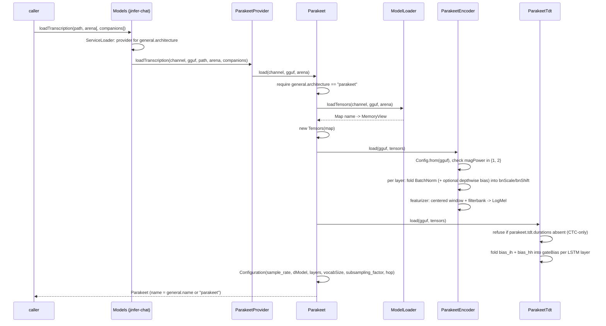

Notable load-time folds: BatchNorm running stats become a per-channel affine (`bnScale`, `bnShift`), and the depthwise
conv bias (absent on v2/v3) is folded into `bnShift`; the LSTM's two biases are summed once. Conformer `Linear` biases
are optional (bias-free checkpoints such as tdt-0.6b-v3); subsampling projections always have one.

---

## 4. Transcription: offline and streaming

Both paths go through the private `Stream`. Windows follow NeMo's chunked streaming: left context + chunk + right
context, in encoder frames (80 ms each). Only the chunk's tokens become final; the decoder `Cursor` carries over so words
continue across chunks.

| Mode | chunk | right | left |
|---|---|---|---|
| `stream(state)` live | 25 frames (2 s) | 25 (2 s) | 125 (10 s) |
| `transcribe(state, pcm)` offline | 575 (46 s) | 50 (4 s) | 125 (10 s) |
| `partial()` | up to fed audio minus 3 edge frames | none | 38 (~3 s) |

`-Djinfer.parakeet.chunkSeconds` (integer 1..3600) overrides the chunk size in both modes (`chunkFrames`).

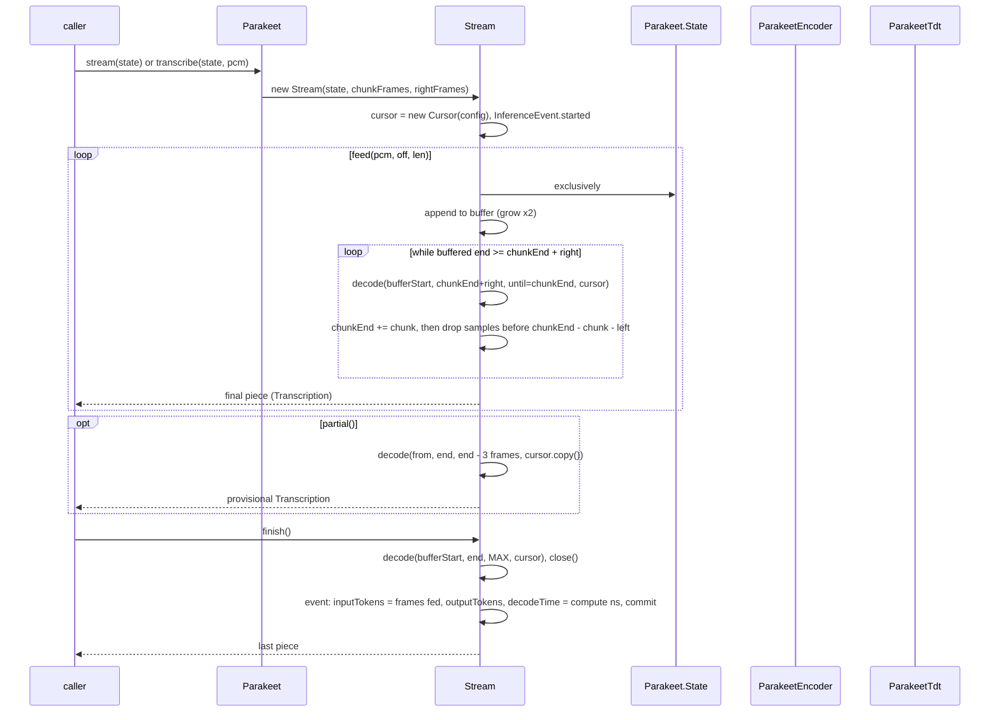

`transcribe` = one `feed(pcm)` + `finish()`, concatenating text and tokens.

### `Stream.decode(from, to, until, cursor)`

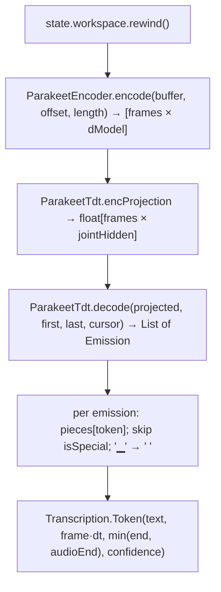

Token times are absolute from stream start (`first = from / frameSamples`); `frameSamples = hop × subsamplingFactor`.
Compute time is accumulated in `computeNanos` so waiting for live audio is not billed. The first token of a transcript
drops its leading space.

---

## 5. Encoder forward pass

### 5a. `encode` and subsampling

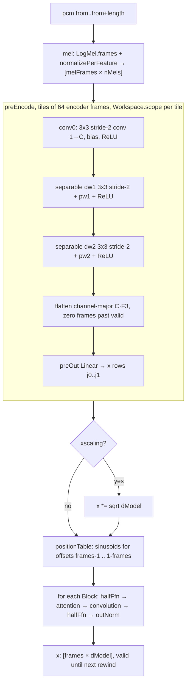

`frames(samples)` = three halvings `(n-1)/2+1` of `1 + samples/hop`. Tiling keeps subsampling intermediates near 40 MB
for any window length; `valid` excludes the trailing center-pad mel frame. An optional `layerTap` receives per-layer
outputs (used for parity checks).

### 5b. Conformer block (macaron)

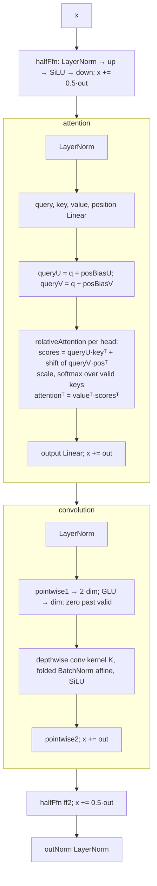

Only the `valid × valid` block of attention is computed; padded query rows are zeroed. Heads run sequentially (MatMul
`mm` refuses nested parallel regions); per-row work uses `Parallel.forLoop`.

---

## 6. TDT greedy decoding

`decode(encProjection, first, until, cursor, workspace)` runs from `cursor.frame` up to `until`; `vPlus = (vocab+1) +
durations.length` logits per step: the token slice and the duration slice.

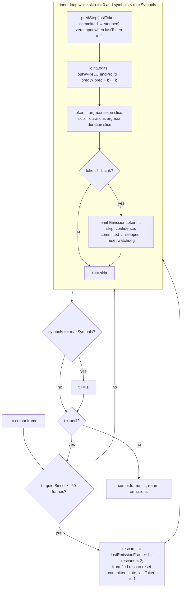

Details worth knowing:

- Matches parakeet.cpp `tdt.cpp`/`prediction.cpp`: the LSTM state commits only on emission; PyTorch `i,f,g,o` gate order.
- The blank watchdog addresses greedy TDT getting stuck on blank (state only advances on emission): first rescan with
  the same state, then with a fresh one; if both stay silent the span is treated as silence.
- `confidence` = token-slice max softmax probability rescaled as `(N·p − 1)/(N − 1)`, clamped to [0, 1].
- `encProjection` does one `MatMul.gemm` for all frames of the window; per-step projections are single-row gemms.
- `probeSos` / `probeJointLogits` are parity probes used by tests.

---

## 7. State and memory

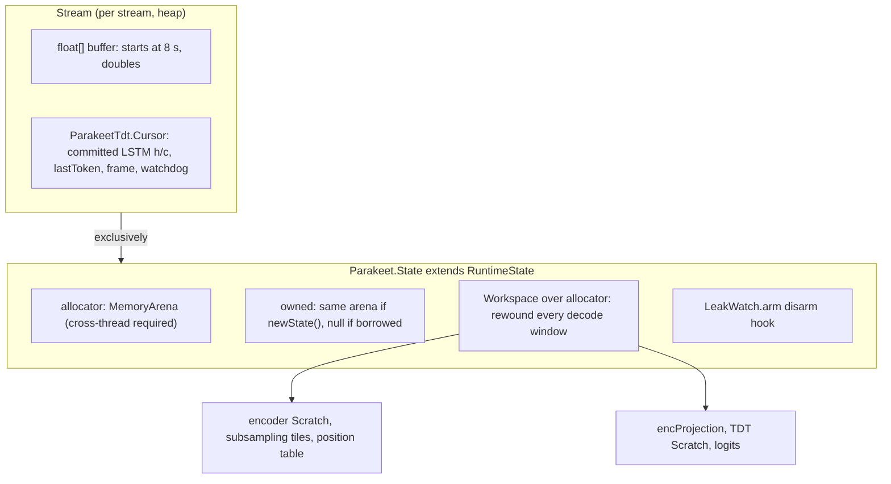

- `newState()` creates an owned cross-thread arena (closed on failure and in `releaseResources`); `newState(arena)`
  borrows one (`Arenas.requireCrossThread`).
- `checkResourcesAlive` fails if the arena was closed. `scratchAllocations()` (backing + heap) lets tests check that a
  warm state transcribes without allocating.
- Weights are the GGUF `MemoryView`s from `ModelLoader.loadTensors`, plus small heap copies (conv taps, folded biases,
  BatchNorm affine).
