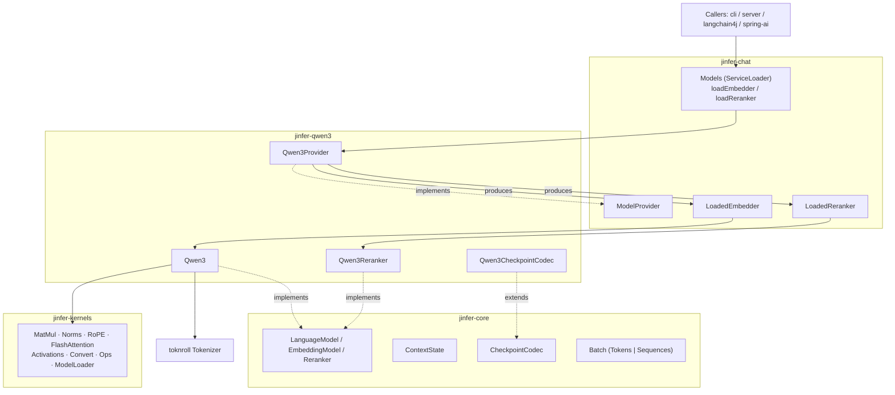
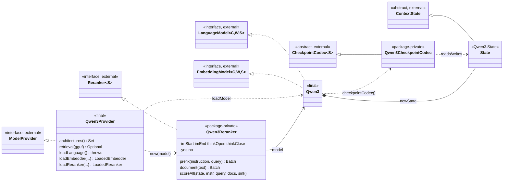
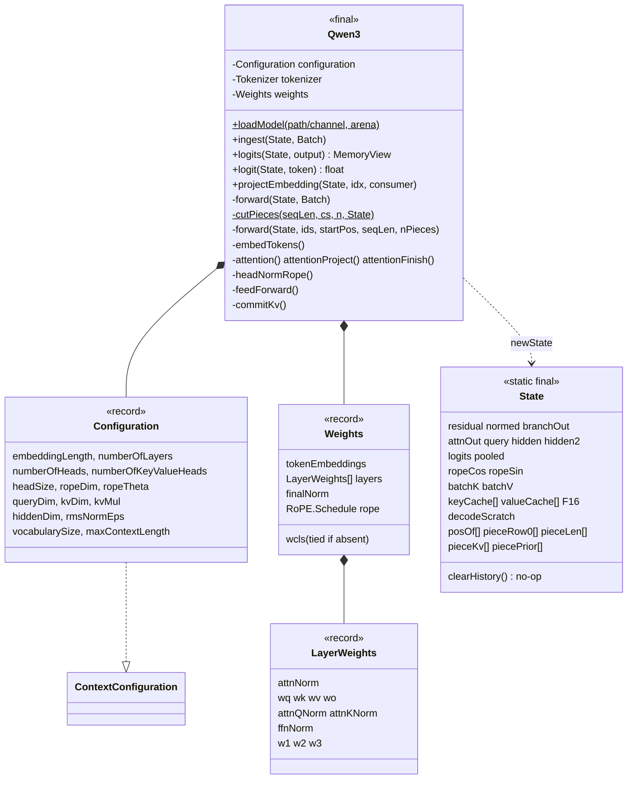
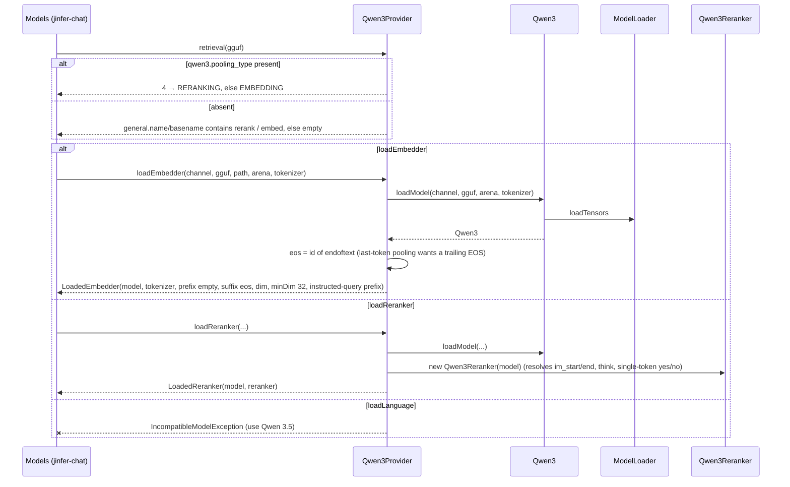
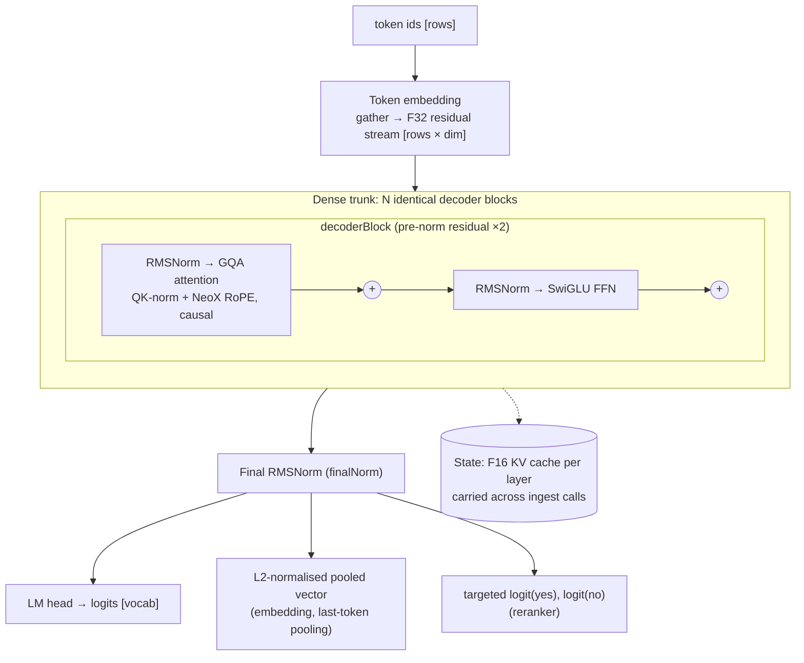
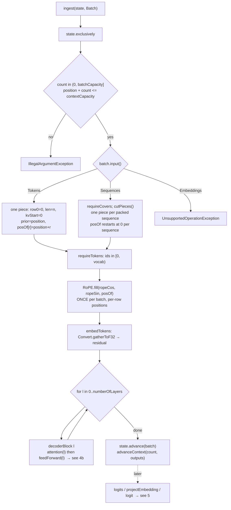
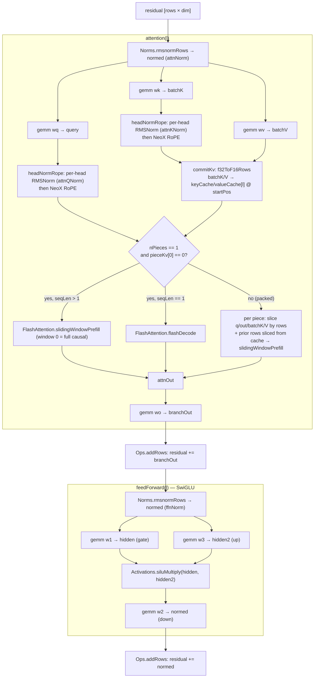
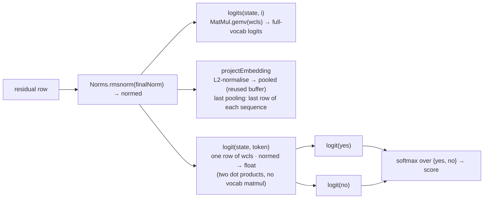
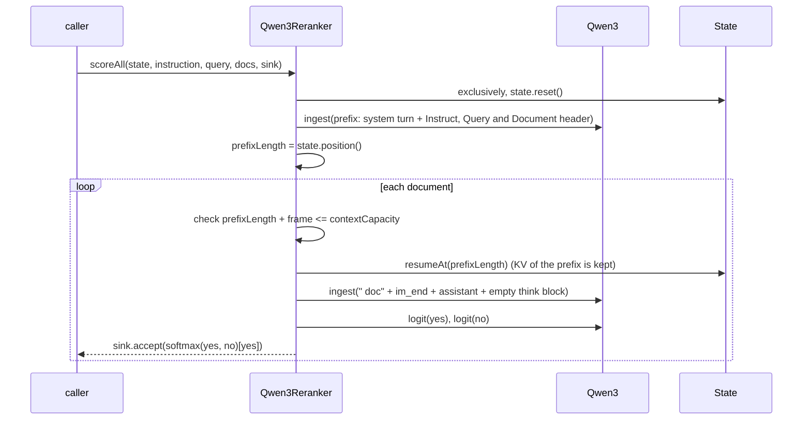
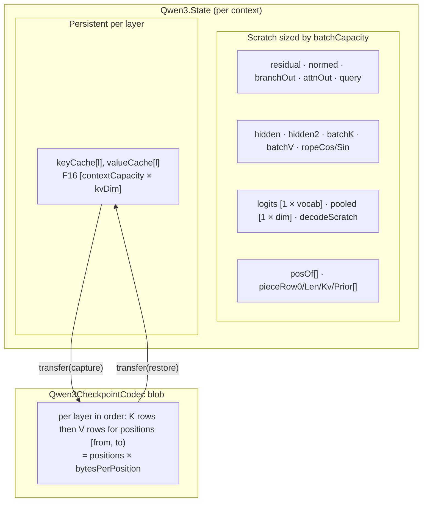

# jinfer-qwen3 — class architecture

Package `com.qxotic.jinfer.models.qwen3` (4 classes, ~1170 lines). It is the `jinfer-<model>` provider for GGUF
architecture `qwen3` — **not a chat model**: it serves the Qwen3 *retrieval family* (Qwen3-Embedding: last-token pooled
vectors; Qwen3-Reranker: a yes/no judge) over one dense backbone. `loadLanguage` throws `IncompatibleModelException`;
generative Qwen models live in `jinfer-qwen35`.

Format: **Mermaid**. Legend: `..|>` implements; `--|>` extends; `-->` holds/uses; `..>` creates/depends;
classes marked `<<external>>` live outside this package.

1. [Position in the stack](#1-position-in-the-jinfer-stack)
2. [Class diagrams](#2-class-diagrams) — 2a contracts, 2b model internals
3. [Loading sequences](#3-loading-sequences)
4. [Forward pass](#4-forward-pass) — 4a `ingest`, 4b `decoderBlock`
5. [Heads: embedding, targeted logit, reranker](#5-heads)
6. [State and checkpoint layout](#6-state-and-checkpoint-layout)

| Class | Role |
|---|---|
| `Qwen3` | The model: `LanguageModel` + `EmbeddingModel` impl with nested `Configuration`, `Weights`, `LayerWeights`, `State`; the whole forward pass and the three heads |
| `Qwen3Provider` | `ModelProvider` SPI: `retrieval(gguf)` (embedding vs reranking), `loadEmbedder`, `loadReranker` |
| `Qwen3Reranker` | `Reranker<State>`: prompt framing + yes/no scoring on one shared query prefix |
| `Qwen3CheckpointCodec` | `CheckpointCodec<State>`: serialises KV rows only (pure attention, no recurrent state) |

---

## 1. Position in the jinfer stack

---

## 2. Class diagrams

### 2a. Contracts and relations

### 2b. Model internals — `Qwen3` and its nested types

---

## 3. Loading sequences

The same GGUF architecture (`qwen3`) backs two faces. `Models` calls `retrieval(gguf)` first and refuses the wrong entry point **before** any weight is read.

---

## 4. Forward pass

`ingest(state, batch)` → `state.exclusively(forward)`. There is **no recurrent state**: every layer is attention + SwiGLU FFN, and the only thing carried across calls is the per-layer F16 KV cache.

### 4.0 Global architecture

### 4a. `ingest` — batch validation, packed pieces, layer loop

Packed sequences (`Batch.Input.Sequences`): `cutPieces` groups the chunk rows into per-sequence *pieces* `{row0, len, kvStart, prior}` so sequences in one packed stream never attend to each other, even when one spans several chunks.

### 4b. `decoderBlock` — one layer

Qwen3 has no single `decoderBlock` method; a block is `attention(l)` followed by `feedForward(l)`, both pre-norm residual.

Details worth knowing:

- `commitKv` runs **inside** the layer: `batchK/batchV` are single buffers reused by every layer, so deferring the commit would write the last layer's values into every cache.
- Scale is `1/sqrt(headSize)`; GQA via `kvMul = heads / kvHeads`; `queryDim = heads × headSize` and `kvDim = kvHeads × headSize` are separate configuration fields.
- The old `headNormScale` multiply is dropped (hard-coded 1.0 — an identity).

---

## 5. Heads

All three read the retained residual row `lastBatchSize - outputCount + output` and apply `finalNorm`.

### Reranker flow — one shared prefix, many documents

`ingest` chunks each framed batch with `Batch.prepare(..., batchCapacity)`. `yes`/`no` must each be a single token (checked at load).

---

## 6. State and checkpoint layout

- `clearHistory()` is a no-op: stale rows past the cursor are masked by attention and overwritten on ingest.
- `newState(ctx, batch)` makes a cross-thread arena owned by the state; `newState(ctx, batch, arena)` borrows the caller's.
- `State` rejects `contextCapacity > maxContextLength`.
