# jinfer-qwen35 — class architecture

Package `com.qxotic.jinfer.models.qwen35` (9 classes, ~4000 lines). It is the `jinfer-<model>`
provider for GGUF architectures `qwen35` (dense) and `qwen35moe` (MoE).

Format: **Mermaid** (renders natively on GitHub / GitLab / IntelliJ / VS Code). Each diagram answers one question:

1. [Where does the module sit?](#1-position-in-the-jinfer-stack) — layering
2. [Who implements what?](#2-class-diagrams) — types and relations (5 sub-diagrams)
3. [How is a model loaded?](#3-loading-sequence)
4. [What happens in one forward pass?](#4-forward-pass) — 4a `ingest`, 4b `decoderBlock` (+ attention / delta / FFN)
5. [How does speculative decoding work?](#5-speculative-decoding-mtp)
6. [How does the decision (d3) path work?](#6-decision-path-vllm-d3)
7. [What is in `State` and in a checkpoint?](#7-state-memory-and-checkpoint-layout)

Legend for class diagrams: `<<…>>` = stereotype; `..|>` implements; `--|>` extends; `-->` uses/holds;
`..>` creates/depends; classes with a grey tint are **outside** this package (contracts / kernels).

---

## 1. Position in the jinfer stack

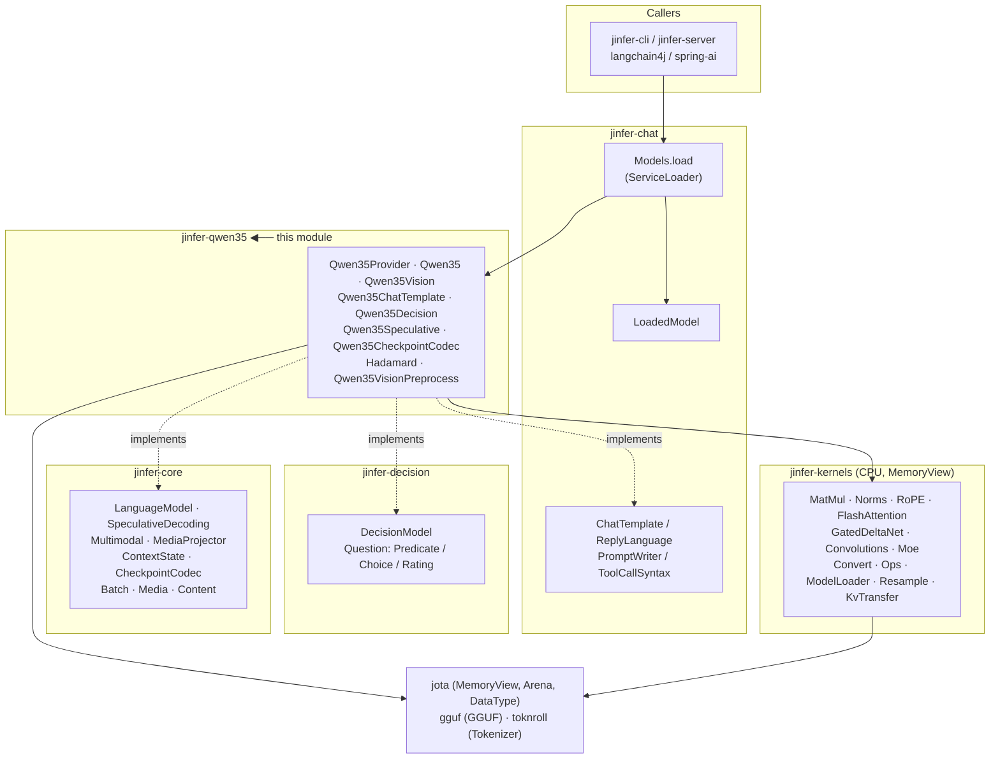

Discovery: `META-INF/services/…ModelProvider` → `Qwen35Provider`.

---

## 2. Class diagrams

The class diagram is split into five focused views. 2a is the overview; 2b–2e zoom into one area each.
Classes shaded `<<interface>>` / `<<abstract>>` come from other modules (core, chat, decision).

### 2a. Overview — the nine classes and who creates / uses whom

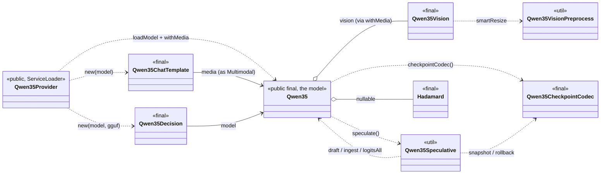

### 2b. Contracts — which external interfaces each class implements

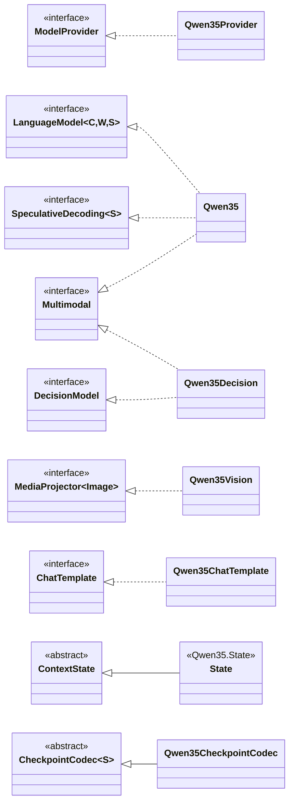

### 2c. Core model — `Qwen35` and its nested types

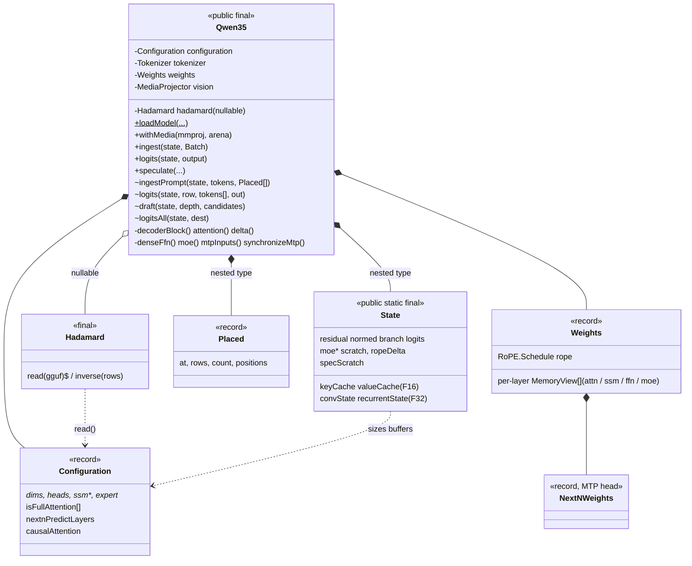

### 2d. Multimodal and chat — vision tower and chat template

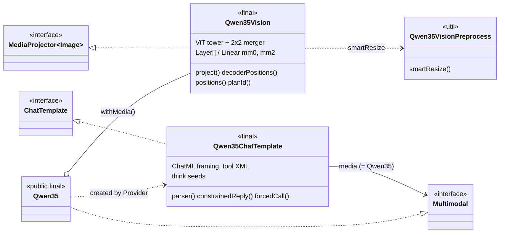

### 2e. Decision, speculation and checkpointing

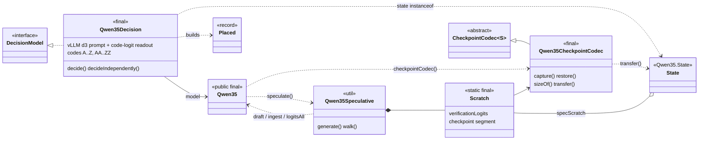

### Relationship summary

| From | To | Kind | Meaning |
|---|---|---|---|
| `Qwen35Provider` | `Qwen35` | creates | `Qwen35.loadModel(...)`, then `.withMedia(mmproj)` when a `media` companion exists |
| `Qwen35Provider` | `Qwen35ChatTemplate` | creates | wrapped in `LoadedModel` as the reply codec (tool calls, constrained decoding, forced calls) |
| `Qwen35Provider` | `Qwen35Decision` | creates | only when GGUF has `<arch>.decision.type` (d3); otherwise language path. The two paths are mutually exclusive (`IncompatibleModelException`) |
| `Qwen35` | `Qwen35Vision` | holds | as `MediaProjector<Media.Image>`; `withMedia` returns a **new** `Qwen35` sharing config/weights/hadamard |
| `Qwen35` | `Hadamard` | holds (nullable) | only for Prism-folded checkpoints; rotates embeddings and projection inputs |
| `Qwen35` | `Qwen35CheckpointCodec` | creates | on each `checkpointCodec()` call; prompt-cache save/restore |
| `Qwen35` | `Qwen35Speculative` | delegates | `speculate(...)` → `Qwen35Speculative.generate` |
| `Qwen35Speculative` | `Qwen35CheckpointCodec` | uses | snapshot before drafting, rollback on rejection (recurrent state cannot be "un-advanced") |
| `Qwen35Decision` | `Qwen35` | uses | package-private `ingestPrompt` + `logits(state,row,tokens,out)` |
| `Qwen35Decision` / `Qwen35ChatTemplate` | `Multimodal` | via `Qwen35` | image positions and rows come from the vision tower |
| `Qwen35Vision` | `Qwen35VisionPreprocess` | uses | `smartResize` for grid size; also used by `positions()` so token count is known without encoding |

---

## 3. Loading sequence

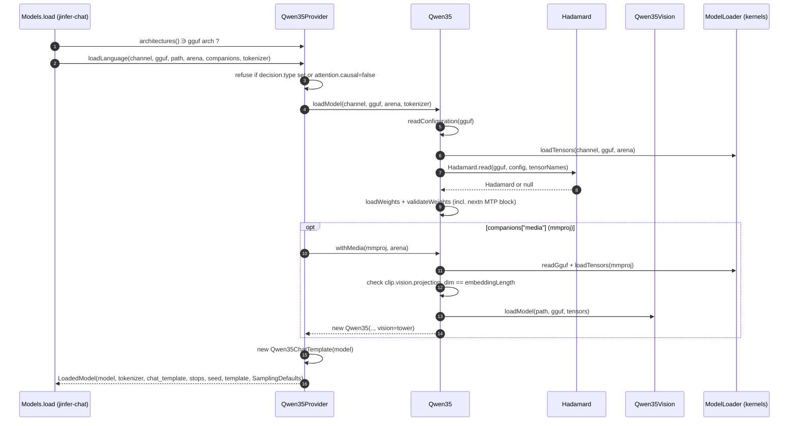

`loadDecisionModel` follows the same steps, then `new Qwen35Decision(model, gguf)` instead of the template.

---

## 4. Forward pass

The forward pass is two nested levels. **4a** is the outer one, `Qwen35.ingest` (one batch → embeddings →
N layers → MTP sync → advance). **4b** is the inner one, `decoderBlock` (one layer: norm → token mixer →
residual → norm → FFN → residual). Everything runs on `State` scratch buffers; no per-call allocation.

### 4-0. Global view

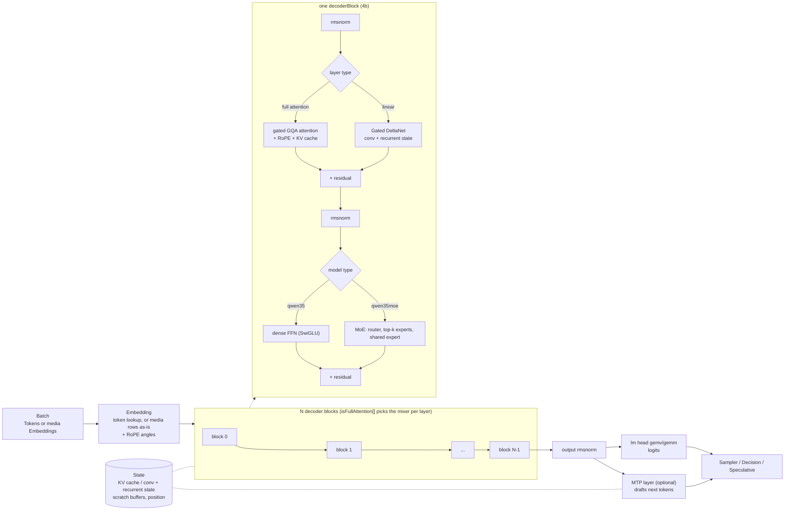

### 4a. `ingest` — one batch through the whole network

Entry: `ingest(state, batch)` → `state.exclusively(() -> forward(state, batch))` + `Reference.reachabilityFence(this)`.

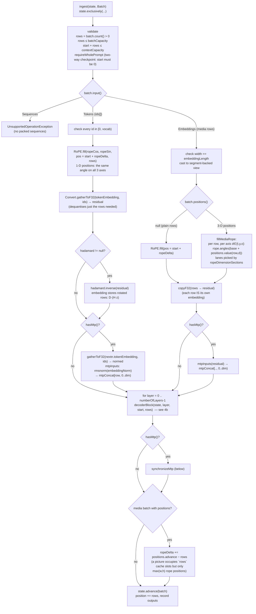

**Notes on 4a**

- **Three input kinds, one body.** `Tokens` and `Embeddings` differ only in how `residual` is filled and
  which RoPE angles are written; after that both run the same layer loop. `Sequences` (packed
  multi-sequence) is rejected.
- **`ropeDelta`.** Cache index and RoPE position diverge after a picture: the tower's grid spans
  `max(w,h)` positions but takes `w·h` cache rows. `ropeDelta` accumulates the difference so every later
  text row gets `cachePosition + ropeDelta`. It is saved in checkpoints (see 7) and reset by `clearHistory`.
- **Hadamard.** Only for Prism-folded checkpoints: the embedding is rotated back after lookup (here), and
  every projection input is rotated forward inside `folded(...)` (see 4b).
- **MTP rows.** The MTP block needs `[norm(embedding(token_i)) ‖ norm(hidden_{i-1})]` per row. The
  embedding half is written *before* the layers (they reuse the scratch it was computed in); the hidden half
  is written *after* them:

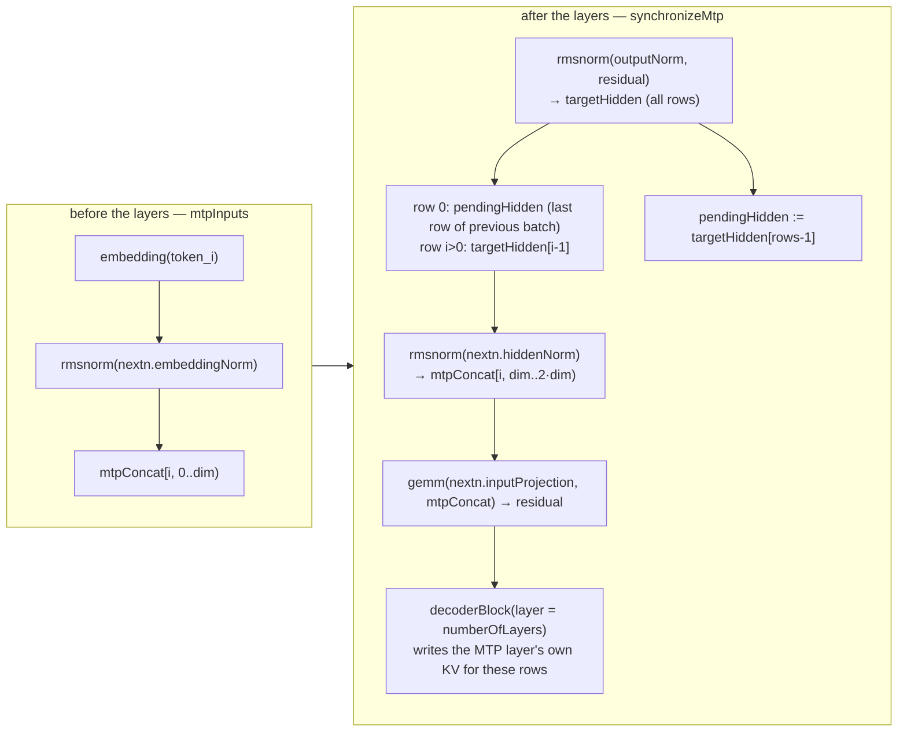

After `ingest`, `logits(state, output)` / `logitsAll` read the final hidden row(s): with MTP from
`targetHidden` (already output-normed), otherwise `rmsnorm(outputNorm)` over `residual`; then
`gemv/gemm(outputWeight)` (through `folded` if rotated).

### 4b. `decoderBlock` — one layer (pre-norm residual block)

Same function for the 0..N-1 main layers and for the single MTP layer (index `numberOfLayers`).

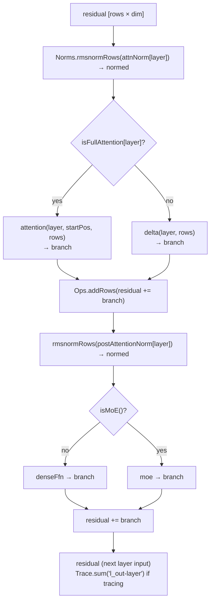

#### 4b-1. `attention` — full-attention layers (gated, GQA, RoPE, KV cache)

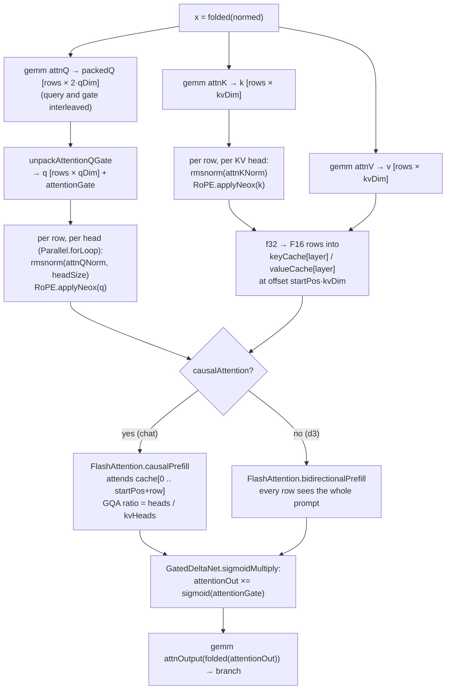

#### 4b-2. `delta` — Gated DeltaNet layers (linear attention with recurrent state)

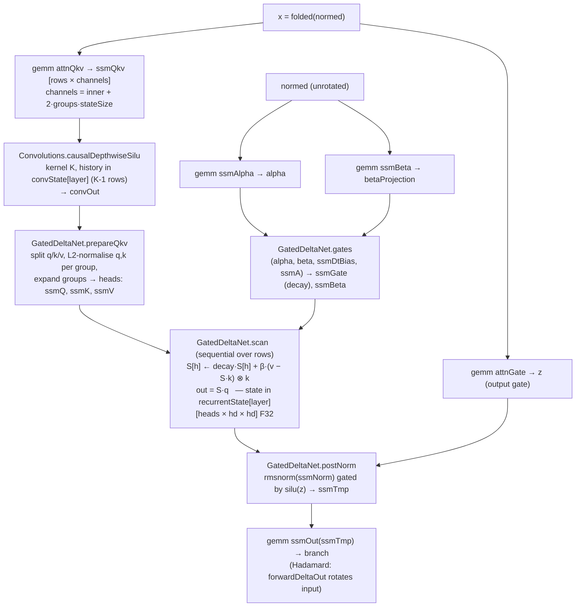

Unlike attention, this layer reads **no KV cache**: its entire history is `convState` + `recurrentState`,
fixed-size whatever the context length. That is also why a rejected speculation cannot just truncate
position — the state must be restored from a checkpoint (section 5).

#### 4b-3. FFN — dense or MoE

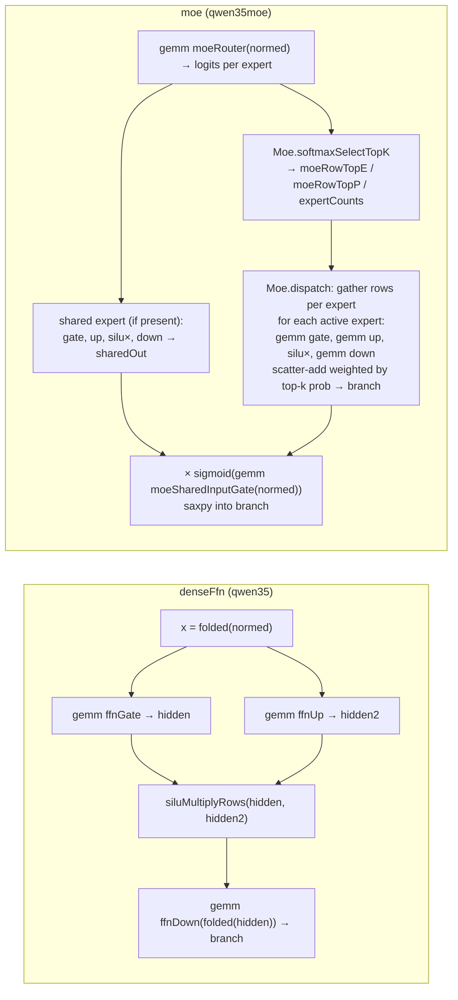

**Notes on 4b**

- **Layer pattern.** `Configuration.isFullAttention[]` decides per layer; the same array also decides what `State`
  allocates for it (KV cache *or* conv+recurrent state) and what the checkpoint codec serialises.
- **`branch` scratch.** Mixer and FFN each write into `branch`, then it is added to `residual`: the only two
  residual updates in a block.
- **`folded(...)`.** Returns `x` itself, or `hadamard.forward(x, state.rotated, …)` for Prism checkpoints. It is applied
  to the input of every quantised projection except `ssmAlpha`/`ssmBeta` and the MoE router/experts, which read `normed` directly.
- **Parallelism.** Matmuls parallelise inside `MatMul`; the per-row/per-head norm+RoPE loops use `Parallel.forLoop`.
  Scalars read from `State` views are read on the owning thread (confined-arena rule).

## 5. Speculative decoding (MTP)

The checkpoint embeds a **single-layer MTP head** (`nextnPredictLayers == 1`, layer index `numberOfLayers`). It drafts tokens; the full model verifies them in one batched forward. The Gated DeltaNet state is recurrent, so rejected drafts cannot be truncated like a KV cache: **snapshot → verify → restore & replay** via `Qwen35CheckpointCodec`.

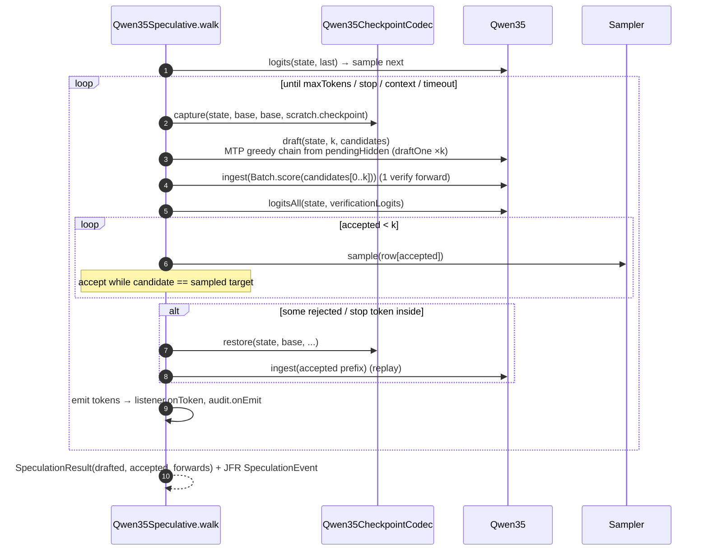

`Scratch` (cached in `State.specScratch`, sized by depth ≤ 8) owns the `(depth+1) × vocab` verification logits and the checkpoint segment.

---

## 6. Decision path (vLLM d3)

Not a chat model: typed questions in → probability per option out. Bidirectional prompt read in **one** batch.

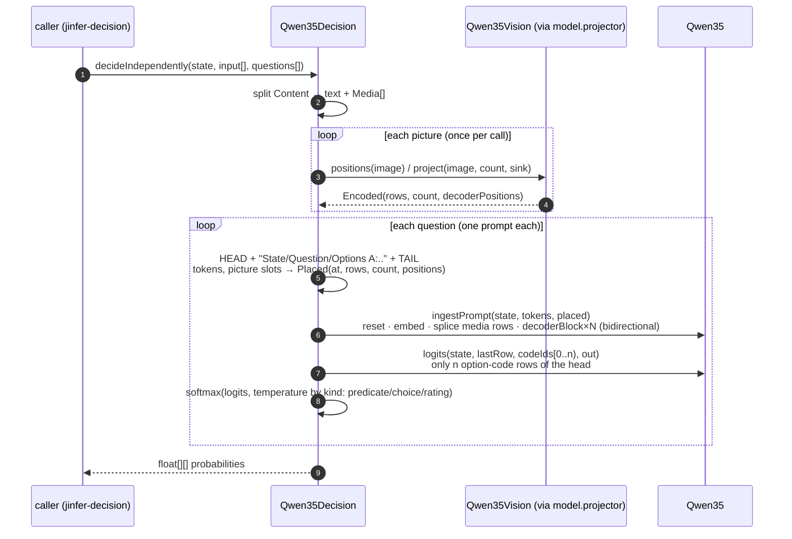

`Qwen35.promptPositions` lays out 3-axis M-RoPE positions: text rows advance all three axes; picture rows use the tower's (t,y,x) from the cursor; the cursor then jumps by `positions.advance()`.

---

## 7. State memory and checkpoint layout

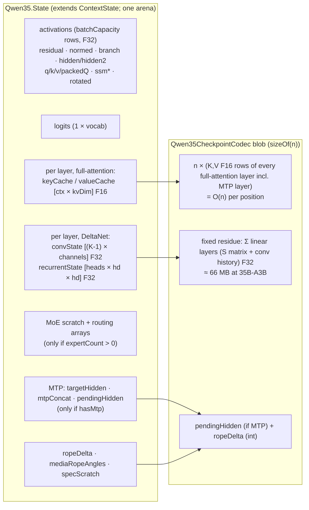

Everything else in `State` is per-batch scratch and is **not** checkpointed (MoE routing is per-token, stateless across tokens).

---

## File index

| File | Lines | Role |
|---|---:|---|
| `Qwen35.java` | 1610 | Model: config/weights/state records, loading, forward pass, attention / Gated DeltaNet / dense+MoE FFN, MTP draft, logits, `withMedia` |
| `Qwen35Vision.java` | 840 | Qwen3-VL ViT tower + 2×2 merger (`MediaProjector<Image>`); fused-QKV, dual patch conv, vision M-RoPE |
| `Qwen35ChatTemplate.java` | 437 | ChatML framing, tool-call XML (render + parse), thinking seeds, constrained/forced replies |
| `Qwen35Decision.java` | 327 | vLLM d3 decision model over a bidirectional Qwen3.5 |
| `Qwen35Speculative.java` | 278 | MTP draft-and-verify loop with checkpoint rollback |
| `Hadamard.java` | 247 | Prism folded Walsh-Hadamard rotation (`prism.hadamard.*`) |
| `Qwen35CheckpointCodec.java` | 119 | Prompt-cache / rollback (de)serialisation of `State` |
| `Qwen35Provider.java` | 91 | `ModelProvider` SPI entry; routes language vs decision, attaches mmproj |
| `Qwen35VisionPreprocess.java` | 74 | `smartResize` (token-bounded, aligned, bicubic target size) |

## Notable design points

- **Hybrid stack.** Layers alternate Gated DeltaNet (linear, recurrent state) and full attention; both write into the same `State`, selected per layer by `isFullAttention[]`.
- **Same weights, three faces.** One `Qwen35` backs chat (`LoadedModel`), decision (`Qwen35Decision`) and speculation. `causalAttention=false` is what makes a checkpoint a d3 decision model.
- **Immutable model, `withMedia` copies.** The vision sidecar borrows the caller's arena; the backbone weights are shared.
- **M-RoPE for media.** Image rows enter as embedding batches carrying 3-D `Batch.Positions`; `ropeDelta` accumulates the gap between cache position and RoPE position so later text stays consistent.
- **Concurrency.** All mutating entry points go through `state.exclusively(...)`; `Reference.reachabilityFence(this)` pins the model while kernels read weights through raw segments.
- **Package-private seams.** `ingestPrompt`, `logits(...,tokens,out)`, `draft`, `logitsAll`, `Placed` exist for `Qwen35Decision` / `Qwen35Speculative`, which are therefore tightly coupled to `Qwen35` by design.
