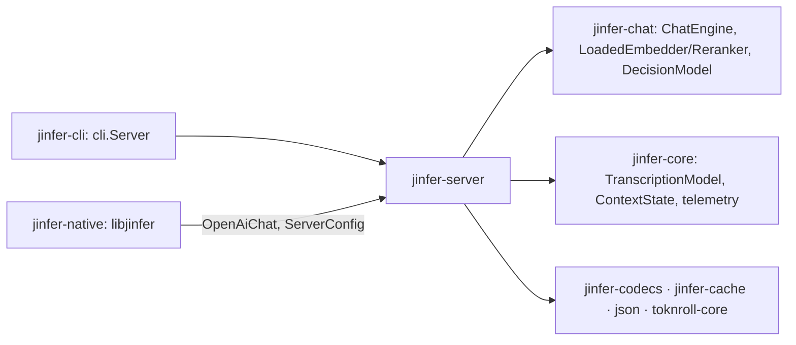

# jinfer-server — architecture summary

`jinfer-server` is jinfer's HTTP front end: an **OpenAI-compatible (llama.cpp-flavoured) server** that
puts an already-loaded model on the network. It uses only the JDK's built-in `com.sun.net.httpserver`
(no web framework). It is a single package, `com.qxotic.jinfer.server`, with 25 classes in about 5 800 lines.
For class diagrams and call flows, see [ARCHITECTURE.md](ARCHITECTURE.md).

## Where it sits

The server never loads models and never owns them. A caller, usually the CLI, loads a model or builds a
`ChatEngine` and passes it to `start(...)`, which returns a `Running` handle. Because the CLI owns the
process, `start` prints nothing, reads no system properties and installs no shutdown hook. The module
has no `META-INF/services` registration. Its only resource is a native-image properties file that adds
`jdk.httpserver`.

## Four servers, one plumbing layer

| Server | Endpoints | Backed by |
|---|---|---|
| `Server` (language) | `/v1/chat/completions`, `/v1/completions`, `/v1/responses`, `/v1/models`, `/tokenize`, `/detokenize` | `ChatEngine` |
| `RetrievalServer` | `/v1/embeddings` or `/v1/rerank` | `LoadedEmbedder` / `LoadedReranker` |
| `DecisionServer` | `/v1/systemone` (System One questions: noul / choice / score) | `DecisionModel` |
| `TranscriptionServer` | `/v1/audio/transcriptions` (multipart) | `TranscriptionModel` |

All four also serve `/health` (always open, no API key), `/props`, `/metrics` (Prometheus) and
`/v1/models`. They also share:

* **`ServerConfig`**: an immutable record of bind address, `Defaults` (sampling, token budgets,
  thinking, raw prompt), `Limits` (threads, body size, grammar switch, timeouts) and `Access` (bearer
  token, CORS origins).
* **`Http`**: the CORS/OPTIONS/bearer preamble, the access-log filter, bounded body reads, and JSON
  responses in OpenAI's error-envelope format.
* **`TaskTransport`**: the probes, gated work routes and 404 catch-all shared by the three task servers.

## Language server internals

* **`Server`**: registers the routes and runs every generation POST through one scaffold. That
  scaffold reads, parses and validates the request on the HTTP handler thread, then queues the job.
* **`Worker`**: one `generation-worker` thread in front of a bounded FIFO. The model runs exactly one
  generation at a time.
* **`Generation`**: turns wire values into engine calls. `OpenAiChat.lower` produces a
  `ChatEngine.Request`. `ChatEngine.prepare` and `ChatEngine.complete` then run the pass, with a
  `WireSink` routing content, reasoning and speech deltas into `Sinks`. `OpenAiChat.reply` finally
  turns the completion into a protocol-neutral `Reply`.
* **`OpenAiSchema`**: builds the chat, completion and Responses-API envelopes, the streaming chunks,
  `usage`, and llama.cpp-style `timings` from a `Reply`.
* **`Sse`**: streams Server-Sent Events. A reaper thread closes any client whose write has stalled
  past `writeTimeout`, so a dead client cannot block the worker.
* **`Validation`, `Values` and `Requests`**: validate request fields, convert their types, and fold
  Responses-API input into the chat format.
* **`SpokenTurns`**, **`MediaParts`** and **`MediaSpill`**: handle audio output that later requests
  refer to by `audio.id`, and inline base64 image, audio and video parts. The server never fetches
  remote URLs.

## Key flows

1. **Admission.** A `Semaphore` of `Limits.threads` permits gates each work route. Requests over the
   limit get `503` with `Retry-After = 2 × threads`. Requests that are admitted wait in the
   worker queue, which holds `threads - 1` jobs. Probes bypass the gate, so they keep answering when
   the server is saturated.
2. **Generation.** The flow is: handler validates → `Worker.submitAndWait` → `Generation.chat` or
   `Generation.completion` → `ChatEngine` → `Reply` → JSON response or SSE chunks ending in `[DONE]`.
3. **Task servers.** The task servers have no worker queue. A fair `ReentrantLock` serializes model
   work, and each server uses one `ContextState` sized at start that closes with the server.
4. **Errors.** Only `IllegalArgumentException` and `UnsupportedOperationException` count as client
   errors. They return `400`, or `404` for `UnknownModel`. Any other exception is the server's fault:
   it returns `500`, is logged, and its text is not sent to the client.

## Notable design choices

* **Transport-only and embeddable.** The engine stays caller-owned and each `start` creates an
  independent instance with its own `Metrics`, so two servers can run in one JVM.
* **Validation before queueing.** A malformed request gets `400` straight away and never takes the
  single generation thread.
* **One OpenAI dialect, shared in-process.** `OpenAiChat` is public, so libjinfer lowers requests with
  exactly the server's rules and error messages.
* **Unsupported features fail loudly.** Requests that ask for something the server cannot do are
  refused: `n > 1`, logprobs, penalties, `previous_response_id` and similar.
* **Observability.** `/metrics` exposes the engine's prompt-cache and media-cache samples, speculation
  counters, queue depth and worker state. `ChatEngine` emits the per-request `InferenceEvent`. The
  server emits one only for requests it sheds.
* **Logging.** Logging goes through the JDK's `System.Logger` (`jinfer.server`), so the module needs no
  logging dependency.
