# jinfer-server — class architecture

Package `com.qxotic.jinfer.server` (25 top-level classes, ~5 790 lines, one package). It is jinfer's
**HTTP transport**: an OpenAI-compatible (and llama.cpp-flavoured) server built on the JDK's
`com.sun.net.httpserver`, with no web framework. Four independent front doors share one plumbing layer:

* `Server` — the language server over a caller-owned `ChatEngine`: `/v1/chat/completions`,
  `/v1/completions`, `/v1/responses`, `/v1/models`, `/tokenize`, `/detokenize`, `/health`, `/props`, `/metrics`;
* `RetrievalServer` — `/v1/embeddings` (OpenAI shape) or `/v1/rerank` (llama.cpp shape);
* `DecisionServer` — `/v1/systemone` (llama.cpp's System One shape) over a `DecisionModel`;
* `TranscriptionServer` — `/v1/audio/transcriptions` (OpenAI multipart) over a `TranscriptionModel`.

Public API: `Server`, `ServerConfig`, `OpenAiChat`, `RetrievalServer`, `DecisionServer`,
`TranscriptionServer` (and their nested `Running` handles). Everything else is package-private.
There is **no `META-INF/services` registration**: the only resource is
`META-INF/native-image/com.qxotic/jinfer-server/native-image.properties` (`--add-modules jdk.httpserver`).

Format: **Mermaid**. Legend: `..|>` implements; `--|>` extends; `-->` holds/uses; `..>` creates/depends;
`*--` owns (composition); classes marked `<<external>>` live outside this module. Nested classes are
written `Outer_Nested` in class diagrams (Mermaid class names cannot contain dots).

1. [Position in the stack](#1-position-in-the-jinfer-stack)
2. [Class diagrams](#2-class-diagrams) — 2a public API, 2b language server, 2c task servers, 2d wire helpers
3. [Server start and shutdown](#3-server-start-and-shutdown)
4. [Request pipeline of a generation endpoint](#4-request-pipeline-of-a-generation-endpoint)
5. [Lowering and the reply path](#5-lowering-and-the-reply-path)
6. [Streaming (SSE)](#6-streaming-sse)
7. [Admission, queueing and concurrency](#7-admission-queueing-and-concurrency)
8. [Task servers: retrieval, decision, transcription](#8-task-servers)
9. [Errors, validation and observability](#9-errors-validation-and-observability)

| Class | Role |
|---|---|
| `Server` | Language transport over a `ChatEngine`: routes, the admission gate (`gated`), the shared generation scaffold (`handleGenerationPost`), streaming handlers; nested `Running` (public handle), `SpokenStream` (spoken SSE), `RequestJob` |
| `ServerConfig` | Public immutable record `(bind, Defaults, Limits, Access)`; `local(port)` factory and `with*` copies |
| `Generation` | Lowers OpenAI wire values onto `ChatEngine` (`chat`, `completion`), keeps the `SpokenTurns`, records metrics; nested `WireSink implements ChatEngine.ReplySink` |
| `OpenAiChat` | Public: the chat.completions dialect — `lower` (request → `ChatEngine.Request`), `reply` (completion → `Reply`), `completion` (JSON envelope). Also used in-process by libjinfer |
| `Worker` | One platform thread (`generation-worker`) + a bounded FIFO; `submitAndWait` returns `Result {COMPLETED, FULL, CLOSED, INTERRUPTED}` |
| `Http` | Transport plumbing: CORS/OPTIONS/bearer preamble, `AccessLog` filter, bounded body reads, JSON/text/bytes responses, OpenAI error envelope |
| `Sse` | Server-Sent Events: `Stream` (frame encode/flush, checked→unchecked bridge), `guarded` error framing, the stalled-write reaper thread |
| `Metrics` | Per-instance Prometheus counters + text exposition; `Outcome` enum |
| `Reply` | Record: protocol-independent result (generator result, token counts, text, reasoning, tool calls, finish reason, speculation, `Audio`) |
| `Sinks` | Record of live channels `(onText, onReasoning, onSpeech)`; `NONE` for non-streaming |
| `OpenAiSchema` | Pure JSON builders: chat/completion/responses envelopes and chunks, `usage`, llama.cpp `timings` |
| `Validation` | Request validation run on the handler thread; `UnknownModel` (→ 404), `require`/`requireParam` |
| `Values` | Typed coercion of parsed JSON maps; `InvalidParam` (names the field in `param`) |
| `Requests` | Request-shape adapters: model id echo, token budget, completion prompt, Responses-API → chat folding |
| `JsonCodec` | The single bridge to the external `com.qxotic.format.json.Json` library (null mapping, ordered objects) |
| `ToolUse` / `ToolCalls` | Tool-choice policy (`offered`, `forced`) / engine `Content.ToolCall` → OpenAI wire (+ streaming deltas) |
| `SpokenTurns` | Bounded (4096), expiring (1 h) LRU of spoken assistant turns referred to by `audio.id` |
| `MediaParts` | OpenAI media content parts (`image_url`, `input_audio`, `video_url`) → `Content.Media`; advertised modalities |
| `MediaSpill` | Streams a base64 video data URI to a temp file while hashing it (20 MB cap) |
| `TaskTransport` | Shared transport for the single-task servers: probes, gated `work` routes, 404 catch-all; nested `Running` |
| `RetrievalServer` | Embedding or rerank server; nested `Embedder`/`Ranker` seams adapted from `LoadedEmbedder`/`LoadedReranker` |
| `DecisionServer` | System One decision server over a `DecisionModel` and one `ContextState` |
| `TranscriptionServer` | Speech-to-text server; nested minimal RFC 7578 `Multipart` parser |
| `Log` | The `System.Logger` named `jinfer.server` |

---

## 1. Position in the jinfer stack

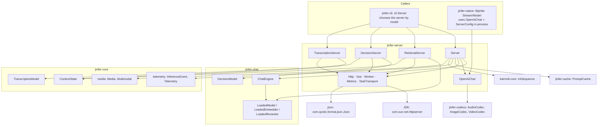

Maven dependencies (compile): `jinfer-core`, `jinfer-chat`, `jinfer-cache`, `jinfer-codecs`, `json`,
`toknroll-core`. Test scope adds `jinfer-testkit`, `jam-native` and several model providers
(`jinfer-lfm2`, `jinfer-lfm3`, `jinfer-qwen3`, `jinfer-qwen35`, `jinfer-gemma-embedding2`) that the
integration tests load through `ModelProvider`'s `ServiceLoader`. The server itself never loads a
model: every `start` takes an already-loaded, caller-owned model or engine.

---

## 2. Class diagrams

### 2a. Public API and handles

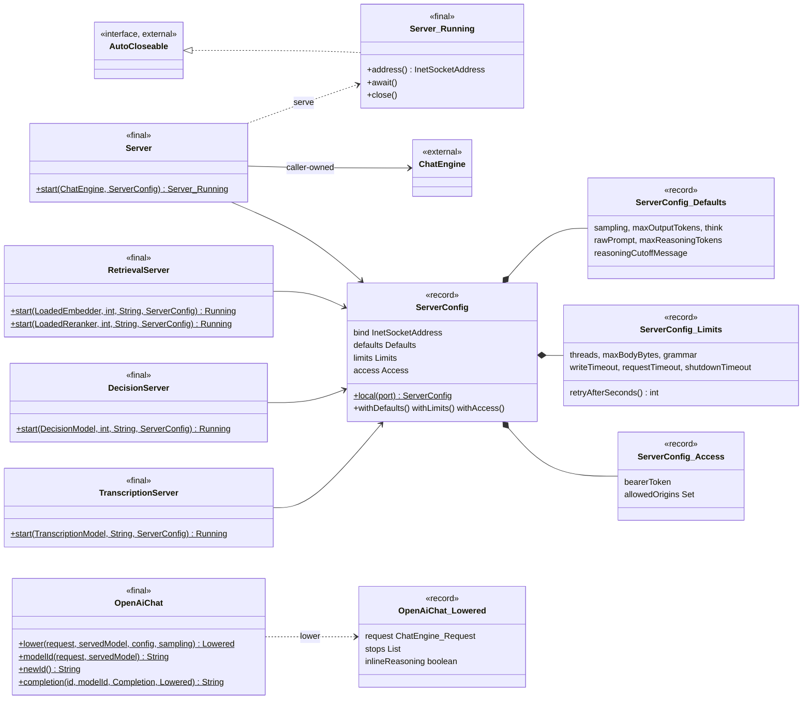

Every server's `start` validates its arguments, binds, starts and returns at once. It **prints nothing,
reads no system properties, installs no shutdown hook**; the CLI owns those concerns. `RetrievalServer`,
`DecisionServer` and `TranscriptionServer` each nest their own public `Running implements AutoCloseable`
that delegates to a `TaskTransport.Running`.

`ServerConfig.Limits.DEFAULTS` = 16 threads, 32 MiB body, grammar on, 30 s write timeout, 300 s request
timeout, 30 s shutdown timeout; `retryAfterSeconds()` = `2 × threads`. `Access.LOCAL` = no bearer token,
origins `{"*"}`.

### 2b. The language server — `Server` and its collaborators

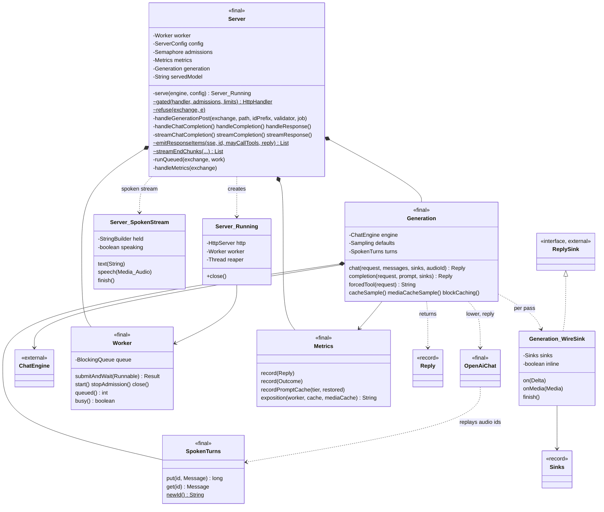

### 2c. Task servers and their shared transport

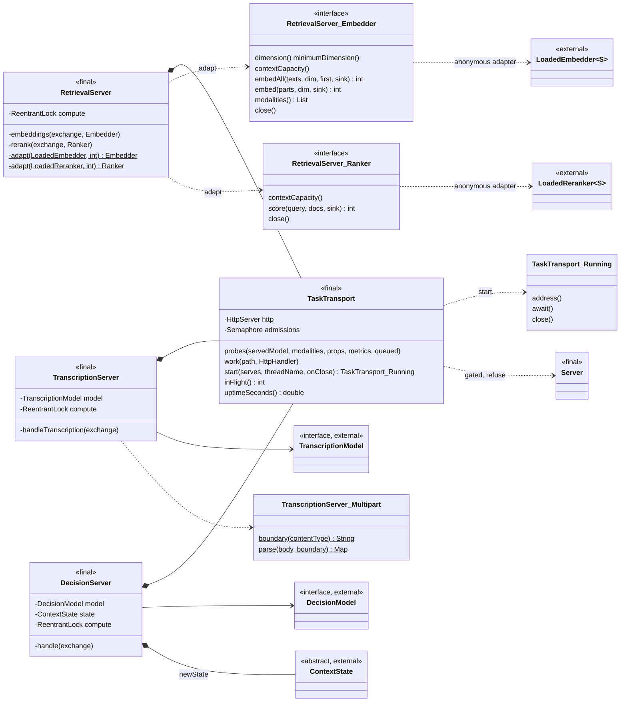

`Embedder` and `Ranker` are package-private seams ("a test fakes it"); the public `start` overloads
adapt a `LoadedEmbedder<S>` / `LoadedReranker<S>` with one `ContextState` of `contextCapacity`
tokens, created at start and closed with the server.

### 2d. Wire helpers (all package-private, stateless)

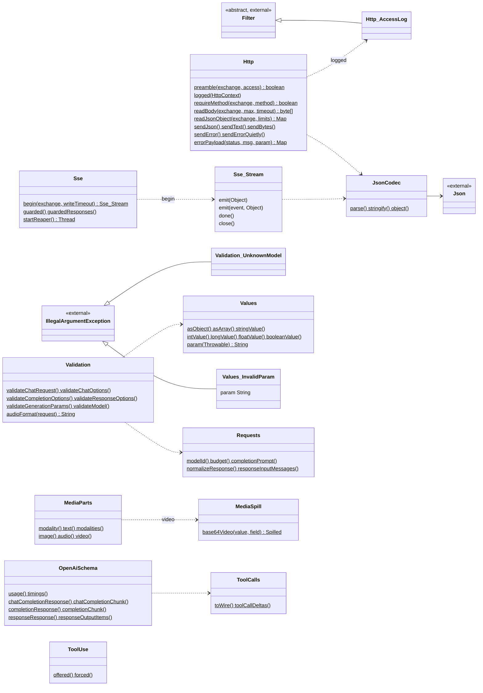

---

## 3. Server start and shutdown

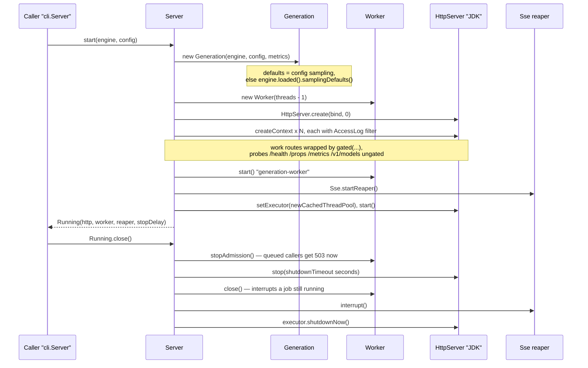

Route table built by `Server.serve`:

| Path | Kind | Method | Handler |
|---|---|---|---|
| `/v1/chat/completions` | gated work | POST | `handleChatCompletion` |
| `/v1/completions` | gated work | POST | `handleCompletion` |
| `/v1/responses` | gated work | POST | `handleResponse` |
| `/tokenize`, `/v1/tokenize` | gated JSON | POST | tokenizer `encode` |
| `/detokenize`, `/v1/detokenize` | gated JSON | POST | tokenizer `decode` (ids range-checked) |
| `/v1/models`, `/v1/models/{id}` | probe | GET | model card (input/output modalities) |
| `/health` | probe, **no bearer key** | GET | `status`, `busy`, `queued` |
| `/props` | probe | GET | n_ctx, sampling, speculation, prompt/media cache stats |
| `/metrics` | probe | GET | `Metrics.exposition` (Prometheus text) |
| `/` | catch-all | any | JSON 404 |

The model card's `input_modalities` comes from `MediaParts.modalities(model, false)` (a `Multimodal`
`supports(...)` check); `output_modalities` adds `audio` when the model is a `SpeechOutput` that `speaks()`.

---

## 4. Request pipeline of a generation endpoint

All three generation routes go through `Server.handleGenerationPost`; parsing and validation happen on
the **handler thread**, only the job reaches the single generation worker.

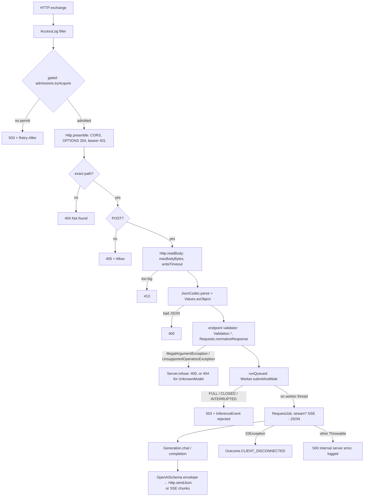

| Endpoint | id prefix | Validator | Job |
|---|---|---|---|
| chat | `chatcmpl-` | `validateChatRequest`, `validateChatOptions`, `validateGenerationParams` | `generation.chat(request, messages, sinks)` |
| completions | `cmpl-` | `validateCompletionOptions`, `validateGenerationParams`, non-blank prompt | `generation.completion(request, prompt, sinks)` |
| responses | `resp_` | `validateResponseOptions`, `Requests.normalizeResponse`, `validateGenerationParams`, `validateChatRequest(request, folded)` | `generation.chat` over `Requests.responseInputMessages` |

---

## 5. Lowering and the reply path

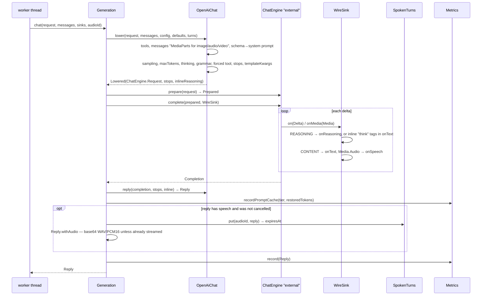

`Generation.completion` skips the chat template: it tokenizes the prompt (`SpecialTokens.encode` when
`Defaults.rawPrompt`, else `tokenizer.encode`) and calls `ChatEngine.prepareRaw(ids, sampling, maxTokens,
requestTimeout, grammar, stops)`.

Key lowering rules in `OpenAiChat`:

* `thinking` = `chat_template_kwargs.enable_thinking`, else `reasoning_effort != "none"`, else
  `Defaults.think`; forced off when audio output is requested.
* `grammar` = request `grammar`, else `Grammar.jsonGbnf()` for `json_object`, else `Grammar.schemaGbnf(schema)`
  for `json_schema` (and `describeSchema` adds the schema to the system message).
* `forced` maps `ToolUse.forced` to `ChatEngine.ForcedTool.NONE / ANY / Named`.
* An assistant message carrying `audio.id` is replayed from `SpokenTurns.get(id)` (refused if unknown/expired).
* `reply()` collects `Content.Text / Reasoning / ToolCall`, applies `TextStops`, and maps
  `finish_reason` to `tool_calls` / `stop` / `length` (`cancelled` for a cancelled pass).

`OpenAiChat.lower(Map, String, ServerConfig, Sampling)` and `OpenAiChat.completion(...)` are public so
`jinfer-native`'s `libjinfer.Stream` can speak the same dialect in-process (with `turns == null`, so
spoken replay is refused there).

---

## 6. Streaming (SSE)

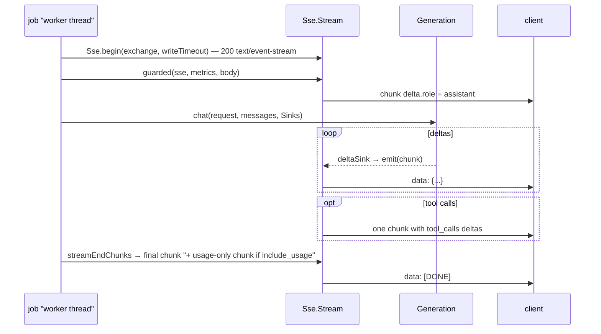

* **Chat** chooses its `Sinks`: a `SpokenStream` (audio requested: text is held until the first speech,
  then sent as `delta.audio.transcript` + base64 PCM16 `delta.audio.data`; never-spoken text goes out
  as `content` at `finish()`), `Sinks.NONE` when `generation.forcedTool(request) != null`, otherwise
  content + `reasoning_content` delta sinks.
* **Completions** stream text chunks via `Sinks.text`.
* **Responses** emit named events (`response.created`, `response.output_item.added`,
  `response.content_part.added`, `response.output_text.delta`, …, `response.completed|incomplete`);
  `Stream.emit(event, map)` adds a `sequence_number`. When tools are offered nothing streams live and
  `emitResponseItems` replays the finished items; the final envelope reuses the same item list so
  tool-call ids agree.
* Timings ride the last chunk (`OpenAiSchema.timings`, llama.cpp's shape).
* `Sse.guarded` turns an `UncheckedIOException` from a frame write back into `IOException` (client
  gone), and other failures into an in-band error event + `[DONE]` (400 for validator types, 500 otherwise).
* The **reaper** thread (`sse-write-reaper`, one per `Server.Running`) scans `ACTIVE` streams each
  second and closes any whose in-flight write exceeded its own `writeTimeout` — the JDK server has no
  write timeout, and a dead client would otherwise wedge the single worker.

---

## 7. Admission, queueing and concurrency

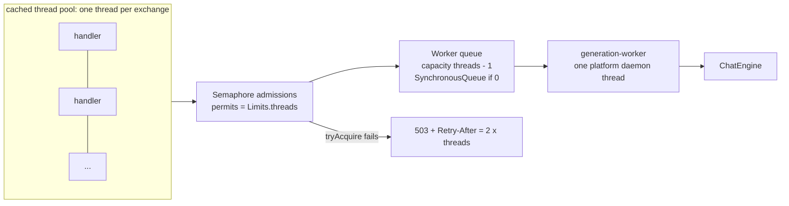

* `Server.requestExecutor()` is a cached pool so the gate — not the JDK — refuses excess load with a
  proper 503 instead of a dropped connection.
* `Worker.submitAndWait` blocks the handler on a `CountDownLatch`. If the handler is interrupted while
  its job is still queued, the job is removed (`INTERRUPTED`); if the worker already owns it, the
  handler waits for it to finish so only one writer touches the exchange.
* `Worker.Job.run` reports `Telemetry.queueWait(...)` before running.
* Probes are never gated, so `/health`, `/props`, `/metrics` answer even when saturated.
* Task servers use the same `Server.gated` gate via `TaskTransport.work`, but no `Worker`: model work is
  serialized by a fair `ReentrantLock compute`, whose `getQueueLength` feeds `/health`'s `queued`. The
  close hook takes the same lock so the `ContextState` closes after the request using it.

---

## 8. Task servers

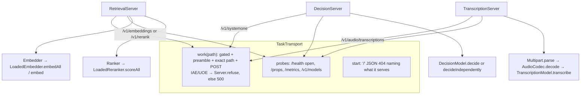

* **Embeddings**: `input` is a string or array (≤ 2048) of strings / content-part arrays (no token ids);
  runs of plain strings batch through `embedAll`, media inputs go one by one through `embed`;
  `dimensions` may go down to `minimumDimension()` (Matryoshka); `encoding_format` `float` or `base64`
  (little-endian float32). Video is sampled one frame per second, at most 32 (`EMBEDDING_FRAMES`).
* **Rerank**: `query` + `documents` scored with the reranker's `defaultInstruction()`, sorted stably by
  score, cut to `top_n`, optional `return_documents`.
* **Decision**: `state` (text or any JSON, or null with media) plus `files`/`images` data URIs; questions
  of type `noul` → `Predicate`, `choice` → `Choice`, `score` → `Rating` (2–10 levels); `joint: true`
  calls `decide`, otherwise `decideIndependently`. Answers carry probabilities, confidence, and for
  scores the probability-weighted mean level. Video uses `FRAMES` (2 fps, 4–768 frames, via `VideoCodec.ffmpeg()`).
* **Transcription**: multipart `file` + `response_format` (`json`, `text`, `verbose_json` with word timings).
* Each keeps its own `AtomicLong` counters and builds a small exposition with `Metrics.metric`.

---

## 9. Errors, validation and observability

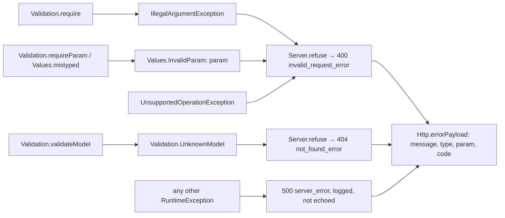

* The rule everywhere (JSON routes, generation scaffold, `Sse.guarded`, `TaskTransport.work`): only
  `IllegalArgumentException` and `UnsupportedOperationException` are the client's fault.
  `Http.errorMessage` keeps the first line, ≤ 512 chars.
* `Validation.validateGenerationParams` checks only fields the request carries (OpenAI ranges for
  temperature, top_p, top_k, min_p, budget, stops ≤ 4, `n == 1`), refuses unsupported options by value
  (logprobs, logit_bias, non-zero penalties), and refuses `grammar` + JSON `response_format` together or
  any grammar when `Limits.grammar` is off.
* `Metrics` is **per instance** (two servers in one JVM do not share counters); it records outcomes
  (`INVALID_REQUEST`, `REJECTED`, `CANCELLED`, `FAILED`, `CLIENT_DISCONNECTED`), tokens, prompt-cache tier
  hits (`PromptCache.Tier` SESSION/BLOCKS/FRESH), speculation, and exports the engine's
  `PromptCache.Sample` and `MediaEncodingCache.Sample` plus queue depth and worker busy.
* The per-inference JFR-style `InferenceEvent` is emitted by `ChatEngine`; the server only commits one
  itself for requests it sheds in `runQueued` (`errorType` `queue-full`, `interrupted`, `shutdown`).
* Logging goes through `Log.LOG` (`System.getLogger("jinfer.server")`); `Http.AccessLog` writes one INFO
  line per exchange (method, URI, status, ms, remote address).
