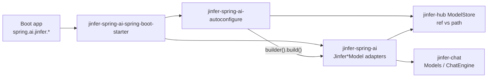

# jinfer-spring-ai-autoconfigure — summary

Spring Boot auto-configuration for jinfer's Spring AI adapters. One package
(`com.qxotic.jinfer.spring.ai.autoconfigure`, 15 small classes, ~650 lines) that turns
`spring.ai.jinfer.*` properties into ready-to-inject Spring AI beans backed by local GGUF models.
Class-level detail and diagrams: [ARCHITECTURE.md](ARCHITECTURE.md).

## Where it sits

It holds no inference logic. Every dependency is `optional`; the starter brings the runtime
classpath, and each configuration guards itself with `@ConditionalOnClass`. Registration is the
standard Boot `META-INF/spring/org.springframework.boot.autoconfigure.AutoConfiguration.imports` file.

## Main pieces

| Capability | Auto-configuration | Properties record | Bean (from jinfer-spring-ai) | Spring AI contract |
|---|---|---|---|---|
| Chat | `JinferChatAutoConfiguration` | `JinferChatProperties` | `JinferChatModel` | `ChatModel` |
| Embedding | `JinferEmbeddingAutoConfiguration` | `JinferEmbeddingProperties` | `JinferEmbeddingModel` | `EmbeddingModel` |
| Decision | `JinferDecisionAutoConfiguration` | `JinferDecisionProperties` | `JinferDecisionModel` | `DecisionModel` |
| Rerank | `JinferRerankAutoConfiguration` | `JinferRerankProperties` | `JinferDocumentPostProcessor` | `DocumentPostProcessor` (RAG) |
| Speech (TTS) | `JinferSpeechAutoConfiguration` | `JinferSpeechProperties` | `JinferSpeechModel` | `TextToSpeechModel` |
| Transcription (STT) | `JinferTranscriptionAutoConfiguration` | `JinferTranscriptionProperties` | `JinferTranscriptionModel` | `TranscriptionModel` |
| Session memory | `JinferSessionAutoConfiguration` | — | `InMemorySessionRepository` | `SessionRepository` |

Helpers: `JinferChatSelected` (custom `Condition` for chat) and `Sources` (routes a property value
to the builder as a hub ref or a local path, and expands `companions.*` maps).

## Key flow

1. Boot evaluates each configuration's conditions (class present, property switch, no user bean).
2. The `@ConfigurationProperties` record is bound (constructor binding, `@DefaultValue` defaults).
3. The `@Bean` method checks required values (model has text; speech `speed`/`maxInputChars` ranges),
   creates the adapter's `Builder`, and feeds it via `Sources.model` / `Sources.companions`.
4. Optional beans (`ObservationRegistry`, the matching `*ObservationConvention`, a `VideoSampler`
   for chat/decision) are applied with `ObjectProvider.ifAvailable`.
5. `builder.build()` resolves refs through `ModelStore` (downloading when absent) and loads the
   GGUF, so misconfiguration fails the boot, not the first request.

## Notable design choices

- **Per-capability activation.** Chat is active on `spring.ai.model.chat=jinfer`, or with no selection
  when `spring.ai.jinfer.chat.model` is set (`JinferChatSelected`), so speech- or rerank-only apps boot.
  Embedding and decision need the explicit `spring.ai.model.<type>=jinfer`. Rerank has no Spring AI
  model type, so setting `spring.ai.jinfer.rerank.model` is the switch. Speech and transcription need a
  model and a provider selection that is `jinfer` or unset.
- **Back off to user beans.** Embedding/decision back off from any `EmbeddingModel` / `DecisionModel`;
  the others from their own adapter type; the session repository from any `SessionRepository`,
  and it is ordered after Spring AI's JDBC repository and before `SessionServiceAutoConfiguration`.
- **No URL downloads.** `Sources` refuses `://` values via `ModelStore.requireRef`, re-throwing with
  the property key; non-refs are local paths that never touch the network.
- **Flat properties, one options object.** `JinferChatProperties.toOptions()` maps flat Boot keys onto
  `JinferChatOptions`; unset values stay null so the model's recommended sampling applies.
- **IDE metadata as a contract.** The configuration processor is declared in `annotationProcessorPaths`
  and `ConfigurationMetadataTest` asserts the `spring.ai.jinfer.*` keys appear in the generated JSON.
