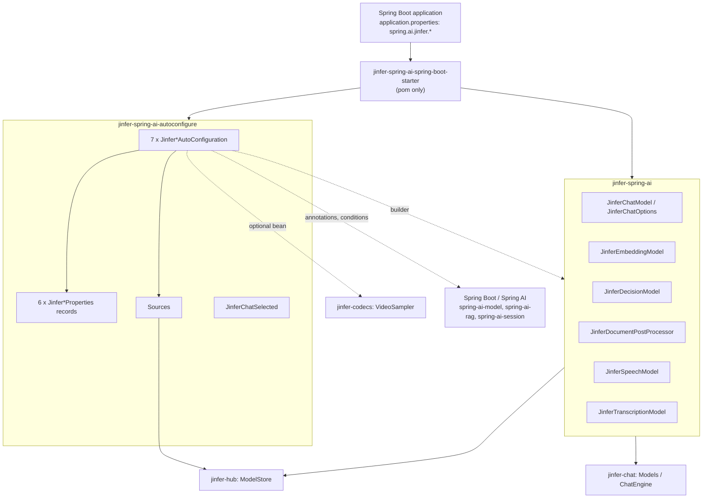
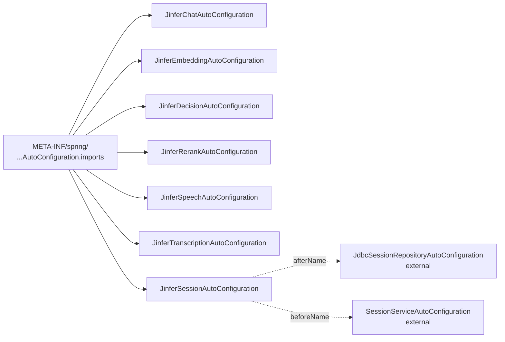
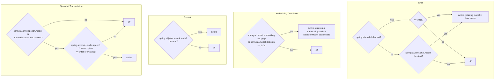
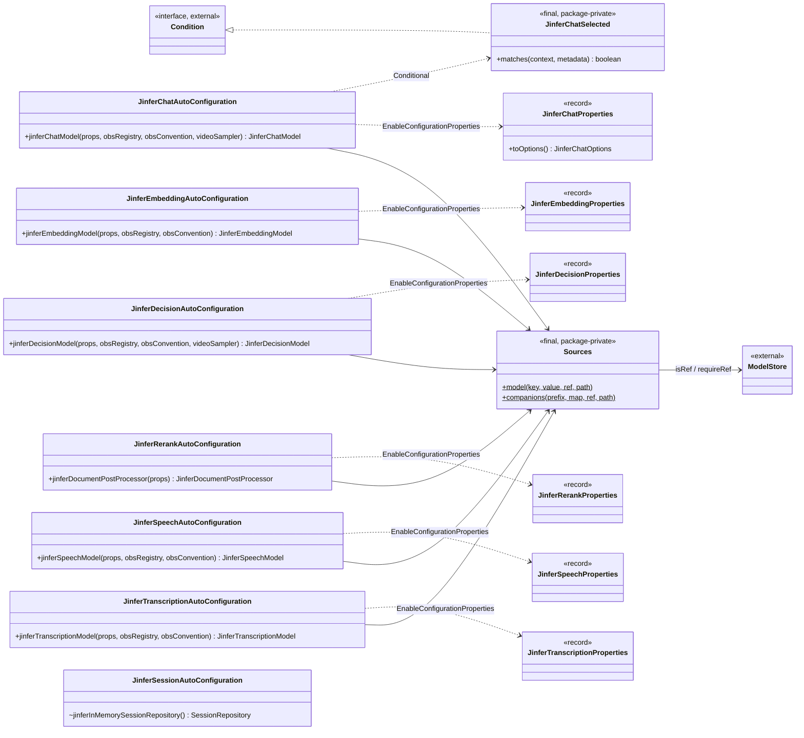
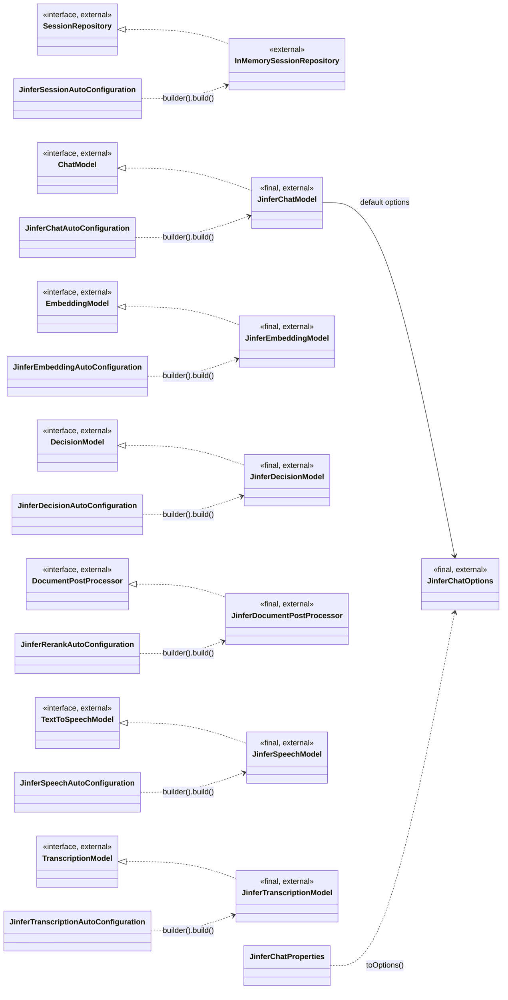
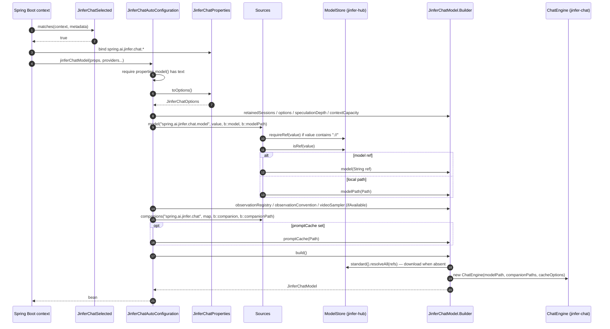
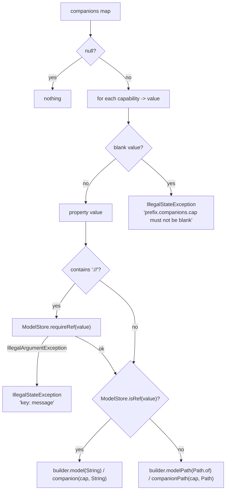
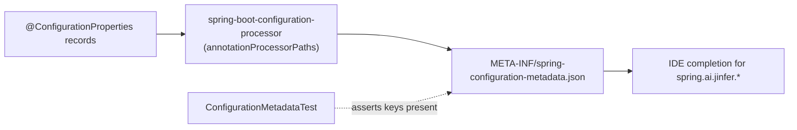

# jinfer-spring-ai-autoconfigure — class architecture

Package `com.qxotic.jinfer.spring.ai.autoconfigure` (15 classes, ~650 lines). It is the **Spring Boot
auto-configuration** layer over `jinfer-spring-ai`: seven `@AutoConfiguration` classes, each wiring one
Spring AI model bean (chat, embedding, decision, rerank, speech, transcription) or a session repository from
`spring.ai.jinfer.*` properties. It contains no inference code: every bean is built through the adapter's
`Builder` (`JinferChatModel.builder()`, ...), and the adapter resolves model refs through `jinfer-hub` and
loads GGUFs through `jinfer-chat`'s `Models` / `ChatEngine`. The `jinfer-spring-ai-spring-boot-starter` module
bundles this jar with `jinfer-spring-ai`.

Format: **Mermaid**. Legend: `..|>` implements; `--|>` extends; `-->` holds/uses; `..>` creates/depends;
classes marked `<<external>>` live outside this package.

1. [Position in the stack](#1-position-in-the-jinfer-stack)
2. [Registration and activation](#2-registration-and-activation) — 2a SPI imports, 2b conditions
3. [Class diagrams](#3-class-diagrams) — 3a configurations and properties, 3b built beans
4. [Bean creation sequence](#4-bean-creation-sequence)
5. [Model source resolution — `Sources`](#5-model-source-resolution--sources)
6. [Property reference](#6-property-reference)
7. [Build-time metadata](#7-build-time-metadata)

| Class | Role |
|---|---|
| `JinferChatAutoConfiguration` | `@AutoConfiguration` wiring a `JinferChatModel` bean; gated by `JinferChatSelected` |
| `JinferChatProperties` | `record` bound to `spring.ai.jinfer.chat`; `toOptions()` builds a `JinferChatOptions` |
| `JinferChatSelected` | package-private `Condition`: `spring.ai.model.chat=jinfer`, or no selection and `spring.ai.jinfer.chat.model` set |
| `JinferEmbeddingAutoConfiguration` | wires a `JinferEmbeddingModel` when `spring.ai.model.embedding=jinfer` and no `EmbeddingModel` bean exists |
| `JinferEmbeddingProperties` | `record` bound to `spring.ai.jinfer.embedding` (model, companions, contextCapacity, dimensions) |
| `JinferDecisionAutoConfiguration` | wires a `JinferDecisionModel` when `spring.ai.model.decision=jinfer` and no `DecisionModel` bean exists |
| `JinferDecisionProperties` | `record` bound to `spring.ai.jinfer.decision` (model, companions, contextCapacity, independent) |
| `JinferRerankAutoConfiguration` | wires a `JinferDocumentPostProcessor` (RAG post-retrieval) when `spring.ai.jinfer.rerank.model` is set |
| `JinferRerankProperties` | `record` bound to `spring.ai.jinfer.rerank` (model, contextCapacity, instruction, topK, minScore) |
| `JinferSpeechAutoConfiguration` | wires a `JinferSpeechModel` (TTS) when `spring.ai.jinfer.speech.model` is set and speech provider is jinfer/unset |
| `JinferSpeechProperties` | `record` bound to `spring.ai.jinfer.speech` (model, companions, speed, maxInputChars) |
| `JinferTranscriptionAutoConfiguration` | wires a `JinferTranscriptionModel` (STT) when `spring.ai.jinfer.transcription.model` is set and provider is jinfer/unset |
| `JinferTranscriptionProperties` | `record` bound to `spring.ai.jinfer.transcription` (model only) |
| `JinferSessionAutoConfiguration` | fallback `InMemorySessionRepository` bean when no `SessionRepository` exists |
| `Sources` | package-private helper: routes a property value to the builder's `model(String ref)` or `modelPath(Path)`, refuses URLs, expands `companions` maps |

---

## 1. Position in the jinfer stack

All dependencies in `pom.xml` are `<optional>true</optional>` (jinfer-codecs, jinfer-hub, jinfer-spring-ai,
spring-ai-model, spring-ai-rag, spring-ai-session, micrometer-observation, spring-boot, spring-boot-autoconfigure,
spring-beans, spring-context, spring-core): the starter supplies the runtime classpath, and each
auto-configuration guards itself with `@ConditionalOnClass`. Test scope pulls real model ports (lfm2, lfm3,
gemma-embedding2, inflect2, parakeet), `jam-native`, `jinfer-testkit` and `spring-ai-autoconfigure-model-session`.

---

## 2. Registration and activation

### 2a. SPI registration

Boot discovers the configurations through
`src/main/resources/META-INF/spring/org.springframework.boot.autoconfigure.AutoConfiguration.imports`
(no `META-INF/services` file in this module).

`JinferSessionAutoConfiguration` is the only one with ordering: it runs after Spring AI's JDBC session
repository auto-configuration (so a JDBC repository wins) and before `SessionServiceAutoConfiguration` (which
needs a `SessionRepository` bean).

### 2b. Activation conditions

Each capability chooses its own switch. Chat, embedding and decision follow Spring AI's
`spring.ai.model.<type>` selector; rerank has no Spring AI model type, so the model property itself is the
switch; speech and transcription need both a model and a non-conflicting provider selection.

| Configuration | `@ConditionalOnClass` | Property gate | Bean guard |
|---|---|---|---|
| Chat | `JinferChatModel` | `@Conditional(JinferChatSelected)` | `@ConditionalOnMissingBean` (type `JinferChatModel`) |
| Embedding | `JinferEmbeddingModel` | `spring.ai.model.embedding=jinfer` | `@ConditionalOnMissingBean(EmbeddingModel.class)` |
| Decision | `JinferDecisionModel`, `DecisionModel` | `spring.ai.model.decision=jinfer` | `@ConditionalOnMissingBean(DecisionModel.class)` |
| Rerank | `JinferDocumentPostProcessor`, `DocumentPostProcessor` | `spring.ai.jinfer.rerank.model` present | `@ConditionalOnMissingBean` (type `JinferDocumentPostProcessor`) |
| Speech | `JinferSpeechModel` | `spring.ai.model.audio.speech=jinfer` (matchIfMissing) **and** `spring.ai.jinfer.speech.model` | `@ConditionalOnMissingBean` |
| Transcription | `JinferTranscriptionModel` | `spring.ai.model.audio.transcription=jinfer` (matchIfMissing) **and** `spring.ai.jinfer.transcription.model` | `@ConditionalOnMissingBean` |
| Session | `SessionRepository` | — | `@ConditionalOnMissingBean(SessionRepository.class)` |

`JinferChatSelected` exists because a `matchIfMissing` default alone made an embeddings/rerank/speech-only app
fail with "spring.ai.jinfer.chat.model is required" (per its Javadoc).

---

## 3. Class diagrams

### 3a. Configurations, properties and helpers

All properties classes are `record`s annotated `@ConfigurationProperties` (constructor binding, defaults via
`@DefaultValue`). `JinferEmbeddingProperties` additionally marks its canonical constructor `@ConstructorBinding`
and keeps a two-argument `(model, contextCapacity)` convenience constructor.

### 3b. Beans built and their Spring AI contracts

All six `Jinfer*` adapters (in `jinfer-spring-ai`) also implement `AutoCloseable`, so Spring's inferred destroy
method closes them on context shutdown. Optional collaborators come in as `ObjectProvider`s and are applied with
`ifAvailable`:

| Configuration | `ObservationRegistry` | `*ObservationConvention` | `VideoSampler` |
|---|---|---|---|
| Chat | yes | `ChatModelObservationConvention` | yes (overrides UNIFORM) |
| Embedding | yes | `EmbeddingModelObservationConvention` | — |
| Decision | yes | `DecisionModelObservationConvention` | yes |
| Speech | yes | `TextToSpeechModelObservationConvention` | — |
| Transcription | yes | `TranscriptionModelObservationConvention` | — |
| Rerank | — | — | — |

---

## 4. Bean creation sequence

The chat bean is representative; the other model configurations follow the same shape (validate, builder,
`Sources.model`, `Sources.companions`, optional providers, `build()`).

Because `build()` resolves and loads at bean creation, a typo in a ref or an out-of-range option fails the
**boot**, not the first request (as documented in `JinferChatProperties` and tested by
`JinferChatAutoConfigurationTest`). The other adapters load via `Models.loadEmbedder`, `Models.loadDecisionModel`,
`Models.loadReranker`, `Models.loadSpeech` and `Models.loadTranscription` respectively.

Per-configuration validation done *before* the builder:

| Configuration | Checks in this module |
|---|---|
| Chat | model has text |
| Embedding | model has text |
| Decision | model has text |
| Rerank | model has text; `minScore` applied only when non-null (ColBERT MaxSim sums may be negative) ; `instruction` only when non-blank |
| Speech | model has text; `speed` positive and finite; `maxInputChars >= 0` (0 keeps the adapter default) |
| Transcription | model has text |

---

## 5. Model source resolution — `Sources`

`Sources.model` never downloads from a URL: a URL goes through `ModelStore.requireRef`, whose error names the
ref a hub link spells, and the message is re-thrown prefixed with the property key. A value that is not a ref is
treated as a local path and never touches the network. Companions (`mmproj` media towers, Gemma 4's
`speculation` MTP sidecar, Inflect's `lexicon`, ...) reuse the same rule per capability key.

---

## 6. Property reference

| Prefix | Properties (default) |
|---|---|
| `spring.ai.jinfer.chat` | `model`, `companions.*`, `prompt-cache`, `retained-sessions` (1), `context-capacity` (0), `temperature`, `top-p`, `top-k`, `min-p`, `max-tokens`, `seed`, `thinking`, `max-reasoning-tokens`, `reasoning-cutoff-message`, `timeout` (Duration), `output-modalities` (Set of `Modality`), `speculation-depth` |
| `spring.ai.jinfer.embedding` | `model`, `companions.*`, `context-capacity` (0), `dimensions` (0 = model's own) |
| `spring.ai.jinfer.decision` | `model`, `companions.*`, `context-capacity` (0), `independent` (false) |
| `spring.ai.jinfer.rerank` | `model`, `context-capacity` (0), `instruction`, `top-k` (0 = keep all), `min-score` |
| `spring.ai.jinfer.speech` | `model`, `companions.*`, `speed`, `max-input-chars` (0 = 4096 adapter default) |
| `spring.ai.jinfer.transcription` | `model` |

`contextCapacity` everywhere: 0 = 4096 or the model's max when smaller, -1 = the model's max, other = exact
(refused at boot past the max). `JinferChatProperties.toOptions()` maps the sampling/reasoning/timeout/modality
fields one-to-one onto `JinferChatOptions.builder()`; null fields stay unset so the model's recommendations apply.

---

## 7. Build-time metadata

The processor is declared in `maven-compiler-plugin`'s `annotationProcessorPaths` (JDK 23+ javac ignores
classpath-discovered processors, per `ConfigurationMetadataTest`), which also keeps it off the runtime classpath.
The jar manifest reserves `Automatic-Module-Name: com.qxotic.jinfer.spring.ai.autoconfigure`.
