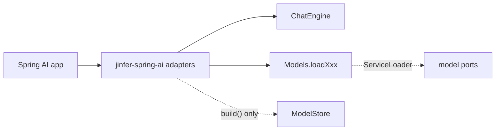

# jinfer-spring-ai — architecture summary

**What it is.** The Spring AI provider for jinfer: one package (`com.qxotic.jinfer.spring.ai`, 10 classes) of thin
adapters that let a Spring AI application use local GGUF models through Spring AI's own interfaces, in-process on
CPU, with no server and no network on the inference path. Details, diagrams and call flows:
[ARCHITECTURE.md](ARCHITECTURE.md).

**Where it sits.** Above `jinfer-chat` (`ChatEngine`, `Models`, `LoadedEmbedder`/`LoadedReranker`, the jinfer
`DecisionModel`), `jinfer-core` (speech and transcription model contracts, states, arenas), `jinfer-cache`
(`PromptCache`), `jinfer-codecs` (image/audio/video decoding) and `jinfer-hub` (`ModelStore`, model refs). Below
`jinfer-spring-ai-autoconfigure` and the Spring Boot starter, which create these adapters as beans. Model ports
(gemma4, qwen3, lfm2, ...) are not dependencies: `Models` finds them at run time via `ServiceLoader`.

## Main classes

| Spring AI contract | Adapter | jinfer model behind it |
|---|---|---|
| `ChatModel` | `JinferChatModel` (+ `JinferChatOptions`) | `ChatEngine` over a `LoadedModel` |
| `EmbeddingModel` | `JinferEmbeddingModel` | `LoadedEmbedder` |
| `DocumentPostProcessor` (RAG rerank) | `JinferDocumentPostProcessor` | `LoadedReranker` |
| `TextToSpeechModel` | `JinferSpeechModel` | `SpeechSynthesisModel` |
| `TranscriptionModel` | `JinferTranscriptionModel` | jinfer `TranscriptionModel` |
| `DecisionModel` | `JinferDecisionModel` | jinfer `chat.DecisionModel` |

Package-private helpers serve the chat side: `JinferMappings` (Spring AI messages, tools and media to jinfer
`Message`/`Tool`/`Content`, and replies back to `AssistantMessage`), `CachedPrompt` (a view's fixed prefix and welded
tools) and `Replies` (an LRU of the exact token records of recent replies).

## Key flows

- **Build.** Every builder takes a local path, a model ref (resolved and downloaded by `ModelStore` at `build()`,
  together with companion refs in one batch) or a model the caller already loaded. The adapter then loads through
  `Models` into an arena it owns, or borrows the caller's model and leaves its arena alone.
- **Chat `call` / `stream`.** Request options are merged over the model defaults (Spring AI tool-merge rules), the
  prompt is mapped to jinfer messages, a `ChatEngine.Request` is prepared (sampling, grammar, reasoning budget,
  stops, output modalities) and completed. Streaming emits `TextPart`/`ReasoningPart` deltas from the engine's
  driver thread, then a final chunk with tool calls, finish reason and usage (`JinferUsage`: timings, cache tier,
  speculation counters).
- **Cached-prompt views.** `withCachedPrompt(messages, tools)` defines a prefix once in the engine's block tree and
  returns a view sharing the engine; views compose by branching. `saveCachedPrompts` freezes them into an artifact
  that `Builder.promptCache` mounts read-only later.
- **Retrieval.** The embedding adapter adds the model card's document prefix on `embed(Document...)` and the query
  prefix on `embed(String)`, so a single wired bean makes any `VectorStore` retrieval-correct; `call` stays
  framing-free. The reranker scores all documents against one shared prefilled judge frame, sorts, then applies
  `minScore` and `topK`.
- **Audio and decisions.** Speech returns WAV (`call`) or PCM16 clips (`stream`, on `boundedElastic`); transcription
  returns text or the full `Transcription`; decisions return probabilities for yes/no, choice and score questions.

## Notable design choices

- **No inference logic here.** Policies live in `ChatEngine` and the ports; this module maps types, validates and
  observes (Micrometer, provider `"jinfer"`, `NOOP` registry by default).
- **One instance = one serial pipeline** for chat, embedding, reranking and decision (fair locks, one reusable
  state). Speech and transcription use a state per call under a read lock and run in parallel. `close()` is blocking
  and idempotent and frees only what the instance loaded.
- **Refuse rather than ignore.** Unsupported knobs (penalties, per-request model, TTS voice/format), remote media
  URLs, inline video bytes, and media in tool results are rejected with explicit errors.
- **Structured output is grammar-only.** `outputSchema` compiles to GBNF (`Grammar.schemaGbnf`) or a raw `grammar` is
  used; the adapter never adds schema text to the prompt (the `package-info` explains why callers should).
- **Byte-exact replay.** `Replies` lets an echoed assistant turn reuse the model's own tokens without storing
  anything on the Spring message, so chat-memory stores stay provider-neutral.
- **Packaging.** No `META-INF/services` of its own; a `native-image.properties` initializes
  `com.qxotic.jinfer.spring` at run time; automatic module name `com.qxotic.jinfer.spring.ai`.
