# jinfer-spring-ai — class architecture

Package `com.qxotic.jinfer.spring.ai` (10 classes + `package-info`, ~3 900 lines; JPMS automatic module name
`com.qxotic.jinfer.spring.ai`). It is the **Spring AI provider** for jinfer: each public class adapts one Spring AI
model contract (`ChatModel`, `EmbeddingModel`, `DocumentPostProcessor`, `TextToSpeechModel`, `TranscriptionModel`,
`DecisionModel`) onto an in-process jinfer model loaded from a local GGUF. It contains no inference code and no
auto-configuration (that lives in `jinfer-spring-ai-autoconfigure`); it maps types, owns the arena/state lifecycle,
applies Spring AI's option precedence and emits Micrometer observations.

Format: **Mermaid**. Legend: `..|>` implements; `--|>` extends; `-->` holds/uses; `..>` creates/depends;
`*--` owns (lifecycle); classes marked `<<external>>` live outside this package.

1. [Position in the stack](#1-position-in-the-jinfer-stack)
2. [Class diagrams](#2-class-diagrams) — 2a contracts, 2b chat internals, 2c retrieval/audio/decision adapters
3. [Building an adapter](#3-building-an-adapter) — source resolution, loading, arena ownership
4. [Chat flows](#4-chat-flows) — 4a `call`, 4b `stream`, 4c cached-prompt views, 4d option precedence
5. [Message mapping and reply replay](#5-message-mapping-and-reply-replay)
6. [Embedding and reranking flows](#6-embedding-and-reranking-flows)
7. [Speech, transcription and decision flows](#7-speech-transcription-and-decision-flows)
8. [Concurrency and lifecycle](#8-concurrency-and-lifecycle)
9. [Packaging: dependencies, SPI, native image](#9-packaging)

| Class | Role |
|---|---|
| `JinferChatModel` | `ChatModel` + `AutoCloseable` over one `ChatEngine`: blocking `call`, Reactor `stream`, tools, grammar-constrained structured output, multimodal input, spoken output; `withCachedPrompt` views; nested `Builder` and `JinferUsage` record |
| `JinferChatOptions` | `DefaultToolCallingChatOptions` + `StructuredOutputChatOptions`: Spring AI common options plus jinfer extras (`seed`, `minP`, `thinking`, `maxReasoningTokens`, `reasoningCutoffMessage`, `timeout`, `outputSchema`, `grammar`, `outputModalities`); nested `Builder` with `combineWith` |
| `CachedPrompt` | package-private record: a view's prefix (jinfer `Message`s + `Tool`s); `merge`, `resolveTools`, `serves`, override warning |
| `Replies` | package-private, thread-safe LRU (`ContentKey` → `Verbatim`, budget 2^24 token ids) so an echoed assistant reply replays its exact generated tokens |
| `JinferMappings` | package-private static seam: Spring AI messages/tools/media → jinfer `Message`/`Tool`/`Content`; jinfer reply → `AssistantMessage`; WAV audio; JSON helpers |
| `JinferEmbeddingModel` | `EmbeddingModel` over a `LoadedEmbedder`: ragged batched `call`, document/query framing on the `embed(...)` overloads, Matryoshka `dimensions`, media documents |
| `JinferDocumentPostProcessor` | `DocumentPostProcessor` (RAG post-retrieval) over a `LoadedReranker`: scores, sorts, `minScore`/`topK` filters |
| `JinferSpeechModel` | `TextToSpeechModel` over a `SpeechSynthesisModel`: WAV from `call`, PCM16 clips from `stream`; per-call state, read/write lifecycle lock |
| `JinferTranscriptionModel` | Spring AI `TranscriptionModel` over a jinfer `TranscriptionModel`; typed `transcribe(...)` doors return the full `Transcription` |
| `JinferDecisionModel` | Spring AI `DecisionModel` over `com.qxotic.jinfer.chat.DecisionModel`: yes/no, choice and score questions answered with probabilities |

---

## 1. Position in the jinfer stack

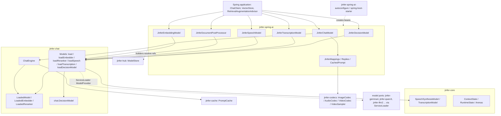

Only the builders touch `ModelStore` (model refs and companion refs are resolved, and downloaded if needed, at
`build()`); nothing on an inference path fetches over the network. `JinferMappings` explicitly rejects `http*` media.

---

## 2. Class diagrams

### 2a. Contracts and relations

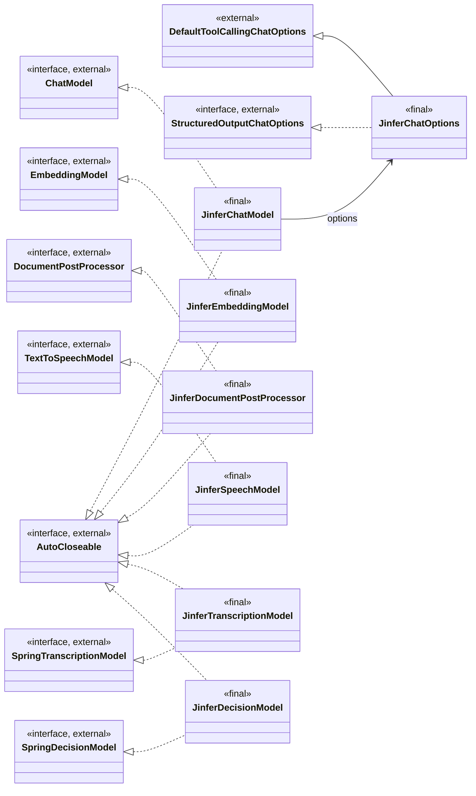

`SpringTranscriptionModel` is `org.springframework.ai.audio.transcription.TranscriptionModel` and
`SpringDecisionModel` is `org.springframework.ai.decision.DecisionModel` (renamed here to distinguish them from the
jinfer types of the same simple name). Every adapter has a nested static `Builder` and a static `builder()`.

### 2b. Chat internals — `JinferChatModel` and its collaborators

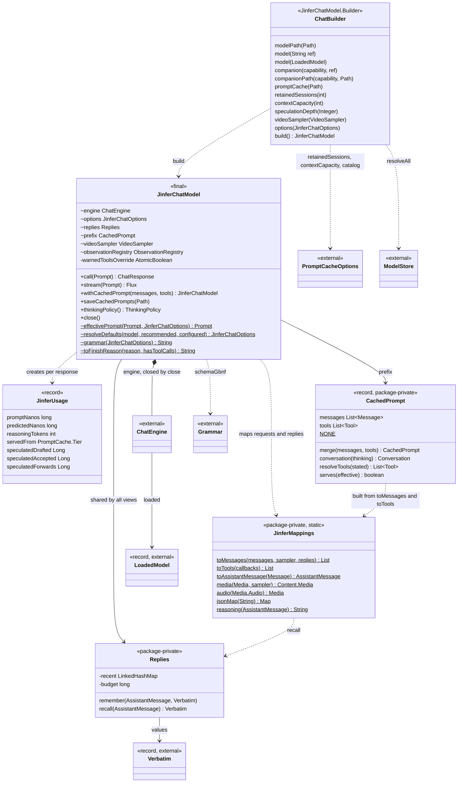

### 2c. Retrieval, audio and decision adapters

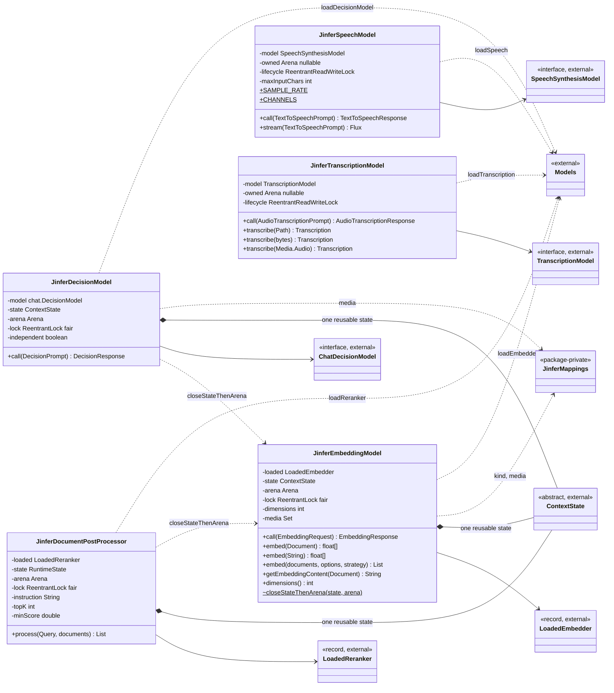

`ChatDecisionModel` is `com.qxotic.jinfer.chat.DecisionModel` (`newState`, `decide`, `decideIndependently`;
nested sealed `Question` with records `Predicate`, `Choice`, `Rating`, `Option`). `SpeechSynthesisModel` and
`TranscriptionModel` are jinfer-core interfaces extending `Model<C, W, S>`.

---

## 3. Building an adapter

Every builder accepts three mutually exclusive sources, "last setter wins": a local `Path`, a model-ref `String`
(validated by `ModelStore.requireRef`), or an already loaded jinfer model. Companions (`companion(capability, ref)` /
`companionPath(capability, path)`) are refused together with a pre-loaded model, because they are load-time settings.

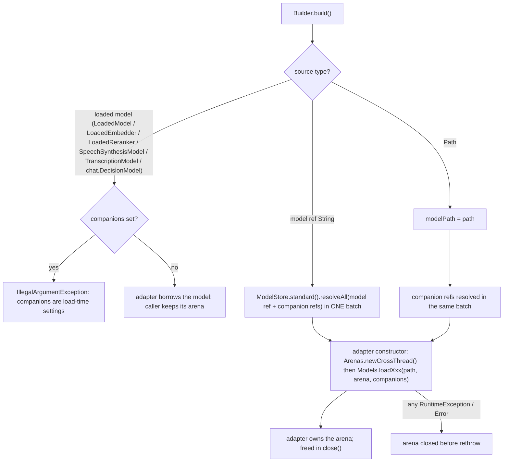

Notes verified in code:

- `JinferDocumentPostProcessor` and `JinferTranscriptionModel` resolve a ref with `ModelStore.standard().resolve(ref)`
  (no companions); the others use `resolveAll` so a cold start pays the slowest download, not the sum.
- `JinferChatModel` does not create an arena itself: it builds `new ChatEngine(modelPath, companionPaths, cacheOptions)`
  or `new ChatEngine(loaded, modelName, cacheOptions)`; on failure after the engine is live it calls `engine.close()`
  with the original exception kept primary (`addSuppressed`).
- `JinferEmbeddingModel`, `JinferDocumentPostProcessor` and `JinferDecisionModel` always create one private arena (the
  reusable state is allocated in it even when weights are borrowed). `JinferSpeechModel` and
  `JinferTranscriptionModel` create an arena only when they load the weights (`owned` is null otherwise).
- Context capacity uses `PromptCache.Options.contextCapacity(requested, maxContextLength, DEFAULT_CONTEXT_CAPACITY)`:
  0 = min(4096, model max), -1 = model max, otherwise exact.

---

## 4. Chat flows

### 4a. Blocking `call`

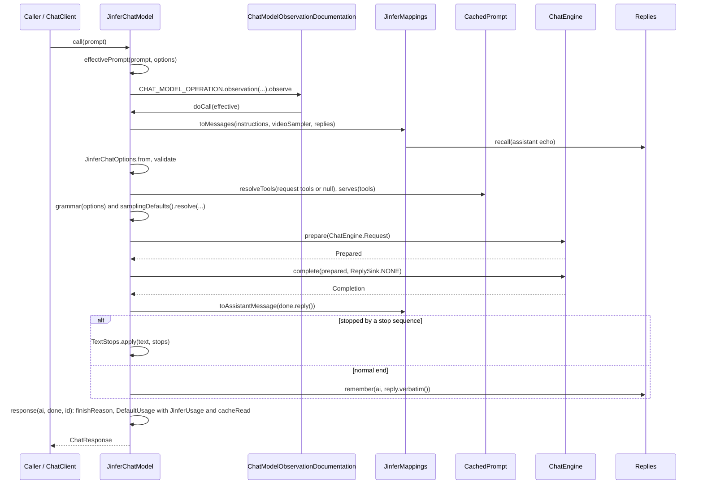

`ChatEngine.Request` carries: prefix + request messages, effective tools, `thinking` (off when `thinking=false` or
when `outputModalities` contains `AUDIO`), `maxTokens` (-1 if unset), reasoning budget and cutoff message, `timeout`,
resolved sampling (`temperature`, `topP`, `topK`, `minP`, `seed`), GBNF grammar, `ForcedTool.NONE`, stop sequences,
`null` template kwargs and output modalities. `frequencyPenalty`, `presencePenalty` and a per-request model other
than the loaded one are rejected in `validate`.

### 4b. Streaming `stream`

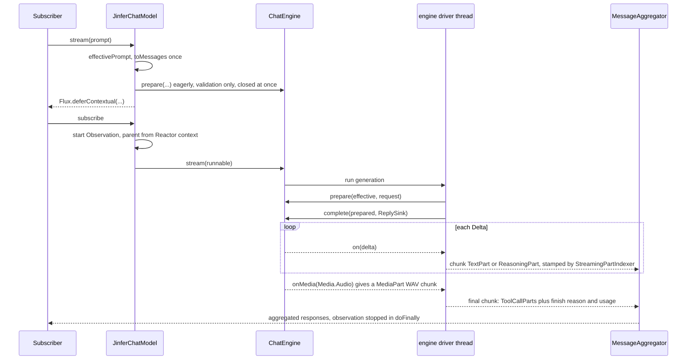

Cancellation is reported to the engine through `ReplySink.cancelled()`; a cancelled pass ends the Flux silently.
Blank leading reasoning deltas are skipped; deltas on other channels (structural spans) are not emitted.

### 4c. Cached-prompt views

```mermaid
flowchart LR
    Base["base JinferChatModel, prefix = CachedPrompt.NONE"] -->|"withCachedPrompt(msgs, tools)"| M1["prefix.merge(toMessages, toTools)"]
    M1 --> D1["engine.definePrompt(conversation)"]
    D1 --> V1["new JinferChatModel(base, merged): view shares engine, options, replies"]
    V1 -->|"withCachedPrompt(more, List.of())"| V2["branched view: parent prefix then new turns"]
    V1 & V2 -->|"saveCachedPrompts(path)"| F["engine.freezePrompts(out)"]
    F -.->|"later process: Builder.promptCache(path)"| Mount["PromptCache catalog mounted read-only"]
```

Tool precedence (`CachedPrompt.resolveTools`): a request that states tools is served with its own; an unstated set
falls back to the view's welded tools. When the effective set differs from the welded one (`serves` is false) the
request is still served correctly but uncached, and the view logs `toolsOverrideWarning` once (`AtomicBoolean`).

### 4d. Option precedence

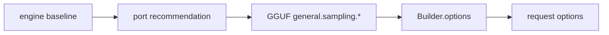

`resolveDefaults` seeds a `JinferChatOptions` from `LoadedModel.SamplingDefaults` and the model name, then
`combineWith(configured)`. Per request, `effectivePrompt` merges request over defaults with `combineWith`, but tool
callbacks and tool context follow `ToolCallingChatOptions.mergeToolCallbacks` / `mergeToolContext` (a request naming
tools replaces the defaults' list). `JinferChatOptions.from(ChatOptions)` returns the instance itself when already a
`JinferChatOptions`, otherwise copies the portable fields.

Structured output: `grammar(options)` returns a raw `grammar` as given, or `Grammar.schemaGbnf(jsonMap(outputSchema))`;
both set at once is an `IllegalArgumentException`. The adapter never restates the schema in the prompt (see
`package-info`).

---

## 5. Message mapping and reply replay

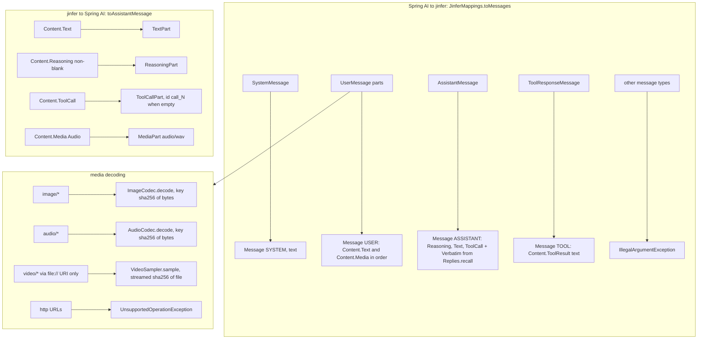

`Replies` keys each delivered reply by a SHA-256 `ContentKey` of `[text, stripped reasoning, (id, name, arguments)
per tool call]` and stores its `Verbatim` (the exact generated token record). When the same reply comes back as
history, `JinferMappings.assistant` attaches the recalled `Verbatim` to the jinfer `Message`, so the engine replays
the model's own tokens instead of re-rendering. Nothing is stored on the Spring message, so chat-memory stores only
see Spring AI fields. Eviction is LRU once more than 2^24 token ids are held. Tools map to
`Tool(name, {"type":"function","function":{name, description, parameters}})`.

---

## 6. Embedding and reranking flows

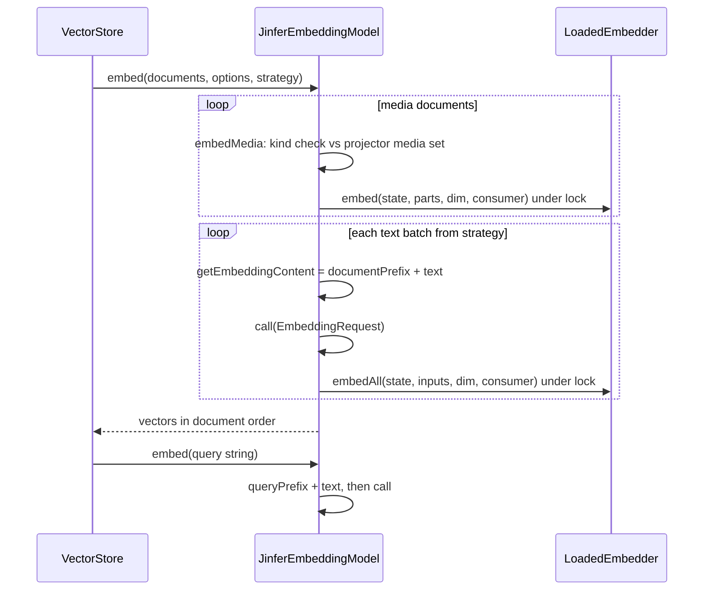

- `call(EmbeddingRequest)` is the framing-free door; the `embed(...)` overloads add the model card's
  `documentPrefix()` (ingestion) or `queryPrefix()` (search) from `LoadedEmbedder`.
- Output width: request `dimensions`, else the builder's `dimensions` (validated against
  `minimumDimension()..dimension()`), else the model's own; a per-request model other than the loaded one is refused.
- Media documents (EmbeddingGemma 2 with a `media` companion) use a fixed video sampler of one frame per second, at
  most 32 (`VideoCodec.ffmpeg().every(...)`).
- Usage is the exact token count returned by `embedAll` / `embed`.

`JinferDocumentPostProcessor.process(query, documents)`: returns at once for an empty list; refuses non-text documents;
under the fair lock calls `LoadedReranker.scoreAll(state, instruction, query.text(), texts, sink)` (one shared judge
frame, each document ingested after it); then sorts descending (stable), filters `score >= minScore` (default
`-infinity`), limits to `topK` (0 = all) and writes the score into `Document.score`. An `instruction` is refused when
the reranker has no instruction slot (`hasInstructionSlot()` false, e.g. ColBERT MaxSim).

---

## 7. Speech, transcription and decision flows

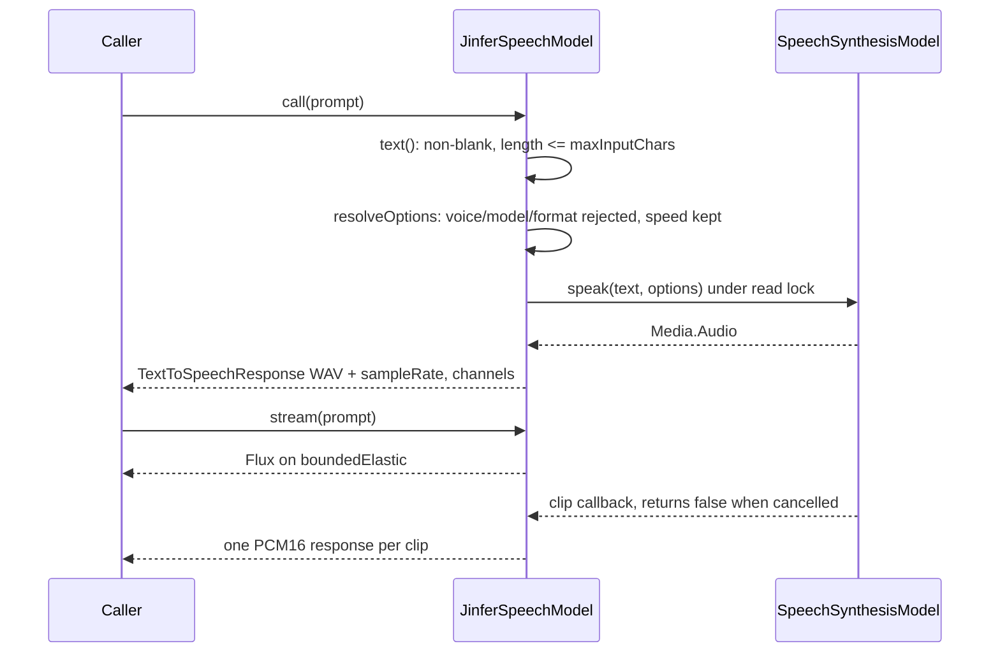

- `JinferTranscriptionModel.call` reads the `Resource` bytes, rejects a requested model, and observes
  `transcribe(bytes).text()`. `transcribe(Path|byte[])` decode through `AudioCodec`; `transcribe(Media.Audio)` calls
  the jinfer model under the read lock (one state per call inside the port).
- `JinferDecisionModel.call` maps `DecisionInput` to jinfer `Content`: `TextInput` parts (text and media via
  `JinferMappings.media`), `FieldsInput` (media join the input, fields rendered as pretty JSON), `ConversationInput`
  (a `{"messages": [...]}` JSON transcript; reasoning dropped, media refused). Questions map
  `YesNoQuestion → Predicate`, `ChoiceQuestion → Choice`, `ScoreQuestion → Rating`; under the fair lock it calls
  `decide` or, with `independent(true)`, `decideIndependently`. Answers: yes/no probability `p[1]`; choice = argmax
  with per-option probabilities; score = expected level clamped to the top; `confidence` = max probability; usage =
  `state.tokensRead()` delta. A row length mismatching the option count throws `IllegalStateException`.

---

## 8. Concurrency and lifecycle

| Adapter | Concurrency | `close()` |
|---|---|---|
| `JinferChatModel` | one serial pipeline in `ChatEngine` (requests queue; streams run on the engine driver thread) | `engine.close()`; views share the engine |
| `JinferEmbeddingModel` | fair `ReentrantLock`, one reusable state | lock, then `closeStateThenArena` |
| `JinferDocumentPostProcessor` | fair `ReentrantLock`, one reusable state | same helper |
| `JinferDecisionModel` | fair `ReentrantLock`, one reusable state | same helper |
| `JinferSpeechModel` | read lock per request, parallel, state per call | write lock waits for in-flight, frees `owned` arena only |
| `JinferTranscriptionModel` | read lock per request, parallel | write lock, idempotent via `closed` flag |

All adapters emit Micrometer observations through Spring AI's `*ObservationDocumentation` with provider `"jinfer"`;
the registry defaults to `ObservationRegistry.NOOP` and a custom convention overrides the default one.

---

## 9. Packaging

- **Dependencies** (`pom.xml`): `spring-ai-model`, `spring-ai-commons`, `spring-ai-rag` (optional, for
  `DocumentPostProcessor`), `micrometer-observation`, `reactor-core`, `spring-core`, `slf4j-api`; jinfer side
  `jinfer-core`, `jinfer-chat`, `jinfer-cache`, `jinfer-codecs`, `jinfer-hub`, `jota-memory` (`MemoryAllocators`),
  `toknroll-core`, `json`. Model ports are not compile dependencies: tests use `jinfer-models-all`, `jam-native`,
  `jinfer-testkit`; applications choose their ports.
- **SPI**: this module registers no `META-INF/services` entries. Architecture dispatch happens inside
  `jinfer-chat`'s `Models`, which discovers `ModelProvider` implementations with `ServiceLoader`.
- **Native image**: `META-INF/native-image/com.qxotic/jinfer-spring-ai/native-image.properties` sets
  `--initialize-at-run-time=com.qxotic.jinfer.spring` (the classes hold Spring objects that may not fold into the
  image heap; the prefix also covers the auto-configuration package).
- **JPMS**: no `module-info.java`; the jar manifest reserves `Automatic-Module-Name: com.qxotic.jinfer.spring.ai`.
