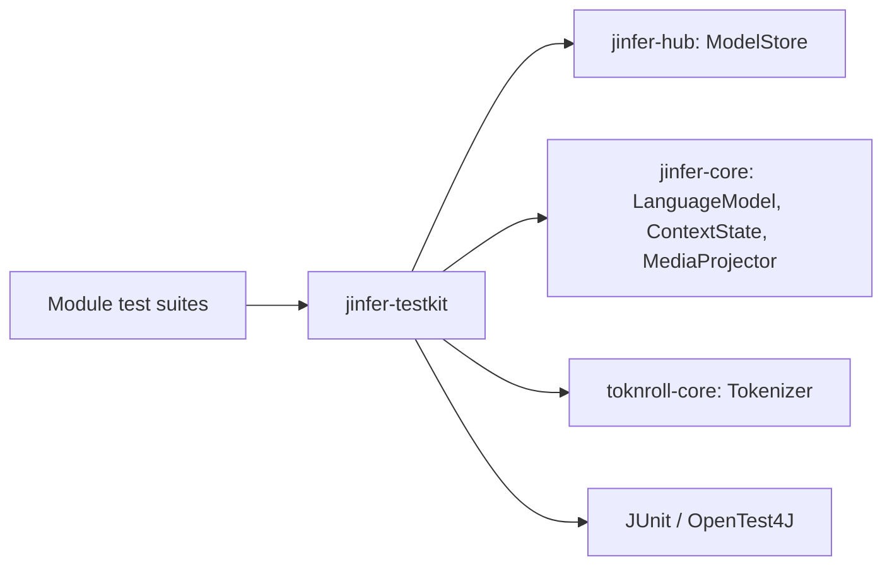

# jinfer-testkit — architecture summary

`jinfer-testkit` is the **shared test-fixture library** of the Jinfer build (package `com.qxotic.jinfer.testkit`,
6 classes, ~700 lines). It ships no runtime feature: every consumer depends on it with `<scope>test</scope>`, and it
is not published to Maven Central. It is a plain jar rather than a test-jar so that its own dependencies
(`jinfer-core`, `jinfer-hub`, `jota-core`, `jota-memory`, `toknroll-core`, JUnit Jupiter API, OpenTest4J) resolve
transitively for the tests that use it.

For class diagrams, flows and per-method detail see [ARCHITECTURE.md](ARCHITECTURE.md).

## Where it sits

It sits beside the stack rather than in it: it depends downward on `jinfer-core` (model/state/batch contracts),
`jinfer-hub` (`ModelStore`) and `toknroll` (`Tokenizer`), and is consumed by the test suites of nearly every other
jinfer module, from model ports (llama, lfm2/3, gemma4, qwen3/3.5, parakeet, kokoro, ...) to integrations
(chat, cli, server, langchain4j, spring-ai).

## Main classes

| Class | What it gives a test |
|---|---|
| `TestModels` | `require(ref)` / `find(ref)` / `fixture(name)`: checkpoints and media resolved locally, **never downloaded** |
| `TestLanguageModel` | A weightless `LanguageModel` that always predicts `'x'`, with a byte-level `TOKENIZER` and a working `CheckpointCodec` |
| `LastRowPrefill` | Asserts a `Batch.Outputs.LAST` prefill matches an `Outputs.ALL` one over prompt + 8 decode steps |
| `MediaProjectorContract` | Asserts the `MediaProjector` contract (row count, chunk shape/dtype/lifetime, determinism, argument checks) |
| `ProcessRss` | Current JVM resident set in KB on Linux/macOS/Windows, for memory-footprint gates |
| `SystemProperty` | Try-with-resources override of a system property, restored on close |

## Key flows

- **Model lookup (`TestModels`)**: the ref must be pinned (a `:QUANT` or an exact `.gguf` file name) or it is
  rejected. A `-Djinfer.testModel.<last-segment>=<path>` override wins (stale overrides fail loudly); otherwise
  `ModelStore.standard()` (jinfer cache, then Hugging Face hub cache), then a `models/` directory next to the git
  checkout. A miss aborts the test (`TestAbortedException`, i.e. skipped) with the fix in the message — or fails it
  under `-Djinfer.test.requireModels=true`. `-Djinfer.test.noModels=true` makes any lookup an error, enforcing a
  model-free suite.
- **Protocol tests without weights (`TestLanguageModel`)**: states store token ids in an arena; `ingest` writes ids
  and advances the context; logits are a fixed 256-float vector peaked at `'x'`; checkpoint capture/restore copies
  token rows. This lets chat/server/CLI/integration tests exercise sessions, caching and streaming cheaply.
- **Contract checkers**: `LastRowPrefill.run` creates a state, ingests the prompt batches, then reads logits and
  ingests a fixed token for 8 steps; results from `LAST` and `ALL` passes are compared after warm-up runs (JIT tiers
  move logits), with the tolerance widened to the drift a prompt split causes. `MediaProjectorContract` projects twice,
  checks every chunk inside the sink, checks chunks expire after `project` returns, and compares the runs bitwise.

## Design choices

- **Lookup only, no network**: tests never download; absence is a skip by default and a failure in the CI gate.
- **Pinned refs**: a repo without a quant is refused because assertions are calibrated on a specific quant.
- **Injectable seams**: package-private overloads take the store and property source as functions, so
  `TestModelsTest` runs without global state.
- **Shared contracts over per-port harnesses**: model ports call one checker instead of re-implementing partial ones;
  they check shape, not numerics (those stay in each port's oracle tests).
- **Bounded subprocess waits** in `ProcessRss`: output goes to a temp file so a hung child cannot block the read.
- **No SPI**: nothing is registered in `META-INF/services`; all entry points are static methods or direct
  instantiation.
