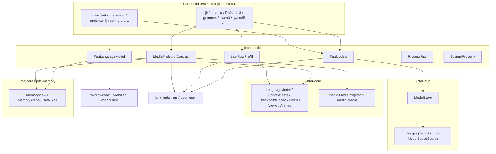
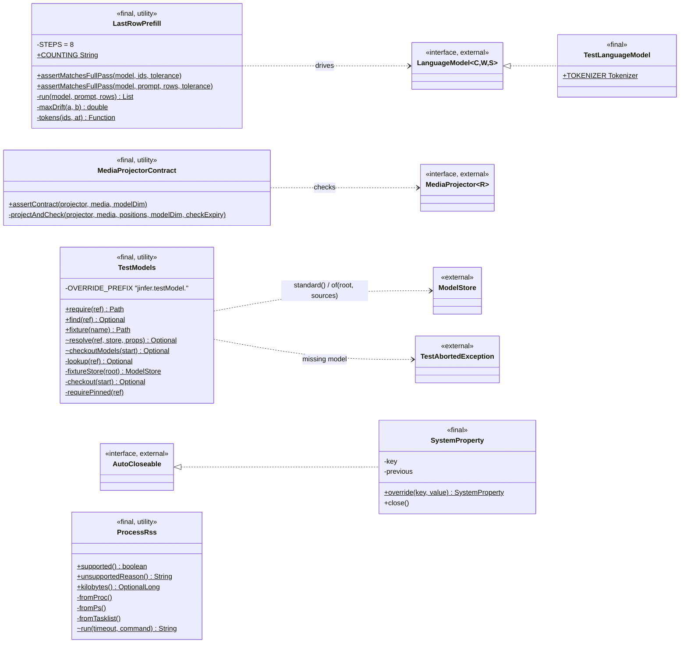
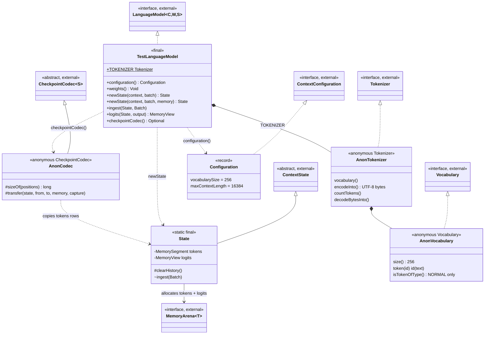
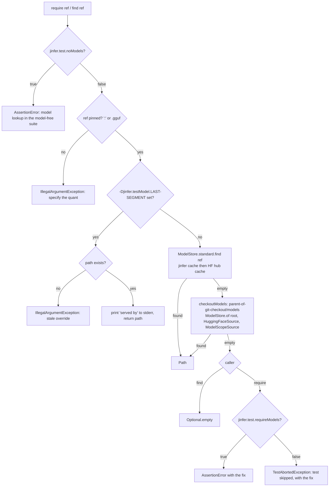
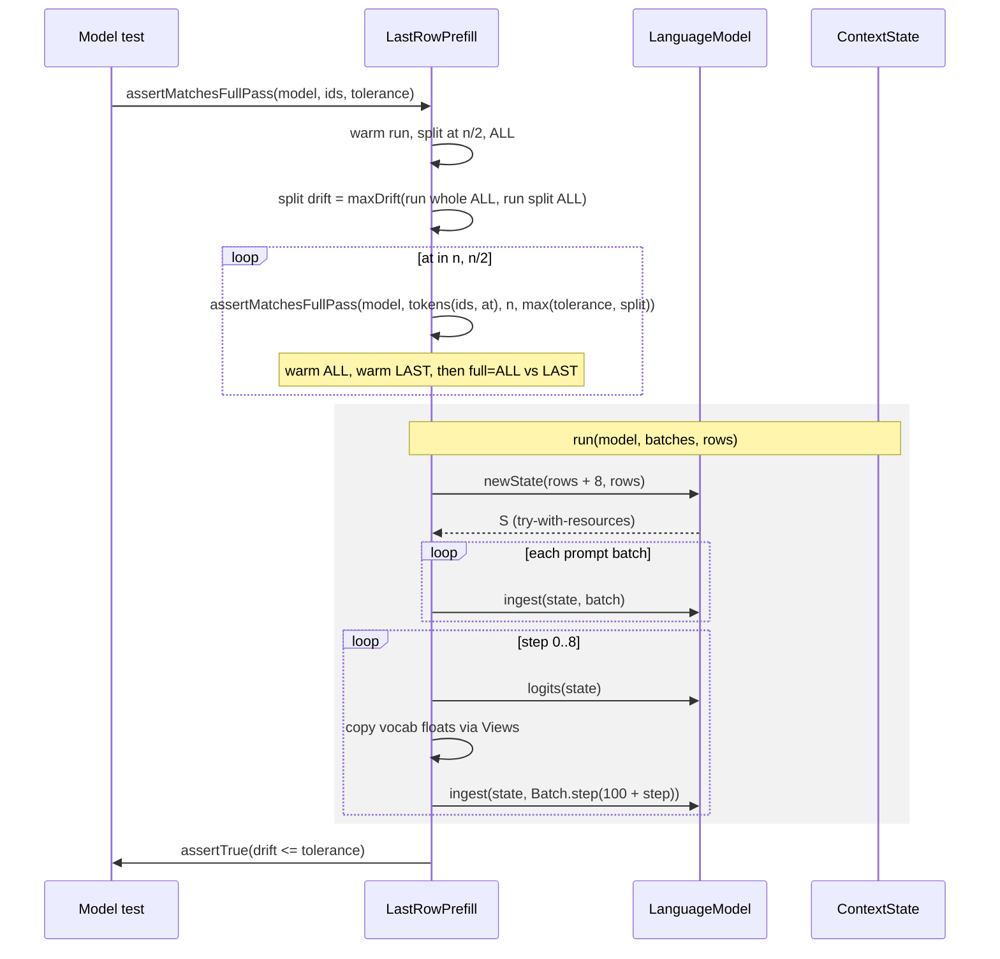
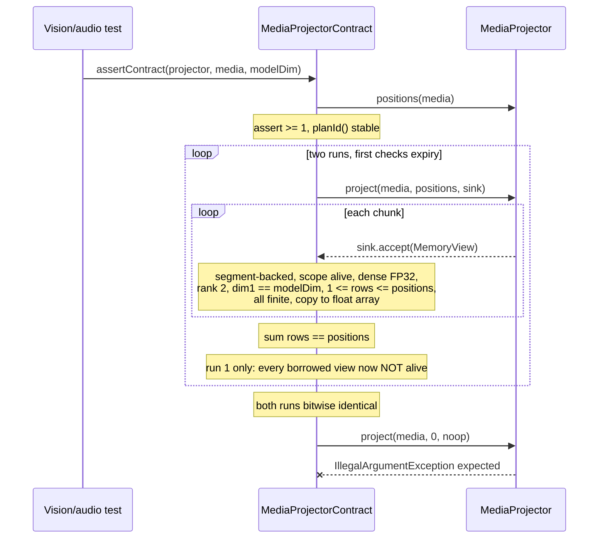
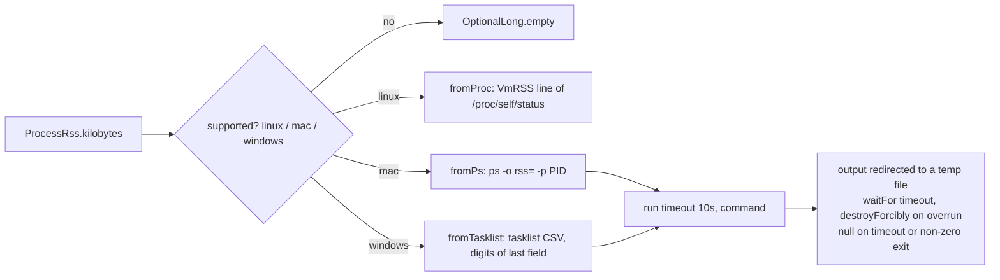

# jinfer-testkit — class architecture

Package `com.qxotic.jinfer.testkit` (6 public classes, ~700 lines). Shared **test fixtures** for the Jinfer build:
checkpoint lookup by ref (never a download), a weightless `LanguageModel`, two reusable contract checkers
(last-row prefill, `MediaProjector`), and two small process utilities (resident set size, scoped system property).
It is packaged as a plain jar (not a test-jar) so its dependencies resolve transitively; every consumer declares it
with `<scope>test</scope>`, so it never reaches a shipped artifact. Not published to Maven Central.

Format: **Mermaid**. Legend: `..|>` implements; `--|>` extends; `-->` holds/uses; `..>` creates/depends;
classes marked `<<external>>` live outside this package. There is **no SPI registration** (`META-INF/services`)
in this module: every class is called statically or instantiated directly by tests.

1. [Position in the build](#1-position-in-the-build)
2. [Class diagrams](#2-class-diagrams) — 2a overview, 2b `TestLanguageModel`
3. [Model resolution — `TestModels`](#3-model-resolution--testmodels)
4. [Contract checker — `LastRowPrefill`](#4-contract-checker--lastrowprefill)
5. [Contract checker — `MediaProjectorContract`](#5-contract-checker--mediaprojectorcontract)
6. [Process utilities — `ProcessRss`, `SystemProperty`](#6-process-utilities)
7. [Consumers](#7-consumers)

| Class | Role |
|---|---|
| `TestModels` | The one place tests acquire checkpoints, by ref (`repo:QUANT` or `repo/file.gguf`). Lookup-only via `ModelStore`; abort/fail policy driven by system properties; per-ref path override; `fixture(name)` for media under `test-fixtures/` |
| `TestLanguageModel` | Weightless `LanguageModel<Configuration, Void, State>` that always emits `'x'`; byte-level 256-token `TOKENIZER`; nested `Configuration` record, `State` (extends `ContextState`), anonymous `CheckpointCodec` |
| `LastRowPrefill` | Contract check: a prefill built with `Batch.Outputs.LAST` must produce the same logits (within tolerance) as `Batch.Outputs.ALL`, over the prompt and 8 forced decode steps; `COUNTING` prompt constant |
| `MediaProjectorContract` | Contract check for any `MediaProjector`: row count = `positions`, dense FP32 `[rows, modelDim]` finite chunks, chunk lifetime scoped to `project`, chunk-size bound, determinism, rejection of `maxChunkSize=0` |
| `ProcessRss` | This JVM's resident set size in KB: `/proc/self/status` (Linux), `ps` (macOS), `tasklist` (Windows); empty elsewhere |
| `SystemProperty` | `AutoCloseable` override of one system property, restored (or cleared) on `close()` |

---

## 1. Position in the build

`pom.xml` dependencies: `toknroll-core`, `jinfer-core`, `jota-core`, `jota-memory`, `jinfer-hub`,
`junit-jupiter-api`, `opentest4j` (JUnit assertions and `TestAbortedException` are used from *main* sources).

---

## 2. Class diagrams

### 2a. Overview

All classes are `final`; the static-utility ones (`TestModels`, `LastRowPrefill`, `MediaProjectorContract`,
`ProcessRss`) have a private constructor.

### 2b. `TestLanguageModel` and its nested types

Behaviour verified in the code:

- `newState(context, batch)` uses `Arenas.newCrossThreadMemoryArena()` and passes `owns = true`; the arena overload
  passes `owns = false`.
- `State` allocates `context * 4` bytes of token ids and a 256-float logits view (`Views.allocateF32`) whose index
  `'x'` is set to `1.0` once: the model always prefers `'x'`.
- `ingest` runs `state.ingest(batch)` under `state.exclusively(...)`: it writes the `Batch.Input.Tokens` ids at
  `position()` and calls `advanceContext(batch.count(), batch.outputs())`. `logits(state, output)` returns the same
  fixed view for any output.
- `clearHistory()` zero-fills the token buffer. The codec stores `positions * Integer.BYTES` bytes and copies the
  `[from, to)` slice of `tokens` to/from the checkpoint segment, so checkpoint/restore protocols can be tested.
- `TOKENIZER` is byte-level: encoding emits the UTF-8 bytes (`b & 255`), decoding writes token ids back as bytes;
  every id is `StandardTokenType.NORMAL`.

---

## 3. Model resolution — `TestModels`

A ref **must be pinned**: its last `/` segment contains `:` (quant form, e.g. `unsloth/gemma-4-E2B-it-GGUF:Q8_0`) or
ends with `.gguf` (exact companion file, e.g. `.../mmproj-F32.gguf`); otherwise `IllegalArgumentException`.

Notes:

- `find(ref)` under `jinfer.test.requireModels=true` delegates to `require`, so a probe also fails on absence.
- The git checkout is found by walking up from the working directory to the first directory containing `.git`
  (file or directory, so worktrees count).
- `fixture(name)` resolves `<checkout>/test-fixtures/<name>` (or relative to the cwd if no checkout); a missing file
  raises `TestAbortedException`, or `AssertionError` under `jinfer.test.requireModels`.
- Package-private overloads `require/resolve/fixture(..., store, props)` inject the store and property source so
  `TestModelsTest` runs in memory without touching global state.

---

## 4. Contract checker — `LastRowPrefill`

Checks that a model which skips work for non-final rows when `Batch.Outputs.LAST` is requested still yields the same
logits, KV caches and histories as a pass with `Batch.Outputs.ALL`.

- `tokens(ids, at)` yields a `Function<Batch.Outputs, List<Batch>>`: `[0, at)` and `[at, n)` as
  `Batch.Input.Tokens` batches, empty parts dropped. With `at = n/2` the second batch starts mid-context and reads
  what a skipping first batch wrote.
- Each comparison runs both modes once untimed first ("a cold JIT tier alone moves logits by up to 0.3").
- `COUNTING` is the string `"1, 2, ..., 400"`, a prompt any length can be cut from.

---

## 5. Contract checker — `MediaProjectorContract`

The checker validates the *shape* of the contract only; per-port numerics stay in each port's own tests. Its
Javadoc advises keeping toy dimensions asymmetric (a projector-dim == vision-dim toy hid a Qwen3.5 merger bug).

---

## 6. Process utilities

- Any `IOException`/`RuntimeException` yields empty; `InterruptedException` re-sets the interrupt flag and yields
  empty. Gates use `unsupportedReason()` to `assume` the check away on other platforms.
- Output goes to a file rather than a pipe so the wait stays bounded even if a child keeps stdout open.

`SystemProperty.override(key, value)` sets the property (or clears it when `value` is null), remembers the previous
value, and `close()` restores it or clears it if there was none. Nested overrides unwind in order through
try-with-resources.

---

## 7. Consumers

Modules whose test sources import each class (grep of `com.qxotic.jinfer.testkit.<Class>`):

| Class | Used by |
|---|---|
| `TestModels` | almost every model and integration module: llama, lfm2, lfm3, gemma4, gemma-embedding2, qwen3, qwen35, mellum, maple, nemotronh, inflect2, kokoro, parakeet, decision, native, cli, server, langchain4j, spring-ai (+ autoconfigure, starter), examples |
| `TestLanguageModel` | jinfer-chat, jinfer-cli, jinfer-server, jinfer-langchain4j, jinfer-spring-ai |
| `LastRowPrefill` | jinfer-gemma4, jinfer-lfm2, jinfer-lfm3 |
| `MediaProjectorContract` | jinfer-gemma4, jinfer-lfm2, jinfer-qwen35 |
| `SystemProperty` | jinfer-chat, jinfer-parakeet, jinfer-qwen35 |
| `ProcessRss` | jinfer-langchain4j |

The module's own tests (`TestModelsTest`, `SystemPropertyTest`, `ProcessRssTest`) cover ref pinning, overrides,
abort-vs-fail policy, checkout fixture lookup, property restoration and the bounded process wait.
