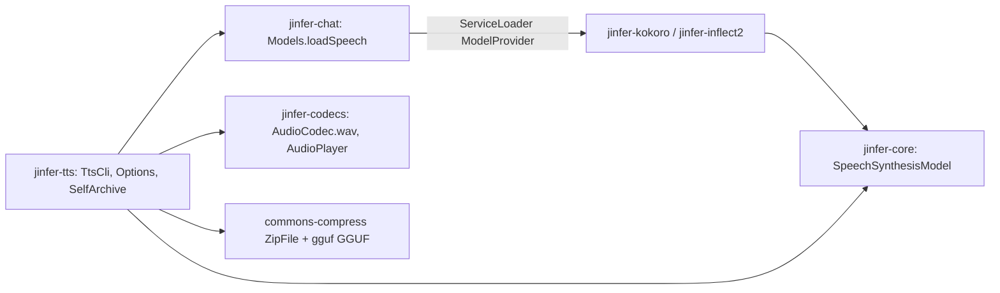

# jinfer-tts — architecture summary

`jinfer-tts` is the generic **text-to-speech command line and GraalVM native executable** of jinfer. It turns a
sentence into a WAV file, or plays it, with any speech model that the `jinfer-models-all` aggregate puts on the
classpath (currently Kokoro and Inflect). It holds no model or kernel code and is not published to Maven Central;
it is a thin application over the `Models.loadSpeech` façade. Details and all diagrams: [ARCHITECTURE.md](ARCHITECTURE.md).

## Where it sits

Compile dependencies: `jinfer-core`, `jinfer-chat`, `jinfer-codecs`, `gguf`, `commons-compress`. Runtime:
`jinfer-models-all` (all providers), `jam-native`, `jam-vector` (kernel back-ends). The module registers no SPI of
its own; it only consumes `ModelProvider` through `Models`.

## The three classes

| Class | What it does |
|---|---|
| `TtsCli` | `main`: parse, run, map errors to exit codes (2 bad command line, 1 I/O, the player's own status for `AudioPlayer.Failed`). `run`: open the archive if needed, `--list` entries, otherwise resolve companions, load the model, synthesize, clean up. |
| `Options` | Immutable `record` of the command line, with `parse` (validation: unknown flags, duplicate model or companion, `--with NAME=SOURCE` form, positive finite `--speed`, `--play` xor `--stream`) and `usage`. |
| `SelfArchive` | Reads a ZIP appended to the executable (or to a file given by `--archive`). Resolves Unix symlink entries safely (cycle/depth limit 8, no escape with `..`), accepts only `STORED` entries, returns `Entry(name, offset, size)` data ranges, bounded positional channels and temp-file extraction. |

## Key flows

1. **Source resolution.** A model or companion is a filesystem path or a `z://<entry>` in the self-archive. With
   no model given, `z://default.gguf` is used, so a packaged executable needs only `--text`.
2. **Companions** (`--with voice=…`, `--with lexicon=…`) are passed as `Map<String, Path>`. Archived companions
   are extracted to temp files (`jinfer-tts-*`) and deleted in `finally`. `Models` checks the names against the
   provider's `companionFiles()` (Kokoro: `voice`, Inflect: `lexicon`).
3. **Model loading.** A file goes through `Models.loadSpeech(Path, arena, companions)`. An archived model is
   *not* extracted: `TtsCli` reads its GGUF header through a bounded entry channel, then calls
   `Models.loadSpeech(fileChannel, gguf, offset, size, archivePath, arena, companions)`, which rebases the header
   with `gguf.at(offset)` so the provider maps weights in place from the executable. `ModelLoader` refuses tensor
   data that is not 4-byte aligned, so the packager must pad.
4. **Output.** Default: `model.speak` → `AudioCodec.wav` → file, printing the realtime factor. `--play`: full
   waveform then `AudioPlayer.play`. `--stream`: `AudioPlayer.stream` plays clips as they are synthesized and the
   CLI prints the time to first audio. `--speed` becomes `SpeechOptions.speed(x)`, else `SpeechOptions.NONE`.

## Notable design choices

- **Single-file distribution:** the native image plus a ZIP overlay (`zip -0`, appended, `zip -A`) bundles model and
  voices; the `native` Maven profile also embeds Inflect's `lexicon.bin` as a classpath resource when available,
  avoiding the espeak-ng fallback.
- **Zero-copy weights:** STORED entries + positional `FileChannel` reads + rebased GGUF offsets mean the model is
  mapped directly from the executable; only small companions are copied out.
- **Runtime-adaptive memory:** `Arenas.newCrossThread()` (shared arena on the JVM, auto arena in a native image) with
  best-effort `Arenas.close` in `finally`.
- **Model-agnostic:** architecture dispatch is entirely in `Models`/`ModelProvider`; adding a speech model to
  `jinfer-models-all` makes it usable here with no change to this module.
