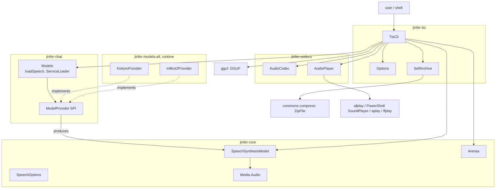
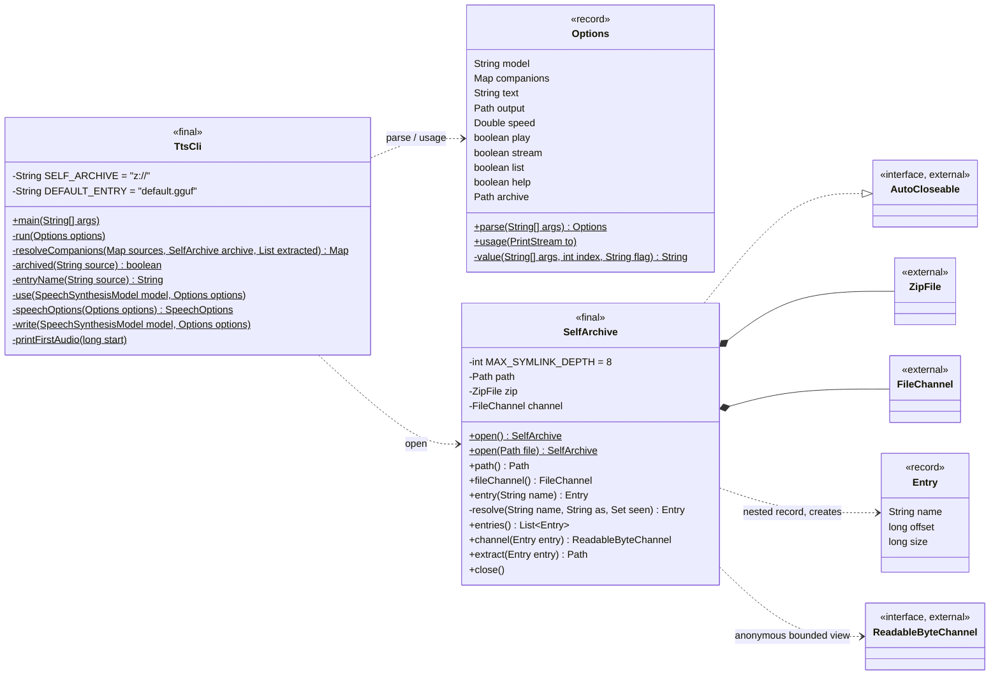
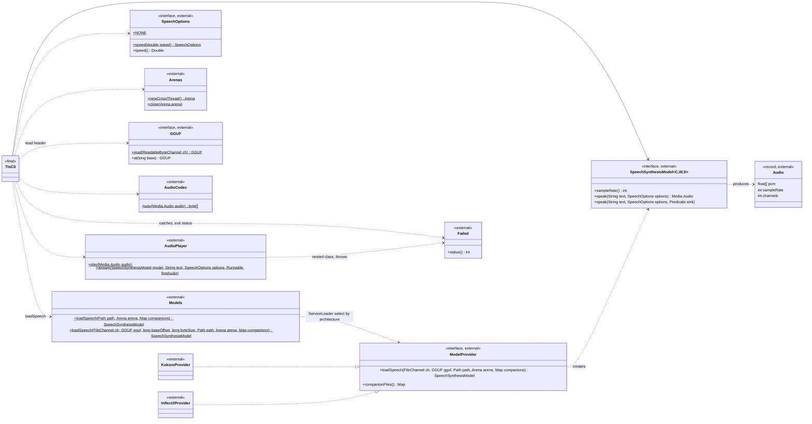
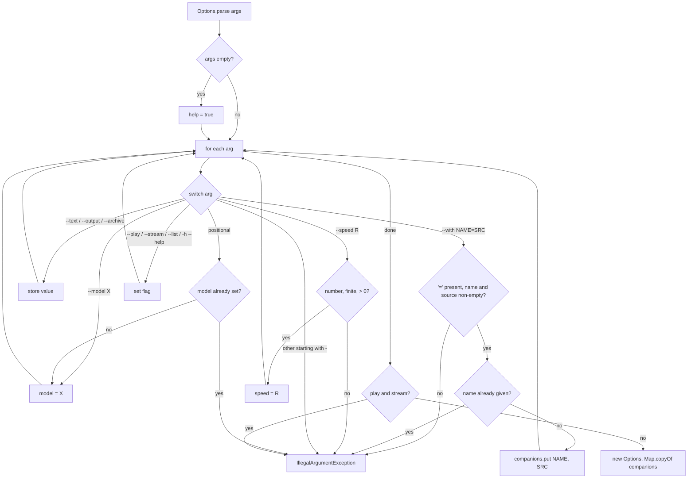
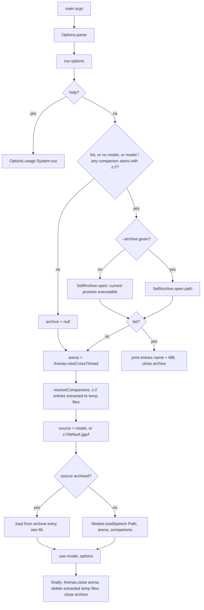
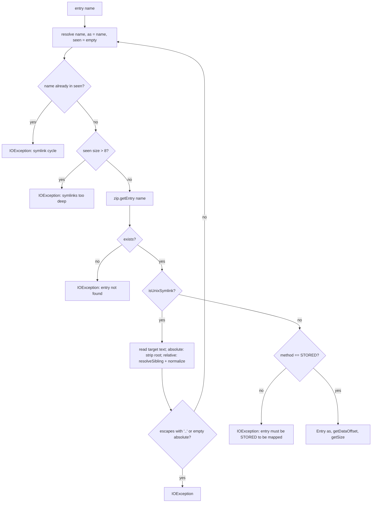
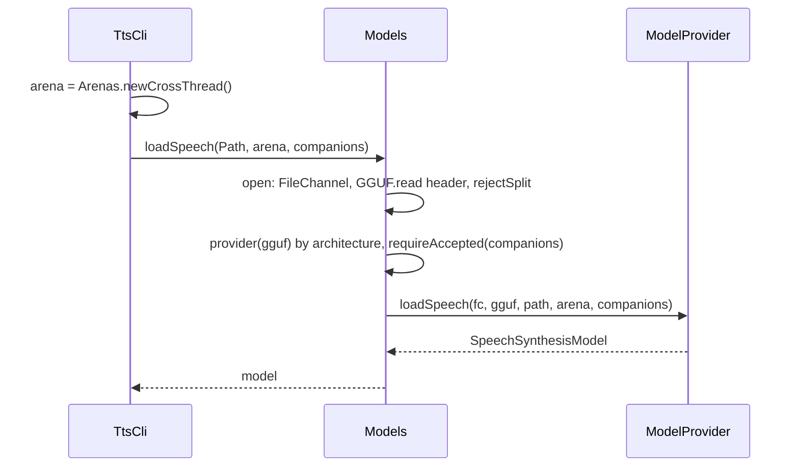
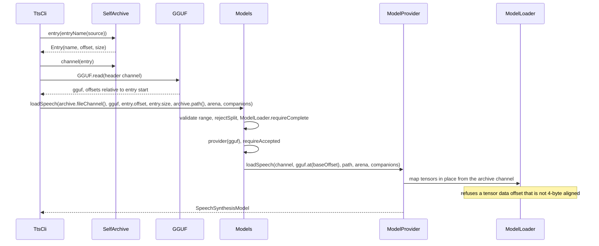
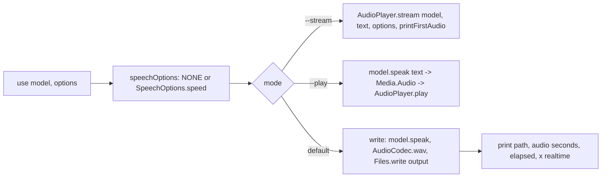
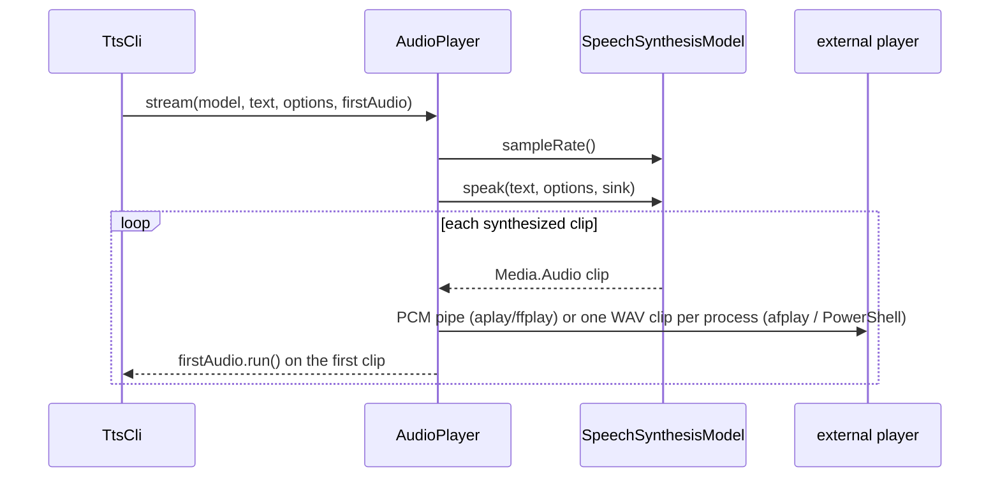

# jinfer-tts — class architecture

Package `com.qxotic.jinfer.tts` (3 classes, ~450 lines). It is the generic **text-to-speech command line and
native executable** (`jinfer-tts`, main class `TtsCli`) for every speech model that `jinfer-models-all` puts on the
classpath (today `jinfer-kokoro` and `jinfer-inflect2`). It contains no model code: it parses options, locates the
model and its companions (plain files or `z://` entries of a ZIP overlay appended to the executable), loads the model
through `Models.loadSpeech` and writes, plays or streams the audio. The module is not published to Maven Central.

Format: **Mermaid**. Legend: `..|>` implements; `--|>` extends; `-->` holds/uses; `..>` creates/depends;
classes marked `<<external>>` live outside this package.

1. [Position in the stack](#1-position-in-the-jinfer-stack)
2. [Class diagrams](#2-class-diagrams) — 2a module classes, 2b external contracts
3. [Command-line parsing](#3-command-line-parsing-options)
4. [Main flow](#4-main-flow-ttscli)
5. [Self-archive](#5-self-archive-selfarchive) — 5a entry resolution, 5b reading an entry
6. [Loading sequences](#6-loading-sequences) — 6a file model, 6b archived model
7. [Output modes](#7-output-modes)
8. [Build, packaging and resources](#8-build-packaging-and-resources)

| Class | Role |
|---|---|
| `TtsCli` | `public final` entry point: `main` maps failures to exit codes; `run` decides whether an archive is needed, lists entries or loads the model, resolves companions, owns the `Arena` and temp files; `use` / `write` drive synthesis |
| `Options` | package-private `record`: the parsed command line (`model`, `companions`, `text`, `output`, `speed`, `play`, `stream`, `list`, `help`, `archive`); `parse(String[])`, `usage(PrintStream)` |
| `SelfArchive` | package-private `AutoCloseable`: a ZIP (commons-compress `ZipFile`) read from the executable itself or a named file; resolves symlinks, demands `STORED` entries, exposes bounded positional channels and temp-file extraction |
| `SelfArchive.Entry` | nested `record (name, offset, size)`: the data range of one usable entry inside the archive file |

There is **no SPI registration** in this module (no `META-INF/services`): it is a consumer of the
`ModelProvider` SPI, which `Models` discovers through `ServiceLoader` in `jinfer-chat`.

---

## 1. Position in the jinfer stack

Dependencies from `pom.xml`: compile `jinfer-core`, `jinfer-codecs`, `jinfer-chat`, `gguf`, `commons-compress`;
runtime `jinfer-models-all` (all model providers), `jam-native`, `jam-vector` (kernel back-ends).

---

## 2. Class diagrams

### 2a. Module classes

### 2b. External contracts used by `TtsCli`

`AudioPlayer.Failed` extends `IOException`. Provider companion names (from `companionFiles()`):
`KokoroProvider` → `voice`, `Inflect2Provider` → `lexicon`. `Models` rejects companions the selected provider does
not accept (`requireAccepted`).

---

## 3. Command-line parsing (`Options`)

Defaults: `text = "Hello world."`, `output = output.wav`, `speed = null` (model default), all flags false.
A missing flag value raises `IllegalArgumentException("<flag> needs a value")`.

---

## 4. Main flow (`TtsCli`)

Error mapping in `main`:

| Exception | Message | Exit |
|---|---|---|
| `IllegalArgumentException`, `UnsupportedOperationException` | `jinfer-tts: <msg>` + usage on stderr | 2 |
| `AudioPlayer.Failed` | `jinfer-tts: <msg>` | `playerQuit.status()` |
| `UncheckedIOException` | cause's message | 1 |
| `IOException` | message | 1 |

Because `Failed` extends `IOException`, it is caught first. Without a model argument the CLI reads
`z://default.gguf`, so a packaged executable speaks with no arguments other than options (note: with *no* arguments
at all, `help` is true and usage is printed).

---

## 5. Self-archive (`SelfArchive`)

The executable may carry a ZIP appended at its end. `SelfArchive.open()` finds the executable through
`ProcessHandle.current().info().command()`; `open(Path)` reads any file (used for `--archive`, e.g. under
`java -jar`). Both a commons-compress `ZipFile` (directory and metadata) and a raw read-only `FileChannel`
(data access) are opened on the same file; `close()` closes both via try-with-resources.

### 5a. Entry resolution (`entry` → `resolve`)

The returned `Entry` keeps the *requested* name (`as`) but the data range of the final target. `entries()`
enumerates all ZIP entries, keeps those that resolve (silently skipping the rest) and sorts by name — this is what
`--list` prints.

### 5b. Reading an entry

- `channel(Entry)` returns an anonymous `ReadableByteChannel` with its own `position`, reading via positional
  `FileChannel.read(dst, offset + position)` and clamping the buffer limit to the remaining entry size. It never
  moves or closes the shared archive channel; `close()` only marks the view closed.
- `extract(Entry)` copies the view to `Files.createTempFile("jinfer-tts-", suffix)` (suffix from the entry's
  extension, else `.bin`), deletes it on failure or if its size differs from `entry.size()`.

Models are **not** extracted: their weights are mapped in place from the archive file (section 6b). Companions
(voice, lexicon) are extracted because providers take them as `Path`s.

---

## 6. Loading sequences

### 6a. Model from a file

### 6b. Model from a `z://` archive entry

`gguf.at(baseOffset)` rebases the header's offsets onto the enclosing file, so the provider reads weights straight
from the executable. `archive.path()` is passed as the model path, which is where a port looks for sibling files.

Resource lifetime: the `Arena` from `Arenas.newCrossThread()` is `Arena.ofShared()` on the JVM and `Arena.ofAuto()`
in a native image (where `close` is a no-op); `Arenas.close` is the best-effort release in `finally`, after which the
extracted companion temp files are deleted.

---

## 7. Output modes

`--play` waits for the whole waveform (`speak` concatenates the clips via `Media.Audio.concat`) before playback;
`--stream` starts after the first chunk. Audio seconds in `write` are `pcm.length / channels / sampleRate`.

---

## 8. Build, packaging and resources

- `pom.xml`: `maven-shade-plugin` produces `target/jinfer-tts.jar`; properties `jinfer.image.name=jinfer-tts` and
  `jinfer.image.mainClass=com.qxotic.jinfer.tts.TtsCli` feed the shared native-image recipe.
- Profile `native`: `maven-resources-plugin` copies `lexicon.bin` from
  `${jinfer.models}/hf.co/remixerdec/Inflect-Nano-v2-GGUF` into the classes (when present) so Inflect can find its
  lexicon on the classpath; then `native-maven-plugin` builds the image. `Makefile` delegates `make native` to the
  repository root Makefile (`NATIVE_MODULE=jinfer-tts`), output in `bin/`.
- Self-archive packaging (README): `zip -0` the payload, append it to the executable, then `zip -A` to fix offsets.
  Entries must be `STORED`; model data must land 4-byte aligned.
- Tests: `OptionsTest`, `SelfArchiveTest` (in `src/test`).
