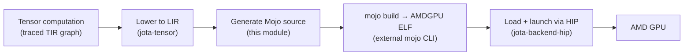
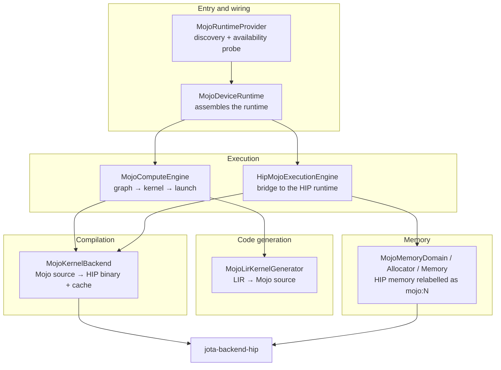

# jota-backend-mojo — architecture overview

A short, high-level tour of the Mojo backend.
For class-level diagrams and details, see [ARCHITECTURE.md](ARCHITECTURE.md).

> **Note: "Mojo" here is not a Maven mojo.**
> In the Maven world, a *mojo* (Maven plain Old Java Object) is a plugin goal; this module has nothing to do with that.
> Here, **Mojo** is the programming language from **Modular**: Python-like syntax, systems-level performance, compiled through MLIR/LLVM, with GPU support.
> This backend uses Mojo to write kernels for **AMD GPUs**.

> **What is HIP?**
> **HIP** (Heterogeneous-compute Interface for Portability) is AMD's GPU programming API and runtime, part of the **ROCm** stack.
> It is AMD's counterpart to CUDA: device memory allocation, host↔device copies, loading compiled GPU code objects (`hipModuleLoad`), and launching kernels on a grid of blocks and threads.
> Jota already has a HIP backend (`jota-backend-hip`), and the Mojo backend reuses it for everything except kernel generation and compilation.

---

## 1. The idea in one picture



The backend is a **code generator plus compiler driver**, layered on top of the HIP backend:

- **Mojo-specific:** turning a LIR graph into Mojo source, running the `mojo` compiler, extracting the GPU binary, and caching it.
- **Borrowed from HIP:** device memory, copies, module loading, kernel launch, and the device itself.
- **Own identity:** tensors on this backend report device `mojo:N` (not `hip:N`), so users can select Mojo explicitly.

---

## 2. Main parts



| Part | What it does |
|---|---|
| **Entry and wiring** | `MojoRuntimeProvider` is found by Java's `ServiceLoader`. It reports Mojo as available only if HIP works, the `mojo` CLI runs, and the small JNI library `libjota_mojo` loads. `MojoDeviceRuntime` then builds the engines. |
| **Execution** | `MojoComputeEngine` receives a tensor graph, lowers it, generates and compiles a kernel, prepares inputs, outputs and arguments, and launches it. `HipMojoExecutionEngine` hands it HIP's memory and kernel services. |
| **Code generation** | `MojoLirKernelGenerator` writes one Mojo kernel function per graph. Simple loop nests become one GPU thread per element. Anything else (for example reductions) falls back to a single thread running the loops. |
| **Compilation** | `MojoKernelBackend` runs `mojo build --emit asm` for the device's GPU architecture, pulls the ELF out of the assembly, finds the entry symbol, caches the result on disk, and gives a binary program to HIP. |
| **Memory** | Thin wrappers around HIP memory whose only job is to label buffers as belonging to the Mojo device. |

---

## 3. Life of a kernel

1. A lazy tensor is materialized; its traced graph reaches `MojoComputeEngine.execute`.
2. The graph is lowered to LIR and optimized by the shared jota pipeline.
3. A SHA-256 of the LIR text gives a **cache key**.
4. Mojo source is generated for that key.
5. If a compiled ELF is already cached (in memory or on disk), it is reused; otherwise `mojo` compiles it, which takes seconds.
6. Inputs that live on another device are copied to the GPU, and outputs are allocated.
7. HIP loads the code object and launches the kernel with 256 threads per block.
8. The result stays on the GPU, or is copied back to host memory when the default runtime expects that.

---

## 4. Worked example: TIR → LIR → Mojo → HIP

The listings in 4.1 to 4.3 are real output from the jota renderers and `MojoLirKernelGenerator`, captured on 2026-11-22.
Only the cache key was fixed to a short placeholder (`0123abcd-mojo-lir-v13`) instead of a SHA-256.
Section 4.4 was also run for real, with Mojo 1.2.0, 0.26.2 and 0.26.1 targeting `gfx1103`; 4.6 shows the GPU assembly they produce.
Section 4.5 is a sketch, because launching needs a GPU.

### 4.0 Java: the tensor computation

```java
Tensor x = Tensor.of(new float[] {1, 2, 3, 4, 5, 6}).view(Shape.of(2, 3));
Tensor y = Tensor.of(new float[] {6, 5, 4, 3, 2, 1}).view(Shape.of(2, 3));

// Lazy: records a TIR graph instead of computing.
Tensor r = Tracer.trace(List.of(x, y), t -> t.get(0).multiply(t.get(1)).add(1.0f));

r.materialize(); // on device mojo:0 → MojoComputeEngine.execute(graph, inputs)
```

### 4.1 TIR: tensor-level IR (`TIRTextRenderer`)

Whole-tensor operations, no loops and no memory addresses yet.

```mlir
module {
  func.func @tensor_ops(%in0: tensor<2x3xfp32>, %in1: tensor<2x3xfp32>, %out0: tensor<2x3xfp32>) {
    %0 = arith.mulf %in0, %in1 : fp32
    %1 = arith.constant 1.0f : fp32
    %out0 = arith.addf %0, %1 : fp32
  }
}
```

### 4.2 LIR: loop-level IR (`TIRToLIRLowerer` + `LIRStandardPipeline`, rendered by `LIRTextRenderer`)

Explicit loops, byte offsets (`i0 * 12 + i1 * 4` for a row-major 2×3 fp32 layout), loads and stores.
Multiply and add are fused into one loop body.

```mlir
module {
  func.func @lir_ops(%0: memref<2x3xfp32>, %1: memref<2x3xfp32>, %2: memref<2x3xfp32>) {
    %3 = arith.constant 0 : index
    %4 = arith.constant 2 : index
    %5 = arith.constant 1 : index
    scf.for %i0 = %3 to %4 step %5 {
      %6 = arith.constant 3 : index
      scf.for %i1 = %3 to %6 step %5 {
        %7 = arith.constant 12 : index
        %8 = arith.muli %i0, %7 : index
        %9 = arith.constant 4 : index
        %10 = arith.muli %i1, %9 : index
        %11 = arith.addi %8, %10 : index
        %12 = memref.load %0[%11] : memref<2x3xfp32>
        %13 = memref.load %1[%11] : memref<2x3xfp32>
        %14 = arith.mulf %12, %13 : fp32
        %15 = arith.constant 1.0f : fp32
        %16 = arith.addf %14, %15 : fp32
        memref.store %16, %2[%11] : memref<2x3xfp32>
        scf.yield
      }
      scf.yield
    }
  }
}
```

### 4.3 Mojo: generated kernel (`MojoLirKernelGenerator`, saved as `kernel.mojo`)

This is the Mojo 1.x dialect (`MojoDialect.V1`), the default.
For Mojo 0.26.x the generator writes `from std.gpu import …` and declares the kernel with `fn` instead of `def`; everything else is the same.

The loop nest is perfect (starts at 0, step 1, no reduction), so the generator takes the **parallel path**.
Each GPU thread computes its global id `gid`, splits it back into `(i0, i1)`, and handles one element.
The byte offsets from the LIR are divided by 4 (the size of `Float32`) to get element indices.

```mojo
from max.gpu import block_idx, block_dim, thread_idx
from std.math import cos, log2, sin, sqrt, tan, tanh

def hip_lir_0123abcd_mojo_lir_v13(
    input0: UnsafePointer[Float32, MutAnyOrigin],
    input1: UnsafePointer[Float32, MutAnyOrigin],
    output0: UnsafePointer[Float32, MutAnyOrigin],
    scratch_ptr: UInt64
):
    var gid = (Int(block_idx.x) * Int(block_dim.x)) + Int(thread_idx.x)

    # Calculate total elements
    var total_0 = 1
    total_0 *= 2
    total_0 *= 3

    # GPU-parallel linear mapping
    var linear_1 = gid
    if linear_1 < total_0:
        var temp_2 = linear_1
        var i1 = temp_2 % 3
        temp_2 = temp_2 // 3
        var i0 = temp_2 % 2
        temp_2 = temp_2 // 2
        output0[Int((((i0 * 12) + (i1 * 4))) // 4)] = ((input0[Int((((i0 * 12) + (i1 * 4))) // 4)] * input1[Int((((i0 * 12) + (i1 * 4))) // 4)]) + Float32(1.0))
```

`scratch_ptr` is always in the signature.
Here it is unused (passed as 0), because this graph needs no temporary buffers.

### 4.4 Mojo → AMDGPU binary (`MojoKernelBackend`)

`MojoKernelBackend` adds a small `main()` to the source and saves the result as `kernel.wrapper.mojo`.
The `main()` asks Mojo to compile the kernel for HIP (Mojo 1.x dialect shown):

```mojo
# ... kernel source from 4.3 ...

from std.sys import has_accelerator
from max.gpu.host import DeviceContext

def main() raises:
    if not has_accelerator():
        return
    var ctx = DeviceContext(api="hip")
    _ = ctx.compile_function[hip_lir_0123abcd_mojo_lir_v13]()
```

The wrapper differs per Mojo release (`MojoDialect`, picked from `mojo --version`):

| Mojo | GPU module | `main` header | compile call |
|---|---|---|---|
| 0.26.1 | `std.gpu.host` | `def main():` | `compile_function[fn, fn]()` |
| 0.26.2 | `std.gpu.host` | `def main() raises:` | `compile_function[fn, fn]()` |
| 1.x | `max.gpu.host` | `def main() raises:` | `compile_function[fn]()` |

It then runs the Mojo compiler for the GPU's architecture:

```bash
mojo build kernel.wrapper.mojo --emit asm --target-accelerator gfx1103 -o kernel.mojo.s
```

The assembly contains the GPU code object as an escaped string that starts with `\177ELF`.
The backend decodes it to `kernel.elf` and finds the real entry symbol with `llvm-nm` (saved as `kernel.entry`).
It then passes `KernelProgram.binary("hip", elf, entry)` on to the HIP backend.

### 4.5 HIP: load and launch (`jota-backend-hip`, JNI)

No HIP C++ source is generated: HIP receives the ready-made ELF.
The native side of `jota-backend-hip` does the equivalent of this (simplified sketch, error handling omitted):

```cpp
hipModule_t module;
hipModuleLoadData(&module, elf_bytes);                      // kernel.elf

hipFunction_t fn;
hipModuleGetFunction(&fn, module, entry_symbol);            // kernel.entry

// Arguments are in the order of the Mojo signature: input0, input1, output0, scratch_ptr.
void* d_in0;  void* d_in1;  void* d_out0;  uint64_t scratch = 0;
void* args[] = { &d_in0, &d_in1, &d_out0, &scratch };

// MojoComputeEngine: 256 threads per block, ceil(6 / 256) = 1 block.
hipModuleLaunchKernel(fn,
                      /*grid*/  1, 1, 1,
                      /*block*/ 256, 1, 1,
                      /*sharedMem*/ 0, stream, args, nullptr);
```

Threads 0 to 5 each write one element of `output0` (`x * y + 1` = `[7, 11, 13, 13, 11, 7]`).
Threads 6 to 255 fail the `linear_1 < total_0` check and do nothing.

### 4.6 The GPU machine code (AMDGPU assembly, gfx1103 / RDNA3)

This is what the GPU actually runs for the Mojo kernel in 4.3, compiled by **Mojo 0.26.1** (0.26.x dialect source).
It was produced by compiling `kernel.mojo` through Mojo's GPU compile API and printing the assembly (`_compile_code[fn, target = get_gpu_target["gfx1103"]()]().asm`).
The instruction words match the `.text` section of the `kernel.elf` built by the backend's normal `mojo build` path.
Only the symbol name differs, because the module name is part of the mangled name.
The `var`-based source produces exactly the same instructions as the earlier source without `var`.

```asm
; kernel arguments (kernarg segment, pointer in s[0:1]):
;   0x00 input0   0x08 input1   0x10 output0   0x18 scratch_ptr   0x2c hidden_group_size_x (u16)
; s2 = workgroup id x (block_idx.x), v0 = thread id x (thread_idx.x)

    s_load_b32      s3, s[0:1], 0x2c          ; load block_dim.x (hidden argument)
    v_mov_b32_e32   v1, 0
    s_waitcnt       lgkmcnt(0)
    s_and_b32       s3, s3, 0xffff            ; group size is a 16-bit field
    v_mad_u64_u32   v[2:3], null, s3, s2, v[0:1]   ; gid = block_dim.x * block_idx.x + thread_idx.x (64-bit)
    s_mov_b32       s2, exec_lo
    v_cmpx_gt_u64_e32 6, v[2:3]               ; if gid < total  (total = 2*3 folded to 6)
    s_cbranch_execz .LBB0_2                   ; no thread left in this wave → skip to the end
    s_load_b128     s[4:7], s[0:1], 0x0       ; input0, input1 pointers
    v_lshlrev_b64   v[0:1], 2, v[2:3]         ; byte offset = gid * 4
    s_load_b64      s[0:1], s[0:1], 0x10      ; output0 pointer
    s_waitcnt       lgkmcnt(0)
    v_add_co_u32    v2, vcc_lo, s4, v0        ; &input0[gid]
    v_add_co_ci_u32_e64 v3, null, s5, v1, vcc_lo
    v_add_co_u32    v4, vcc_lo, s6, v0        ; &input1[gid]
    v_add_co_ci_u32_e64 v5, null, s7, v1, vcc_lo
    global_load_b32 v2, v[2:3], off           ; a = input0[gid]
    global_load_b32 v3, v[4:5], off           ; b = input1[gid]
    v_add_co_u32    v0, vcc_lo, s0, v0        ; &output0[gid]
    v_add_co_ci_u32_e64 v1, null, s1, v1, vcc_lo
    s_waitcnt       vmcnt(0)
    v_fma_f32       v2, v2, v3, 1.0           ; a * b + 1.0 in ONE fused multiply-add
    global_store_b32 v[0:1], v2, off          ; output0[gid] = result
.LBB0_2:
    s_endpgm
```

(`s_delay_alu` scheduling hints are left out for readability.
The comments are added; the instructions are unchanged.)

Things to notice:

- **The index arithmetic disappears.**
  The generated Mojo splits `gid` into `(i0, i1)` and rebuilds the byte offset `i0*12 + i1*4`, then divides by 4.
  LLVM proves that this equals `gid` and keeps only a shift (`gid * 4`).
- **Multiply and add become one `v_fma_f32`.**
  This is fast, but a fused multiply-add rounds once instead of twice.
  Results can differ in the last bit from a backend that does a separate multiply and add.
- **Loop bounds are compile-time constants**, so `total_0 = 2 * 3` becomes the literal `6` in the bounds check.
- **`scratch_ptr` is never loaded**, because this graph has no scratch buffers.
- **Resource usage:** 6 vector registers, 10 scalar registers, wave32, no LDS (shared memory), no stack.
  The kernel is tiny and memory-bound.
- **The real entry symbol is mangled:** in `kernel.elf` it is `kernel_wrapper_hip_lir_0123abcduA6A6A_c23d6fae1d6079bf`, not `hip_lir_0123abcd_mojo_lir_v13`.
  This is why `MojoKernelBackend` reads the symbol table with `llvm-nm` before HIP calls `hipModuleGetFunction`.

**Mojo 1.2 output is slightly worse for this kernel.**
It does not prove that the rebuilt offset `(i0*12 + i1*4) // 4` equals `gid`.
Instead it computes the row and column with compare-and-select instructions, then rebuilds the byte offset (7 vector registers instead of 6):

```asm
    v_cmp_lt_u64_e32    vcc_lo, 2, v[2:3]                 ; i0 = (gid > 2) ? 1 : 0
    v_cndmask_b32_e64   v0, 0, -3, vcc_lo                 ; i1 = gid - 3*i0 ...
    v_cndmask_b32_e64   v1, 0, 0x3fffffff, vcc_lo
    v_add_co_u32        v0, s2, v0, v2
    v_add_co_ci_u32_e64 v1, null, v1, v3, s2
    v_cndmask_b32_e64   v2, 0, 12, vcc_lo                 ; i0 * 12
    v_lshlrev_b64       v[0:1], 2, v[0:1]                 ; i1 * 4
    v_add_co_u32        v4, vcc_lo, v0, v2                ; byte offset
    v_add_co_ci_u32_e64 v5, null, 0, v1, vcc_lo
```

The loads, the `v_fma_f32 … 1.0` and the store are the same.
This is a difference in the Mojo compilers, not in the generated source.
Emitting the element index directly (`gid`) for contiguous outputs, instead of splitting and rebuilding it, would remove this work on every version.

To reproduce, append this to the generated `kernel.mojo` and `mojo run` it; no GPU is needed.
For Mojo 1.2 (`pip install mojo==1.2.0 max-core==26.7.0`):

```mojo
from max.gpu.host.compile import _compile_code
from max.gpu.host import get_gpu_target

def main() raises:
    print(_compile_code[hip_lir_0123abcd_mojo_lir_v13, target = get_gpu_target["gfx1103"]()]().asm)
```

For Mojo 0.26.1 (`pip install mojo==0.26.1.0`), import from `std.gpu.host…` instead and write `def main():`.

`_compile_code` is an internal Mojo API (leading underscore) and may change between versions.
With ROCm installed, `llvm-objdump -d --mcpu=gfx1103 kernel.elf` disassembles the backend's real binary instead.

---

## 5. Requirements and status

- **Runtime:** Linux x86_64, ROCm/HIP with a supported AMD GPU, the `mojo` CLI on `PATH` (or set `jota.mojo.compiler`), and `libjota_mojo` (bundled in the JAR).
- **Mojo version:** Mojo **0.26.1, 0.26.2 and 1.x** are supported (tested with 1.2.0).
  The backend runs `mojo --version` once and generates the matching syntax (`MojoDialect`); `-Djota.mojo.version=0.26.1` overrides the detection.
  Mojo 1.x moved the GPU library into the MAX packages: install `mojo` **and** `max-core` (for example `pip install mojo==1.2.0 max-core==26.7.0`), otherwise every GPU build fails with "please install MAX for accelerator support".
  Known compiler limit: Mojo 0.26.1 cannot convert fp16 ↔ bf16 on AMD GPUs (fixed in 0.26.2).
- **Build:** enabled by the `-Pmojo` Maven profile.
- **Status:** experimental. Only one execution engine (HIP) exists. The JNI library is used only as an availability check.
  Reductions run on a single GPU thread.
- **Tuning knobs:** `jota.mojo.version` (skip `mojo --version` detection), `jota.mojo.target` (GPU arch, e.g. `gfx1103`), `jota.mojo.compile.flags`, `jota.mojo.compile.timeout.seconds`, `jota.mojo.kernel.summary` (prints compile/cache stats at exit).
