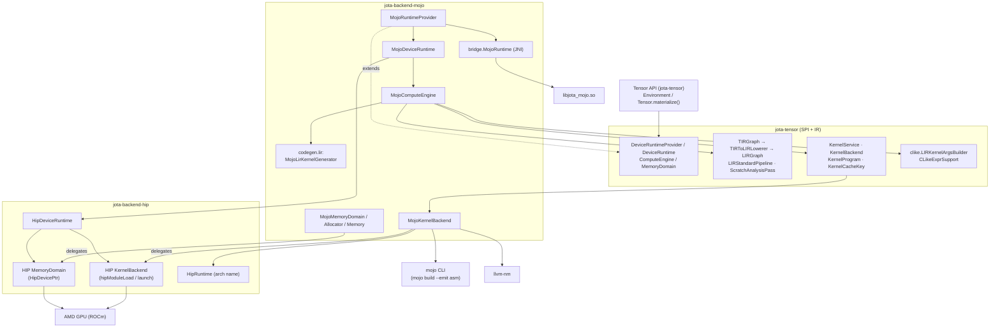
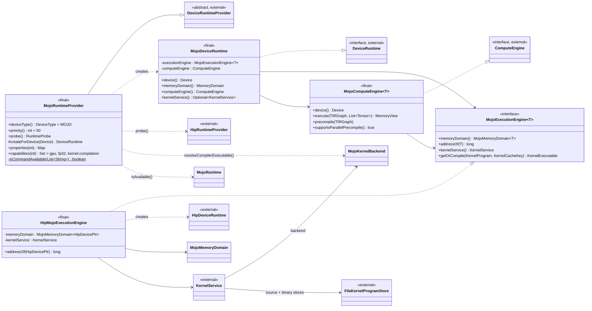
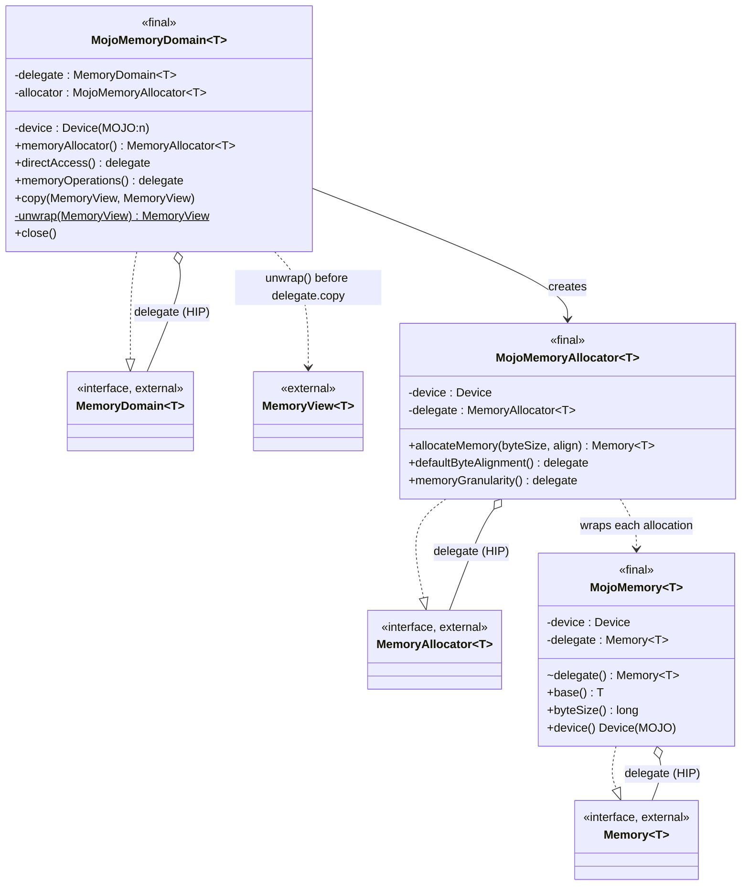
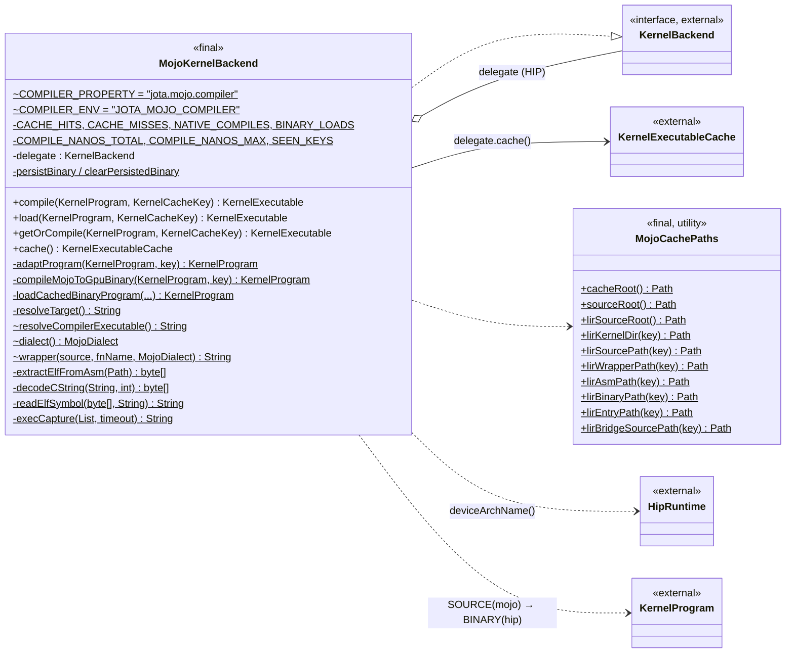
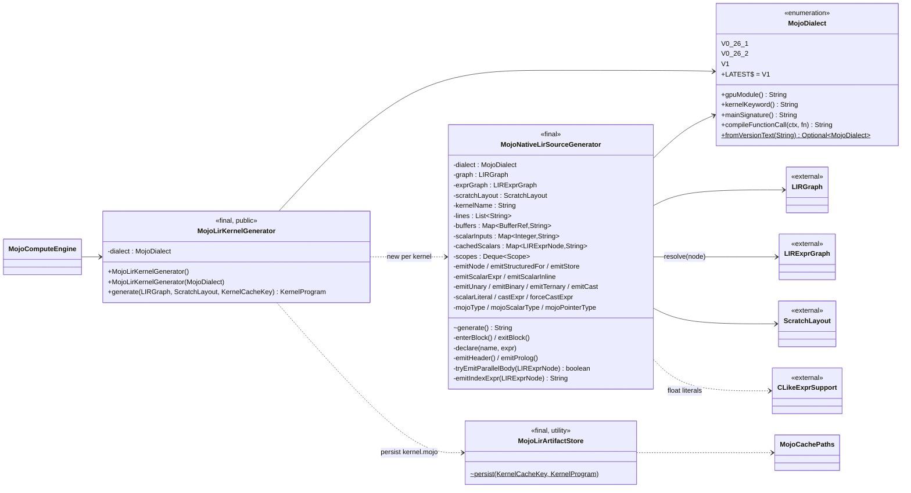
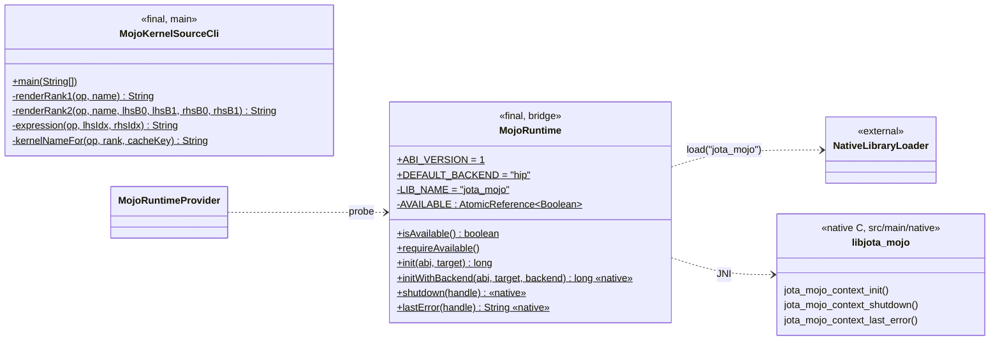
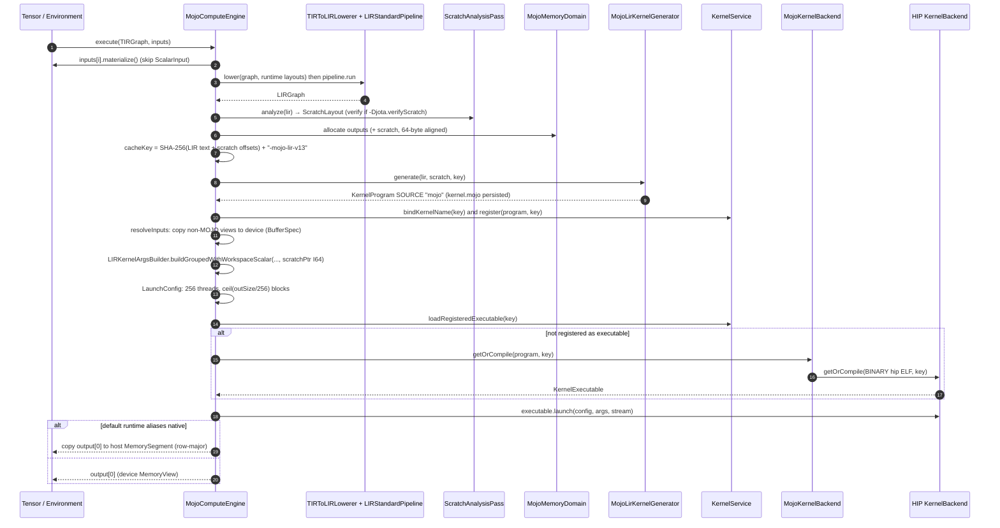
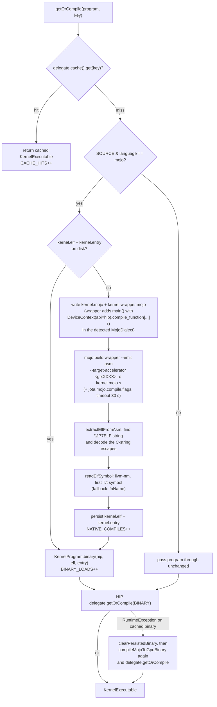
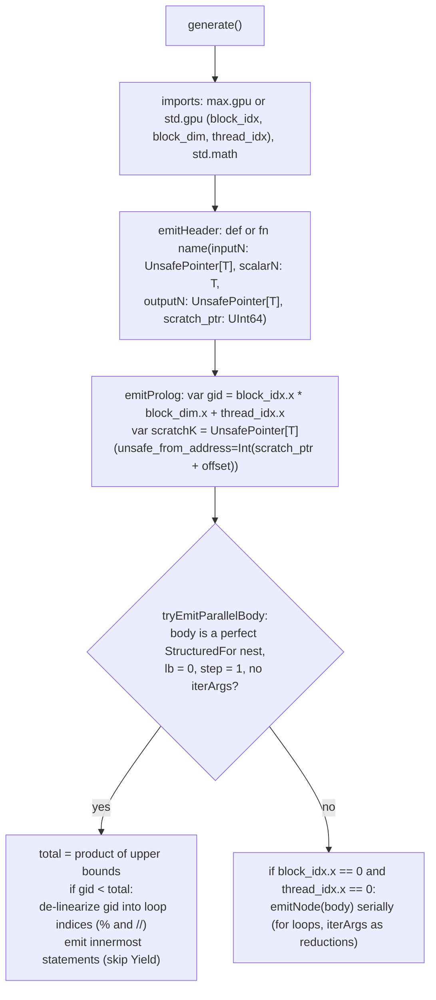
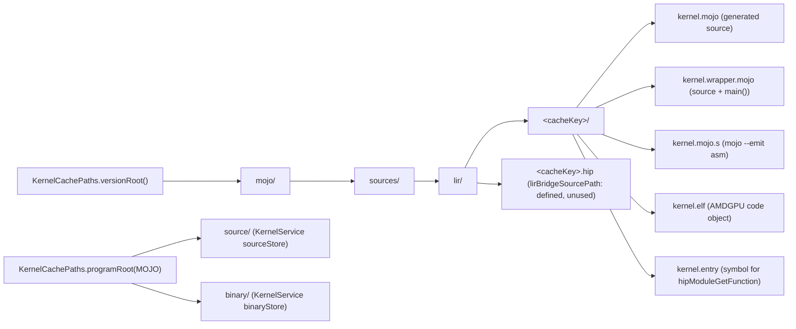

# jota-backend-mojo — class architecture

Packages `com.qxotic.jota.runtime.mojo` (+ `.bridge`, `.codegen`, `.codegen.lir`): 16 classes plus `package-info`, about 2.4k lines.
This is the **experimental Mojo backend** for Jota.
It registers a distinct device type `DeviceType.MOJO`.
Kernels are generated as **Mojo source** from the LIR graph, compiled by the `mojo` CLI to an AMDGPU ELF, and then **loaded and launched through the HIP backend** (`jota-backend-hip`).
Memory, streams and kernel launches are therefore HIP's.
The Mojo layer adds three things: a separate device identity, Mojo code generation, and the Mojo→ELF build step.

Format: **Mermaid**.
Legend: `..|>` implements, `--|>` extends, `-->` holds/uses, `..>` creates/depends, `o--` wraps (decorator).
Classes marked `<<external>>` live outside this module.

1. [Position in the jota stack](#1-position-in-the-jota-stack)
2. [Class diagrams](#2-class-diagrams): 2a runtime and SPI, 2b memory decorators, 2c kernel compilation, 2d code generation, 2e native bridge and tools
3. [Execution sequence](#3-execution-sequence-mojocomputeengineexecute)
4. [Mojo→GPU binary compilation](#4-mojo--gpu-binary-compilation)
5. [Code generation: LIR → Mojo source](#5-code-generation-lir--mojo-source)
6. [On-disk cache layout](#6-on-disk-cache-layout)
7. [Configuration knobs](#7-configuration-knobs)

| Class | Package | Role |
|---|---|---|
| `MojoRuntimeProvider` | `mojo` | `DeviceRuntimeProvider` SPI (ServiceLoader) for `DeviceType.MOJO`, priority 50. Its probe checks the HIP probe, then `mojo --version`, then that the JNI lib loads |
| `MojoDeviceRuntime` | `mojo` | `DeviceRuntime`: wires `HipMojoExecutionEngine` and `MojoComputeEngine` together |
| `MojoExecutionEngine<T>` | `mojo` | Package-private interface: memory domain, pointer→address, `KernelService`, `getOrCompile` |
| `HipMojoExecutionEngine` | `mojo` | The only implementation, built on `HipDeviceRuntime`. Wraps the HIP domain and kernel backend in Mojo decorators |
| `MojoComputeEngine<T>` | `mojo` | `ComputeEngine`: TIR→LIR→Mojo source, cache key, registration, arg building, launch config, launch |
| `MojoKernelBackend` | `mojo` | `KernelBackend` decorator over HIP's backend. Turns Mojo `SOURCE` programs into HIP `BINARY` (ELF) programs, with a disk cache and stats |
| `MojoMemoryDomain<T>` | `mojo` | `MemoryDomain` decorator. Changes the device identity to MOJO and unwraps `MojoMemory` before `copy` |
| `MojoMemoryAllocator<T>` | `mojo` | `MemoryAllocator` decorator that wraps every allocation in a `MojoMemory` |
| `MojoMemory<T>` | `mojo` | `Memory` decorator: HIP device pointer with a MOJO `Device` |
| `MojoCachePaths` | `mojo` | Static helpers for the on-disk cache layout (`<version>/mojo/sources/lir/<key>/…`) |
| `MojoLirKernelGenerator` | `codegen.lir` | Public entry point: `LIRGraph` + `ScratchLayout` + key → `KernelProgram.source("mojo", …)` |
| `MojoNativeLirSourceGenerator` | `codegen.lir` | Emits Mojo text from the LIR expression graph (parallel loop nest or serial fallback) |
| `MojoLirArtifactStore` | `codegen.lir` | Writes the generated `kernel.mojo` to the cache directory |
| `MojoDialect` | `codegen` | Enum `V0_26_1` / `V0_26_2` / `V1`: the Mojo syntax to generate (GPU module `std.gpu` or `max.gpu`, `fn` or `def`, wrapper `main` and `compile_function` form), parsed from `mojo --version` |
| `MojoKernelSourceCli` | `codegen` | Standalone `main()`: template generator for f32 rank-1/rank-2 elementwise kernels (`add/sub/mul/div/relu`), with `--mojo-version` |
| `MojoRuntime` | `bridge` | JNI bindings to `libjota_mojo` (`initWithBackend`, `shutdown`, `lastError`). In main code only `isAvailable()` is used, by the provider probe |

---

## 1. Position in the jota stack

The module has **no GPU driver code of its own**.
Device work goes through HIP, and kernel builds go through an external process (`mojo`).
The JNI library `libjota_mojo` is checked for availability only.
Its context API is exposed in Java but nothing in the main code calls it.

---

## 2. Class diagrams

### 2a. Runtime and SPI wiring

`MojoDeviceRuntime`'s constructor always builds a `HipMojoExecutionEngine`.
`MojoExecutionEngine<T>` is the seam where a non-HIP engine (CUDA, for example) could be added later, but HIP is the only implementation today.

`HipMojoExecutionEngine` builds a `KernelService` with these parts:

- `backend`: `new MojoKernelBackend(hipRuntime.kernelService().backend())`
- `sourceStore`: `FileKernelProgramStore(KernelCachePaths.programRoot(MOJO)/source)`
- `binaryStore`: `FileKernelProgramStore(KernelCachePaths.programRoot(MOJO)/binary)`

### 2b. Memory decorators (device identity)

All three classes follow the same pattern.
Each is a **thin decorator** that only changes `device()` to the `MOJO` device of the same index, so tensors report `mojo:N` instead of `hip:N`.
Each constructor rejects a delegate that is already a Mojo wrapper, so wrappers never nest.
`copy` unwraps `MojoMemory` views back to the raw HIP memory, because the HIP domain cannot copy a foreign `Memory` type.

### 2c. Kernel compilation (`MojoKernelBackend`)

`MojoKernelBackend` is a **program adapter**.
Any `KernelProgram` with `kind=SOURCE` and `language="mojo"` is turned into `KernelProgram.binary("hip", elf, entrySymbol, options)` before it reaches the HIP backend.
Other programs, such as HIP C++ source or a precompiled binary, pass through unchanged.
If an executable is already in the in-memory cache, the backend returns it before adapting anything.
If a cached on-disk ELF fails to load, the backend deletes it, rebuilds it once, and tries again.

### 2d. Code generation (`codegen.lir`)

The entry point name is `hip_lir_<cacheKey with '-'→'_'>`.
`MojoComputeEngine` builds its generator with `MojoKernelBackend.dialect()`, which is read once from `-Djota.mojo.version` or else from `mojo --version` (default `MojoDialect.LATEST`).
The program is `KernelProgram.source("mojo", src, fnName, {})`.

### 2e. Native bridge and stand-alone tool

`MojoKernelSourceCli` is not part of the runtime path.
It is a separate generator for hand-written-style kernels (`--operation add|sub|mul|div|relu --rank 1|2 --dtype f32 --output <file>` and optional `--{lhs,rhs}-broadcast{0,1}`).
Kernels from this tool use `global_idx.x` and explicit strides.

---

## 3. Execution sequence (`MojoComputeEngine.execute`)

`precompile(TIRGraph)` takes the same path up to `getOrCompile`, using the static layouts from `TensorInput.layout()`.
It swallows any `RuntimeException`, because some graphs need layouts that are only known at run time.

---

## 4. Mojo → GPU binary compilation

The GPU target is resolved in this order: `-Djota.mojo.target`, then `JOTA_MOJO_TARGET`, then `HipRuntime.deviceArchName(currentDevice)`, then the hard-coded default `gfx1103`.
With `-Djota.mojo.kernel.summary=true`, a shutdown hook prints the cache and compile counters.

---

## 5. Code generation: LIR → Mojo source

| LIR node | Mojo emission |
|---|---|
| `Block` / `StructuredFor` / `Store` / `Yield` | statements / `for i in range(lb, ub, step):` / `buf[Int(off // size)] = v` / iterArg update |
| `SConst` | typed literal (`Float32(…)`, `Int64(…)`, `True`). NaN becomes `0.0` and ±Inf becomes ±max finite |
| `SInput` / `SRef` / `SLoad` / `SFromIndex` | `scalarN` / name / `buf[idx]` / forced cast of the index expression |
| `SUnary` | `-x`, abs via ternary, `exp` as `e ** x`, `log` as `log2(x)·ln2`, `sqrt`, trig (FP64 computed in Float32), `1/x`, `not`, `~` |
| `SBinary` | arithmetic, min/max via ternary, `**`, logical ops via truthiness, bitwise ops, masked shifts, `>>>` via `UInt32`/`UInt64` |
| `STernary` / `SCast` | `(t if c else f)` / `TypeName(x)` |
| `IConst` / `IVar` / `IBinary` / `IFromScalar` | integer index arithmetic (`//`, `%`, `<<`, …) / `Int(scalar)` |

A scalar subexpression used more than once (`useCount > 1`, unary/binary/ternary/cast) is hoisted into a temporary `tN` and cached by node identity.
Every local is declared with `var`, which Mojo 1.x requires.
A `var` lives only in its indented block, so the generator tracks declared names per block and drops cached temporaries when their block ends; a value needed again after a loop is recomputed instead of read from a temporary declared inside the loop.
Literals and shift amounts carry the operand's type (`Float32(1.0) / x`, `x << Int32(...)`), and a Bool becomes a float through `Int` (`Float32(Int(b))`), because Mojo 1.x no longer mixes these implicitly.

---

## 6. On-disk cache layout

---

## 7. Configuration knobs

| Key | Kind | Default | Used by |
|---|---|---|---|
| `jota.mojo.compiler` / `JOTA_MOJO_COMPILER` | sysprop / env | `mojo` | `MojoKernelBackend`, provider probe |
| `jota.mojo.target` / `JOTA_MOJO_TARGET` | sysprop / env | HIP device arch, else `gfx1103` | `MojoKernelBackend.resolveTarget` |
| `jota.mojo.compile.flags` | sysprop | empty (quote-aware tokenized) | extra `mojo build` args |
| `jota.mojo.compile.timeout.seconds` | sysprop | `30` | `mojo build` timeout |
| `jota.mojo.kernel.summary` | sysprop | `false` | shutdown-hook stats line |
| `jota.verifyScratch` | sysprop | `false` | `MojoComputeEngine` scratch verification |
| `jota.mojo.version` | sysprop | output of `mojo --version` | `MojoKernelBackend.dialect()`: which `MojoDialect` to generate |

Provider-reported properties: `device.name=Mojo (via HIP)`, `device.vendor=Modular`, `device.kind=gpu`, `mojo.execution.backend=hip`.
