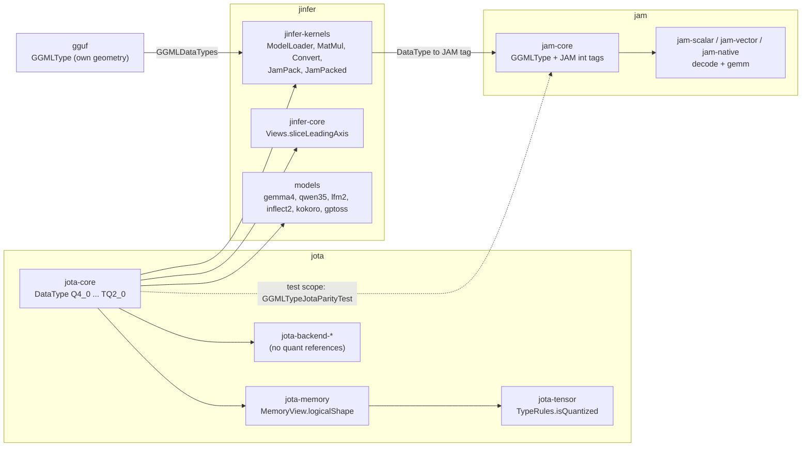

# jota-core — Quantization

This page explains the block-quantized `DataType` constants of jota-core: what each format stores, which values it can represent, and how one block decodes to `float`.
It then lists every place in the other modules that refers to these types, and why.

See [ARCHITECTURE-summary.md](ARCHITECTURE-summary.md) for the general concepts (DataType, Shape, Stride, Layout, View) and [ARCHITECTURE.md](ARCHITECTURE.md) for the class diagrams.

1. [What jota-core knows about a quantized type](#1-what-jota-core-knows-about-a-quantized-type)
2. [Common building blocks](#2-common-building-blocks)
3. [The formats, one by one](#3-the-formats-one-by-one)
4. [Summary table](#4-summary-table)
5. [References from other modules](#5-references-from-other-modules)

---

## 1. What jota-core knows about a quantized type

A quantized `DataType` stores `elementsPerBlock()` logical values in one block of `byteSize()` bytes.
Inside the block, one or more **scales** are mixed with packed low-bit **codes**; the decoded value is roughly `scale × code` (sometimes `+ min`).

jota-core itself knows only the **geometry** of a block, never its content:

```java
DataType Q8_0 = blockType("q8_0", 32, 34);   // 32 elements in a 34-byte block
// layout() = MemoryLayout.sequenceLayout(34, JAVA_BYTE).withName("q8_0")
// isFloatingPoint() = false, isIntegral() = false
```

This geometry is enough for everything jota-core does:

- **Shapes.** The physical (storage) shape divides the innermost logical dimension by `elementsPerBlock()`: `Q8_0.physicalShape((4096, 4096)) = (4096, 128)`, and `logicalShape` multiplies it back.
- **Sizes.** `byteSizeFor(physicalShape)` = number of blocks × `byteSize()`.
- **Addressing.** Strides count whole blocks, so `byteOffset = Σ coord[i] × stride[i] × byteSize()` is the same formula as for dense types.
  Slicing, transposing and reshaping move whole blocks and never split one.

Decoding the bytes of a block is the job of the kernels (jam, jinfer-kernels).
The formulas below come from those decoders (`jam/jam-scalar/.../Decode.java` and `jinfer/jinfer-kernels/.../MatMul.java`), which match GGML's reference code.

---

## 2. Common building blocks

All multi-byte fields are **little-endian**, like GGUF.

| Name | Size | Meaning |
|---|---|---|
| `f16` | 2 bytes | IEEE half float (`Float.float16ToFloat`), used for most scales `d`, `m`, `dmin` |
| `i8` | 1 byte | signed byte, `-128 … 127` |
| `u32` | 4 bytes | unsigned 32-bit int, used as a bit field (`qh`) |
| nibble | 4 bits | two codes per byte: **low** nibble `b & 0xF`, **high** nibble `b >> 4` |
| `e8m0` | 1 byte | a power of two: `2^(e − 127)` (MXFP4) |
| `ue4m3` | 1 byte | unsigned FP8 with 4 exponent and 3 mantissa bits (NVFP4) |
| `e2m1` | 4 bits | FP4 code (MXFP4, NVFP4) |
| trit | base-3 digit | a value in `{0, 1, 2}`, five packed per byte (ternary formats) |

### The nibble split of the 32-element formats

Q4_0, Q4_1, Q5_0, Q5_1 and MXFP4 pack 32 codes into 16 bytes `qs[0..15]`.
Element `i < 16` is the **low** nibble of `qs[i]`; element `16 + i` is the **high** nibble of the same byte `qs[i]`.
So one byte holds elements `i` and `i + 16`, not two neighbours.

```text
qs[0] = 0x9C   →  element 0 = 0xC = 12,  element 16 = 0x9 = 9
```

### The E2M1 (FP4) table

The 4-bit float code `q` of MXFP4 and NVFP4 decodes through a table.
The kernels store it **doubled** as integers, `kv[q]`, and put the factor ½ into the scale:

| `q` | 0 | 1 | 2 | 3 | 4 | 5 | 6 | 7 | 8 | 9 | 10 | 11 | 12 | 13 | 14 | 15 |
|---|---|---|---|---|---|---|---|---|---|---|---|---|---|---|---|---|
| `kv[q]` | 0 | 1 | 2 | 3 | 4 | 6 | 8 | 12 | 0 | −1 | −2 | −3 | −4 | −6 | −8 | −12 |
| E2M1 value `kv[q] / 2` | 0 | 0.5 | 1 | 1.5 | 2 | 3 | 4 | 6 | −0 | −0.5 | −1 | −1.5 | −2 | −3 | −4 | −6 |

### Base-3 packing of trits

The ternary formats (TQ1_0, PTQ1_0) pack 5 trits `t0 … t4` into one byte.
The encoder forms `x = 81·t0 + 27·t1 + 9·t2 + 3·t3 + t4` (0 … 242) and stores `b = ⌈x · 256 / 243⌉`, a base-3 fixed-point fraction.
The decoder brings trit `n` to the top and reads it:

```text
trit_n(b) = (((b · 3^n) mod 256) · 3) >> 8
```

Example: trits `(2, 0, 1, 1, 0)` → `x = 174` → `b = 184`; decoding `184` gives `2, 0, 1, 1, 0` again.
The decoded value is always `(trit − 1) · d`, so a trit means `−d`, `0` or `+d`.

---

## 3. The formats, one by one

In every formula, `i` is the element index inside the block and `q` its unsigned code.

### 3.1 Q8_0 — 8-bit, symmetric (32 elements, 34 bytes, 8.5 bits/element)

```text
offset  0      2                                   34
        | d f16 | qs[32]  i8                         |
```

```text
v[i] = d · qs[i]                    qs[i] ∈ −128 … 127
```

Values: `d · {−128, …, 127}`.
Example: `d = 0.5` (bytes `00 38`), `qs[0] = −3` → `v[0] = −1.5`.

### 3.2 Q4_0 — 4-bit, symmetric (32 elements, 18 bytes, 4.5 bits/element)

```text
offset  0      2                    18
        | d f16 | qs[16] nibbles     |
```

```text
q = i < 16 ? qs[i] & 0xF : qs[i − 16] >> 4
v[i] = d · (q − 8)
```

Values: `d · {−8, …, 7}` (16 levels, zero included).
Example: `d = 0.25`, `qs[0] = 0x9C` → `v[0] = (12 − 8) · 0.25 = 1.0`, `v[16] = (9 − 8) · 0.25 = 0.25`.

### 3.3 Q4_1 — 4-bit, with offset (32 elements, 20 bytes, 5 bits/element)

```text
offset  0      2      4                    20
        | d f16 | m f16 | qs[16] nibbles     |
```

```text
q = (same nibble split as Q4_0)
v[i] = d · q + m
```

Values: `m + d · {0, …, 15}`: an affine range that does not need to be centred on zero.

### 3.4 Q5_0 — 5-bit, symmetric (32 elements, 22 bytes, 5.5 bits/element)

```text
offset  0      2         6                    22
        | d f16 | qh u32  | qs[16] nibbles     |
```

The 4 low bits come from the nibbles (same split as Q4_0); bit `i` of `qh` is the fifth bit of element `i`.

```text
q = nibble(i) | (((qh >> i) & 1) << 4)          q ∈ 0 … 31
v[i] = d · (q − 16)
```

Values: `d · {−16, …, 15}`.

### 3.5 Q5_1 — 5-bit, with offset (32 elements, 24 bytes, 6 bits/element)

```text
offset  0      2      4         8                    24
        | d f16 | m f16 | qh u32  | qs[16] nibbles     |
```

```text
q = nibble(i) | (((qh >> i) & 1) << 4)
v[i] = d · q + m
```

Values: `m + d · {0, …, 31}`.

### 3.6 Q4_K — 4-bit k-quant (256 elements, 144 bytes, 4.5 bits/element)

A **super-block** of 256 elements is split into 8 sub-blocks of 32.
Each sub-block `j` has its own 6-bit scale `sc[j]` and 6-bit min `mn[j]`, which are themselves scaled by the two f16 super-scales.

```text
offset  0      2         4               16                    144
        | d f16 | dmin f16 | scales[12]    | qs[128] nibbles     |
```

The 8 scales and 8 mins (6 bits each, 96 bits) are packed in 12 bytes `s[0..11]`:

```text
j < 4 :  sc[j] = s[j]   & 63                         mn[j] = s[j+4] & 63
j ≥ 4 :  sc[j] = (s[j+4] & 0xF) | ((s[j−4] >> 6) << 4)
         mn[j] = (s[j+4] >> 4)  | ((s[j]   >> 6) << 4)
```

The codes are read in 4 groups of 64 elements; group `g` uses bytes `qs[32g … 32g+31]`.
Element `64g + e` (`e < 32`) is the low nibble of `qs[32g + e]` (sub-block `2g`); element `64g + 32 + e` is its high nibble (sub-block `2g + 1`).

```text
v = d · sc[j] · q − dmin · mn[j]                 q ∈ 0 … 15,  sc, mn ∈ 0 … 63
```

### 3.7 Q5_K — 5-bit k-quant (256 elements, 176 bytes, 5.5 bits/element)

Q4_K plus 32 bytes `qh` holding the fifth bit of every code.

```text
offset  0      2         4               16         48                    176
        | d f16 | dmin f16 | scales[12]    | qh[32]   | qs[128] nibbles     |
```

For group `g` and `e < 32`: the low half (element `64g + e`) takes bit `2g` of `qh[e]`, the high half (element `64g + 32 + e`) takes bit `2g + 1`.

```text
q = nibble | (fifth bit << 4)                    q ∈ 0 … 31
v = d · sc[j] · q − dmin · mn[j]
```

### 3.8 Q6_K — 6-bit k-quant (256 elements, 210 bytes, 6.5625 bits/element)

16 sub-blocks of 16 elements, each with a signed 8-bit scale.

```text
offset  0                 128          192             208     210
        | ql[128] nibbles  | qh[64]      | scales[16] i8  | d f16 |
```

The block is two halves of 128 elements; half `h` uses `ql[64h …]`, `qh[32h …]` and `scales[8h …]`.
Inside a half, for `l < 32`:

| element (in half) | low 4 bits | high 2 bits |
|---|---|---|
| `l` | `ql[l] & 0xF` | `qh[l] & 3` |
| `32 + l` | `ql[32 + l] & 0xF` | `(qh[l] >> 2) & 3` |
| `64 + l` | `ql[l] >> 4` | `(qh[l] >> 4) & 3` |
| `96 + l` | `ql[32 + l] >> 4` | `(qh[l] >> 6) & 3` |

```text
q  = low4 | (high2 << 4)                         q ∈ 0 … 63
sc = scales[8h + 2·(element_in_half / 32) + l / 16]       signed
v  = d · sc · (q − 32)
```

Values: `d · sc · {−32, …, 31}`.

### 3.9 MXFP4 — OCP microscaling FP4 (32 elements, 17 bytes, 4.25 bits/element)

```text
offset  0        1                    17
        | e e8m0 | qs[16] nibbles     |
```

The nibbles follow the 32-element split (element `i` low, `i + 16` high).

```text
scale = 2^(e − 127)          (e = 0 gives 2^−127)
v[i]  = kv[q] · ½ · scale  =  E2M1(q) · 2^(e − 127)
```

Values: `{0, ±0.5, ±1, ±1.5, ±2, ±3, ±4, ±6} · 2^(e − 127)`.
Example: `e = 127`, `qs[0] = 0xB5` → `v[0] = E2M1(5) = 3.0`, `v[16] = E2M1(11) = −1.5`.

### 3.10 NVFP4 — NVIDIA FP4 (64 elements, 36 bytes, 4.5 bits/element)

Four sub-blocks of 16 elements, each with its own FP8 scale.

```text
offset  0             4                                    36
        | d[4] ue4m3  | qs[32] nibbles (4 × 8 bytes)       |
```

Sub-block `g` uses `d[g]` and bytes `qs[8g … 8g+7]`; its element `e < 8` is the low nibble of `qs[8g + e]`, element `8 + e` the high nibble.

```text
ue4m3(x):  x = 0 or 0x7F → 0
           E = (x >> 3) & 0xF,  M = x & 7
           E ≠ 0 → (1 + M/8) · 2^(E − 7)        else  M · 2^−9
v = kv[q] · ½ · ue4m3(d[g])  =  E2M1(q) · ue4m3(d[g])
```

Values: the E2M1 values times a per-16-element FP8 scale (finer scales than MXFP4).

### 3.11 Q1_0 — 1-bit signs (128 elements, 18 bytes, 1.125 bits/element)

```text
offset  0      2                         18
        | d f16 | bits[16]  LSB first     |
```

```text
bit  = (bits[i / 8] >> (i % 8)) & 1
v[i] = bit ? +d : −d
```

Values: `{−d, +d}` (no zero).

### 3.12 Q2_0 and PQ2_0 — 2-bit codes (64 / 128 elements, 18 / 34 bytes)

Same layout, only the block size differs: Q2_0 has 64 elements (2.25 bits/element), PQ2_0 has 128 (2.125 bits/element).
PQ2_0 comes from the PrismML fork of llama.cpp (GGML code 142).

```text
offset  0      2                               2 + n/4
        | d f16 | codes, 4 per byte, LSB first  |
```

```text
code = (bytes[i / 4] >> (2 · (i % 4))) & 3
v[i] = (code − 1) · d
```

Values: `{−d, 0, +d, +2d}`.

### 3.13 TQ1_0 — ternary, base-3 (256 elements, 54 bytes, 1.6875 bits/element)

```text
offset  0             32           48       52      54
        | qs[0..31]    | qs[32..47]  | qh[4]  | d f16 |
          5 trits/byte   5 trits/byte  4 trits/byte
```

Three stages, each a group of `c` bytes where element `n · c + m` is trit `n` of byte `m`:

| elements | bytes | `c` | trits per byte |
|---|---|---|---|
| 0 … 159 | `qs[0..31]` | 32 | 5 |
| 160 … 239 | `qs[32..47]` | 16 | 5 |
| 240 … 255 | `qh[0..3]` | 4 | 4 |

```text
v = (trit_n(byte) − 1) · d
```

Values: `{−d, 0, +d}` (BitNet b1.58 style ternary weights).

### 3.14 TQ2_0 — ternary, 2-bit (256 elements, 66 bytes, 2.0625 bits/element)

```text
offset  0                          64      66
        | qs[64]  4 codes per byte   | d f16 |
```

The block is two halves of 128; in half `h`, element `32·j + m` (`j < 4`, `m < 32`) is bits `2j … 2j+1` of `qs[32h + m]`.

```text
v = (code − 1) · d                code ∈ 0 … 2
```

Values: `{−d, 0, +d}`; faster to decode than TQ1_0, at a little more space.

### 3.15 PTQ1_0 — ternary, 128-element (128 elements, 28 bytes, 1.75 bits/element)

TQ1_0's base-3 packing on a 128-element block (PrismML fork, GGML code 143).

```text
offset  0             16           24       26      28
        | qs[0..15]    | qs[16..23]  | qh[2]  | d f16 |
```

| elements | bytes | `c` | trits per byte |
|---|---|---|---|
| 0 … 79 | `qs[0..15]` | 16 | 5 |
| 80 … 119 | `qs[16..23]` | 8 | 5 |
| 120 … 127 | `qh[0..1]` | 2 | 4 |

```text
v = (trit_n(byte) − 1) · d
```

---

## 4. Summary table

| Constant | Elems / block | Bytes / block | Bits / elem | Scales | Decoded values |
|---|---:|---:|---:|---|---|
| `Q8_0` | 32 | 34 | 8.5 | f16 `d` | `d · {−128…127}` |
| `Q4_0` | 32 | 18 | 4.5 | f16 `d` | `d · {−8…7}` |
| `Q4_1` | 32 | 20 | 5.0 | f16 `d`, `m` | `m + d · {0…15}` |
| `Q5_0` | 32 | 22 | 5.5 | f16 `d` | `d · {−16…15}` |
| `Q5_1` | 32 | 24 | 6.0 | f16 `d`, `m` | `m + d · {0…31}` |
| `Q4_K` | 256 | 144 | 4.5 | f16 `d`, `dmin` + 8 × 6-bit (sc, mn) | `d·sc·{0…15} − dmin·mn` |
| `Q5_K` | 256 | 176 | 5.5 | as Q4_K | `d·sc·{0…31} − dmin·mn` |
| `Q6_K` | 256 | 210 | 6.5625 | f16 `d` + 16 × i8 `sc` | `d·sc·{−32…31}` |
| `MXFP4` | 32 | 17 | 4.25 | e8m0 | `E2M1 · 2^(e−127)` |
| `NVFP4` | 64 | 36 | 4.5 | 4 × ue4m3 | `E2M1 · ue4m3` |
| `Q1_0` | 128 | 18 | 1.125 | f16 `d` | `{−d, +d}` |
| `Q2_0` | 64 | 18 | 2.25 | f16 `d` | `{−d, 0, d, 2d}` |
| `PQ2_0` | 128 | 34 | 2.125 | f16 `d` | `{−d, 0, d, 2d}` |
| `PTQ1_0` | 128 | 28 | 1.75 | f16 `d` | `{−d, 0, +d}` |
| `TQ1_0` | 256 | 54 | 1.6875 | f16 `d` | `{−d, 0, +d}` |
| `TQ2_0` | 256 | 66 | 2.0625 | f16 `d` | `{−d, 0, +d}` |

Bits per element = `8 · byteSize() / elementsPerBlock()`, scales included.

---

## 5. References from other modules

Every module below depends on jota-core, except `gguf` (no dependency) and `jam-core` (test scope only).
The block-quantized constants are referred to in four ways:

- **geometry** — `elementsPerBlock()`, `byteSize()`, `physicalShape`, `logicalShape`, `logicalSize()`;
- **identity** — `dt == DataType.Q8_0` to pick a code path or accept a tensor;
- **mapping** — translating to and from another type system (GGUF's `GGMLType`, jam's int tags);
- **decoding** — reading the bytes, which only the kernels do.



### 5.1 jota modules

| Where | What | Why |
|---|---|---|
| `jota-memory` — `MemoryView<B> extends View` | inherits `logicalShape()` / `logicalSize()`; strides, slices and copies work on physical (block) units | a quantized tensor is a view like any other; copying it moves whole blocks without decoding them |
| `jota-memory` test — `StridedCopyTest` | copies views of `Q4_0`, `Q4_1`, `Q8_0`, `Q4_K`, … | checks that strided copy treats a block as one opaque unit |
| `jota-tensor` — `TypeRules.isQuantized` (`Q8_0`, `Q4_0`) | type promotion throws `"quantized types require explicit cast"` | a quantized type has no arithmetic meaning, so it never mixes implicitly with dense types |
| `jota-tensor` testkit — `LogicalShapeTest` | checks `logicalShape` / `physicalShape` for every block dtype, scalars, nested shapes, and `MemoryView.logicalShape()` | the contract of section 1, run on every backend |
| `jota-backend-*` (panama, c, cuda, hip, metal, opencl, mojo) | no references | the compiled tensor kernels work on dense types; quantized weights are consumed by jinfer and jam |

### 5.2 gguf

`com.qxotic.format.gguf.GGMLType` has its own table of GGML codes, block sizes and byte sizes (`getElementsPerBlock()`, `getBlockByteSize()`, `byteSizeFor(elements)`).
`gguf` does not depend on jota; `jinfer-kernels` connects the two.

### 5.3 jam (matrix-multiply kernels)

| Where | What | Why |
|---|---|---|
| `jam-core` — `internal.GGMLType` | its own copy of the geometry for the 15 dtypes jam runs (F32, F16, BF16 and 12 quantized ones), keyed by GGML code; `rowBytes(elements)`, `spanBytes(...)` | jam stays dependency-free; its public API takes GGML int tags (`JAM.Q8_0`, …) |
| `jam-core` test — `GGMLTypeJotaParityTest` | for each jam dtype: JAM tag ⇄ `GGMLType` ⇄ jota `DataType`, same `elementsPerBlock` and `byteSize` | the only place jam meets jota; any drift fails a test instead of corrupting a matmul |
| `jam-scalar` — `Decode` | pure-Java decoders, one per format (the formulas of section 3) | reference decode for the portable gemm |
| `jam-scalar` `ScalarJAM`, `jam-vector` `VectorJAM` | reject a call unless `k` and the row stride are multiples of `elementsPerBlock()` | a kernel can only start on a block boundary |
| `jam-vector` (e.g. `Ptq1Kernel`), `jam-native` | SIMD / native gemm per format | fast paths |

jam does **not** implement `Q4_1`, `Q5_1`, `TQ1_0` or `TQ2_0`; jinfer handles those with its own Java dots.

### 5.4 jinfer-kernels

| Class | What | Why |
|---|---|---|
| `GGMLDataTypes` | table GGUF `GGMLType` ⇄ jota `DataType` for F32, F16, BF16 and all 16 block types; each pair checks at class initialization that elements per block and bytes per block agree | the single bridge between the file format and jota; a mismatch stops startup |
| `ModelLoader` | maps the GGUF file into one `Memory`, then for each tensor: reverses GGUF's fastest-first dims, calls `dtype.physicalShape(...)`, checks `dtype.byteSizeFor(physical)` against GGUF's byte size, builds a row-major `MemoryView` | this is where a quantized tensor becomes a jota view, with no copy and no decode |
| `MatMul` | `jamTag(DataType)` maps a jota dtype to jam's int tag (a `JamPacked` type adds the `JAM.PACKED` flag) and throws for the four types jam lacks; `C = W · Aᵀ` with dense FP32 activations and weights in any jota dtype; per-dtype dot products (`dotQ8`, `dotQ4_0`, `dotQ4K`, `dotTernary`, …) and per-element decoders (`getQ4_0`, `getQ4K`, `getTq1_0`, …); routing to jam (native, vector, scalar) by dtype, CPU and thread count | the hot path of inference; offsets and strides must be block-aligned |
| `Convert` | `copyToF32` / `gatherToF32`: Q8_0 and MXFP4 have dedicated dequantizers (Q8_0 vectorized for embedding gathers); other block types go through `dequantLegacy`, which reuses `MatMul`'s decoders | embedding lookup, and any weight read outside a matmul |
| `JamPack` | at load time, re-packs `Q4_0`, `MXFP4`, `Q4_K`, `Q5_K`, `Q6_K` weights into jam's interleaved layout in one slab; computes `k = lastDim × elementsPerBlock()` and rebuilds the view with `logicalShape` → `physicalShape` | faster native gemm, and a single copy that Metal can read zero-copy |
| `JamPacked implements DataType` | a jinfer-side `DataType` whose block is **one whole weight row** (`elementsPerBlock = k`, `byteSize = row bytes`, name `q4_k+jam`, …); `base()` and `canonical()` give back the original type and view | shows the `DataType` contract is open: a custom geometry gets all the view algebra for free, and blocks are never split, so a row is never cut. It is never written to a file (`GGMLDataTypes` does not know it) |

### 5.5 jinfer-core

`Views.sliceLeadingAxis` splits a stacked 3D weight `[groups, rows, cols/elementsPerBlock]` (for example MoE experts) into zero-copy 2D views.
It needs the view to be suffix-contiguous on axis 0, so the innermost blocked axis is never touched and quantized experts stay valid views.

### 5.6 Model modules

| Module | Use | Why |
|---|---|---|
| `jinfer-gemma4` (`Gemma4Audio`, `Gemma4VisionUnified`), `jinfer-qwen35` (`Qwen35Vision`), `jinfer-lfm2` (`Lfm2Vision`) | `dtype.logicalShape(view.shape())` to check weight dims against the model config; accept only `FP32`, `BF16`, `Q8_0` for some projections | the physical shape of a Q8_0 weight has `cols / 32` columns, so config checks must use the logical shape |
| `jinfer-inflect2` (`Inflect2`), `jinfer-kokoro` (`KokoroLayers`, `KokoroOps`, `TextEncoder`, `PlBert`, …) | `logicalSize()` for element counts and row strides; `elementsPerBlock() > 1` to detect a quantized conv weight; keep `FP32` / `Q8_0` and dequantize anything else to F32 | convolution kernels only route those two dtypes natively |
| `jinfer-gptoss` test — `GptOssSliceExpertsTest` | the expert pre-slicing contract on a stacked `[experts, rows, cols/elementsPerBlock]` weight (tested with FP32 data) | the same zero-copy slicing serves the MXFP4 expert weights of gpt-oss |
