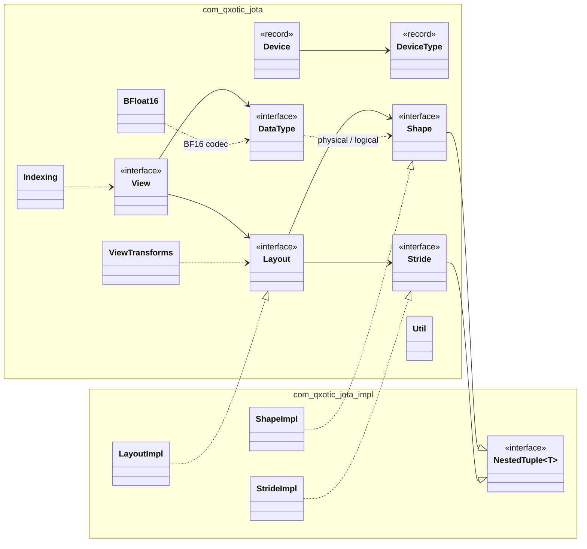
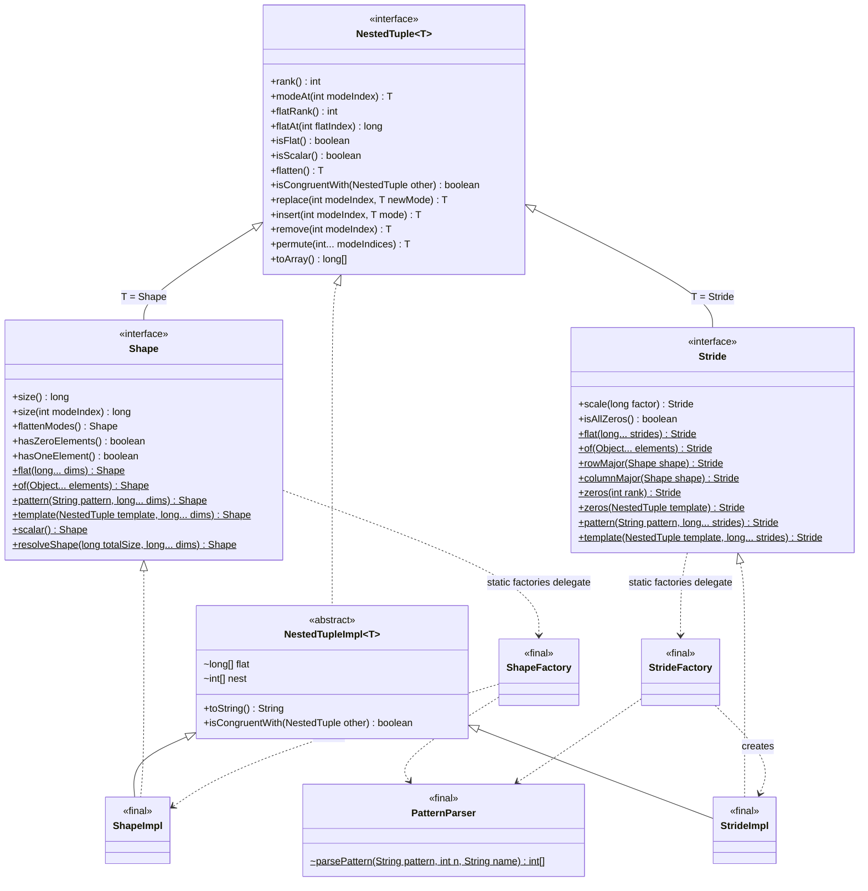
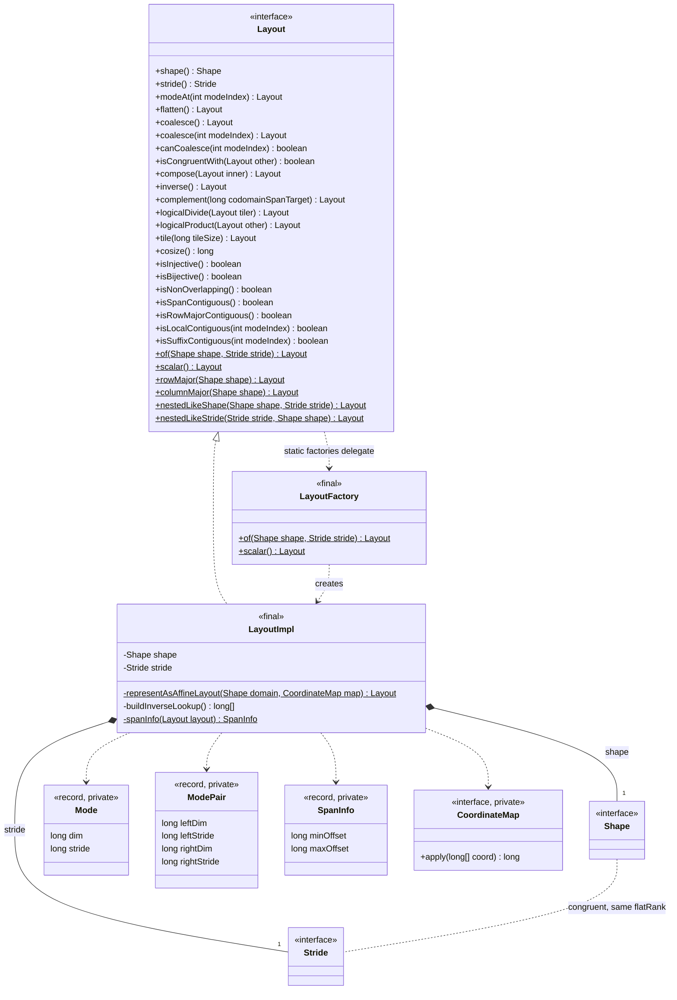
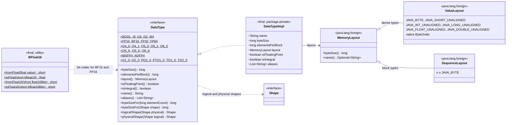
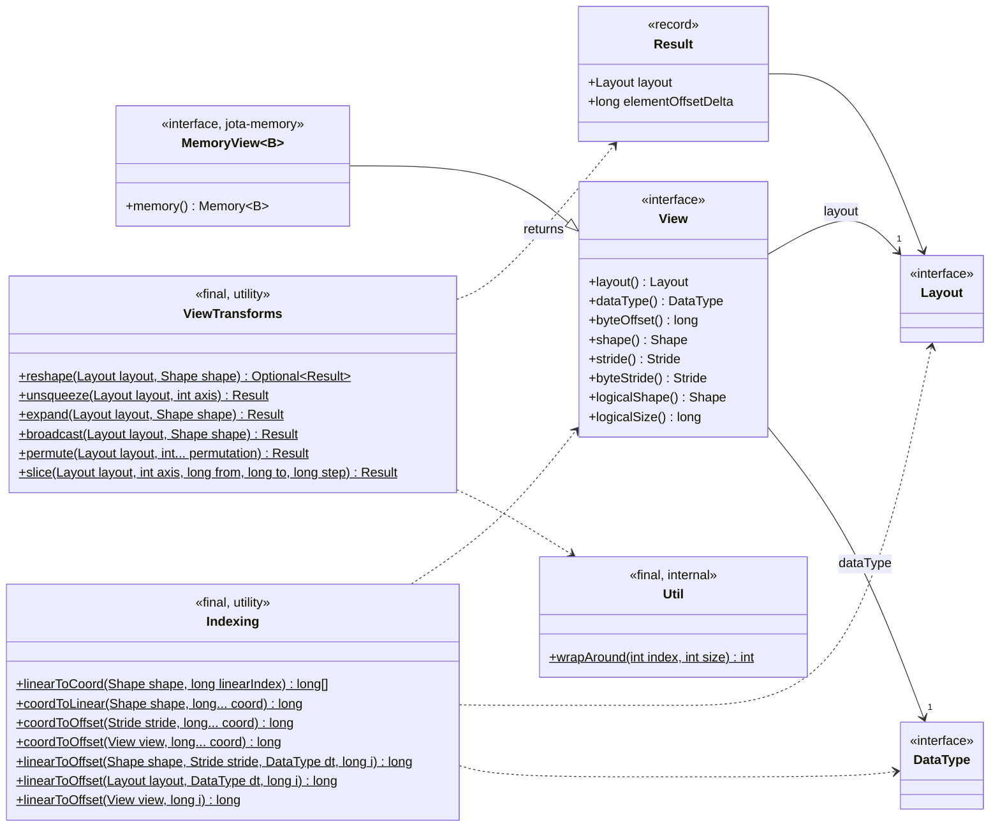
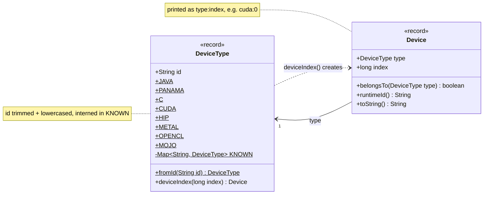
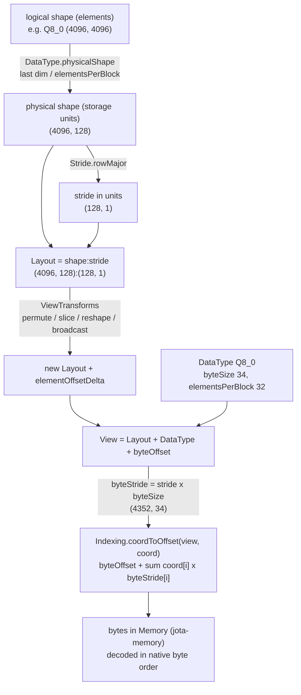
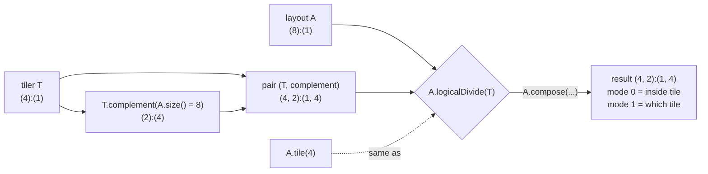

# jota-core — Architecture

`jota-core` is the dependency-free value model of jota: data types, devices, shapes, strides, layouts and views.
It is the JPMS module `com.qxotic.jota`, which exports only the package `com.qxotic.jota`.
The package `com.qxotic.jota.impl` holds the implementations; it is internal and not exported.

For a plain-language explanation of each concept (DataType, byte order, Shape, Stride, Layout, quantization, View), read [ARCHITECTURE-summary.md](ARCHITECTURE-summary.md) first.

The diagrams below go from the big picture to the details:

1. [Module overview](#1-module-overview)
2. [Nested tuples: Shape and Stride](#2-nested-tuples-shape-and-stride)
3. [Layout and its algebra](#3-layout-and-its-algebra)
4. [DataType, quantization and byte order](#4-datatype-quantization-and-byte-order)
5. [View, ViewTransforms and Indexing](#5-view-viewtransforms-and-indexing)
6. [Devices](#6-devices)
7. [From a logical shape to a byte address](#7-from-a-logical-shape-to-a-byte-address)
8. [Layout algebra: how tile and logicalDivide are built](#8-layout-algebra-how-tile-and-logicaldivide-are-built)

---

## 1. Module overview

Every public type is an interface or a final class in `com.qxotic.jota`.
Its static factory methods delegate to a `*Factory` class in `com.qxotic.jota.impl`, which builds the package-private implementation.
`NestedTuple<T>` lives in `impl` but is the parent of the public `Shape` and `Stride`.

| Group | Public types | Internal types |
|---|---|---|
| Tuples | `Shape`, `Stride` | `NestedTuple<T>`, `NestedTupleImpl<T>`, `ShapeImpl`, `StrideImpl`, `ShapeFactory`, `StrideFactory`, `PatternParser` |
| Layout | `Layout` | `LayoutImpl`, `LayoutFactory` |
| Element types | `DataType`, `BFloat16` | `DataTypeImpl` (package-private in `com.qxotic.jota`) |
| Views | `View`, `ViewTransforms`, `ViewTransforms.Result`, `Indexing` | — |
| Devices | `DeviceType`, `Device` | — |
| Helpers | `Util` (public for compatibility only) | — |

---

## 2. Nested tuples: Shape and Stride

`Shape` and `Stride` share one contract, `NestedTuple<T extends NestedTuple<T>>`.
The F-bounded generic makes structural edits (`modeAt`, `replace`, `insert`, `remove`, `permute`, `flatten`) return the same type: a `Shape` edits into a `Shape`, a `Stride` into a `Stride`.

`NestedTupleImpl<T>` stores a tuple as two arrays:

- `long[] flat` — the leaves in flatten order;
- `int[] nest` — per leaf, the number of brackets opened before it (positive) or closed after it (negative); `null` for a flat tuple.

`(2, (3, 4), 5)` is `flat = [2, 3, 4, 5]` and `nest = [0, +1, -1, 0]`.
Two tuples are *congruent* when they have the same rank, flat rank and `nest` array; a `Layout` requires its shape and stride to be congruent.

`PatternParser` turns the bracket notation of `Shape.pattern("(batch, (n, m))", 2, 3, 4)` into a `nest` array.
It rejects empty brackets, single-element brackets and trailing commas, so every tuple has one canonical form.

Index arguments follow the jota naming convention: a `_prefix` parameter (`_modeIndex`) wraps around with respect to the input, a `suffix_` parameter (`modeIndex_` in `insert`) with respect to the output.
`Util.wrapAround` does the wrapping.

---

## 3. Layout and its algebra

A `Layout` is a congruent `(Shape, Stride)` pair: the affine map `c -> Σ c[i] × stride[i]`, in storage units.
`LayoutImpl` checks congruence in its constructor and prints itself as `shape:stride`, e.g. `(2, 3):(3, 1)`.

The interface groups three kinds of methods:

- **Factories** — `of`, `scalar`, `rowMajor`, `columnMajor`, `nestedLikeShape`, `nestedLikeStride`.
- **Predicates and metrics** (default methods, computed from the flat arrays) — `isRowMajorContiguous`, `isSpanContiguous`, `isNonOverlapping` / `isInjective`, `isBijective`, `isLocalContiguous`, `isSuffixContiguous`, `cosize`.
- **Algebra** (in `LayoutImpl`, CuTe-style) — `flatten`, `coalesce`, `compose`, `inverse`, `complement`, `logicalDivide`, `logicalProduct`, `tile`.

`compose` and `inverse` evaluate the map point by point and then fit an affine `(shape, stride)` to the result (`representAsAffineLayout`).
They throw `IllegalArgumentException` when the result is not a plain strided layout.

| Operation | Rule | Example |
|---|---|---|
| `coalesce()` | merge mode `i` into `i+1` when `stride[i] == dim[i+1] × stride[i+1]`; drop size-1 modes | `(2, 3, 4):(12, 4, 1)` → `(24):(1)` |
| `complement(n)` | sort modes by stride, fill each gap, then extend to cover `n` | `(4):(2)`, `n = 24` → `(2, 3):(1, 8)` |
| `logicalDivide(T)` | `compose((T, T.complement(size())))` | see section 8 |
| `logicalProduct(B)` | `(this, complement(size() × B.cosize()).compose(B))` | repeat `this` following `B` |
| `inverse()` | requires bijective onto `[0, size−1]`, and the inverse must be strided over the same shape | `(3, 2):(2, 1)` → `(3, 2):(2, 1)`; `(3, 2):(1, 3)` throws (not representable) |

---

## 4. DataType, quantization and byte order

`DataType` is an interface whose constants are instances of the package-private `DataTypeImpl`.
Each one wraps a `java.lang.foreign.MemoryLayout`, from which it takes its `name` and `byteSize`.

- **Dense types** use a `ValueLayout` (`JAVA_BYTE` or a `JAVA_*_UNALIGNED` constant) and have `elementsPerBlock() == 1`.
- **Block-quantized types** use `MemoryLayout.sequenceLayout(bytes, JAVA_BYTE)` and have `elementsPerBlock() > 1`: one storage unit is a whole block.

The `ValueLayout` constants use the platform's native byte order, so jota reads multi-byte values in native order (little-endian on all supported targets) and never swaps bytes.
The `_UNALIGNED` variants let a value start at any address, which odd-sized blocks (Q8_0 = 34 bytes) need.
The inner layout of a quantized block is opaque to jota-core: only kernels decode it.

`logicalShape` and `physicalShape` convert between element counts and storage-unit counts by scaling the last flat dimension by `elementsPerBlock()`.
`BFloat16` is a stateless codec for the raw `short` bits that carry `BF16` (and, through `Float.float16ToFloat`, `FP16`) values.

| Family | Constants | Elements / block | Bytes / block |
|---|---|---:|---:|
| Dense integers | `BOOL`, `I8`, `I16`, `I32`, `I64` | 1 | 1, 1, 2, 4, 8 |
| Dense floats | `FP16`, `BF16`, `FP32`, `FP64` | 1 | 2, 2, 4, 8 |
| GGML legacy | `Q4_0`, `Q4_1`, `Q5_0`, `Q5_1`, `Q8_0` | 32 | 18, 20, 22, 24, 34 |
| GGML k-quants | `Q4_K`, `Q5_K`, `Q6_K` | 256 | 144, 176, 210 |
| 4-bit floats | `MXFP4`, `NVFP4` | 32, 64 | 17, 36 |
| Low-bit / ternary | `Q1_0`, `Q2_0`, `PQ2_0`, `PTQ1_0`, `TQ1_0`, `TQ2_0` | 128, 64, 128, 128, 256, 256 | 18, 18, 34, 28, 54, 66 |

---

## 5. View, ViewTransforms and Indexing

`View` is the storage-free addressing recipe: `layout()`, `dataType()` and an absolute `byteOffset()`.
Its default methods derive `shape()`, `stride()` and `byteStride()` (always physical) and `logicalShape()` / `logicalSize()` (read-back only).
`jota-memory`'s `MemoryView<B>` extends it with the `Memory<B>` the offsets point into.

`ViewTransforms` computes zero-copy layout changes.
Each returns a `Result(layout, elementOffsetDelta)`; the caller adds `delta × byteSize` to its base offset.
`reshape` returns `Optional.empty()` when the new shape cannot be expressed with strides and a copy is required.

`Indexing` converts between row-major linear indexes, coordinates, unit offsets and absolute byte offsets.

| Transform | Input | Output |
|---|---|---|
| `permute(l, 1, 0)` | `(2, 3):(3, 1)` | `(3, 2):(1, 3)` |
| `slice(l, 1, 2, 6, 2)` | `(4, 6):(6, 1)` | `(4, 2):(6, 2)`, delta 2 |
| `unsqueeze(l, 0)` | `(3):(1)` | `(1, 3):(0, 1)` |
| `expand(l, (4, 3))` | `(1, 3):(0, 1)` | `(4, 3):(0, 1)` |
| `broadcast(l, (2, 3))` | `(3):(1)` | `(2, 3):(0, 1)` |
| `reshape(l, (6))` | `(2, 3):(3, 1)` | `(6):(1)` |
| `reshape(l, (6))` | `(3, 2):(1, 3)` | empty: needs a copy |

---

## 6. Devices

`DeviceType` is a record around a normalized (trimmed, lowercase) id, interned in a static `ConcurrentHashMap`, so `fromId("Cuda") == CUDA`.
New ids can be added at runtime; the built-in ones name the jota backends.
`Device` pairs a `DeviceType` with a non-negative index.

---

## 7. From a logical shape to a byte address

The path a Q8_0 weight matrix takes from its element shape to a byte address.
Every step after the first works in whole blocks, so the same formula serves dense and quantized types.

---

## 8. Layout algebra: how tile and logicalDivide are built

`tile(n)` is `logicalDivide(rowMajor(n))`, and `logicalDivide` is built from `complement` and `compose`.
The result has two modes: the position inside a tile, and the tile index.

The examples in sections 3, 5 and 8 were checked against the implementation with `jshell`.
