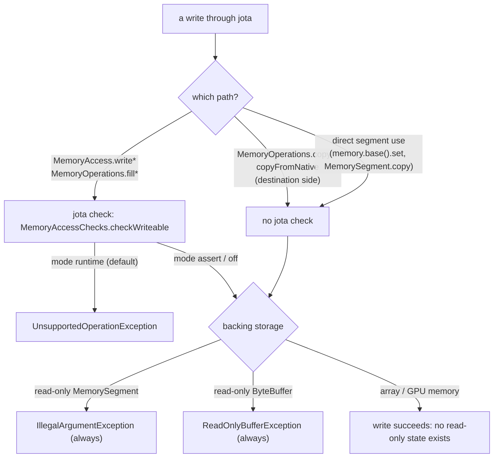
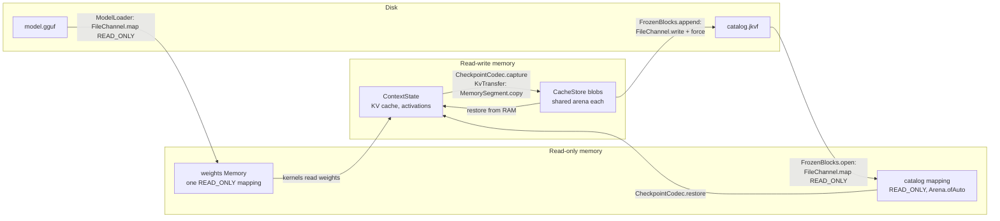

# jota-memory — File inputs and outputs

This page follows memory to and from disk: model weights read from files, model state (KV cache) written to and restored from files.
It complements [ARCHITECTURE.md](ARCHITECTURE.md) (the module's model) and [ARCHITECTURE-java25.md](ARCHITECTURE-java25.md) (the `java.lang.foreign` adapters).

Short version:

- `jota-memory` has **no file API of its own**; files enter and leave as `java.lang.foreign.MemorySegment`s that callers map or write with `FileChannel`.
- **Weights are read-only** because they are mapped `READ_ONLY`; the read-only flag comes from the segment, not from a jota policy.
- **State and KV cache are read-write** because they are allocated from an arena.
- The **prompt cache** (`jinfer-cache`) is the only component that writes model memory to disk, in its own JKVF file format.

Contents:

1. [Read-only and read-write memory](#1-read-only-and-read-write-memory)
2. [Inputs: reading memory from files](#2-inputs-reading-memory-from-files)
3. [Outputs: writing memory to files (prompt cache, KV cache)](#3-outputs-writing-memory-to-files-prompt-cache-kv-cache)
4. [End-to-end data flow](#4-end-to-end-data-flow)
5. [Tests that use the disk](#5-tests-that-use-the-disk)
6. [Gaps and suggestions](#6-gaps-and-suggestions)

---

## 1. Read-only and read-write memory

### 1.1 Where the flag comes from

`Memory.isReadOnly()` is a property of the backing storage, never a separate jota setting:

| Memory | `isReadOnly()` | How it becomes read-only |
|---|---|---|
| `NativeMemorySegmentMemory` (`Memories.of(segment)`) | `segment.isReadOnly()` | `segment.asReadOnly()`, or a `FileChannel.map(READ_ONLY, …)` mapping |
| `ByteBufferMemory` (`Memories.of(buffer)`) | `buffer.isReadOnly()` | `buffer.asReadOnlyBuffer()` |
| `ArrayMemory` (`Memories.of(float[])` …) | always `false` | never: Java arrays cannot be made read-only |
| scoped native memory (`newScopedArena()`) | `segment.isReadOnly()` (false in practice) | never |
| GPU memory (`CudaMemory`, `HipMemory`, `MetalMemory`, `OpenClMemory`) | always `false` | never |
| `CMemory`, `MojoMemory` (backends) | delegate to their segment or wrapped memory | as their backing storage |

`NativeMemorySegmentMemory.asReadOnly()` and `ByteBufferMemory.asReadOnly()` return a read-only copy of the wrapper over the same bytes.
They are internal; from the public API, make the segment or buffer read-only before calling `Memories.of`.

A `READ_ONLY` mapping really is read-only at the JDK level (checked on JDK 25.0.4):

```text
READ_ONLY mapping isReadOnly=true
MemorySegment.copy into it   -> IllegalArgumentException
segment.set / segment.fill   -> IllegalArgumentException
read-only ByteBuffer put     -> ReadOnlyBufferException
```

### 1.2 Who checks it: two layers



1. **jota's check.** `MemoryAccessChecks.checkWriteable(memory)` throws `UnsupportedOperationException("memory is read-only")` in the default `runtime` mode.
   With `-Djota.memory.checks=assert` it becomes an `assert`, and with `off` it is skipped.
   It runs in every `MemoryAccess.write*` and every `MemoryOperations.fill*` of the host backends (and in the CUDA fills).
   It does **not** run on the destination of `copy`, `copyFromNative` or `copyToNative`.
2. **The JDK's check.** A read-only `MemorySegment` or `ByteBuffer` rejects every write itself, whatever jota's mode.
   This is what actually protects bulk copies and code that writes through `memory.base()` directly.

So a read-only **segment or buffer** cannot be written through any path; only the exception type depends on the path.
Arrays and GPU memory have no read-only state, so for them "read-only" is purely advisory, as the package documentation says.

### 1.3 Expected roles in inference

| Memory | Expected | Actual | Why |
|---|---|---|---|
| model weights (GGUF tensors) | read-only | **read-only** | `ModelLoader` maps the tensor data `READ_ONLY` |
| repacked weights (`JamPack`) | read-only after packing | **read-write** | written into a `PRIVATE` (copy-on-write) mapping; never wrapped with `asReadOnly()` afterwards |
| state activations, KV cache, recurrent state | read-write | **read-write** | allocated with `Views.allocateF32` / `allocateF16` from the state's `MemoryArena` |
| prompt-cache blobs in RAM (`CacheStore`) | read-write while filled, then immutable | **read-write** | one shared arena per blob, zero-filled; immutability is a single-thread lifecycle contract |
| prompt-cache blocks from a catalog file (`FrozenBlocks`) | read-only | **read-only** | the JKVF file is mapped `READ_ONLY` |
| weights uploaded to a GPU | read-only | **read-write** | GPU memory reports `isReadOnly() == false` |

Nothing in `jinfer` or `jota-tensor` calls `asReadOnly()` or `isReadOnly()` today: weights are read-only only because of how they are mapped, and no test asserts it.

---

## 2. Inputs: reading memory from files

### 2.1 Model weights (`jinfer-kernels` `ModelLoader`)

`ModelLoader.loadTensors(fileChannel, tensorDataOffset, tensors, arena)` is the weight loader used by the model ports:

1. checks that the tensor data offset is inside the file and 4-byte aligned, and that the file holds every tensor's bytes (a truncated file fails with the tensor's name);
2. maps **once** the whole tensor-data region: `fileChannel.map(READ_ONLY, tensorDataOffset, required, arena)`;
3. wraps it in **one** `Memory<MemorySegment>` (`Memories.of(tensorData)`);
4. builds one `MemoryView` per tensor at its byte offset, reversing GGUF's fastest-first dimensions into a row-major shape and folding block-quantized types into their physical shape.

The arena must be usable across threads (`Arenas.requireCrossThread`): a confined arena is rejected before mapping, because kernels read weights from worker threads.
The arena decides when the mapping goes away; with `Arena.ofAuto()`, it is unmapped by the GC once no tensor view is reachable (verified by `MappingReleaseTest`).

Weights are never copied at load: kernels read straight from the page cache, and the OS pages them in on first access.

### 2.2 Other readers

| Code | Mapping | Purpose |
|---|---|---|
| `jinfer-cache` `FrozenBlocks.open` | `READ_ONLY`, `Arena.ofAuto()` | mount a prompt-cache catalog: only the header and index pages are touched, KV bytes stay unread until a chain is restored |
| `jinfer-cache` `FrozenBlocks.describe` | `READ_ONLY`, confined arena | inspect a catalog for its report |
| `jinfer-kernels` `JamPack.mappedSlab` | `PRIVATE` over an unlinked temp file | file-backed scratch for repacked weights (see 3.3) |
| `examples` `MnistMlp` | `READ_ONLY`, per tensor | the minimal pattern: map one F32 tensor, `Memories.of`, `MemoryView.of` |

No main code in the repository uses `MapMode.READ_WRITE`.

---

## 3. Outputs: writing memory to files (prompt cache, KV cache)

### 3.1 The path from KV cache to disk

Model state never goes to disk as `jota` views; it is first serialized into opaque blobs.

| Step | Code | Memory used |
|---|---|---|
| 1. live state | `ContextState` subclasses (`Qwen3.State`, …) | read-write `MemoryView`s from the state's `MemoryArena` (cross-thread) |
| 2. capture | `CheckpointCodec.capture(state, from, to, blob)`, one codec per model (`Qwen3CheckpointCodec`, `Gemma4CheckpointCodec`, `Lfm2CheckpointCodec`, …) | copies positions `[from, to)` of each layer's K and V into the blob |
| 3. raw copy | `KvTransfer.transfer` / `ringSpan` (`jinfer-kernels`) | `MemorySegment.copy(view.memory().base(), …, blob, …)` at the view's native encoding (FP16 KV = 2 bytes per element); ring slots for sliding-window layers |
| 4. RAM blob | `CacheStore.allocate` | a zero-filled, 64-aligned segment in its own shared arena, freed deterministically on eviction |
| 5. persist | `FrozenBlocks.write` / `append` | `FileChannel.write(blob.asSlice(...).asByteBuffer(), pos)` in 1 GiB chunks, CRC32C per blob |

`KvTransfer` works on segments directly: it checks that the view is dense and alive, then calls `MemorySegment.copy`.
It does not go through `MemoryOperations`, so the read-only check that applies is the JDK's (layer 2 in 1.2).

### 3.2 The JKVF catalog file (`FrozenBlocks`)

The prompt cache stores a content-addressed tree of blocks; shared prompt prefixes are stored once.

- **Layout** (little-endian): a 4 KiB header (magic `JKVF`, format version 4, model seed digest, CRC), two 64-byte commit slots on separate 4 KiB pages, then 64-aligned KV blobs and complete indexes.
- **Index entries**: `{key, parentKey, from, to, byteOffset, byteLen, crc}` in breadth-first order, so a parent is always grafted before its children.
- **Crash safety**: append writes the new blobs and index, calls `force(true)`, then publishes into the older commit slot and calls `force(true)` again; a torn publication falls back to the previous generation.
- **Concurrency**: a class monitor serializes writers in one JVM and a file lock serializes processes; readers share the mapping.
- **Model identity**: the model seed (including the codec's blob layout) must match, or `open` throws; a catalog can never restore bytes into the wrong model.

`PromptCache.Options.withCatalog(path, readOnly)` selects the mode:

| Mode | Missing file | Writes back |
|---|---|---|
| read-write | an empty catalog is created | `save` appends new blocks |
| read-only | `IllegalArgumentException` | never |

Restoring is the reverse of capture: the blob is a slice of the `READ_ONLY` mapping, and `CheckpointCodec.restore` copies it into the read-write state.
Every restore stops one position short and re-ingests the last position, so logits are fresh and cached generation matches cold generation.

### 3.3 Repacked weights (`JamPack`)

`JamPack` rewrites quantized weights into the native kernels' packed layout.
For large models it writes into a file-backed "slab": a temp file mapped `PRIVATE`, then unlinked immediately (on POSIX the pages live until the arena closes; Windows falls back to `deleteOnExit`).
This is not persistence: the file only gives the OS somewhere to page the packed weights out, and it disappears with the process.

### 3.4 Not written to disk

- Weights are never written back.
- Activations and scratch buffers of a state are not part of checkpoints; only what each codec declares (KV rows, recurrent residue) is captured.
- `jota-tensor` has no tensor save/load API; GGUF and safetensors writers exist in the `gguf` and `safetensors` modules, which work on bytes, not on `jota` memory.

---

## 4. End-to-end data flow



---

## 5. Tests that use the disk

Yes: the file paths are covered by tests that create their own files in JUnit `@TempDir` directories, so they are repeatable and need no external data.
None of them depends on a downloaded model.

| Test | Module | What the file is used for |
|---|---|---|
| `ModelLoaderTest` | `jinfer-kernels` | writes small GGUF files and checks mapping: confined arenas rejected before mapping, truncated files name the tensor, unaligned data rejected, embedded GGUF with a relocated header, only tensor data mapped |
| `MappingReleaseTest` | `jinfer-kernels` | maps weights into an automatic arena and checks in `/proc/self/maps` that the mapping disappears after the GC (Linux only) |
| `JamPackTest` | `jinfer-kernels` | the slab file is deleted whether the map succeeds or fails; packed weights are bit-exact against two reference dequantizers |
| `FrozenBlocksTest` | `jinfer-cache` | freeze, write, reopen and restore round-trips byte-exact; wrong model seed rejected; corrupt files rejected; append grows the file without rewriting it; frozen blocks are never evicted |
| `PromptCacheTest` | `jinfer-cache` | catalogs end to end: create, save, reopen, read-only mode, missing read-only catalog rejected, export |
| `KvTransferContractTest` | `jinfer-kernels` | not on disk, but the same capture/restore copies into arena blobs: sliding-window ring spans rebuild the live window at every chain boundary |

How they stay repeatable:

- every file is generated by the test (small synthetic GGUF tensors, fake-codec states with readable rows), and `@TempDir` gives each test a fresh directory that JUnit deletes;
- the cache tests use a fake model and fake codecs (`BlockResumeTest`'s codec), so restored bytes can be compared exactly;
- random data is seeded where it is used (`JamPackTest` payloads).

Tests that need real model files are separate and **skipped** when the files are absent: they use JUnit `assumeTrue` on a system property such as `-Djinfer.gemmaEmbedding2.reference=…` (`GemmaEmbedding2ParityTest`) or a path property (`BailingMoe3IntegrationTest`).

`jota-memory` itself has **no file-based test**.
Its read-only coverage is in memory only:

- `NativeMemoryAccessTest.testWriteToReadOnlyMemory`: writes through `NativeMemoryAccess` into an `asReadOnly()` segment throw `UnsupportedOperationException`;
- `ByteBufferMemoryTest.readOnlyBuffersYieldReadOnlyMemory`: a read-only buffer gives read-only memory;
- `PanamaMemoryTest.testReadOnlySegment`.

---

## 6. Gaps and suggestions

1. **Bulk copies skip jota's writeable check.** `MemoryOperations.copy` / `copyFromNative` / `copyToNative` do not call `checkWriteable` on the destination.
   The JDK still rejects read-only segments and buffers, but with `IllegalArgumentException` / `ReadOnlyBufferException` instead of jota's `UnsupportedOperationException`.
   Adding the check would make the error type consistent across paths.
2. **No test asserts that weights are read-only.** A one-line assertion in `ModelLoaderTest` (`assertTrue(view.memory().isReadOnly())`) would lock in the property that the `READ_ONLY` mapping gives today.
3. **Repacked weights are writable.** `JamPack` output could be wrapped with `asReadOnly()` once packing is done, so a stray kernel write fails instead of silently corrupting weights.
4. **Weights on a GPU lose the read-only flag**, because GPU memory always reports `false`; a backend could carry the flag from the source memory when uploading weights.
5. **No mapped-file test in `jota-memory`.** A small `@TempDir` test that maps a file `READ_ONLY`, wraps it with `Memories.of` and checks reads, views and rejected writes would cover the pattern that every weight loader depends on.
