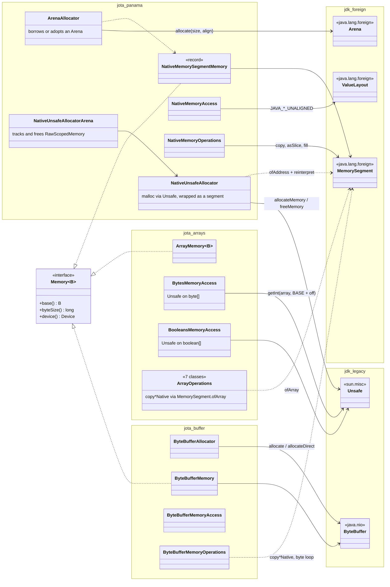
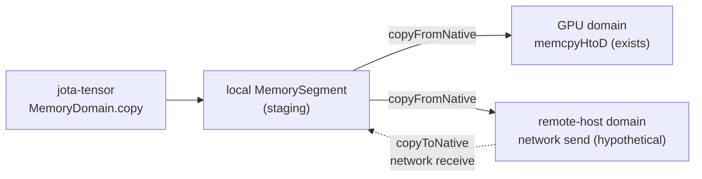

# jota-memory and Java 25 — FFM, Unsafe and ByteBuffer

This page explains the parts of `jota-memory` that sit directly on the JDK's off-heap memory APIs.
It complements [ARCHITECTURE.md](ARCHITECTURE.md), which covers the module's public model (`Memory`, `MemoryView`, `MemoryDomain`).

Contents:

1. [A short reminder: `java.lang.foreign` in Java 25](#1-a-short-reminder-javalangforeign-in-java-25)
2. [The jota adapters over the JDK APIs](#2-the-jota-adapters-over-the-jdk-apis)
3. [Unsafe vs ByteBuffer vs java.lang.foreign: architecture choices](#3-unsafe-vs-bytebuffer-vs-javalangforeign-architecture-choices)
4. [Development status: mapped files](#4-development-status-mapped-files)
5. [Development status: distributed memory across cluster hosts](#5-development-status-distributed-memory-across-cluster-hosts)

---

## 1. A short reminder: `java.lang.foreign` in Java 25

The Foreign Function & Memory API (FFM, "Panama") became final in Java 22 (JEP 454) and is a standard API in Java 25.
It has two halves: **memory access** (`Arena`, `MemorySegment`, `ValueLayout`) and **native calls** (`Linker`, `SymbolLookup`, `FunctionDescriptor`).
`jota-memory` only uses the memory half; the native backends (`jota-backend-c`, `-cuda`, …) use the `Linker` half to call drivers.

### 1.1 `MemorySegment`: bounded, scoped memory

A `MemorySegment` is a contiguous region of memory with three guarantees the older APIs do not give together:

- **spatial bounds**: every access is checked against `[0, byteSize())`, with `long` offsets (no 2 GiB limit);
- **temporal bounds**: the segment belongs to a *scope*; once the scope is closed, any access throws `IllegalStateException` instead of reading freed memory;
- **thread confinement**: a segment from a confined arena may only be touched by its owner thread (`WrongThreadException` otherwise).

There are three kinds of segment, all with the same API:

| Kind | Created by | Backing | Can be passed to native code |
|---|---|---|---|
| heap | `MemorySegment.ofArray(float[])`, `ofBuffer(heapBuffer)` | a Java array | no (the GC may move it) |
| native | `arena.allocate(size, alignment)` | off-heap `malloc`-like memory | yes, `segment.address()` is stable |
| mapped | `fileChannel.map(mode, offset, size, arena)` | pages of a file | yes |

Useful operations:

- `segment.get(ValueLayout.JAVA_INT_UNALIGNED, offset)` / `set(...)`: typed access, in the layout's byte order (native order by default).
- `MemorySegment.copy(src, srcOff, dst, dstOff, bytes)`: bulk copy between any two segments, heap, native or mapped.
- `segment.asSlice(offset, size)`, `segment.fill(byte)`, `segment.asReadOnly()`.
- `MemorySegment.ofAddress(long)` + `reinterpret(size)`: turn a raw address into a usable segment.
  `reinterpret` is a **restricted method**: it can create a segment over memory that does not exist, so the JVM warns unless the caller module has `--enable-native-access`.

### 1.2 `Arena`: who frees the memory, and when

An `Arena` is the lifetime (scope) of the segments it allocates.

| Arena | Closeable | Accessible from | Memory freed |
|---|---|---|---|
| `Arena.global()` | no | any thread | never |
| `Arena.ofAuto()` | no | any thread | by the GC, once no segment is reachable |
| `Arena.ofConfined()` | yes | the creating thread only | at `close()` |
| `Arena.ofShared()` | yes | any thread | at `close()` (with a safepoint handshake, more expensive than confined) |

`arena.allocate` returns **zero-filled** memory.
An arena is usually opened in a try-with-resources block; closing it frees every segment it allocated at once.

### 1.3 Related JDK 24/25 changes that matter here

- **`sun.misc.Unsafe` memory access is being removed.** JEP 471 (JDK 23) deprecated its memory-access methods for removal, and JEP 498 (JDK 24) makes the JVM print a warning the first time one is used (`--sun-misc-unsafe-memory-access=warn` is the default; `allow`, `debug` and `deny` also exist).
- **Restricted methods warn by default.** JEP 472 (JDK 24) applies the same "warn unless `--enable-native-access`" policy to FFM restricted methods and to JNI.
  `jota/pom.xml` passes `--enable-native-access=ALL-UNNAMED` to tests for this reason.

---

## 2. The jota adapters over the JDK APIs

`jota-memory` exposes three storage families behind the one `Memory<B>` interface.
Each family is a small adapter over one JDK mechanism.



### 2.1 Native memory: `Memory<MemorySegment>` (device `PANAMA:0`)

This is the main host backend; the Panama compute backend and the C backend both run on it.

- **`NativeMemorySegmentMemory`** is a record holding one `MemorySegment`.
  `byteSize()`, `isReadOnly()` and `asReadOnly()` delegate to the segment, and `memoryGranularity()` is 1 (byte-addressable).
  `Memories.of(segment)` wraps *any* segment this way: native, heap or mapped.
- **`NativeMemoryAccess`** reads and writes through `ValueLayout.JAVA_SHORT_UNALIGNED`, `JAVA_INT_UNALIGNED`, … in native byte order.
  The unaligned layouts are used because tensor offsets are byte offsets and block-quantized types are not naturally aligned.
  Each call first runs `MemoryAccessChecks` (bounds, read-only), then the segment adds its own spatial and temporal checks.
- **`NativeMemoryOperations`** maps directly onto FFM: `copy` and both `copy*Native` methods are `MemorySegment.copy`, `fillByte` is `asSlice(off, size).fill(b)`, and the wider fills are loops of `set(JAVA_*_UNALIGNED, …)`.
- **`NativeMemoryDomain`** bundles these with an allocator, and refuses an allocator whose device is not `PANAMA`.

Two allocators produce native segments, with opposite trade-offs:

| | `ArenaAllocator` (`MemoryAllocators.ofArena` / `adoptArena`) | `NativeUnsafeAllocatorArena` (`MemoryAllocators.newScopedArena`) |
|---|---|---|
| Allocation | `arena.allocate(size, alignment)` | `Unsafe.allocateMemory(size + alignment - 1)`, then the address is rounded up |
| Segment | scoped to the JDK arena | `MemorySegment.ofAddress(aligned).reinterpret(size)`: **global scope**, no temporal checks |
| Zero-filled | yes | no |
| Free one buffer early | no (only the whole arena) | yes, `ScopedMemory.close()` calls `Unsafe.freeMemory` once (an `AtomicBoolean` guards double free) |
| Use after free | `IllegalStateException` | undefined (likely a crash) |
| Threads | the arena's rule (confined arenas reject other threads) | any thread; allocation and close are `synchronized` |
| Default alignment | 64 bytes (cache line / vector width) | 1 byte |
| `close()` | no-op when borrowed (`of`), closes the arena when adopted (`adopt`) | frees every allocation still tracked |

`ArenaAllocator.of(Arena.global())` returns one shared instance, since the global arena is a process singleton.
Adopting `Arena.ofAuto()` or `Arena.global()` makes `close()` throw `UnsupportedOperationException`, because those arenas cannot be closed.

The scoped arena exists for frequent, short-lived buffers (kernel temporaries, staging) where waiting for an arena or the GC is too coarse.
`TIREvalContext` uses it for interpreter temporaries, and `StridedCopy.releaseTemp` frees a staging buffer immediately when it is a `ScopedMemory`.

### 2.2 `ByteBuffer` memory: `Memory<ByteBuffer>` (device `JAVA:0`)

- **`ByteBufferAllocator`** creates heap or direct buffers in **native byte order**.
  To honour an alignment it over-allocates by `alignment - 1` and returns an exact-size `slice` starting at the first aligned index (not `alignedSlice`, which would also shorten the limit).
  Heap buffers reject any alignment above 1, because the GC can move the backing array.
- **`ByteBufferMemory`** treats the buffer as `[0, capacity)` with absolute indexing; position, limit and mark are ignored and never moved.
  A read-only buffer gives read-only memory.
- **`ByteBufferMemoryAccess`** uses the absolute `get`/`put` methods, so it follows the buffer's own byte order.
  A big-endian buffer (the default for `ByteBuffer.allocate`, `allocateDirect` and `slice()`) holds big-endian values, while every other jota backend is native order; this is why the allocator forces native order.
- **`ByteBufferMemoryOperations`** copies buffer to buffer with a bulk absolute `put`, but `copyFromNative` / `copyToNative` and the fills are per-byte or per-value loops.
  `MemorySegment.ofBuffer(buffer)` plus `MemorySegment.copy` would make those transfers bulk copies; this is a possible improvement, not current behaviour.

### 2.3 Java arrays: `Memory<float[]>`, `Memory<byte[]>`, … (device `JAVA:0`)

- Arrays stay ordinary GC-managed Java arrays; nothing is off-heap.
- The `float[]`, `int[]`, `long[]`, `double[]` and `short[]` accessors index the array directly.
- `BytesMemoryAccess` and `BooleansMemoryAccess` read wider values out of a `byte[]` with `Unsafe.getShort/getInt/getLong(array, ARRAY_BYTE_BASE_OFFSET + offset)`, which is how a `byte[]` becomes byte-addressable for every width.
- The array `MemoryOperations` bridge to segments with `MemorySegment.ofArray(array)` and `MemorySegment.copy`, so arrays interoperate with native memory without per-element loops.
  A heap segment cannot be handed to a driver, so GPU backends copy it into a native staging segment first.

### 2.4 Where jota-memory itself opens arenas

| Place | Arena | Why |
|---|---|---|
| static `MemoryOperations.copy` (two non-segment backends) | `Arena.ofConfined()` per call | a staging buffer for chunked copies, aligned to 4 KiB |
| `StridedCopy.copyViaHost` (opaque domains) | `Arena.ofConfined()` per call | host mirrors of the two views' byte spans |
| `MemoryViews.arange` | `Arena.ofConfined()` per call | build the sequence once on the host, then one `copyFromNative` |

All of them are confined and short-lived: the thread that copies is the thread that owns the staging memory.

---

## 3. Unsafe vs ByteBuffer vs java.lang.foreign: architecture choices

| | `sun.misc.Unsafe` | `java.nio.ByteBuffer` | `java.lang.foreign` (FFM) |
|---|---|---|---|
| Status in Java 25 | internal, memory methods deprecated for removal; warns on first use (JDK 24+) | standard, maintained, no new features | standard and final since Java 22; the replacement for both others |
| Addressing | raw `long` addresses, or `(object, offset)` for arrays | `int` index | `long` offset inside a segment |
| Maximum size | unlimited | 2 GiB − 1 per buffer | unlimited |
| Bounds checks | none | yes | yes |
| Lifetime | manual `freeMemory`; forgetting leaks, freeing twice or using after free crashes | GC: a direct buffer is freed by a `Cleaner` some time after it becomes unreachable | explicit and deterministic through an `Arena`, or GC-driven with `Arena.ofAuto()` |
| Use after free | undefined behaviour | impossible (the GC keeps it alive) | `IllegalStateException` |
| Thread model | none | none; buffers are not thread-safe because of position/limit state | confinement enforced by the arena kind |
| Byte order | always native | mutable per-buffer state, big-endian by default | chosen per access by the `ValueLayout` (native by default) |
| Mutable cursor state | none | position, limit, mark | none |
| Native interop | an address you pass to JNI yourself | direct buffers only, via JNI `GetDirectBufferAddress` | segments passed directly through `Linker` downcalls |
| Files | none | `MappedByteBuffer` (2 GiB limit, unmapped only by the GC) | mapped segments, unmapped when their arena closes |
| Performance | JIT intrinsics, no checks | JIT intrinsics, bounds checks | JIT intrinsics, bounds and liveness checks usually hoisted out of loops |

What jota chooses, and why:

- **FFM is the default for native memory.** It is the only API that combines `long` sizes, deterministic release and safety checks, and segments can go straight to native code.
  Every native path in jota (`ArenaAllocator`, `NativeMemoryAccess`, `NativeMemoryOperations`) and every cross-backend transfer (`copyFromNative` / `copyToNative`) speaks `MemorySegment`.
- **`MemorySegment` is the common format between backends.** Arrays, buffers, native memory, mapped files and GPU staging all meet as segments, so N backends need N pairs of `copy*Native` methods instead of N² copy routines.
- **`ByteBuffer` is kept for interop**, because many libraries still hand out or expect buffers.
  It is wrapped without copying and stays a second-class backend: `int`-sized, byte-order-sensitive, with per-byte transfers to segments.
- **`Unsafe` remains in three places**, each for a reason FFM did not cover cheaply:
  - `NativeUnsafeAllocator`: `malloc`/`free` of single buffers, so a buffer can be freed before its arena (FFM frees only whole arenas);
  - `BytesMemoryAccess` / `BooleansMemoryAccess`: unaligned multi-byte reads out of a `byte[]` and byte access to a `boolean[]`;
  - `UnsafeMemoryAccess`: raw-address access over `Memory<Void>`, used only by its own test.

  On Java 25 these trigger the one-time `sun.misc.Unsafe` warning unless the JVM runs with `--sun-misc-unsafe-memory-access=allow`; no jota build file sets that flag today.
  The FFM replacements are:
  - per-buffer release with `Linker` downcalls to `malloc`/`free`, or one small confined arena per buffer;
  - `MemorySegment.ofArray(byte[])` with `JAVA_*_UNALIGNED` layouts, or `MethodHandles.byteArrayViewVarHandle`.

---

## 4. Development status: mapped files

**Mapped files work today by composition, without a dedicated API.**
Map the file with FFM, wrap the segment, and build views at byte offsets:

```java
try (Arena arena = Arena.ofShared();
     FileChannel ch = FileChannel.open(path, StandardOpenOption.READ)) {
    MemorySegment mapped = ch.map(FileChannel.MapMode.READ_ONLY, offset, size, arena);
    Memory<MemorySegment> memory = Memories.of(mapped);          // zero-copy, device PANAMA:0
    MemoryView<MemorySegment> weights =
            MemoryView.of(memory, tensorByteOffset, DataType.FP32, Layout.rowMajor(shape));
    // ... use the view; the mapping is released when the arena closes
}
```

Because the mapped segment is an ordinary `MemorySegment`, everything downstream works unchanged: `NativeMemoryAccess`, the Panama kernels, strided views, and uploads to GPUs (a mapped segment is native, so `memcpyHtoD` reads it directly and the OS pages it in on demand).
A `READ_ONLY` mapping yields a read-only segment, so `Memory.isReadOnly()` is true and jota's writers reject it.

Where it is used:

| Module | Code | Pattern |
|---|---|---|
| `jinfer-kernels` | `ModelLoader` | maps the whole GGUF tensor-data region once (`READ_ONLY`), wraps it in **one** `Memory`, and creates one byte-offset `MemoryView` per tensor; requires a cross-thread arena (`Arenas.requireCrossThread`) |
| `jinfer-kernels` | `JamPack` | `MapMode.PRIVATE` (copy-on-write) mapping |
| `jinfer-cache` | `FrozenBlocks` | `READ_ONLY` mappings of frozen cache blocks |
| `examples` | `MnistMlp` | maps each F32 GGUF tensor and wraps it with `Memories.of` |

What is **not** there yet:

- no `MemoryAllocator` or `MemoryDomain` that creates, grows or maps files: mapping is done by the caller, who owns the arena;
- no jota API for `MemorySegment.load()`, `isLoaded()`, `unload()` or `force()` (prefetch, residency, flush to disk); callers use the segment directly;
- no file-backed `DeviceType`: a mapped memory reports `PANAMA:0`, the same as heap-allocated native memory;
- no tests in `jota-memory` that exercise a mapped segment; coverage comes from the jinfer loaders and the example.

The design accepts mapped memory without changes; a first-class `MemoryAllocators.mapFile(...)` (choosing mode, arena and alignment checks) would be the natural next step if needed.

---

## 5. Development status: distributed memory across cluster hosts

**Not started.** Nothing in `jota-memory`, `jota-tensor` or the backends addresses memory on another host, and the repository contains no networking, RDMA, MPI or NCCL-style code.

Concretely:

- `Device` is `(DeviceType, index)` (for example `cuda:1`); it has no notion of a host, so every device is assumed to be in the current process.
- `MemoryDomain.copy(srcDomain, src, dstDomain, dst)` assumes both domains are local: cross-device copies stage through a local `MemorySegment`.
- `jota-tensor` has no sharding, collectives (all-reduce, all-gather) or placement across machines; `ScheduledExecutor` only moves data between local devices.

The architecture would admit it the same way it admits GPUs, which are already "memory the host cannot address":



A remote domain would need:

1. a host-qualified device identity (a new `DeviceType`, or a host field in `Device`);
2. a `MemoryDomain<RemoteHandle>` with `directAccess() == null` and a `MemoryOperations` whose `copyFromNative` / `copyToNative` send and receive bytes, and whose `copy` runs on the remote side;
3. on-remote strided copies (like the GPU `*StridedCopy` kernels), so strided views are not shipped through the local host;
4. above the memory layer, sharding and collective operations in `jota-tensor`, which do not exist.

Points 1–3 fit the current interfaces; point 4 is new work in the tensor engine.
