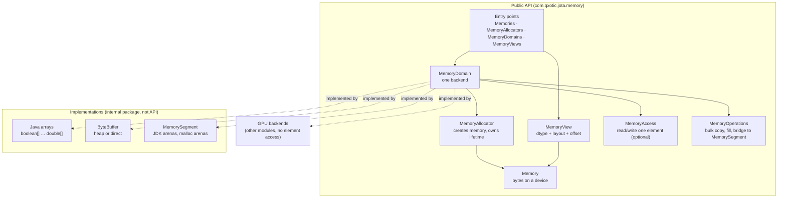
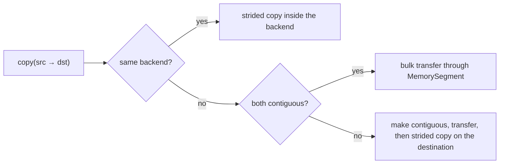

# jota-memory — Architecture overview

A short, high-level tour of `jota-memory`.
For the class diagrams and the details, see [ARCHITECTURE.md](ARCHITECTURE.md).

## Purpose

`jota-memory` is the storage layer under jota tensors.
It knows nothing about tensor operations: it only holds bytes, describes how to read them as shaped data, and moves them around.
It depends only on `jota-core` (data types, devices, shapes, strides, layouts).

It answers three questions:

| Question | Abstraction |
|---|---|
| Where are the bytes? | `Memory` — a block of bytes on a device |
| How do I read them as a tensor? | `MemoryView` — data type + layout (shape, stride) + offset over a `Memory` |
| Who allocates, reads and copies them? | `MemoryDomain` — the backend: allocator, element access, bulk operations |

## The big picture

## Main ideas

- **One backing type per backend.**
  Every interface is generic in the backing type `B` (`float[]`, `ByteBuffer`, `MemorySegment`, a GPU handle…), so the compiler keeps backends apart.
- **Bytes everywhere.**
  Offsets and sizes are always in bytes, even over a `float[]`.
- **Views are cheap and immutable.**
  Reshape, permute, transpose, slice, expand and broadcast return a new view over the same memory; nothing is copied.
- **Element access is optional.**
  A backend the host cannot address directly (a GPU) provides no `MemoryAccess`; generic code then goes through host staging.
- **`MemorySegment` is the common currency.**
  Each backend only knows how to copy to and from a `MemorySegment`, so moving data between any two backends needs no pairwise code.

## Backends provided here

| Backend | Backing | Freed by |
|---|---|---|
| Java arrays (7 shared domains) | `boolean[]` … `double[]` | the GC |
| ByteBuffer | heap or direct `ByteBuffer` | the GC |
| Native, JDK arena | `MemorySegment` | the arena (borrowed or adopted) |
| Native, scoped arena | `MemorySegment` (malloc) | each buffer individually, or the arena |

GPU and other device backends live in other modules and implement the same `MemoryDomain` interface.

## Lifetimes and ownership

Native memory always names its lifetime: there is no default native allocator.
Constructor names state who owns what:

- `of(x)` wraps `x` and inherits its lifetime;
- `adopt(x)` takes `x` over, closing the result closes `x`;
- `newX()` creates something the caller owns and closes;
- a bare noun (`floats()`) is a shared, stateless instance.

Closing a domain closes its allocator; for GC-managed backends this does nothing.

## Copying data

There is one entry point, `MemoryDomain.copy(srcDomain, src, dstDomain, dst)`, which picks the cheapest path:

Any layout and any data type are supported, including block-quantized types, without special cases.

## Cross-cutting concerns

- **Checks.** Bounds, alignment and read-only checks are centralised; `-Djota.memory.checks=off|assert|runtime` chooses how they fail (default `runtime`).
- **Read-only is advisory.** Writers check it, but the raw storage stays reachable.
- **Threads.** Views and layouts are immutable; concurrent reads are safe; writers synchronize among themselves; arenas allocate thread-safely.
- **Debugging.** `MemoryViewPrinter` renders a view's metadata and values, with truncation options.

## Package layout

- `com.qxotic.jota.memory` — the public API: interfaces, the four entry-point classes, copy and printing helpers.
- `com.qxotic.jota.memory.internal` — implementations, reached only through public `*Factory` bridges.
