# jota-memory — Architecture

`jota-memory` is the storage layer under jota tensors.
It answers three questions:

| Question | Abstraction |
|---|---|
| *Where are the bytes?* | `Memory<B>` — a block of bytes on a `Device`, backed by `B` (a Java array, a `ByteBuffer`, a `MemorySegment`, or an opaque GPU handle) |
| *How do I read them as a tensor?* | `MemoryView<B>` — dtype + `Layout` (shape/stride) + byte offset over a `Memory<B>` |
| *Who allocates, reads and copies them?* | `MemoryDomain<B>` — bundles a `MemoryAllocator<B>`, an optional `MemoryAccess<B>` and `MemoryOperations<B>` |

The type parameter `B` (the *backing type*) runs through every interface, so a `MemoryView<float[]>` can only be handled by a `MemoryDomain<float[]>`, and the compiler keeps backends apart.

The module depends only on `jota-core` (`DataType`, `Device`/`DeviceType`, `Shape`, `Stride`, `Layout`, `View`, `ViewTransforms`).

Packages:

- `com.qxotic.jota.memory` — the public API: interfaces, the four entry-point classes (`Memories`, `MemoryAllocators`, `MemoryDomains`, `MemoryViews`), copy and printing helpers.
- `com.qxotic.jota.memory.internal` — the implementations; not API.
  Only the `*Factory` classes are `public`, as bridges for the entry points.

For the Java 25 side (`java.lang.foreign`, `Unsafe`, `ByteBuffer`, mapped files), see [ARCHITECTURE-java25.md](ARCHITECTURE-java25.md).
For files (read-only weights, read-write state, the prompt cache on disk), see [ARCHITECTURE-in-out.md](ARCHITECTURE-in-out.md).

The diagrams below go from the big picture to the details:

1. [Core model](#1-core-model)
2. [Memory and allocator hierarchy (lifetimes)](#2-memory-and-allocator-hierarchy-lifetimes)
3. [Domains: the backends](#3-domains-the-backends)
4. [Element access and bulk operations per backend](#4-element-access-and-bulk-operations-per-backend)
5. [Views, strided copy and printing](#5-views-strided-copy-and-printing)
6. [Entry points and internal factories](#6-entry-points-and-internal-factories)
7. [Checks and low-level utilities](#7-checks-and-low-level-utilities)
8. [How a copy is routed](#8-how-a-copy-is-routed)
9. [How jota-tensor and the backends use the memory layer](#9-how-jota-tensor-and-the-backends-use-the-memory-layer)

---

## 1. Core model

The four public interfaces a backend implements, how `MemoryDomain` groups them, and how a `MemoryView` sits on top of a `Memory`.
Types in the `jota-core` namespace come from the `jota-core` module.

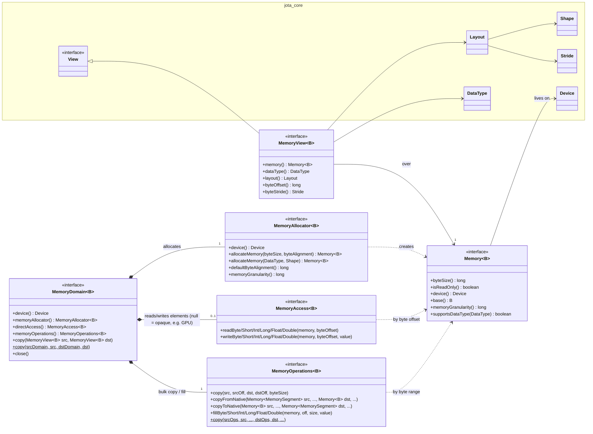

Key points:

- **Byte addressing everywhere.** Offsets and sizes in `MemoryAccess` and `MemoryOperations` are in bytes, whatever the backing type.
  A `float[]` is addressed as bytes too.
- **Granularity.** `memoryGranularity()` is 1 for byte-addressable memory (segments, buffers, `byte[]`), otherwise the element size of the backing array (4 for `float[]`).
  A non-byte memory only supports dtypes of exactly that size (`supportsDataType`); `boolean[]` only supports `BOOL`.
- **`MemoryAccess` is optional.** A domain whose memory the host cannot address (a GPU) returns `null` from `directAccess()`.
  Everything generic (strided copies, `arange`, printing staging) then goes through `copyToNative` / `copyFromNative`, which every backend must implement.
- **`MemorySegment` is the common currency.** Cross-backend transfers stage through a `Memory<MemorySegment>` (heap or native), so N backends need N pairs of `copy*Native` methods, not N² copy routines.

---

## 2. Memory and allocator hierarchy (lifetimes)

Who owns the bytes, and when are they freed?
The interfaces split *plain* memory (GC- or arena-managed) from *scoped* memory that can be freed one buffer at a time.

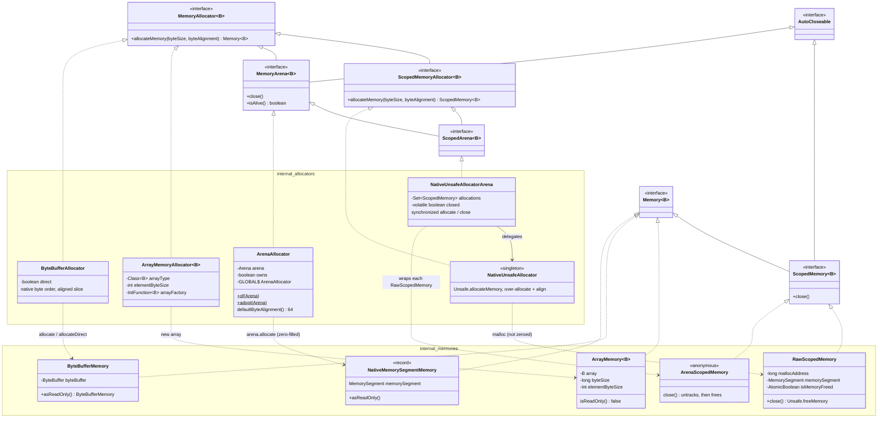

| Allocator | Entry point | Backing `B` | Device | Freed when | Zero-filled | Use after free |
|---|---|---|---|---|---|---|
| `ArrayMemoryAllocator` (×7) | `MemoryDomains.floats()` … | `boolean[]` … `double[]` | `JAVA:0` | GC | yes | impossible |
| `ByteBufferAllocator` | `MemoryAllocators.newByteBuffer(direct)` | `ByteBuffer` | `JAVA:0` | GC (Cleaner for direct) | yes | impossible |
| `ArenaAllocator` (borrowed) | `MemoryAllocators.ofArena(arena)` | `MemorySegment` | `PANAMA:0` | the arena's creator closes it; `close()` is a no-op | yes | `IllegalStateException` |
| `ArenaAllocator` (adopted) | `MemoryAllocators.adoptArena(arena)` | `MemorySegment` | `PANAMA:0` | `close()` closes the arena | yes | `IllegalStateException` |
| `NativeUnsafeAllocatorArena` | `MemoryAllocators.newScopedArena()` | `MemorySegment` | `PANAMA:0` | each `ScopedMemory.close()`, the rest at arena `close()` | **no** | **undefined** |

There is intentionally **no default native allocator**: native memory always names its lifetime.

`StridedCopy.releaseTemp` uses the scoped branch: a temporary staging buffer that happens to be a `ScopedMemory` is freed right away; arena memory waits for its arena.

---

## 3. Domains: the backends

A `MemoryDomain` is a backend: allocator + access + operations for one backing type on one device.
Three record implementations cover all the host backends; GPU backends (in other modules) implement the same interface with `directAccess() == null`.

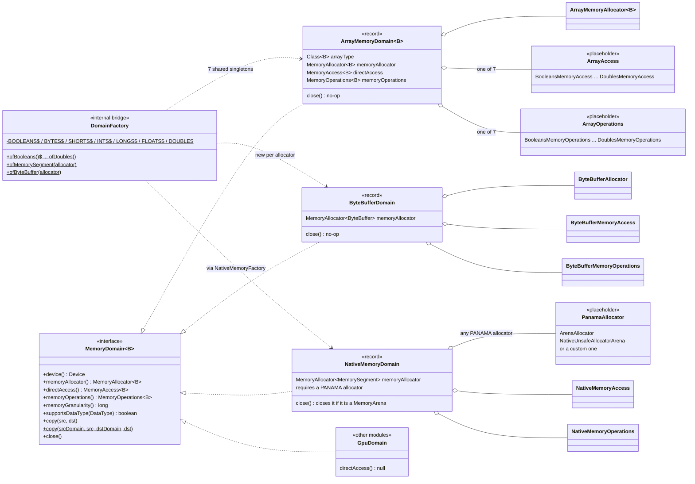

Ownership rule: **closing a domain closes its allocator**.
The array and `ByteBuffer` domains own nothing (GC-managed), so their `close()` is a no-op and the seven array domains are shared stateless singletons.
A native domain is always built *of* an allocator you name (`MemoryDomains.of(allocator)`); whether its `close()` frees memory depends on that allocator (borrowed arena: no; adopted or new arena: yes).

---

## 4. Element access and bulk operations per backend

Each backing type has one stateless singleton `MemoryAccess` (typed scalar reads/writes) and one `MemoryOperations` (bulk copy, fill, and the `MemorySegment` bridge), all obtained via `instance()`.
There are 19 such classes, so this section splits them into three small diagrams and a table.

### 4.1 Which classes exist, per backing type

| Backing `B` | `MemoryAccess` | `MemoryOperations` | Granularity | How elements are reached |
|---|---|---|---|---|
| `boolean[]` | `BooleansMemoryAccess` | `BooleansMemoryOperations` | 1 | `Unsafe`, a boolean read as byte 0/1; byte width only |
| `byte[]` | `BytesMemoryAccess` | `BytesMemoryOperations` | 1 | `Unsafe`, every width, unaligned |
| `short[]` | `ShortsMemoryAccess` | `ShortsMemoryOperations` | 2 | array index; short width only |
| `int[]` | `IntsMemoryAccess` | `IntsMemoryOperations` | 4 | array index; int (and float bits) only |
| `long[]` | `LongsMemoryAccess` | `LongsMemoryOperations` | 8 | array index; long (and double bits) only |
| `float[]` | `FloatsMemoryAccess` | `FloatsMemoryOperations` | 4 | array index; float (and int bits) only |
| `double[]` | `DoublesMemoryAccess` | `DoublesMemoryOperations` | 8 | array index; double (and long bits) only |
| `ByteBuffer` | `ByteBufferMemoryAccess` | `ByteBufferMemoryOperations` | 1 | absolute `get`/`put`, in the buffer's own byte order |
| `MemorySegment` | `NativeMemoryAccess` | `NativeMemoryOperations` | 1 | `ValueLayout.JAVA_*_UNALIGNED`; `copy*Native` is plain `MemorySegment.copy` |
| `Void` (raw address) | `UnsafeMemoryAccess` | none | 1 | `Unsafe` on absolute addresses; only used by its test |

### 4.2 `MemoryAccess`: one implementation per backend family

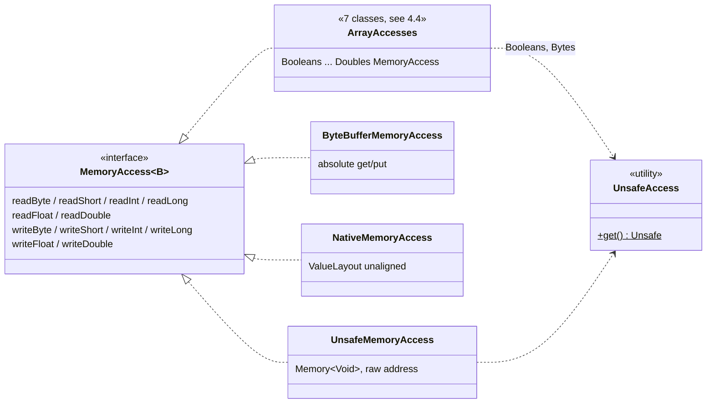

### 4.3 `MemoryOperations`: one implementation per backend family

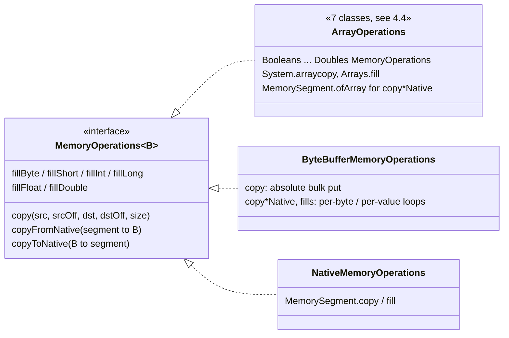

### 4.4 The array backends

The seven array backends repeat the same pattern, one access and one operations class per primitive array type.
`DomainFactory` combines each pair with an `ArrayMemoryAllocator` into one shared `ArrayMemoryDomain`.

Element access, one class per array type:

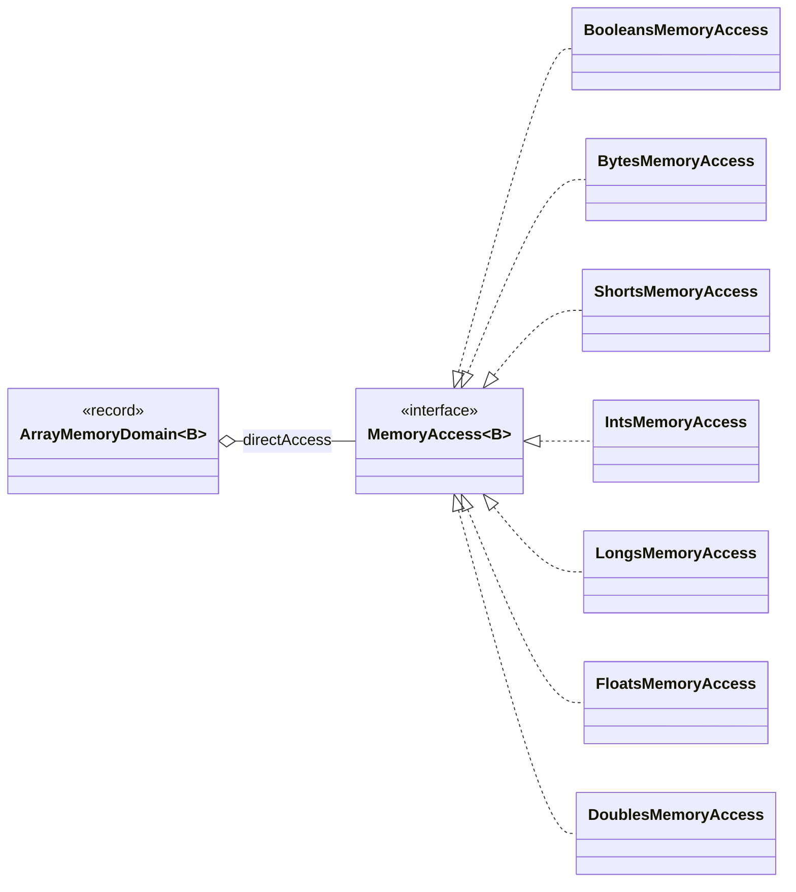

Bulk operations, one class per array type:

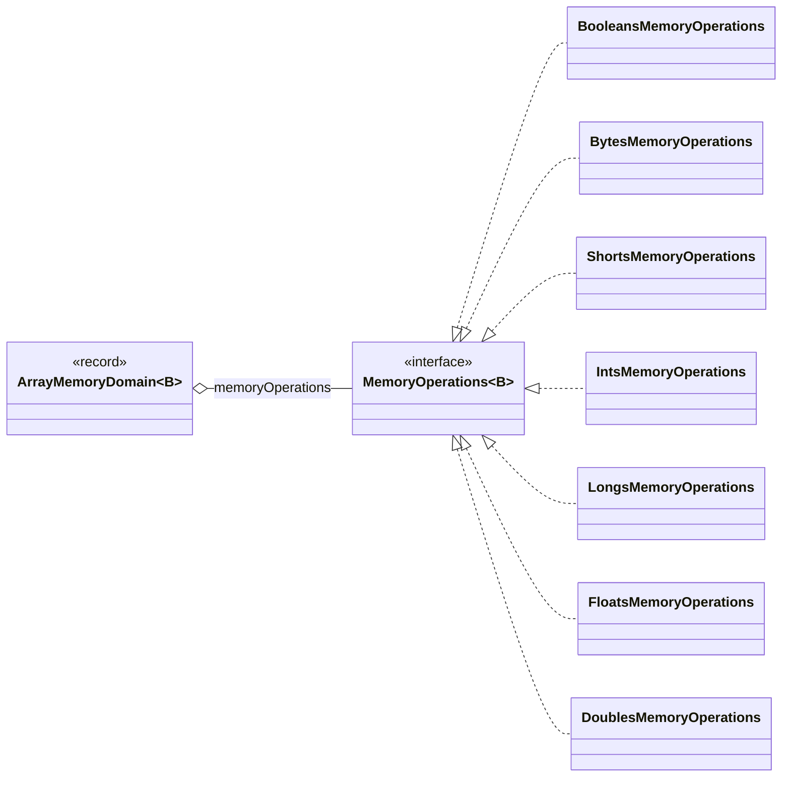

Notes on the array backends:

- The non-byte array accesses (`Shorts`, `Ints`, `Longs`, `Floats`, `Doubles`) only serve their element width, at element-aligned byte offsets.
  The same-width accessor reinterprets bits (`readInt` on `float[]` returns `floatToRawIntBits`); any other width throws `UnsupportedOperationException`.
- `BytesMemoryAccess` is byte-addressable and reads every width, unaligned, through `Unsafe`.
- `copyFromNative` / `copyToNative` go through `MemorySegment.ofArray(array)` and `MemorySegment.copy`, so arrays, buffers and native segments interoperate without extra code.
- Fills of another width replicate the bit pattern into each element (`fillByte` on `float[]` fills with `0x01010101 * b`); offset and size must stay element-aligned.

---

## 5. Views, strided copy and printing

`MemoryView` is immutable and cheap: every transform delegates the layout algebra to `ViewTransforms` (jota-core) and returns a new view over the same `Memory`, adjusting `byteOffset`.
The constructor validates dtype support and bounds.

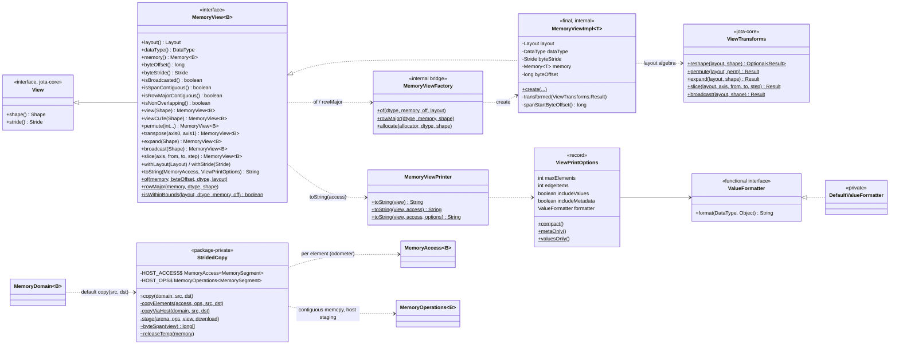

Contiguity vocabulary used throughout:

- **row-major contiguous** — dense C order; the only layout safe to copy as one block (`MemoryOperations.copy`).
- **span-contiguous** — gapless byte range in *some* order (a transposed square matrix).
  `viewCuTe` may reshape such a view (CuTe semantics) even when `view` would refuse.
- **non-overlapping** — no zero (broadcast) strides; two indices never alias one element.

`StridedCopy.copy` (used by `MemoryDomain.copy(src, dst)`):

1. both views row-major contiguous → a single `ops.copy`;
2. no `directAccess` (opaque domain) → `copyViaHost`: download each view's byte span into a confined `Arena`, copy element-wise on the host, upload the destination span (reading it back first if it has gaps);
3. same `Memory` on both sides → through a contiguous temporary (two passes) to survive aliasing;
4. otherwise → `copyElements`: an odometer over the flat dims with running byte offsets; 1/2/4/8-byte dtypes use typed access, any other width (block-quantized types) one `ops.copy` per element, so no dtype is ever special-cased.

---

## 6. Entry points and internal factories

The public constructors follow a naming convention that states ownership:

- `of(x)` — wraps `x`, inherits its lifetime, allocates nothing;
- `adopt(x)` — takes `x` over: closing the result closes `x`;
- `newX()` — creates something the caller owns (and closes, if `AutoCloseable`);
- bare noun (`floats()`) — a shared stateless instance (array backends only).

Each public entry point delegates to a `public` bridge in `internal`, so implementation classes stay package-private.

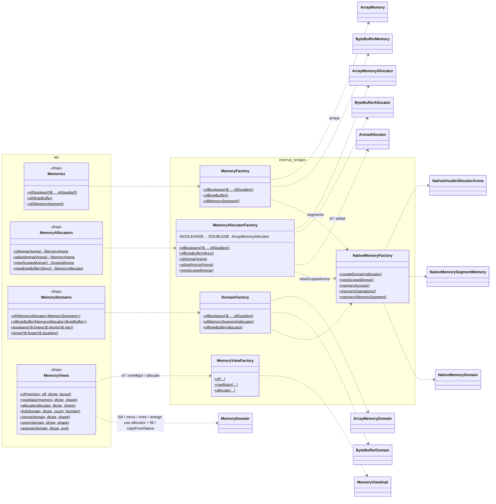

`MemoryViews.full/zeros/ones` allocate from the domain's allocator and fill with the domain's `MemoryOperations` (works on opaque domains).
`arange` builds the sequence in a host segment and transfers it with one `copyFromNative`, for the same reason.

---

## 7. Checks and low-level utilities

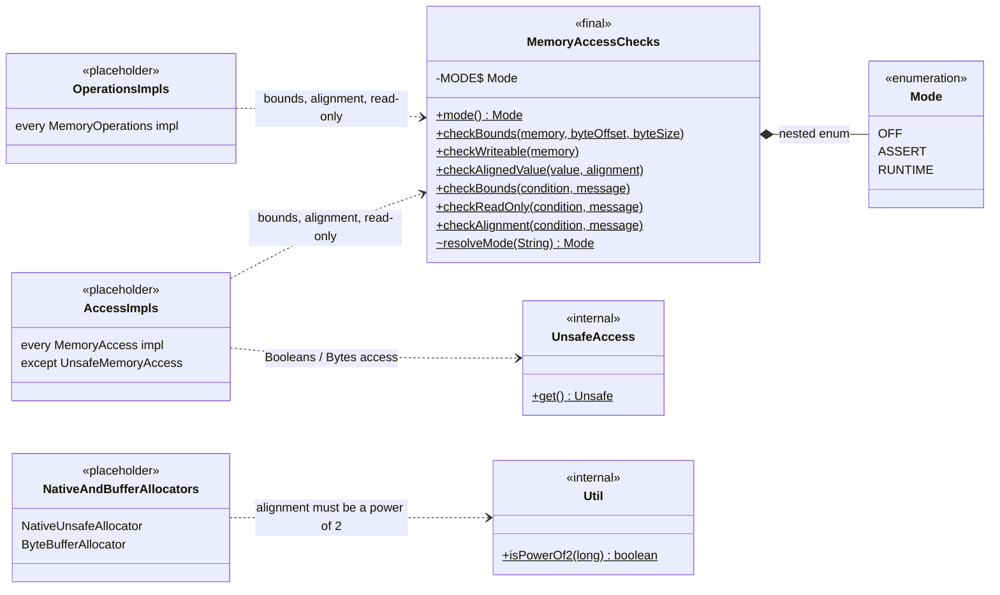

- `-Djota.memory.checks=off|assert|runtime` (default `runtime`) selects how a failed check fails: skipped, `assert`, or an exception.
- `Memory.isReadOnly()` is **advisory**: the implementations check it before writing, but `base()` hands out the raw storage and the JVM enforces nothing.
  Only `ByteBuffer`- and `MemorySegment`-backed memory can be read-only (`asReadOnly()`); arrays never are.

---

## 8. How a copy is routed

Not a class diagram, but it ties the pieces together: the static `MemoryDomain.copy(srcDomain, src, dstDomain, dst)` chooses between the same-backend path (§5) and the cross-backend path through `MemoryOperations.copy` and `MemorySegment` staging (§1).

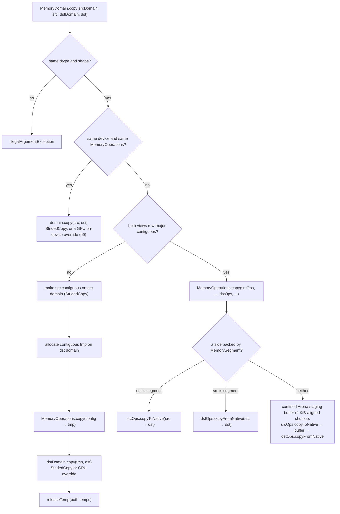

---

## 9. How jota-tensor and the backends use the memory layer

The IR never names a `MemoryOperations` call.
Arithmetic (`BinaryOp`, `ReductionOp`, …) is lowered to LIR and becomes kernel code; the memory layer only appears in three places:

- **binding**: kernel buffers are `MemoryView`s, and LIR offsets are computed from their byte strides;
- **element access**: LIR loads and stores turn into `MemoryAccess.read*` / `write*` on the Java paths;
- **data movement at the edges**: creating tensors, constants, and moving data between devices, through `MemoryDomain.copy` and `MemoryOperations`.

### 9.1 From tensor operations to memory calls

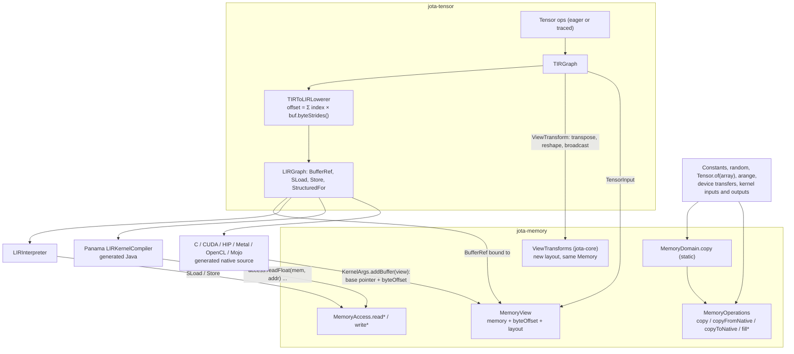

### 9.2 LIR nodes and the memory layer

| LIR node | Meaning | Memory layer |
|---|---|---|
| `BufferRef` | a kernel input or output | bound to a `MemoryView` (`LIRInterpreter.Bindings`, or `KernelArgs.addBuffer(view)` for compiled kernels) |
| `SLoad(buffer, offset, dtype)` | read one scalar at `view.byteOffset() + offset` | `MemoryAccess.read*` |
| `Store(buffer, offset, value)` | write one scalar | `MemoryAccess.write*` |

`TIRToLIRLowerer` builds each offset expression from the loop indices and `buf.byteStrides()` (`layout.stride() × dtype.byteSize()`), the same formula as `MemoryView.byteStride()`.
Strided, broadcast and sliced inputs are therefore read in place, without a copy.

How each execution path performs `SLoad` / `Store`:

- `LIRInterpreter` (`jota-tensor`) calls `readScalar` / `writeScalar`, which pick the width from the dtype: `FP32` → `readFloat`, `FP64` → `readDouble`, `FP16` / `BF16` → `readShort` plus a conversion, `I8` / `BOOL` → `readByte`, the other integers → `readShort` / `readInt` / `readLong`.
- The Panama backend's `LIRKernelCompiler` generates Java source that fetches `memoryDomain.directAccess()` once and emits `access.readFloat(mem, addr)` and friends, so compiled Java kernels run on `NativeMemoryAccess`.
- The C and GPU backends generate C, CUDA, HIP, Metal, OpenCL or Mojo source with raw pointer arithmetic.
  `MemoryAccess` is not used inside those kernels; the host only passes `memory.base()` and `byteOffset` through `KernelArgs`.

### 9.3 TIR nodes and tensor operations

| TIR node or tensor operation | Memory layer used |
|---|---|
| `TensorInput` | an existing `MemoryView`, bound as is |
| `ViewTransform` (transpose, reshape, unsqueeze, broadcast, …) | `ViewTransforms` computes a new layout and an element offset delta: a new `MemoryView` over the same `Memory`, no copy (the same algebra as `MemoryView.permute` / `expand` / `view`) |
| `ViewTransform` that is not expressible as a view, `Contiguous` | `TIRInterpreter` copies element by element into a row-major temporary from a `MemoryAllocators.newScopedArena()` (`TIREvalContext`), with its own loop rather than `StridedCopy` |
| `ScalarConstant` (`ConstantComputation`) | allocate one element and write it with `MemoryAccess.write*`; on an opaque domain, write it on the host and upload it with `MemoryDomain.copy`; then broadcast it with zero strides |
| `IotaConstant` / range (`RangeComputation`) | `MemoryViews.arange`: the sequence is built on the host, then one `copyFromNative` |
| `RandomUniformOp` (`RandomComputation`), `Tensor.of(float[])` and friends (`TensorFactory`) | data in a host segment, then static `MemoryOperations.copy(HOST ops → device ops)`, which reduces to `copyFromNative` |
| device transfer (`ScheduledExecutor.ensureDeviceView`, `TensorSupport.transferToDevice`) | allocate a row-major destination on the target domain, then static `MemoryDomain.copy(srcDomain, src, dstDomain, dst)` |
| scalar tensor passed as a kernel argument (`LIRKernelArgsBuilder.readScalarBits`) | if its memory is not a `MemorySegment`, `MemoryDomain.copy` it to the native host domain, then read it |
| kernel inputs and outputs in each `*ComputeEngine` | static `MemoryDomain.copy` between the host and device domains |

Nothing in `jota-tensor` or the backends calls `fill*` directly; the only caller is `MemoryViews.full` / `zeros` / `ones`.
Constants avoid fills by allocating one element and broadcasting it with zero strides.

### 9.4 Backend memory domains

Every backend plugs into the memory layer with its own `MemoryDomain`.

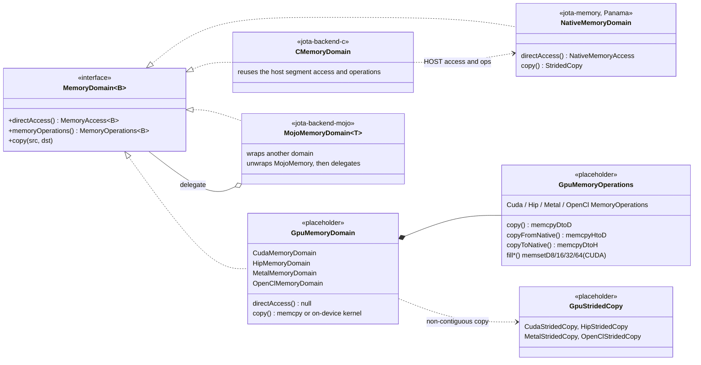

On a GPU domain, `directAccess()` returns `null`, so everything generic in `jota-memory` falls back to `copyToNative` / `copyFromNative`.
A heap `MemorySegment` given to `copyFromNative` is first copied into a native staging segment, because the driver needs an address.

Each GPU domain overrides `MemoryDomain.copy(src, dst)`: a contiguous pair is one `memcpy`, anything else runs an on-device strided-copy kernel.
This is what keeps the rule from `jota/CLAUDE.md` ("every backend must handle strided operands on-device"): without the override, the default `StridedCopy` would download the views' byte spans to the host (`copyViaHost`).
