# jota-tensor — Architecture

`jota-tensor` is the backend-independent core of Jota: the lazy `Tensor` API, the two intermediate representations (TIR, LIR), the scheduling of a traced graph into kernels, and the runtime SPI that the device backends (`jota-backend-panama`, `-c`, `-cuda`, `-hip`, `-metal`, `-opencl`, `-mojo`) implement.

Value types such as `DataType`, `Shape`, `Stride`, `Layout`, `Device` and the `memory` package (`MemoryView`, `MemoryDomain`, `Memory`, …) come from the core module and appear here only as references.

| Package | Classes | Role |
|---|---|---|
| `com.qxotic.jota` | `Environment`, `EnvironmentImpl`, `TypeRules` | Global/scoped configuration: default device, default float type, runtime registry; dtype promotion rules |
| `com.qxotic.jota.tensor` | 22 | Public `Tensor` API, its lazy implementations, tracing to TIR, scheduled execution |
| `com.qxotic.jota.ir` | `IRNode`, `TIRToLIRLowerer`, `TextRenderUtils` | Common IR root and the TIR → LIR lowering |
| `com.qxotic.jota.ir.tir` | 39 | **Tensor IR**: immutable, shape-typed operation DAG, its passes, scheduler and reference interpreter |
| `com.qxotic.jota.ir.lir` | 35 | **Loop IR**: explicit loops, index math, loads/stores over buffers; hash-consed expression graph |
| `com.qxotic.jota.ir.lir.scratch` | 4 | Liveness analysis and scratch-memory layout for intermediate buffers |
| `com.qxotic.jota.runtime` | 27 | Device runtimes, compute engines, kernel programs, compilation, caches, launch arguments |
| `com.qxotic.jota.runtime.spi` | 3 | `DeviceRuntimeProvider` service-loader SPI and probing |
| `com.qxotic.jota.runtime.clike` | 11 | Shared LIR → C-like source generator (C, CUDA, HIP, OpenCL, Metal dialects) |
| `com.qxotic.jota.random` | 4 | Counter-based random number keys and algorithms |

---

## 1. Overview: from a `Tensor` call to a kernel launch

```mermaid
flowchart LR
    subgraph API["tensor package"]
        T["Tensor (API)"] --> TS["TensorSupport / ConstantFolder"]
        TS --> TR["Tracer + IRTensorOps"]
        TR --> IC["IRComputation (LazyComputation)"]
    end
    subgraph TIR["ir.tir"]
        G["TIRGraph"] --> P["TIRCSEPass, TIRConstantFoldingPass"]
        P --> S["TIRSchedulePass"]
        S --> SP["ScheduledProgram = KernelStep*"]
    end
    subgraph EXE["tensor + runtime"]
        SE["ScheduledExecutor"] --> CE["ComputeEngine.execute(stepGraph)"]
    end
    subgraph LIR["ir / ir.lir (in backend engines)"]
        L["TIRToLIRLowerer"] --> LG["LIRGraph"]
        LG --> LP["LIRStandardPipeline"]
        LP --> SA["ScratchAnalysisPass"]
    end
    subgraph GEN["runtime.clike + runtime"]
        KG["CLikeKernelGenerator + dialect"] --> KP["KernelProgram"]
        KP --> KB["KernelBackend.getOrCompile"]
        KB --> KX["KernelExecutable.launch(KernelArgs)"]
    end
    IC -- "materialize()" --> G
    SP --> SE
    CE --> L
    SA --> KG
```

Key ideas:

* **Tensors are lazy.** Every op returns a new `Tensor`; nothing runs until `materialize()`.
* **Tracing** turns a chain of eager-looking calls into an immutable `TIRGraph` (a DAG of sealed `TIRNode` records).
* **Scheduling** splits the TIR graph into `KernelStep`s, each with one materialized output.
* Each step is handed to the device's `ComputeEngine`.
  GPU/C engines lower it to **LIR**, optimize it, generate source code through the C-like generator, compile it (with caching), and launch it.

---

## 2. Environment and runtime discovery (SPI)

`Environment` is the entry point for configuration.
It is resolved through a scoped value (`Environment.with(env, action)`) or the global default (`Environment.global()`), and gives access to the `RuntimeRegistry`.
`DefaultRuntimeRegistry` is filled by `EnvironmentImpl` from every `DeviceRuntimeProvider` found by `ServiceLoader`, filtered by include/exclude backend selectors; each provider reports a `RuntimeProbe` so missing drivers produce a `RuntimeDiagnostic` instead of an error.

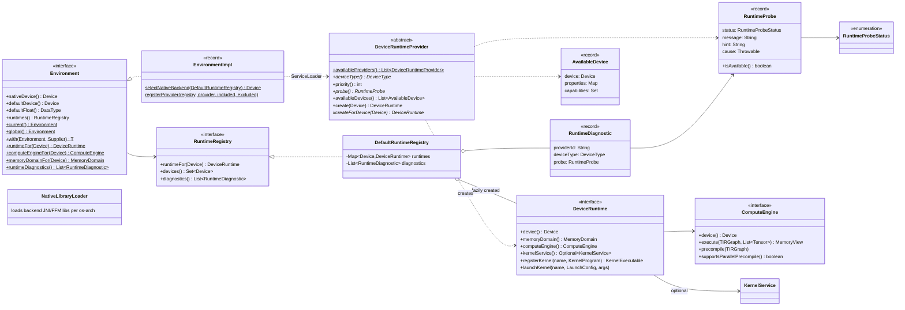

Backends supply the concrete classes, e.g. `PanamaRuntimeProvider` / `PanamaDeviceRuntime` / `PanamaLirComputeEngine`, `HipRuntimeProvider` / `HipDeviceRuntime` / `HipComputeEngine`, and likewise for CUDA, OpenCL, Metal, Mojo and C.

---

## 3. Tensor API and its implementations

`Tensor` is the only public type of the package (≈160 methods: element-wise, comparison, bitwise/logical, reductions, matmul, gather/embedding, view ops, factories such as `zeros`, `iota`, `rand`, `concat`…).
All implementations share `AbstractTensorImpl`, which dispatches each op through `TensorSupport`: constant folding first, then the IR ops of the active trace, or a fresh one-op trace.

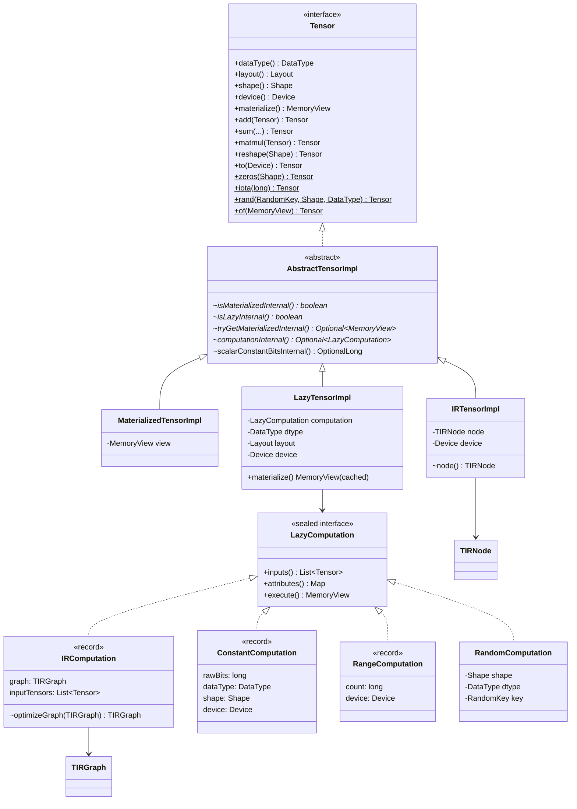

* `MaterializedTensorImpl` wraps an existing `MemoryView` (already computed data).
* `LazyTensorImpl` holds a `LazyComputation` and materializes it once on demand.
* `IRTensorImpl` exists **only during tracing**: it is a symbolic tensor pointing at a `TIRNode`; calling `materialize()` on it is an error.

### Package-private helpers

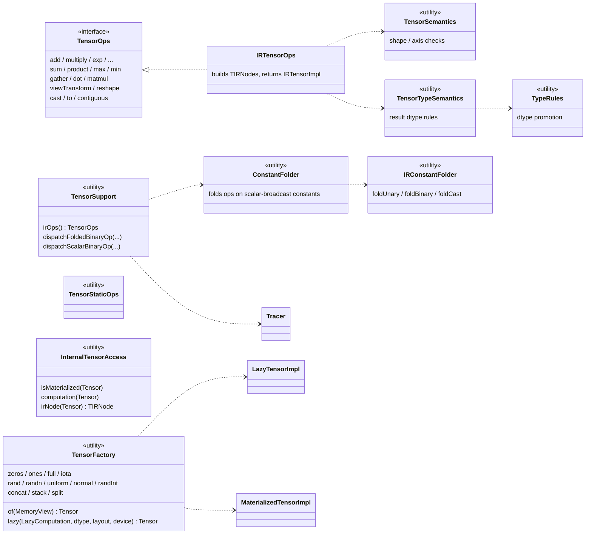

---

## 4. Tracing, scheduling and lazy execution

`Tracer` installs an `IRTensorOps` in a `ScopedValue`.
Inside the scope every op builds TIR nodes; at the end the output node becomes a `TIRGraph` wrapped in an `IRComputation`, returned as a `LazyTensorImpl`.
`Tracer.traceFunction(...)` returns a reusable function built on the same mechanism.

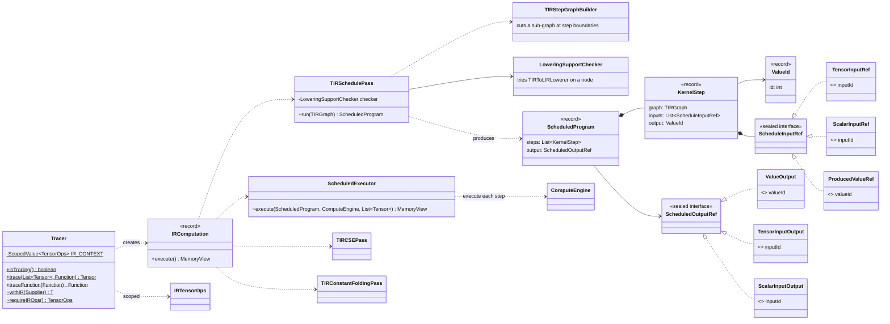

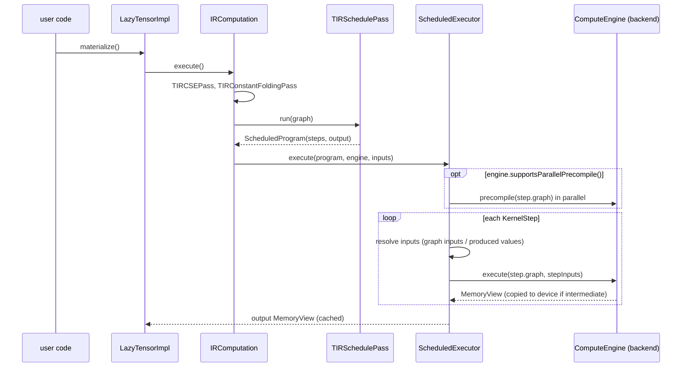

---

## 5. TIR — Tensor IR nodes

TIR nodes are immutable records forming a DAG.
Every node has a `DataType` and a `Shape`; only `TensorInput` and `ViewTransform` carry a layout.
`TIRNode` is sealed, so visitors and `switch` patterns are exhaustive.

```mermaid
classDiagram
    direction TB
    class IRNode {
        <<interface>>
        +dataType() DataType
    }
    class TIRNode {
        <<sealed interface>>
        +shape() Shape
        +accept(TIRVisitor~T~) T
    }
    class TIRGraph {
        <<record>>
        inputs: List~TIRNode~
        outputs: List~TIRNode~
    }
    class TensorInput {
        <<record>>
        id: int
        dataType: DataType
        layout: Layout
    }
    class ScalarInput {
        <<record>>
        id: int
        dataType: DataType
    }
    class ScalarConstant {
        <<record>>
        rawBits: long
        dataType: DataType
    }
    class IotaConstant {
        <<record>>
        count: long
        dataType: DataType
    }
    class RandomUniformOp {
        <<record>>
        dataType: DataType
        key0: long
        key1: long
    }
    class UnaryOp {
        <<record>>
        op: UnaryOperator
        input: TIRNode
    }
    class BinaryOp {
        <<record>>
        op: BinaryOperator
        left: TIRNode
        right: TIRNode
    }
    class TernaryOp {
        <<record>>
        op: TernaryOperator
        cond, trueValue, falseValue
    }
    class CastOp {
        <<record>>
        input: TIRNode
        targetDataType: DataType
    }
    class ReductionOp {
        <<record>>
        op: ReductionOperator
        input: TIRNode
        axes: int[]
        keepDims: boolean
        accumulatorType: DataType
    }
    class GatherOp {
        <<record>>
        input: TIRNode
        indices: TIRNode
        axis: int
    }
    class ViewTransform {
        <<record>>
        input: TIRNode
        operation: ViewOperation
    }
    class Contiguous {
        <<record>>
        input: TIRNode
    }

    IRNode <|-- TIRNode
    TIRGraph o-- TIRNode
    TIRNode <|.. TensorInput
    TIRNode <|.. ScalarInput
    TIRNode <|.. ScalarConstant
    TIRNode <|.. IotaConstant
    TIRNode <|.. RandomUniformOp
    TIRNode <|.. UnaryOp
    TIRNode <|.. BinaryOp
    TIRNode <|.. TernaryOp
    TIRNode <|.. CastOp
    TIRNode <|.. ReductionOp
    TIRNode <|.. GatherOp
    TIRNode <|.. ViewTransform
    TIRNode <|.. Contiguous
```

Operators and view operations:

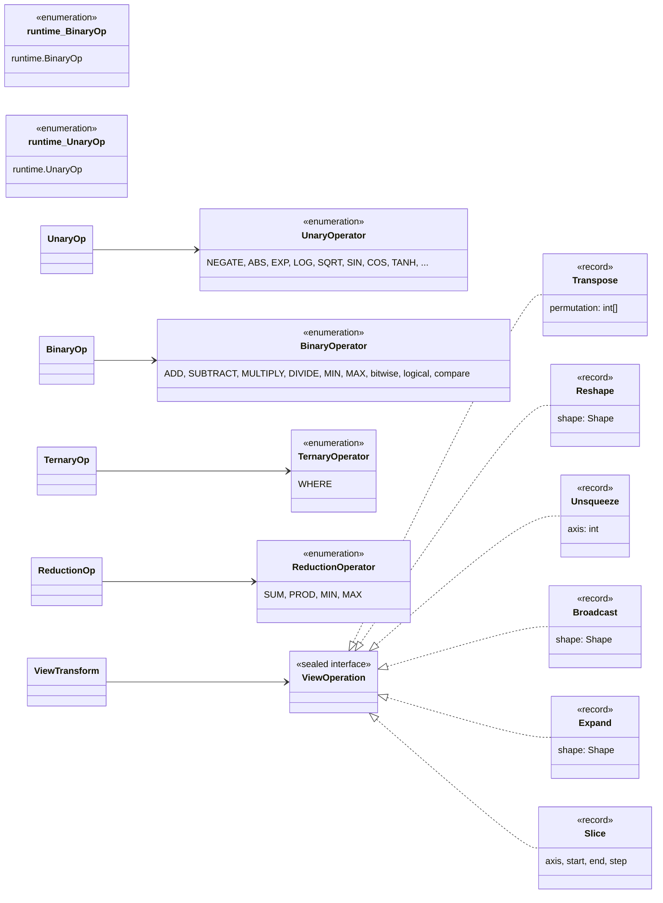

`runtime.BinaryOp` / `runtime.UnaryOp` are the tensor-level op identifiers used by `AbstractTensorImpl`/`ConstantFolder` dispatch; they are mapped onto the TIR operator enums.

---

## 6. TIR passes, visitors and the reference interpreter

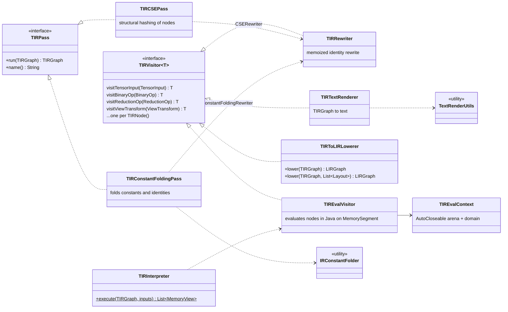

`TIRInterpreter` is a slow but complete Java evaluator, used as an oracle by tests and by backends that fall back to it.
`TIRToLIRLowerer` is the bridge to the next level.

---

## 7. LIR — Loop IR

LIR makes iteration and memory explicit.
A `LIRGraph` has buffer/scalar inputs, output buffers and a body expression.
Nodes live in an `LIRExprGraph`, which hash-conses them (one node per structure), keeps use lists, and runs a canonicalization worklist.
Nodes are split into **scalar** (`S*`) values, **index** (`I*`) arithmetic, and **statements** (`Block`, `Store`, `Yield`, `StructuredFor`); `LIRExprKind` names each kind.

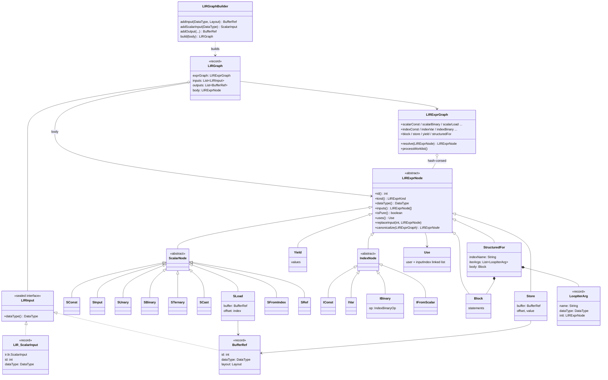

(`LIRGraphBuilder` is `LIRGraph.Builder`; `LIR_ScalarInput` is `ir.lir.ScalarInput`, not to be confused with the TIR record of the same name.)

Reductions lower to a `StructuredFor` whose `LoopIterArg`s carry the accumulators and whose body ends with a `Yield`; `SRef` reads a loop-carried value by name.

---

## 8. LIR passes, scratch memory and interpreter

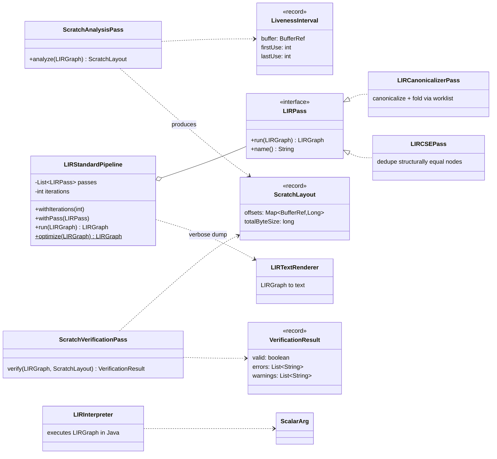

`ScratchAnalysisPass` computes liveness intervals of intermediate buffers and packs them into a single scratch allocation (`ScratchLayout.offsets` + `totalByteSize`), which the generated kernel receives as one extra buffer.

---

## 9. Kernel programs, compilation and caching

### Kernel programs and execution

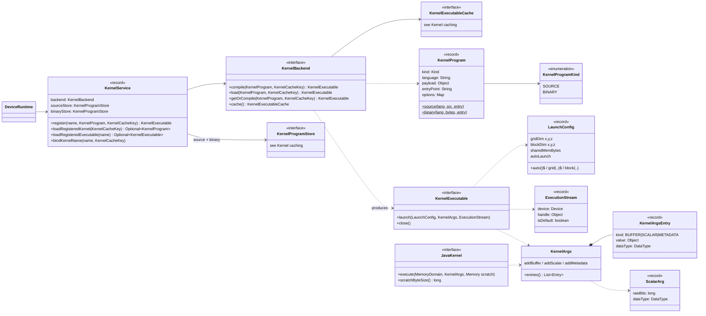

### Kernel caching

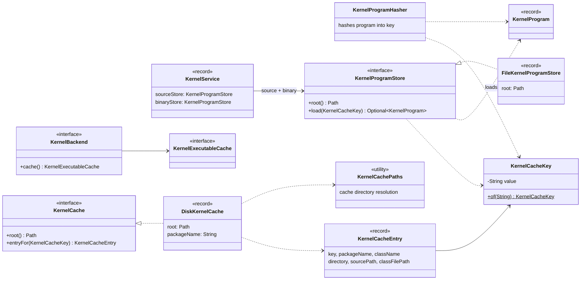

### Per-backend executable caches

`KernelExecutableCache` (nested in `KernelBackend`) is the in-memory map from a `KernelCacheKey` to a loaded `KernelExecutable`.
Each backend module holds its own private `InMemoryKernelCache` implementation, one per `KernelBackend` instance.
The Mojo backend has none: it wraps another backend and returns that backend's cache.

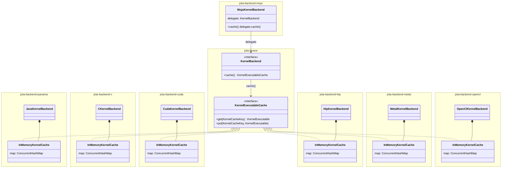

* `KernelService` is a device runtime's registry of named kernels; it is also how user code registers hand-written kernels (`DeviceRuntime.registerKernel/launchKernel`).
* `DiskKernelCache` + `JavaKernel` serve the Panama backend, which generates and compiles Java classes; GPU/C backends cache compiled binaries through `KernelBackend.cache()` and `FileKernelProgramStore`.

---

## 10. C-like code generation (`runtime.clike`)

One generator serves every C-family backend.
A backend provides a `CLikeDialect` (e.g. `HipDialect`, `CudaDialect`, `OpenClDialect`, `MetalDialect`, C) that subclasses `CLikeLirSourceGenerator` and fills in the dialect-specific pieces: kernel signature, thread-id expression, type names, literals, casts and math function names.

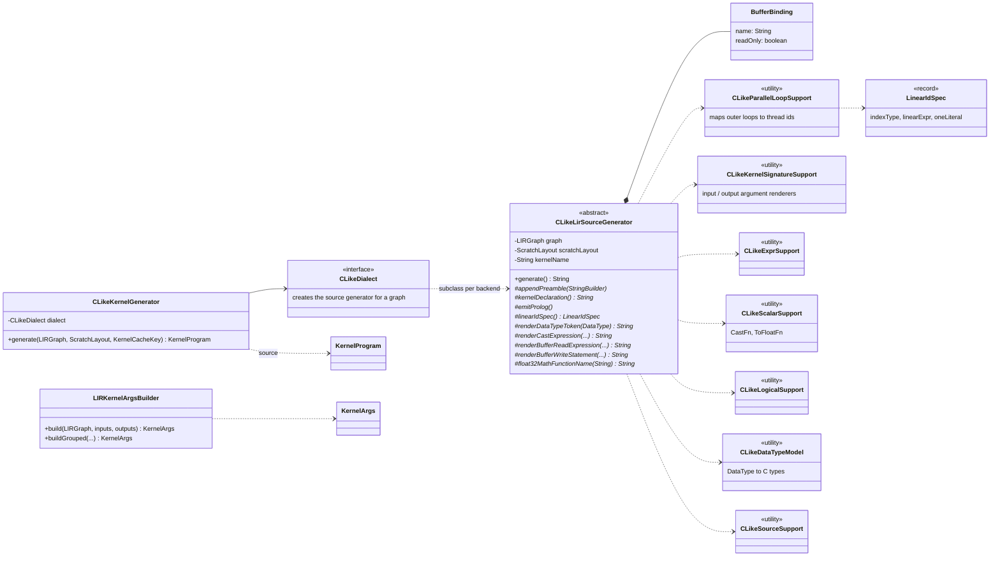

Typical backend `ComputeEngine.execute(TIRGraph, inputs)` (e.g. `HipComputeEngine`):

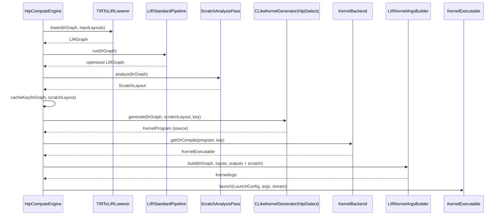

---

## 11. Random numbers

Random tensors are counter-based: a `RandomKey` (two 64-bit words) plus the element index fully determine each value, so the same result is produced by `RandomComputation` (eager), by the TIR interpreter, and by generated kernels (`RandomUniformOp` carries `key0`/`key1`).

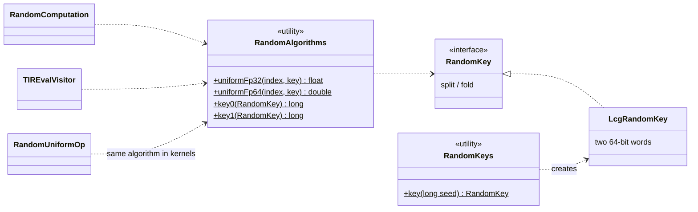
