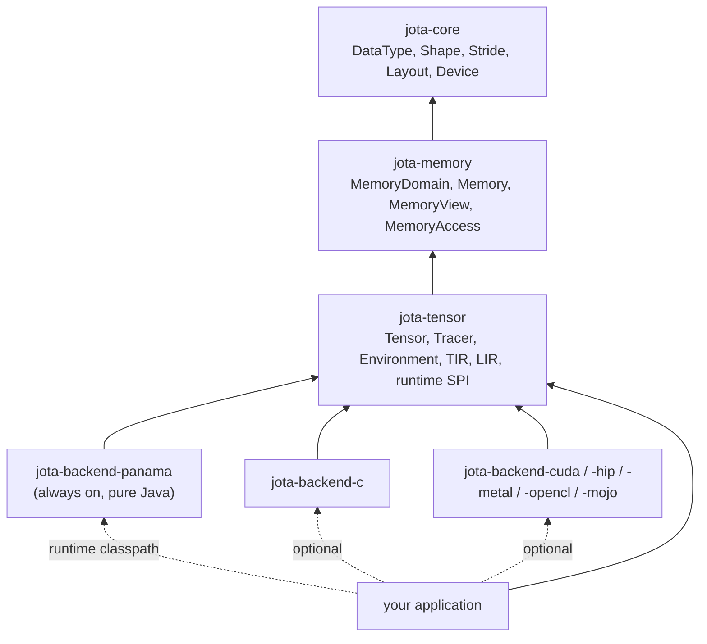
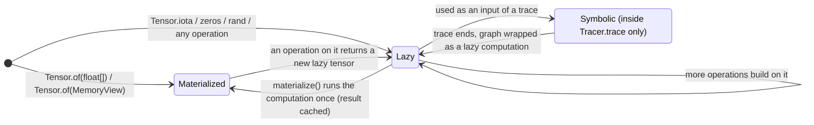
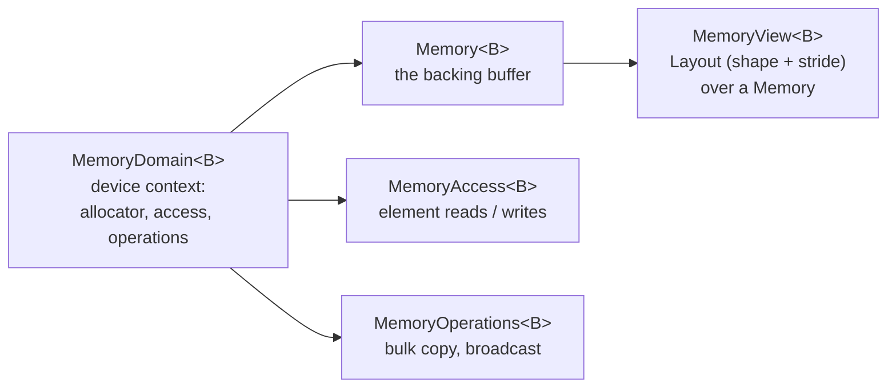
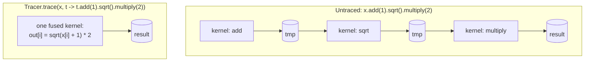
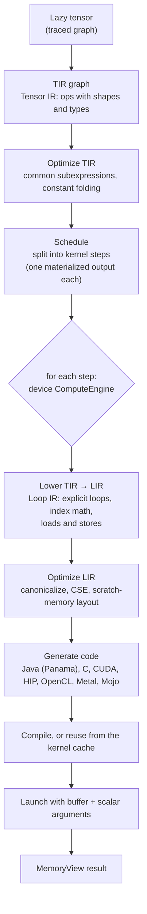
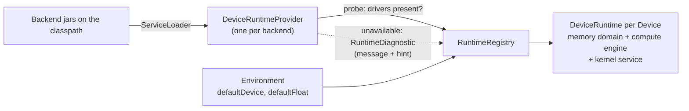
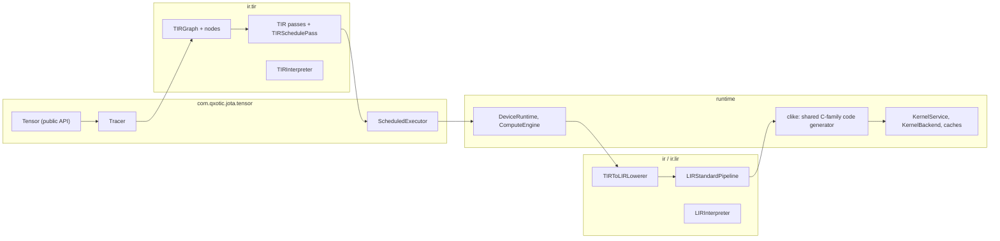

# jota-tensor — Developer Guide: Getting Started

This guide is for developers who want to use or contribute to `jota-tensor`.
It starts from the basics and builds up the high-level concepts one at a time, with runnable code samples.
For the class-level view (every package and class, with UML diagrams), read [docs/ARCHITECTURE.md](ARCHITECTURE.md) next.

---

## 1. What is jota-tensor?

Jota (JVM Open Tensor Algebra) is a tensor engine for the JVM, inspired by tinygrad and JAX.
You write tensor code once in Java, and it runs on any available backend: Panama (pure Java), C, CUDA, HIP, Metal, OpenCL or Mojo.

Three ideas make it different from a plain array library:

1. **Tensors are lazy.** An operation does not compute anything; it describes a computation.
2. **Computations are compiled.** When you ask for a result, jota turns the description into a kernel for your device and runs it.
3. **Backends are plugins.** Putting a backend jar on the classpath is enough; it registers itself.

`jota-tensor` sits on top of two lower layers and below the backends:



---

## 2. Setting up

Java 25 is required.
`jota-tensor` and the backends are not on Maven Central yet, so build them from the repository:

```bash
mvn -f jota/pom.xml install -DskipTests        # or: cd jota && mvnd install -DskipTests
```

Then depend on the tensor module plus at least one backend:

```xml
<dependency>
    <groupId>com.qxotic</groupId>
    <artifactId>jota-tensor</artifactId>
    <version>${jota.version}</version>
</dependency>
<dependency>
    <groupId>com.qxotic</groupId>
    <artifactId>jota-backend-panama</artifactId>
    <version>${jota.version}</version>
    <scope>runtime</scope>
</dependency>
```

Run your JVM with `--enable-native-access=ALL-UNNAMED`, because the memory layer and the native backends call restricted FFM methods.

---

## 3. Your first program

```java
import com.qxotic.jota.DataType;
import com.qxotic.jota.Environment;
import com.qxotic.jota.Shape;
import com.qxotic.jota.memory.MemoryAccess;
import com.qxotic.jota.memory.MemoryView;
import com.qxotic.jota.tensor.Tensor;
import com.qxotic.jota.tensor.Tracer;

public class HelloJota {
    public static void main(String[] args) {
        Tensor x = Tensor.iota(6, DataType.FP32).view(Shape.of(2, 3)); // [[0,1,2],[3,4,5]]

        // Trace a small function: (a + b) + 3.14
        Tensor result =
                Tracer.trace(x, Tensor.scalar(2f), (a, b) -> a.add(b).add(Tensor.scalar(3.14f)));

        // Nothing has been computed yet. materialize() compiles and runs the kernel.
        MemoryView<?> out = result.materialize();

        MemoryAccess access = Environment.nativeMemoryDomain().directAccess();
        System.out.println(out.toString(access));
    }
}
```

This is `com.qxotic.jota.Canary` from the test kit.
It already shows every concept of this guide: creating tensors, views, operations, tracing, materialization and reading the result back.

---

## 4. The building blocks: data types, shapes, layouts

These types come from `jota-core`.

| Concept | Type | Example |
|---|---|---|
| Element type | `DataType` | `DataType.FP32`, `FP16`, `BF16`, `FP64`, `I8`, `I16`, `I32`, `I64`, `BOOL` |
| Logical dimensions | `Shape` | `Shape.of(2, 3)`, `Shape.flat(6)`, nested: `Shape.of(2, Shape.of(3, 4), 5)` |
| Memory steps per dimension | `Stride` | row-major `[3, 1]` for a `2×3` tensor |
| Shape + stride | `Layout` | `Layout.rowMajor(Shape.of(2, 3))` |
| Where data lives | `Device` | `DeviceType.PANAMA.deviceIndex(0)`, `DeviceType.CUDA.deviceIndex(0)` |

Jota is **strict by default**.
There is no implicit broadcasting between different shapes (only scalars broadcast) and no lossy implicit type promotion.
If you want a `[2,1]` tensor combined with a `[2,3]` tensor, say so with `broadcast(...)`; if you want `I64` values as floats, say so with `cast(...)`.

Axes follow the wrap-around convention: a parameter named `_axis` accepts negative values, so `-1` is the last axis.

---

## 5. Tensors: a description of a computation

A `Tensor` has a data type, a layout (shape + stride) and a device.
It does **not** necessarily have data.
Internally a tensor is in one of three states:



* **Materialized**: backed by a `MemoryView` (real memory on some device).
* **Lazy**: holds a recipe (a constant, an iota range, random numbers, or a traced graph) that runs on `materialize()`.
* **Symbolic**: exists only while a function is being traced; it is a node in a graph and cannot be materialized.

### Creating tensors

```java
Tensor a = Tensor.of(new float[] {1f, 2f, 3f, 4f, 5f, 6f}, Shape.of(2, 3)); // copies Java data
Tensor b = Tensor.zeros(DataType.FP32, Shape.of(2, 3));
Tensor c = Tensor.ones(Shape.of(2, 3));                    // default float type (FP32)
Tensor d = Tensor.full(7L, Shape.flat(4));                 // I64 filled with 7
Tensor e = Tensor.iota(6);                                 // I64: 0, 1, ..., 5
Tensor s = Tensor.scalar(3.14f);                           // rank-0 tensor
Tensor m = Tensor.of(someMemoryView);                      // wrap memory you already own
```

Constants such as `zeros`, `full` and `scalar` are stored as a single value broadcast with stride 0; they cost no memory and are folded into kernels as literals.

### Operations

Every operation returns a new `Tensor`; inputs are never modified.

| Family | Examples |
|---|---|
| Arithmetic | `add`, `subtract`, `multiply`, `divide`, `negate`, `abs`, `reciprocal`, `square`, `min`, `max` |
| Math | `exp`, `log`, `sqrt`, `rsqrt`, `sin`, `cos`, `tanh`, `sigmoid`, `relu`, `silu`, `gelu` |
| Comparison / logic | `equal`, `lessThan`, `greaterThan`, `logicalAnd`, `logicalNot`, `where`, `clip` |
| Bitwise | `bitwiseAnd`, `bitwiseOr`, `bitwiseXor`, `leftShift`, `rightShift`, `rightShiftUnsigned` |
| Reductions | `sum(accType, axes…)`, `mean`, `max(axes…)`, `min`, `product`, `argmax`, `argmin`, `all`, `any` |
| Linear algebra | `dot`, `matmul`, `batchedMatmul` |
| Views (no copy) | `view`, `reshape`, `transpose`, `permute`, `slice`, `broadcast`, `expand`, `squeeze`, `unsqueeze` |
| Indexing | `gather`, `embeddingLookup` |
| Composition | `Tensor.concat`, `Tensor.stack`, `Tensor.split`, `repeat`, `repeatInterleave` |
| Type / place | `cast(DataType)`, `to(Device)`, `contiguous()` |

```java
Tensor y = Tensor.iota(6, DataType.FP32).view(Shape.of(2, 3)).add(1.0f).sqrt();
Tensor rowSums = Tensor.iota(6, DataType.FP32).view(Shape.of(2, 3)).sum(DataType.FP32, 1); // shape [2]
Tensor mask = Tensor.iota(5).lessThan(Tensor.full(2L, Shape.flat(5)));                      // BOOL
Tensor t = Tensor.iota(6).view(Shape.of(2, 3)).transpose(0, 1);                              // shape [3,2]
```

Reductions take an explicit accumulator type (`sum(DataType.FP32, …)`), so you decide whether an `FP16` sum accumulates in `FP16` or `FP32`.

---

## 6. Getting results: `materialize()`

`materialize()` is the only call that runs work.
It returns a `MemoryView<?>`: a typed, laid-out view over memory on the tensor's device.

```java
MemoryView<?> out = y.materialize();
out.dataType();   // FP32
out.shape();      // [2, 3]
```

To read individual values on the host, use a `MemoryAccess` from the memory domain:

```java
MemoryDomain<MemorySegment> host = Environment.nativeMemoryDomain();
MemoryView<MemorySegment> view = (MemoryView<MemorySegment>) y.to(host.device()).materialize();
MemoryAccess<MemorySegment> access = host.directAccess();
float first = access.readFloat(view.memory(), view.byteOffset());
System.out.println(view.toString(access));   // pretty-prints the whole tensor
```

The memory model has five layers, from `jota-memory`:



`B` is the buffer type of the domain: `MemorySegment` on the host, a device pointer wrapper on a GPU.

---

## 7. Tracing: how operations get fused into one kernel

This is the most important concept for performance.

**Without tracing**, every operation is its own tiny graph.
When you call `materialize()`, each step becomes a separate kernel, and each intermediate result is written to memory.

**With `Tracer.trace`**, the whole function is recorded into one graph, optimized as a whole, and usually compiled into one fused kernel.



```java
// One-shot trace: returns a lazy tensor whose graph covers the whole lambda.
Tensor out = Tracer.trace(x, t -> t.add(1.0f).sqrt().multiply(2.0f));

// Two inputs
Tensor sum = Tracer.trace(a, b, (p, q) -> p.multiply(q).add(p));

// Any number of inputs
Tensor z = Tracer.trace(List.of(a, b, c), in -> in.get(0).add(in.get(1)).multiply(in.get(2)));

// No inputs: iota and constants are generated inside the kernel
Tensor img = Tracer.trace(() -> mandelbrot(800, 600, 100));

// Random tensors are created outside and passed in; they are still generated in-kernel
Tensor noise = Tensor.rand(Tensor.randomKey(42), Shape.of(2, 3), DataType.FP32);
Tensor noisy = Tracer.trace(x, noise, (p, n) -> p.add(n));
```

### Reusable traced functions

`Tracer.traceFunction` traces once and returns a Java function you can call many times with new data.
The input **shapes and layouts** are fixed at trace time; only the data changes.
Scalars and constants created inside the lambda are baked into the graph; any other tensor the lambda uses must be passed as an input (a captured tensor fails with `Expected IRTensorImpl`).

```java
Function<Tensor, Tensor> gelu = Tracer.traceFunction(sampleInput, Tensor::gelu);

for (Tensor batch : batches) {
    MemoryView<?> result = gelu.apply(batch).materialize(); // same graph, compiled kernel is reused from cache
}
```

### What can be inside a trace

Inside the lambda you use the normal `Tensor` API.
Do **not** call `materialize()` inside a trace: tensors there are symbolic.
Control flow must not depend on tensor values (there is no data-dependent control flow in the IR); plain Java loops that unroll a fixed number of times are fine:

```java
static Tensor iterate(Tensor z, Tensor c, int steps) {
    for (int i = 0; i < steps; i++) {      // unrolled into the graph at trace time
        z = z.multiply(z).add(c);
    }
    return z;
}
Tensor out = Tracer.trace(z0, c, (z, cc) -> iterate(z, cc, 20));
```

### A worked example: row-wise softmax

```java
static Tensor softmax(Tensor x) {                        // x: [rows, cols], FP32
    Tensor max = x.max(true, -1).broadcast(x.shape());   // keepDims, then explicit broadcast
    Tensor e = x.subtract(max).exp();
    Tensor sum = e.sum(DataType.FP32, true, -1).broadcast(x.shape());
    return e.divide(sum);
}

Tensor probs = Tracer.trace(logits, MyOps::softmax); // still lazy
MemoryView<?> result = probs.materialize();
```

A graph with at most one reduction is fused into one kernel.
Softmax has two reductions (`max`, `sum`), so today the scheduler falls back to one kernel per compute operation (5 kernels); see [DEVELOPER-GUIDE-tracker.md](DEVELOPER-GUIDE-tracer.md).
For the full story of tracing, read [DEVELOPER-GUIDE-tracer.md](DEVELOPER-GUIDE-tracer.md); for why and how TIR is lowered to loops, read [DEVELOPER-GUIDE-tir-2-lir.md](DEVELOPER-GUIDE-tir-2-lir.md).

---

## 8. What happens when you call `materialize()`

You do not need to know this to use jota, but it explains performance and errors.



* **TIR** (Tensor IR) speaks in whole tensors: `BinaryOp(ADD, a, b)`, `ReductionOp(SUM, x, axes=[1])`, `ViewTransform(transpose)`.
* **LIR** (Loop IR) speaks in loops and scalars: `for i in 0..N: out[i] = load(a, i) + load(b, i)`.
* Generated kernels are cached on disk by a hash of the program, so the second run of the same graph skips compilation.

Example of the same computation at both levels, for `y = sum(x * 2, axis=1)` with `x: [4, 8]`:

```text
TIR                                         LIR (simplified)
---                                         ----------------
%0 = input  FP32[4,8]                       for i in 0..4:
%1 = const  2.0 FP32[4,8]                       acc = 0.0
%2 = mul    %0, %1                              for j in 0..8:
%3 = sum    %2 axes=[1] acc=FP32 -> [4]             acc = acc + load(x, i*8 + j) * 2.0
                                                store(y, i, acc)
```

---

## 9. Devices and the Environment

`Environment` holds the global configuration: the default device, the default float type, and the registry of device runtimes discovered on the classpath.



```java
// Which devices can I use?
Environment env = Environment.current();
System.out.println(env.runtimes().devices());
for (RuntimeDiagnostic d : Environment.runtimeDiagnostics()) {
    if (!d.probe().isAvailable()) {
        System.out.println(d.deviceType() + ": " + d.probe().message() + " (" + d.probe().hint() + ")");
    }
}

// Run a block of code with another default device (scoped, thread-safe)
Device cuda = DeviceType.CUDA.deviceIndex(0);
Tensor r = Environment.with(Environment.withDefaultDevice(cuda), () ->
        Tracer.trace(() -> Tensor.iota(1_000_000, DataType.FP32).sqrt().sum(DataType.FP32)));
MemoryView<?> onGpu = r.materialize();

// Move data explicitly between devices
Tensor onHost = Tensor.of(new float[] {1, 2, 3});
Tensor moved = onHost.to(cuda);
```

The "native" device is the host backend: Panama on a regular JVM, C under GraalVM Native Image.

### Useful system properties

| Property | Effect |
|---|---|
| `-Djota.backends.include=c,opencl` | register only these backends |
| `-Djota.backends.exclude=hip` | never register these backends (wins over include) |
| `-Djota.native.backend=c` | force the host ("native") backend |
| `-Djota.defaultFloat=BF16` | default float type for `ones`, `full(float)`, … (default `FP32`) |
| `-Djota.kernel.log=true` | log generated kernels and cache hits |
| `-Djota.schedule.log=true` | log how graphs are split into kernel steps |
| `-Djota.runtime.probe.log=false` | silence backend probing messages |

---

## 10. Random numbers

Random tensors are deterministic and counter-based: a key plus the element index decides each value.
The same key gives the same numbers on every backend, and random generation fuses into kernels like any other op.

```java
RandomKey key = Tensor.randomKey(1234L);
Tensor u = Tensor.rand(key, Shape.of(3, 4), DataType.FP32);          // uniform [0, 1)
Tensor n = Tensor.randn(key.split(1), Shape.of(3, 4), DataType.FP32); // normal(0, 1)
Tensor k = Tensor.randInt(key.split(2), 0, 10, Shape.flat(8), DataType.I32);
```

Use `split(stream)` or `foldIn(data)` to derive independent keys instead of reusing one key.

---

## 11. Escape hatch: custom kernels

Generated kernels are good for most work, but hot paths (attention, GEMM) often need hand-written code.
Every `DeviceRuntime` that supports kernels can register and launch your own source:

```java
DeviceRuntime rt = Environment.runtimeFor(DeviceType.CUDA.deviceIndex(0));

KernelProgram program = KernelProgram.source("cuda", CUDA_SOURCE, "my_softmax");
rt.registerKernel("custom.softmax", program);   // compiled once, cached on disk

rt.launchKernel(
        "custom.softmax",
        LaunchConfig.grid(rows).block(256),
        inputView, outputView, rows, cols);   // buffers (MemoryViews) then scalars
```

The language string is backend specific (`"c"`, `"cuda"`, `"hip"`, `"opencl"`, `"metal"`, …).
See `AbstractCustomKernelSoftmaxTest` and `AbstractCustomKernelGemmTest` in the test kit for complete examples per backend.

---

## 12. Working on jota-tensor itself

### Where things are



| You want to… | Start in |
|---|---|
| add a tensor operation | `tensor/Tensor.java`, `tensor/TensorOps.java`, `tensor/IRTensorOps.java`, then a TIR node or a composition of existing ones |
| add a TIR node | `ir/tir/TIRNode.java` (sealed: also update `TIRVisitor`, `TIRRewriter`, the interpreter, the text renderer and `TIRToLIRLowerer`) |
| change fusion / kernel splitting | `ir/tir/TIRSchedulePass.java` |
| add an optimization | a `TIRPass` (`ir/tir`) or an `LIRPass` (`ir/lir`) |
| support a new C-like target | implement `runtime/clike/CLikeDialect` + a `CLikeLirSourceGenerator` subclass |
| add a backend | a `DeviceRuntimeProvider` registered through `META-INF/services`, a `DeviceRuntime`, a `ComputeEngine` |

### Build and test

The tensor test suite lives in `jota-tensor/src/testkit/java`, not in `src/test`.
It is compiled and run by each backend module, so `jota-tensor` alone runs no tests.

```bash
make jota-test                      # from the repo root: core, memory, tensor suite on Panama
cd jota && mvnd test                # same, from the subtree
mvnd -Pc test                       # also the C backend (needs cmake + a C compiler)
mvnd -Pcuda test                    # CUDA; likewise -Phip, -Pmetal, -Popencl, -Pmojo, -Pall
mvnd test -Dtest=ApiExampleTest     # one class
mvnd spotless:apply                 # Google Java Format (AOSP); the build fails on unformatted code
```

Tests annotated with `@RunOnAllAvailableBackends` run once per backend found at test time.
Two rules for any backend change: strided (non-contiguous) inputs must be handled on the device, and both the default suite and the backend's profile suite must pass.

### Debugging tips

* Compare against the interpreters: `TIRInterpreter` evaluates a TIR graph in plain Java, `LIRInterpreter` evaluates a lowered LIR graph; a mismatch tells you which stage is wrong.
* `-Djota.schedule.log=true` shows how a graph was cut into kernels.
* `-Djota.kernel.log=true` shows the generated source and the kernel cache directory, so you can open the exact kernel that ran.
* Good first examples to read in the test kit: `tensor/ApiExampleTest`, `examples/TensorUsabilityExamplesTest`, `runtime/MandelbrotTest`, `examples/GameOfLife`.

---

## 13. Summary

```mermaid
mindmap
  root((jota-tensor))
    Tensor
      lazy description of work
      strict types and shapes
      views without copies
      materialize returns MemoryView
    Tracing
      Tracer.trace fuses a function
      traceFunction reuses the graph
      no data-dependent control flow
    Compilation
      TIR tensor graph
      schedule into kernel steps
      LIR loops
      generated code + disk cache
    Devices
      Environment and RuntimeRegistry
      backends self-register via SPI
      to Device moves data
    Extras
      counter-based random
      custom kernels
      interpreters for debugging
```



Next step: [docs/ARCHITECTURE.md](ARCHITECTURE.md) for the class diagrams of each package.
