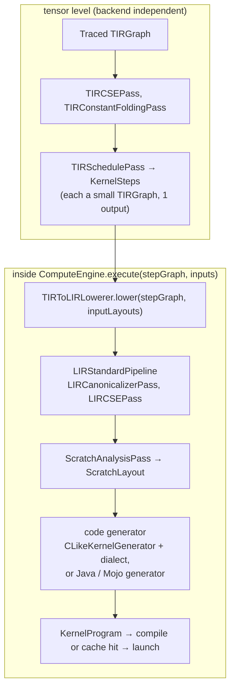
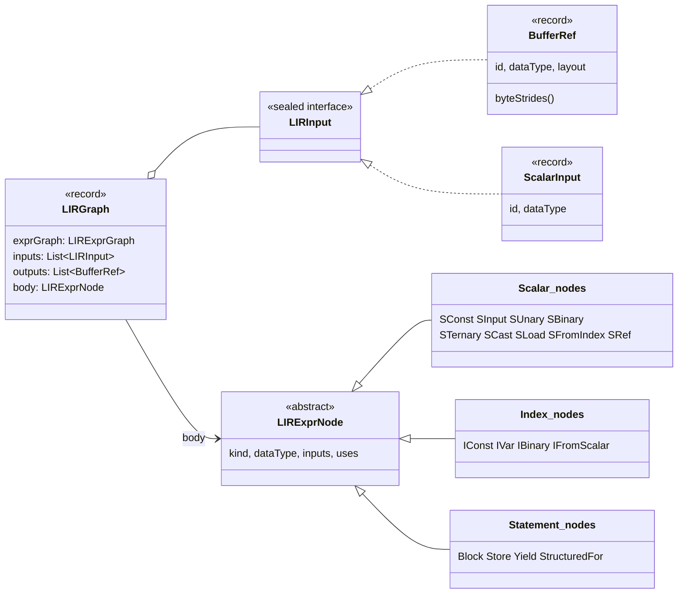
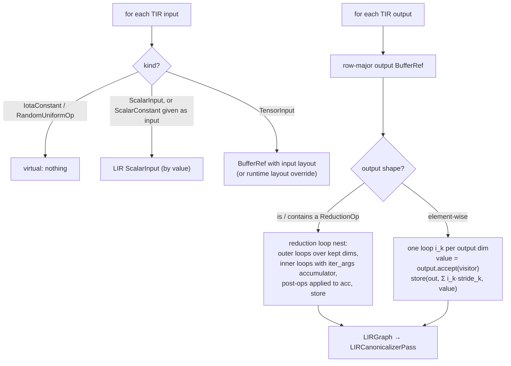
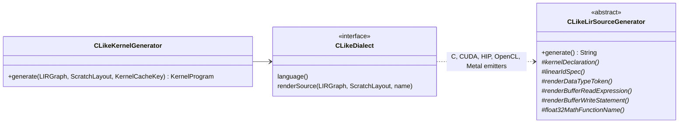

# Developer Guide: from TIR to LIR

This guide explains the second half of the compiler: why jota has a second IR, **LIR** (Loop IR), and how `TIRToLIRLowerer` turns a **TIR** (Tensor IR) graph into it.
Read [DEVELOPER-GUIDE-tracer.md](DEVELOPER-GUIDE-tracer.md) first for how the TIR graph is produced.

All dumps below are real output of the built jars, rendered with `TIRTextRenderer`, `LIRTextRenderer`, and the C dialect of the C-like code generator.

---

## 1. The short answer: TIR says *what*, LIR says *how*

TIR is the right level for the user and for graph optimisations: it speaks in whole tensors.
A backend cannot run "`sum` of a `2×3` tensor over axis 1" directly: a CPU or a GPU runs **loops** that **load and store bytes at addresses**.
LIR is that level: explicit loop nests, explicit index arithmetic, explicit loads and stores, and scalar arithmetic on single elements.

| | TIR (Tensor IR) | LIR (Loop IR) |
|---|---|---|
| Unit of computation | whole tensor | one scalar element |
| Values | tensors with `Shape` and `DataType` | scalars (`S*` nodes) and indices (`I*` nodes) |
| Memory | implicit; only inputs and views carry a `Layout` | explicit `BufferRef`s, byte offsets, `load` / `store` |
| Iteration | implicit in each op | explicit `StructuredFor` loops |
| Views (`transpose`, `broadcast`, `slice`, `reshape`) | `ViewTransform` nodes | gone: folded into index arithmetic |
| Reductions | `ReductionOp(axes, accumulatorType)` | loop with loop-carried accumulator (`iter_args` / `yield`) |
| `iota`, `rand` | `IotaConstant`, `RandomUniformOp` nodes | computed from the loop index; no memory at all |
| Data structure | immutable records (DAG) | hash-consed `LIRExprGraph` with use lists |
| Who produces it | `Tracer` | `TIRToLIRLowerer` |
| Who consumes it | scheduler, TIR passes, `TIRInterpreter` | LIR passes, scratch analysis, code generators, `LIRInterpreter` |
| Text syntax | MLIR-like `tensor<…>`, `arith.*`, `math.*` | MLIR-like `memref<…>`, `scf.for`, `memref.load/store` |

### Why not generate code from TIR directly?

Because every backend would then reimplement the same hard parts.
With LIR, these are solved **once**, in a backend-independent place:

1. **Fusion becomes trivial.** A fused element-wise chain is one scalar expression per output element inside one loop nest; no intermediate tensor exists.
2. **Views cost nothing.** `transpose`, `broadcast`, `slice`, `reshape` become different index formulas; no data is copied.
3. **Strided inputs work everywhere.** Each input's real strides go into the address computation, so non-contiguous tensors never need to be copied first.
4. **Reductions get one canonical form**: a loop with an accumulator, which every target can print.
5. **Virtual tensors.** `iota` becomes the loop index; random values are a hash of key and index; neither touches memory.
6. **Scalar-level optimisation.** Hash-consing, canonicalisation and CSE work on small scalar/index expressions, which is where redundant address math lives.
7. **Memory planning.** Scratch buffers for intermediates are visible as `BufferRef`s, so their lifetimes can be analysed and packed (`ScratchAnalysisPass`).
8. **Many code generators, one input.** C, CUDA, HIP, OpenCL, Metal (via `runtime.clike`), Java (Panama) and Mojo all start from the same LIR; a new C-like target only implements a dialect.
9. **A second reference interpreter.** `LIRInterpreter` executes LIR in Java, so a wrong result can be pinned to lowering or to code generation.

---

## 2. Where lowering happens in the pipeline

Lowering is **per kernel step**, inside the backend's `ComputeEngine`, not once per traced graph.



`lower(graph, inputLayouts)` accepts the **actual layouts** of the runtime inputs, so a kernel is specialised for the strides it will really see.

---

## 3. The LIR model



* **Inputs** are `BufferRef`s (pointer + dtype + layout, i.e. byte strides) or `ScalarInput`s (passed by value).
* **Outputs** are `BufferRef`s, always freshly allocated **row-major**.
* **Index nodes** (`IConst`, `IVar` = loop variable, `IBinary` = `+ - * / %`…) compute byte offsets.
* **Scalar nodes** compute element values: `SLoad(buffer, offset)`, `SBinary`, `SUnary`, `SCast`, `STernary` (select), `SConst`, `SInput`, `SFromIndex` (index → value, used by iota), `SRef` (read a loop-carried accumulator).
* **Statements**: `StructuredFor(i, lo, hi, step, iterArgs, body)`, `Store(buffer, offset, value)`, `Yield(values)`, `Block`.
* All nodes live in an `LIRExprGraph` that **hash-conses** them: building the same expression twice returns the same node, which gives CSE for free.

---

## 4. The lowering algorithm

`TIRToLIRLowerer` is a `TIRVisitor<LIRExprNode>`: visiting a TIR node returns the **scalar expression for one element** of that node, at the current loop indices.



Visitor rules per TIR node (simplified):

| TIR node | LIR expression for one element |
|---|---|
| `TensorInput` | `SLoad(buf, Σ index_k · byteStride_k)` |
| `ScalarInput` / input `ScalarConstant` | `SInput(id)` |
| other `ScalarConstant` | `SConst(bits)` (a literal) |
| `IotaConstant` | `SFromIndex(linear index)` |
| `RandomUniformOp` | hash of `(key0, key1, linear index)` mapped to `[0, 1)` |
| `UnaryOp`, `BinaryOp`, `TernaryOp`, `CastOp` | `SUnary`, `SBinary`, `STernary`, `SCast` of the lowered operands |
| `ViewTransform` chain | apply the **inverse** transform to the current indices, then lower the base node at the remapped indices |
| `GatherOp` | lower the indices tensor, use the loaded value as an index into the input |
| `ReductionOp` | handled by the output lowering (accumulator loop), not by the visitor |

Within one output, results are cached per TIR node (`cacheScalar`), so a value used twice is computed once.

---

## 5. Worked examples (real dumps)

All examples use a `2×3` FP32 input, row-major, so its byte strides are `[12, 4]`.

### 5.1 Element-wise fusion: `(a*b + 1).sqrt()`

TIR, four tensor-level operations:

```text
func.func @tensor_ops(%in0: tensor<2x3xfp32>, %in1: tensor<2x3xfp32>, %out0: tensor<2x3xfp32>) {
  %1 = arith.mulf %in0, %in1 : fp32
  %2 = arith.constant 1.0f : fp32
  %0 = arith.addf %1, %2 : fp32
  %out0 = math.sqrt %0 : fp32
}
```

LIR: one loop nest, a shared offset `%11`, and a scalar expression per element:

```text
func.func @lir_ops(%0: memref<2x3xfp32>, %1: memref<2x3xfp32>, %2: memref<2x3xfp32>) {
  scf.for %i0 = 0 to 2 step 1 {
    scf.for %i1 = 0 to 3 step 1 {
      %8  = arith.muli %i0, 12 : index
      %10 = arith.muli %i1, 4 : index
      %11 = arith.addi %8, %10 : index          // byte offset, computed once, used 3 times
      %12 = memref.load %0[%11]
      %13 = memref.load %1[%11]
      %14 = arith.mulf %12, %13 : fp32
      %16 = arith.addf %14, 1.0f : fp32
      %17 = math.sqrt %16 : fp32
      memref.store %17, %2[%11]
    }
  }
}
```

(constants inlined here for readability; the real dump has them as `arith.constant` lines.)

Generated C:

```c
#pragma omp parallel for
for (long long i0 = 0LL; i0 < 2LL; i0++) {
  for (long long i1 = 0LL; i1 < 3LL; i1++) {
    *(float *)((uint8_t *)output0 + ((i0 * 12LL) + (i1 * 4LL))) =
        sqrtf(((*(float *)((uint8_t *)input0 + ((i0 * 12LL) + (i1 * 4LL)))
              * *(float *)((uint8_t *)input1 + ((i0 * 12LL) + (i1 * 4LL)))) + 1.0f));
  }
}
```

No intermediate tensor exists for `a*b` or `+1`: this is what fusion means at the LIR level.

### 5.2 A view is just different indexing: `a.transpose(0, 1).exp()`

TIR (with views shown):

```text
%0 = tensor.transpose %in0 perm=[1, 0] : tensor<2x3xfp32> to tensor<3x2xfp32, strided<[1, 3]>>
%out0 = math.exp %0 : fp32
```

LIR loops over the **output** `3×2`; the load swaps the roles of `i0` and `i1`:

```text
scf.for %i0 = 0 to 3 {
  scf.for %i1 = 0 to 2 {
    %10 = arith.addi (%i1 * 12), (%i0 * 4)     // read input[i1][i0]
    %11 = memref.load %0[%10] : memref<2x3xfp32>
    %12 = math.exp %11
    %16 = arith.addi (%i0 * 8), (%i1 * 4)      // write output[i0][i1], row-major 3x2
    memref.store %12, %1[%16] : memref<3x2xfp32>
  }
}
```

```c
*(float *)((uint8_t *)output0 + ((i0 * 8LL) + (i1 * 4LL))) =
    expf(*(float *)((uint8_t *)input0 + ((i1 * 12LL) + (i0 * 4LL))));
```

The transpose costs nothing: no copy, just swapped strides in the address formula.

### 5.3 Broadcast = stride 0: `in0 - broadcast(rowMax)`

This is step 1 of the softmax schedule; `%in1` is the `2×1` row maxima produced by step 0.

```text
%0 = tensor.broadcast %in1 : tensor<2x1xfp32> to tensor<2x3xfp32, strided<[1, 0]>>
%out0 = arith.subf %in0, %0 : fp32
```

```c
*(float *)((uint8_t *)output0 + ((i0 * 12LL) + (i1 * 4LL))) =
    (*(float *)((uint8_t *)input0 + ((i0 * 12LL) + (i1 * 4LL)))
     - *(float *)((uint8_t *)input1 + (i0 * 4LL)));      // no i1 term: stride 0
```

### 5.4 Reduction with a fused pre-op: `(a*2).sum(FP32, axis=1)`

TIR:

```text
%1 = arith.constant 2.0f : fp32
%0 = arith.mulf %in0, %1 : fp32
%out0 = tensor.sum %0 axes=[1] keepDims=false
```

LIR: the reduced axis becomes an inner loop with a loop-carried accumulator (`iter_args`), initialised with the identity of `SUM` (`0.0`):

```text
scf.for %i0 = 0 to 2 {
  %6 = arith.constant 0.0f : fp32
  scf.for %i1 = 0 to 3 iter_args(%acc0 = %6) -> (fp32) {
    %12 = memref.load %0[(%i0 * 12) + (%i1 * 4)]
    %14 = arith.mulf %12, 2.0f
    %15 = arith.addf %14, %acc0
    scf.yield %15
  }
  memref.store %acc0, %1[%i0 * 4] : memref<2xfp32>
}
```

```c
#pragma omp parallel for
for (long long i0 = 0LL; i0 < 2LL; i0++) {
  float acc0 = 0.0f;
  for (long long i1 = 0LL; i1 < 3LL; i1++) {
    float acc0_next0 = ((*(float *)((uint8_t *)input0 + ((i0 * 12LL) + (i1 * 4LL))) * 2.0f) + acc0);
    acc0 = acc0_next0;
  }
  *(float *)((uint8_t *)output0 + (i0 * 4LL)) = acc0;
}
```

Identities per operator: `SUM` → 0, `PROD` → 1, `MAX` → lowest value of the type, `MIN` → highest value.
Element-wise operations *after* the reduction (e.g. `sum(...).multiply(k)`) are applied to the accumulator before the store (`buildPostOpExpr`).

### 5.5 Virtual input: `iota(8).multiply(0.5f)` with no inputs at all

TIR:

```text
func.func @tensor_ops(%out0: tensor<8xfp32>) {
  %0 = tensor.generate(%i) { arith.index_cast %i : index to fp32 } : tensor<8xfp32>
  %out0 = arith.mulf %0, 0.5f : fp32
}
```

The kernel has **only an output buffer**; the iota is the loop index:

```c
for (long long i0 = 0LL; i0 < 8LL; i0++) {
  *(float *)((uint8_t *)output0 + (i0 * 4LL)) = ((float)(i0) * 0.5f);
}
```

---

## 6. After lowering: LIR passes and scratch memory

`TIRToLIRLowerer.lower` already ends with one `LIRCanonicalizerPass`.
Backends then run `LIRStandardPipeline`:

| Pass | What it does |
|---|---|
| `LIRCanonicalizerPass` | processes the `LIRExprGraph` worklist: each node's `canonicalize()` folds constants and simplifies (`x*1`, `x+0`, constant index math, operand order of commutative ops) |
| `LIRCSEPass` | merges structurally equal nodes (`NodeKey` = kind + inputs + attributes) |

Then `ScratchAnalysisPass.analyze(lir)` computes a `ScratchLayout`: liveness intervals of intermediate buffers packed into one scratch allocation (`offsets`, `totalByteSize`).
For the simple examples above it is empty (`totalByteSize=0`), because fused kernels need no intermediate buffers.
`ScratchVerificationPass` can check that no two live buffers overlap.

---

## 7. From LIR to source code



The shared generator walks the LIR body once: `StructuredFor` → `for` loop (the outermost parallel loops become `#pragma omp parallel for` in C, or thread/block ids on GPUs via `CLikeParallelLoopSupport`), index nodes → integer expressions, `SLoad`/`Store` → pointer arithmetic on byte offsets, scalar nodes → C expressions with dialect-specific type names, literals, casts and math functions (`sqrtf`, `expf`, …).
Panama and Mojo have their own generators but consume the same `LIRGraph`.

---

## 8. Current limits (and where they come from)

| Limit | Where | Consequence |
|---|---|---|
| At most **one reduction** per kernel | `TIRSchedulePass` (`countReductions <= 1`), `TIRToLIRLowerer.visitReductionOp` throws if reached as a sub-expression | graphs like softmax / layer-norm are staged into one kernel per compute node |
| Steps must be lowerable in isolation | `LoweringSupportChecker` runs the lowerer on each candidate step | unsupported patterns fail fast at schedule time with `Unsupported scheduled kernel …` |
| Outputs are always row-major | `createOutputBufferRef` | a transposed result is written contiguously; views on it are applied by later steps |
| No data-dependent control flow | by design of both IRs | `where`/`select` instead of `if`; loops have static bounds |
| Shapes are static per kernel | layouts are baked into offsets | a new shape or layout gives a new kernel (and a new cache entry) |

---

## 9. Debugging lowering

```java
TIRGraph step = ...;                                         // e.g. KernelStep.graph()
LIRGraph lir = new TIRToLIRLowerer().lower(step);
System.out.println(new LIRTextRenderer().render(lir));       // before passes
LIRGraph opt = new LIRStandardPipeline().run(lir);
System.out.println(new LIRTextRenderer().render(opt));       // after passes
ScratchLayout scratch = new ScratchAnalysisPass().analyze(opt);
```

* Wrong result on every backend: compare `TIRInterpreter` (TIR semantics) with `LIRInterpreter` (LIR semantics). If they differ, the bug is in lowering or an LIR pass; if both are right, it is in code generation.
* Wrong result on one backend only: dump the source with `-Djota.kernel.log=true` and compare dialects.
* Lowering tests live in `jota-tensor/src/testkit/java/com/qxotic/jota/ir/lir` (for example `LIRInterpreterTraceTest`).

---

## 10. Source map

| File | Content |
|---|---|
| `ir/TIRToLIRLowerer.java` | `lower`, `lowerOutput`, `lowerReduction`, `buildPostOpExpr`, view-chain inversion (`applyInverseTransform`), gather, iota, random |
| `ir/lir/LIRExprGraph.java` | node factory with hash-consing, use lists, canonicalisation worklist |
| `ir/lir/*.java` | node classes (`S*`, `I*`, `Block`, `Store`, `Yield`, `StructuredFor`), `LIRGraph`, `BufferRef`, `ScalarInput` |
| `ir/lir/LIRStandardPipeline.java`, `LIRCanonicalizerPass.java`, `LIRCSEPass.java` | LIR optimisation |
| `ir/lir/scratch/*` | liveness, scratch layout, verification |
| `ir/lir/LIRInterpreter.java`, `LIRTextRenderer.java` | execution and printing for tests / debugging |
| `runtime/clike/*` | the shared C-family source generator and `LIRKernelArgsBuilder` (maps runtime tensors to kernel arguments) |
