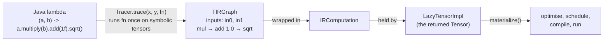
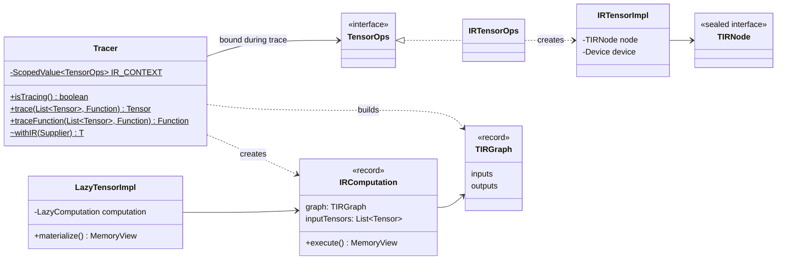
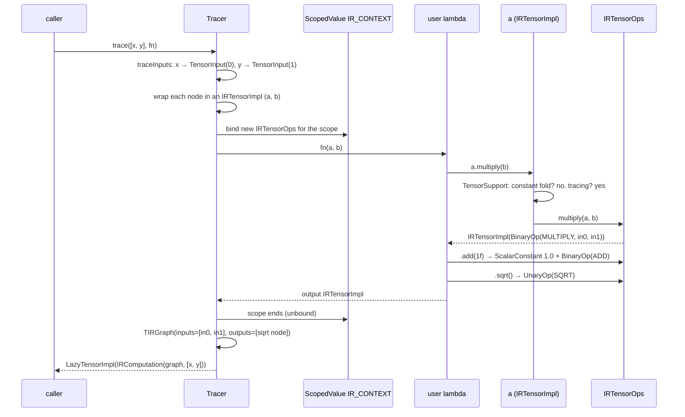
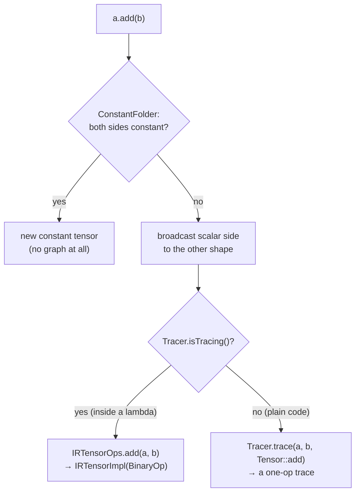
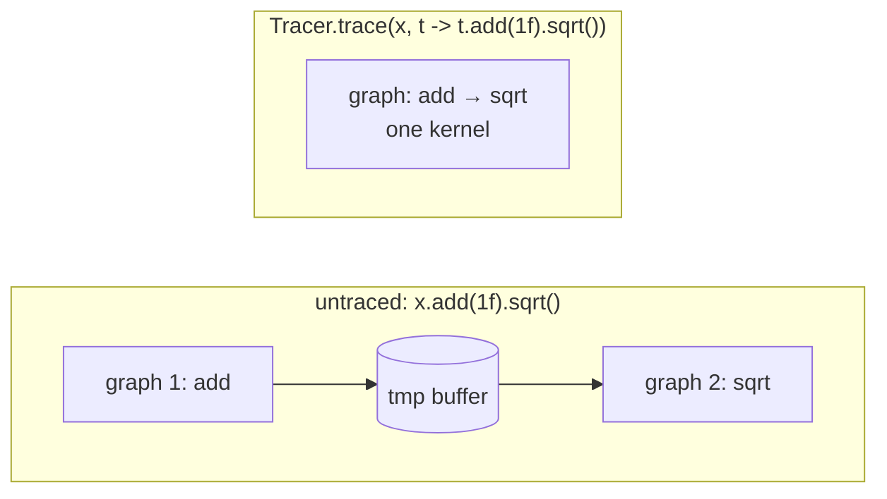
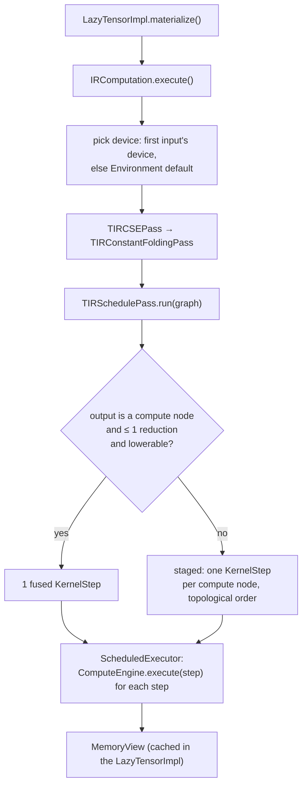

# Developer Guide: the Tracer

This guide explains how `jota-tensor` turns ordinary-looking Java tensor code into a graph that can be compiled.
The class at the centre of this is `com.qxotic.jota.tensor.Tracer`.

Prerequisites: read [DEVELOPER-GUIDE-getting-started.md](DEVELOPER-GUIDE-getting-started.md) first.
For what happens to the graph afterwards, read [DEVELOPER-GUIDE-tir-2-lir.md](DEVELOPER-GUIDE-tir-2-lir.md).

All IR dumps in this guide are real output, captured from the built jars with the C dialect for the generated code.

---

## 1. The problem the Tracer solves

Jota tensors are lazy: `a.multiply(b).add(1f).sqrt()` must not compute anything; it must produce a *description* of the computation.
The description has to be:

* **a graph**, so the whole computation can be optimised and fused into one kernel;
* **device independent**, so the same description runs on Panama, C, CUDA, …;
* **reusable**, so a model layer can be traced once and executed many times.

The Tracer records Java calls on `Tensor` into such a graph, the **TIR** (Tensor IR).
It works like JAX's `jit` tracing: the Java lambda is executed once, but on *symbolic* tensors that only record what is done to them.



---

## 2. The cast of classes

| Class | Visibility | Role |
|---|---|---|
| `Tracer` | public | Entry point: `trace(...)`, `traceFunction(...)`, `isTracing()`. Holds the tracing context in a `ScopedValue<TensorOps>` |
| `TensorOps` | package | The operation set (add, sum, gather, view, cast, …) as a strategy interface |
| `IRTensorOps` | package | The `TensorOps` used while tracing: each call validates types/shapes and creates a TIR node |
| `IRTensorImpl` | package | A **symbolic** tensor: wraps one `TIRNode` and a `Device`; cannot be materialized |
| `TIRNode` + records | public (`ir.tir`) | The graph nodes: `TensorInput`, `ScalarInput`, `ScalarConstant`, `IotaConstant`, `RandomUniformOp`, `UnaryOp`, `BinaryOp`, `TernaryOp`, `CastOp`, `ReductionOp`, `GatherOp`, `ViewTransform`, `Contiguous` |
| `TIRGraph` | public (`ir.tir`) | `record TIRGraph(List<TIRNode> inputs, List<TIRNode> outputs)` |
| `IRComputation` | package | `LazyComputation` holding a `TIRGraph` + the concrete input tensors; runs it on `execute()` |
| `LazyTensorImpl` | package | The tensor returned to the user; materializes its computation once and caches the result |
| `TensorSupport`, `ConstantFolder` | package | Dispatch of each `Tensor` method: fold constants, else trace |



---

## 3. What `Tracer.trace` does, step by step

```java
Tensor x = Tensor.of(new float[] {1, 2, 3, 4, 5, 6}, Shape.of(2, 3));
Tensor y = Tensor.of(new float[] {6, 5, 4, 3, 2, 1}, Shape.of(2, 3));
Tensor out = Tracer.trace(x, y, (a, b) -> a.multiply(b).add(1f).sqrt());
```



1. **Map the inputs.** `traceInputs` turns each concrete input tensor into a TIR leaf node (table below) and wraps it in an `IRTensorImpl`.
2. **Open a scope.** `withIR` binds a fresh `IRTensorOps` into the `ScopedValue IR_CONTEXT`. While bound, `Tracer.isTracing()` is true on this thread (and only in this dynamic scope, so concurrent traces on other threads do not interfere).
3. **Run the lambda once** with the symbolic tensors. Every `Tensor` method called on them appends a node.
4. **Close the scope** and build `TIRGraph(inputNodes, [outputNode])`.
5. **Return a lazy tensor**: `LazyTensorImpl(new IRComputation(graph, originalInputs), dtype, layout, device)`. Nothing has executed.

The resulting TIR, as printed by `TIRTextRenderer`:

```text
module {
  func.func @tensor_ops(%in0: tensor<2x3xfp32>, %in1: tensor<2x3xfp32>, %out0: tensor<2x3xfp32>) {
    %1 = arith.mulf %in0, %in1 : fp32
    %2 = arith.constant 1.0f : fp32
    %0 = arith.addf %1, %2 : fp32
    %out0 = math.sqrt %0 : fp32
  }
}
```

### How inputs become graph leaves

`Tracer.traceInputs` looks at what each input tensor *is* and picks the cheapest leaf:

| Input tensor | TIR leaf | Effect in the kernel |
|---|---|---|
| scalar broadcast (all strides 0), on a native-capable runtime | `ScalarInput(id)` | passed **by value** as a kernel scalar argument |
| materialized (has a `MemoryView`) | `TensorInput(id, dtype, layout)` | passed as a buffer pointer, read with its real strides |
| lazy `RangeComputation` (`Tensor.iota`) | `IotaConstant(n)` | **virtual**: computed from the loop index, no memory |
| lazy `RandomComputation` (`Tensor.rand…`) | `RandomUniformOp(key0, key1)` | **virtual**: generated in-kernel from key + index |
| lazy `ConstantComputation` (`zeros`, `full`, …) | `ScalarConstant` broadcast | inlined as a literal |
| other lazy tensor (e.g. a previous trace) | `TensorInput(id, …)` | computed first, then passed as a buffer |

The last row matters: **a trace does not look inside another lazy trace.** The previous computation is executed as its own program and its result is fed in as a buffer.

---

## 4. Dispatch: every `Tensor` method goes through the same funnel

All tensor implementations extend `AbstractTensorImpl`, whose methods delegate to `TensorSupport`:



So there is no separate "eager engine": **outside a trace, each call is traced on its own**, producing a one-node graph whose inputs are the operands.

This has a performance consequence.
Here is `x.add(1f).sqrt()` written *without* `Tracer.trace` (real dump):

```text
outer graph (sqrt):
  func.func @tensor_ops(%in0: tensor<2x3xfp32>, %out0: tensor<2x3xfp32>) {
    %out0 = math.sqrt %in0 : fp32
  }
its input is lazy? true
input graph (add):
  func.func @tensor_ops(%in0: tensor<2x3xfp32>, %in1: tensor<2x3xfp32>, %out0: tensor<2x3xfp32>) {
    %out0 = arith.addf %in0, %in1 : fp32
  }
```

Two graphs, so two kernels and one intermediate buffer.
With `Tracer.trace(x, t -> t.add(1f).sqrt())` you get one graph and one fused kernel.
Note also that in the untraced `add`, the constant `1f` arrives as `%in1`: a scalar-broadcast input becomes a `ScalarInput` kernel *argument*, so the same compiled kernel is reused for `add(2f)`, `add(3f)`, ….
Inside a trace, `1f` becomes an `arith.constant` baked into the kernel.



### Constant folding happens before tracing

`ConstantFolder` runs first, even inside a trace.
`Tensor.scalar(2f).multiply(Tensor.scalar(3f))` never creates a `BinaryOp`: it returns a constant `6f` directly.
This keeps graphs small without any pass.

---

## 5. Reusable functions: `traceFunction`

`trace` returns one lazy tensor bound to specific inputs.
`traceFunction` traces once and returns a Java function that creates a new `IRComputation` with the **same graph** for each call:

```java
Function<Tensor, Tensor> gelu = Tracer.traceFunction(sample, Tensor::gelu);

Tensor r1 = gelu.apply(batch1);   // same TIRGraph, new inputs
Tensor r2 = gelu.apply(batch2);   // compiled kernel found in the cache by its hash
```

| Variant | Signature |
|---|---|
| no input | `Supplier<Tensor> traceFunction(Supplier<Tensor>)` |
| one input | `Function<Tensor, Tensor> traceFunction(Tensor sample, Function<Tensor, Tensor>)` |
| two inputs | `BiFunction<…> traceFunction(Tensor, Tensor, BiFunction<…>)` |
| N inputs | `Function<List<Tensor>, Tensor> traceFunction(List<Tensor> samples, Function<List<Tensor>, Tensor>)` |

The sample tensors decide the **leaf kinds, dtypes, shapes and layouts** of the graph; only the data changes between calls.
Calling the function with a tensor of another shape or layout is a contract violation; make a new trace for it.

---

## 6. Rules and pitfalls inside a trace

| Rule | Why | What you see if broken |
|---|---|---|
| Pass every tensor the lambda uses as a trace **input** | Captured tensors are concrete, not symbolic; `IRTensorOps` only accepts `IRTensorImpl` | `IllegalArgumentException: Expected IRTensorImpl, got: class …MaterializedTensorImpl` |
| Constants can be created inside the lambda (`Tensor.scalar`, `full`, `zeros`, `ones`, `iota`) | These factories check `Tracer.isTracing()` and return symbolic nodes | (works) |
| Random tensors must be created **outside** and passed as inputs | `Tensor.rand…` always returns a concrete lazy tensor; as a trace input it becomes a virtual `RandomUniformOp` | `Expected IRTensorImpl, got: class …LazyTensorImpl` |
| Do not call `materialize()` | Symbolic tensors have no data | `IRTensor cannot be materialized directly…` |
| Do not call `to(Device)` | Transfers are not graph operations | error asking to materialize and use `to()` outside IR-T |
| No control flow that depends on tensor **values** | The lambda runs once, at trace time; values do not exist yet | (you cannot even read a value) |
| Java control flow on **shapes / constants** is fine | It is evaluated once and unrolled into the graph | a bigger graph |
| Validation happens at trace time | `IRTensorOps` checks dtypes and shapes when creating each node | exception from the offending call, with a normal stack trace |

Example of a captured tensor (real result):

```java
Tracer.trace(x, a -> a.add(y));             // y not passed as input
// IllegalArgumentException: Expected IRTensorImpl, got: class com.qxotic.jota.tensor.MaterializedTensorImpl

Tracer.trace(x, y, (a, b) -> a.add(b));     // correct
```

Unrolled loop example (each iteration adds nodes; the graph has no loop):

```java
Tensor out = Tracer.trace(z0, c, (z, cc) -> {
    for (int i = 0; i < 20; i++) z = z.multiply(z).add(cc);
    return z;
});
```

Composite operations are expanded at trace time.
For instance `matmul(a, b)` on `[m,k] × [k,n]` is recorded as `view` to `[m,k,1]` and `[1,k,n]`, `broadcast` to `[m,k,n]`, `multiply`, then `sum` over axis 1.
There is no `MatMul` node in TIR.

---

## 7. After the trace: what `materialize()` does with the graph



**CSE** merges identical sub-expressions recorded twice.
Traced `(a+b)*(a+b)`:

```text
traced TIR                                    optimized TIR
%0 = arith.addf %in0, %in1 : fp32             %0 = arith.addf %in1, %in0 : fp32
%1 = arith.addf %in0, %in1 : fp32             %out0 = arith.mulf %0, %0 : fp32
%out0 = arith.mulf %0, %1 : fp32
```

**Scheduling** decides how many kernels run.
A graph with at most one reduction fuses into one step, for example `(a*2).sum(FP32, 1)` is one kernel.
A row-wise softmax has two reductions (`max` and `sum`), so it falls back to a staged schedule with one step per compute node.
The real schedule for softmax on a `2x3` input:

```text
traced TIR
  %3 = tensor.max %in0 axes=[1] keepDims=true
  %2 = tensor.broadcast %3 : tensor<2x1xfp32> to tensor<2x3xfp32, strided<[1, 0]>>
  %1 = arith.subf %in0, %2 : fp32
  %0 = math.exp %1 : fp32
  %5 = tensor.sum %0 axes=[1] keepDims=true
  %4 = tensor.broadcast %5 : tensor<2x1xfp32> to tensor<2x3xfp32, strided<[1, 0]>>
  %out0 = arith.divf %0, %4 : fp32

schedule: 5 step(s)
  step 0  inputs=[TensorInputRef(0)]                         max
  step 1  inputs=[TensorInputRef(0), ProducedValueRef(0)]    subtract (broadcast folded into indexing)
  step 2  inputs=[ProducedValueRef(1)]                       exp
  step 3  inputs=[ProducedValueRef(2)]                       sum
  step 4  inputs=[ProducedValueRef(2), ProducedValueRef(3)]  divide
```

`ViewTransform` nodes (`broadcast`, `transpose`, `reshape`, …) are never steps of their own: they are folded into the index computation of the step that reads them.
Each step is a stand-alone `TIRGraph`; values produced by earlier steps come in as `TensorInput` placeholders (`ProducedValueRef`).
If you need fewer kernels for such a pattern, that is the job of the scheduler (`TIRSchedulePass`), or of a custom kernel.

---

## 8. Debugging traces

* `-Djota.schedule.log=true` prints `[jota-schedule] fused schedule with 1 step …` or `falling back to staged schedule …` for each materialization.
* `-Djota.kernel.log=true` (backends) prints the generated kernel and its cache location.
* `TIRGraph.toString()` renders the graph with `TIRTextRenderer`; `new TIRTextRenderer(2, true)` also shows view nodes with their layouts.
* `TIRInterpreter.execute(graph, inputs)` evaluates a TIR graph in plain Java: use it as a reference to tell a tracing bug from a backend bug.
* In tests inside the `com.qxotic.jota.tensor` package, `InternalTensorAccess.computation(t)` gives the `IRComputation` and its `graph()`.

---

## 9. Source map

| File | What to look at |
|---|---|
| `tensor/Tracer.java` | `trace`, `traceFunction`, `traceInputs`, the `ScopedValue` |
| `tensor/TensorSupport.java` | `dispatchFoldedBinaryOp`, `dispatchBinaryOp`: fold → trace or one-op trace |
| `tensor/ConstantFolder.java` | folding of constant operands before any node is created |
| `tensor/IRTensorOps.java` | one method per operation: validation + TIR node creation; composite ops (`matmul`, `dot`) |
| `tensor/IRTensorImpl.java` | the symbolic tensor |
| `tensor/IRComputation.java` | `execute()`: optimise, schedule, run |
| `tensor/ScheduledExecutor.java` | runs `KernelStep`s on the `ComputeEngine` |
| `ir/tir/TIRSchedulePass.java`, `TIRStepGraphBuilder.java` | fused vs staged schedule, step sub-graphs |
