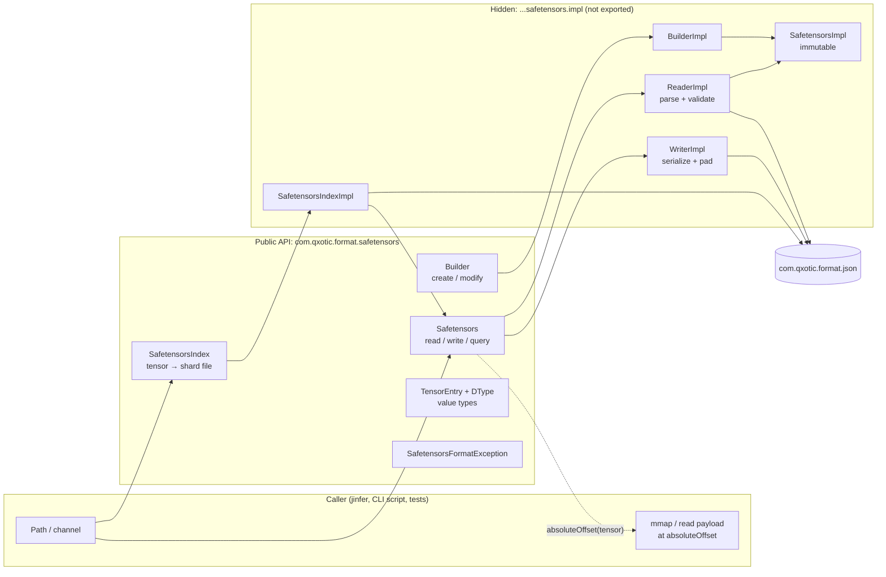
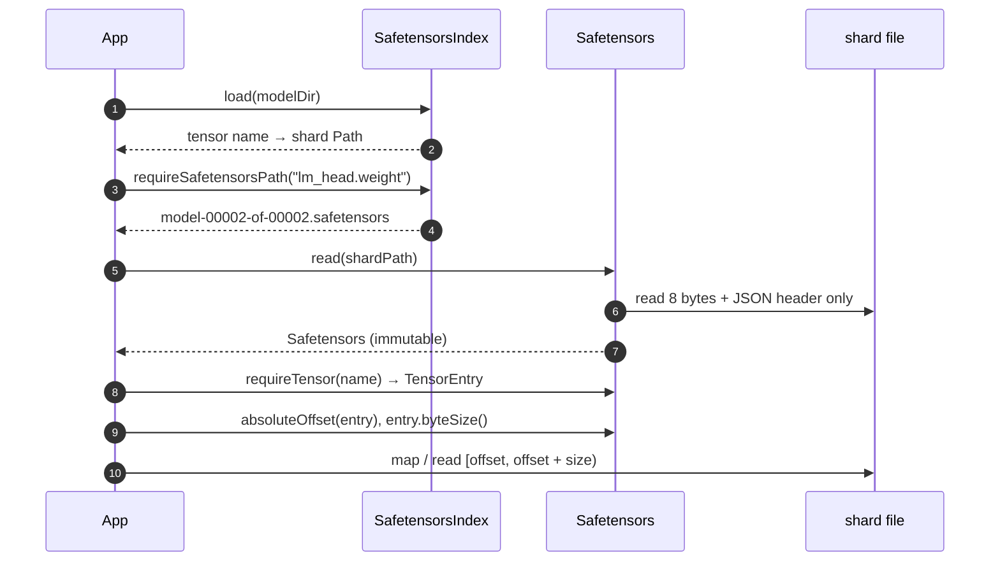

# safetensors — High-level overview

## What it is

`safetensors` (module `com.qxotic.format.safetensors`, artifact `com.qxotic:safetensors`) is a
small, pure-Java library that **reads and writes the header** of Hugging Face
[Safetensors](https://github.com/huggingface/safetensors) files, and **locates tensors across
sharded models**.

It deliberately does **not** touch tensor payload bytes: it tells the caller *where* each tensor
lives (file, absolute byte offset, size, dtype, shape) and lets the caller map or copy the data
itself (e.g. with a `MemorySegment` over the file). Its only dependency is `com.qxotic:json`.

Main consumer in this repository: **jinfer** (via `jinfer-bom`), which uses it to find model
weights before mapping them.

## The file format in one picture

```
 offset 0          8                         8+N = tensorDataOffset
 ┌────────────────┬──────────────────────────┬─────────────────────────────────────┐
 │ N (u64 LE)     │ JSON header (UTF-8),     │ tensor data: tensors packed back to │
 │ header length  │ padded with spaces       │ back, no holes, no overlaps          │
 └────────────────┴──────────────────────────┴─────────────────────────────────────┘

 JSON header:
 {
   "__metadata__": { "format": "pt", "__alignment__": "64", ... },   // string → string
   "model.embed_tokens.weight": { "dtype": "BF16", "shape": [49152, 576],
                                  "data_offsets": [0, 56623104] },   // relative to data start
   ...
 }
```

## Big picture



## Key ideas

1. **Header-only.** `Safetensors.read` consumes `8 + N` bytes and stops. A truncated or
   header-only file still reads; bounds checking the payload is the job of whoever reads it.
   `Safetensors.write` writes only the header (padded with spaces up to `tensorDataOffset`); the
   caller appends tensor bytes in the same order.

2. **Interfaces in the API, implementations hidden.** The exported package holds only
   interfaces (`Safetensors`, `Builder`, `SafetensorsIndex`), immutable value types
   (`TensorEntry`, `DType`) and one exception. Static factory methods on the interfaces delegate
   through `impl.ImplAccessor`, the single public class of the non-exported `impl` package.

3. **Strict, upstream-compatible validation.** The reader mirrors the Rust reference
   implementation: header size bound (100 MB), must start with `{`, valid UTF-8, exactly the
   fields `dtype`/`shape`/`data_offsets`, integers in `[0, 2^48)`, byte size matching
   `dtype × shape` (including sub-byte types like `F4`/`F6`), and tensors **packed back to back
   from 0 with no hole and no overlap** (anti-polyglot rule). Malformed input raises the
   unchecked `SafetensorsFormatException`.

4. **Immutability + builder.** A `Safetensors` is immutable and order-preserving
   (`LinkedHashMap` everywhere, so header bytes are deterministic). To change one, copy it into a
   `Builder` (`Builder.newBuilder(st)`), edit metadata / tensors, and `build()`, which by default
   recomputes packed offsets and the padded `tensorDataOffset`. The builder runs the same
   back-to-back validation a reader would.

5. **Alignment via header padding.** The format forbids holes between tensors, so alignment is
   achieved by padding the JSON header: the data always starts on a multiple of 8 (as upstream
   writes it), or of the `__alignment__` metadata value (a power of 2) when larger. Ordering
   tensors by element size, largest first, keeps each tensor naturally aligned.

6. **Sharded models.** `SafetensorsIndex.load(path)` accepts a directory containing
   `model.safetensors.index.json` (reads its `weight_map`), a directory with a single
   `model.safetensors`, or a single `.safetensors` file. Shard paths are validated: relative,
   inside the model directory (no `..` escape), ending in `.safetensors`, and existing.

## Typical flows



Writing a new file:

```java
Safetensors st = Builder.newBuilder()
        .putMetadataKey("format", "pt")
        .setAlignment(64)
        .putTensor(TensorEntry.create("w", DType.F32, new long[] {4, 4}, 0))
        .build();                          // offsets packed, tensorDataOffset padded
try (var ch = FileChannel.open(path, CREATE_NEW, WRITE)) {
    Safetensors.write(st, ch);             // header + space padding
    ch.write(payload);                     // tensor bytes, in header order
}
```

## Where to look next

- [`ARCHITECTURE.md`](ARCHITECTURE.md) — class diagrams of every type and how they collaborate.
- [`../README.md`](../README.md) — usage, CLI (`scripts/safetensors.java`), supported dtypes.
