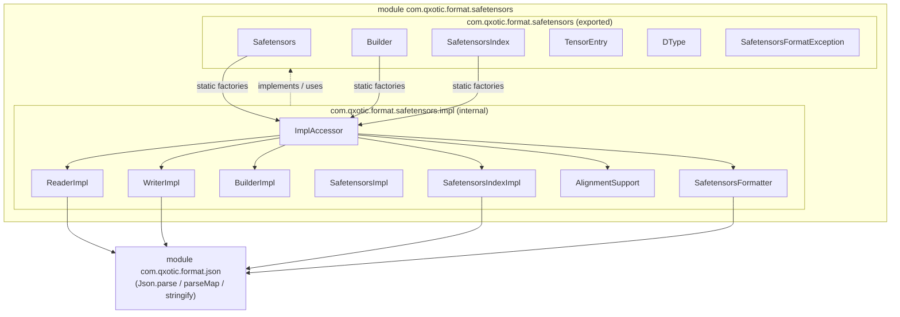
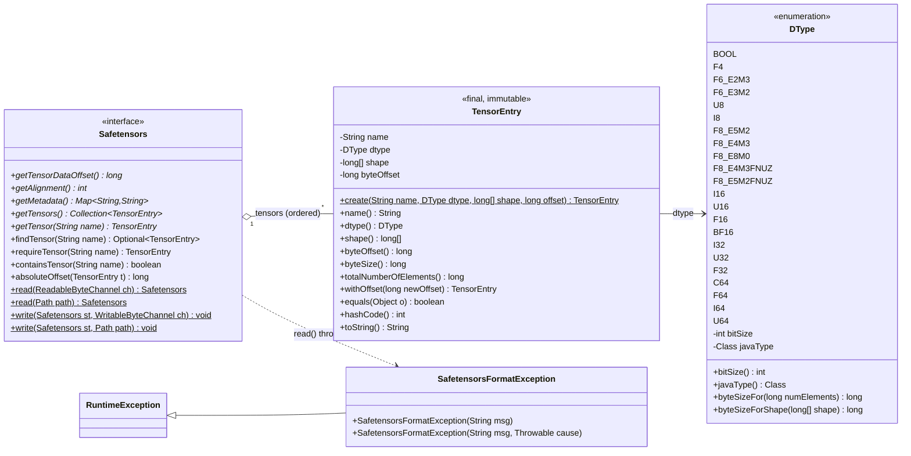
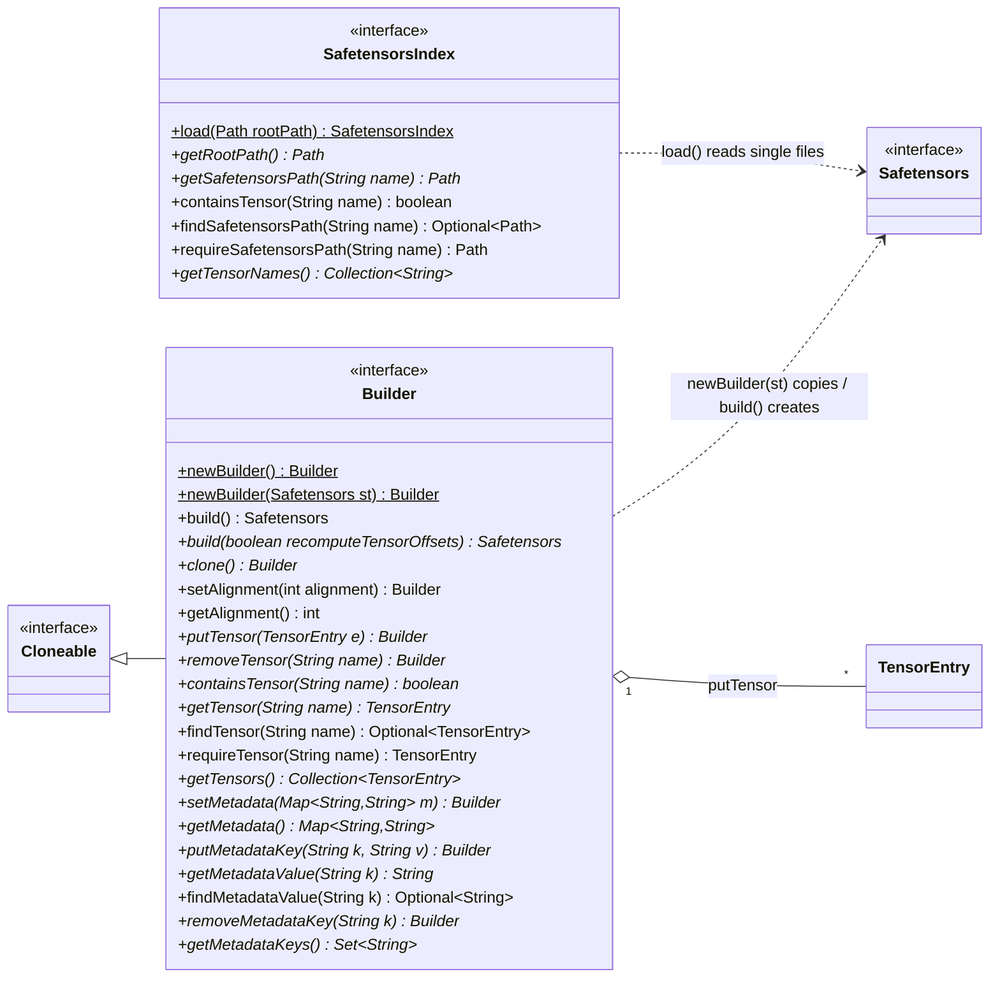
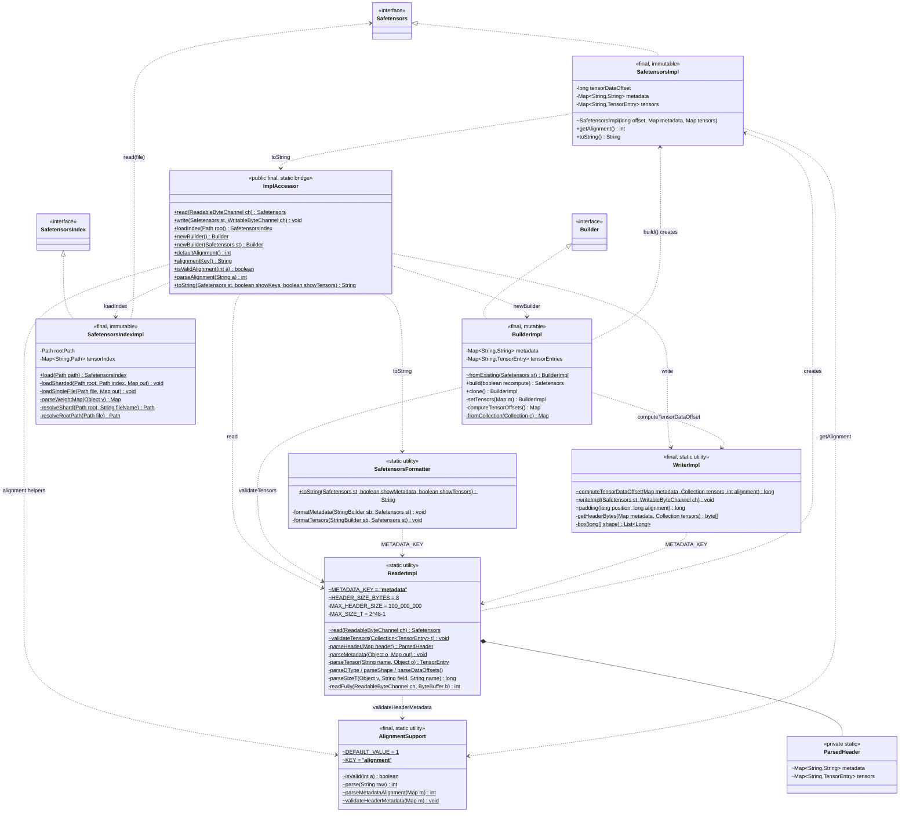
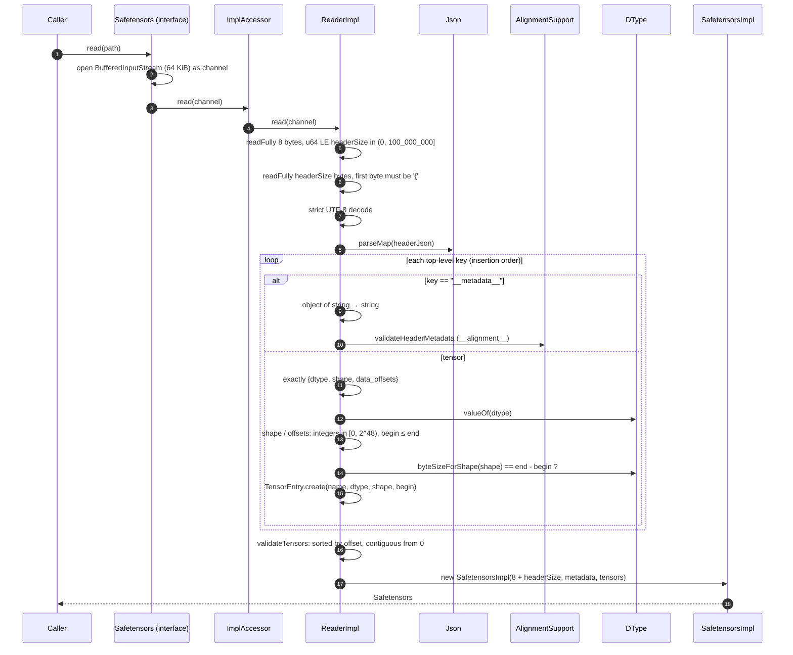
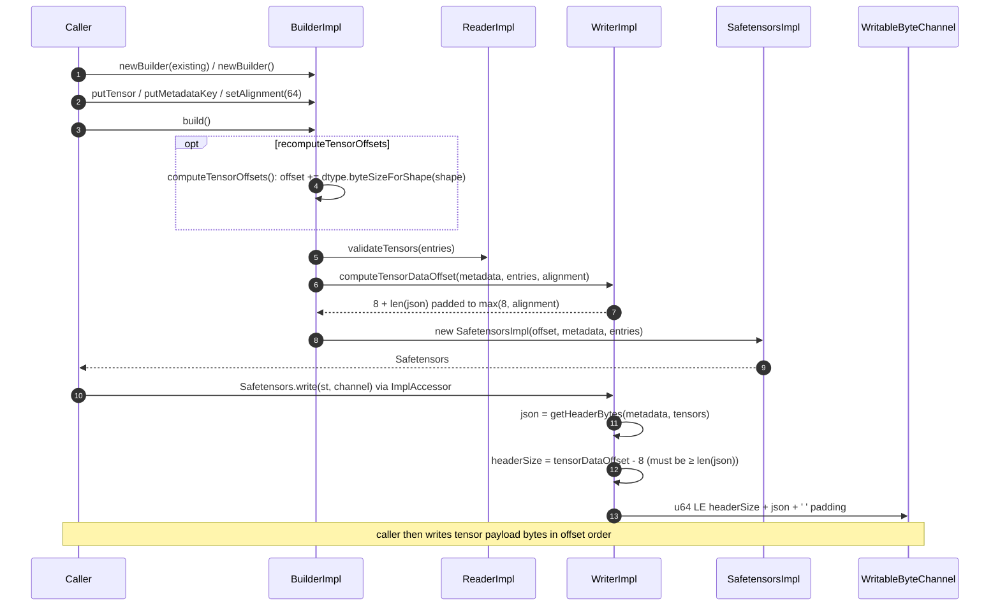
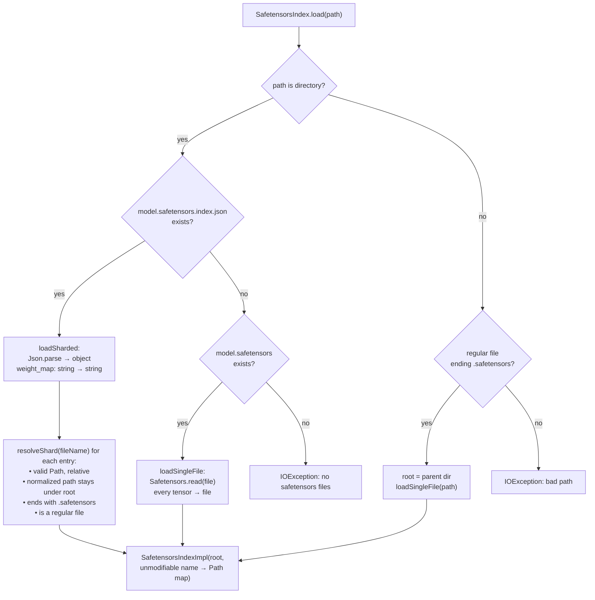

# safetensors — Architecture (class diagrams)

Source: `safetensors/src/main/java` — 14 types in two packages (~1.5 kLOC).

| Package | Exported | Types |
|---|---|---|
| `com.qxotic.format.safetensors` | yes (`module-info`) | `Safetensors`, `Builder`, `SafetensorsIndex`, `TensorEntry`, `DType`, `SafetensorsFormatException` |
| `com.qxotic.format.safetensors.impl` | no | `ImplAccessor` (public bridge), `ReaderImpl`, `WriterImpl`, `BuilderImpl`, `SafetensorsImpl`, `SafetensorsIndexImpl`, `AlignmentSupport`, `SafetensorsFormatter` |

See [`ARCHITECTURE-overview.md`](ARCHITECTURE-overview.md) for the high-level picture.

Diagram conventions: `$` = static, `*` = abstract, `+` public, `~` package-private, `-` private;
methods marked `«default»` in notes are interface default methods.

---

## 1. Module and package layering

The API package depends on `impl` **only** through `ImplAccessor` (the one public class in
`impl`). Because `impl` is not exported, the JPMS boundary keeps every implementation class
invisible to clients while the interfaces can still offer static factories (`Safetensors.read`,
`Builder.newBuilder`, `SafetensorsIndex.load`).

---

## 2. Public API: the data model

Notes:

- `Safetensors` describes **one file's header**: metadata (`__metadata__`, string → string),
  ordered tensor entries, and `tensorDataOffset = 8 + headerSize`. `absoluteOffset(t)` =
  `tensorDataOffset + t.byteOffset()` is the file position of the payload.
- `TensorEntry.byteOffset` is **relative** to the start of the data section. `shape` is copied
  in and out (defensive copies). `byteSize()` is derived from `dtype` and `shape`, so an entry
  holds only the begin offset; the end offset is recomputed on write.
- `DType` constants are declared in increasing alignment order, as upstream. `byteSizeFor` works
  in **bits** so sub-byte types (`F4` = 4 bits, `F6_*` = 6 bits) are sized exactly; it throws
  `IllegalArgumentException` when the bit total is not a whole number of bytes and
  `ArithmeticException` on overflow. `javaType()` is the primitive carrier (`byte.class` for
  FP8/sub-byte, `float.class` for `C64`).

---

## 3. Public API: building and indexing

Notes:

- `Builder.setAlignment` / `getAlignment` are **default** methods implemented purely on top of
  the metadata map: they store/remove the `__alignment__` key (removed when set back to the
  default `1`) and validate "positive power of 2" through `ImplAccessor`.
- `build()` = `build(true)`: offsets are recomputed so tensors are packed back to back in
  insertion order. `build(false)` keeps the entries' offsets as given, but they must still form a
  valid hole-free, overlap-free layout.
- `SafetensorsIndex` maps a **tensor name → shard file `Path`**; it does not keep the parsed
  headers. Callers then `Safetensors.read(path)` the shard they need.
- Every interface has the same accessor triad: `getX` (nullable), `findX` (`Optional`),
  `requireX` (throws `IllegalArgumentException("tensor not found: …")`).

---

## 4. Implementation classes

Responsibilities:

| Class | Role |
|---|---|
| `ImplAccessor` | Only public class of `impl`; static trampolines used by the API interfaces' static/default methods. Keeps the API package free of implementation types. |
| `SafetensorsImpl` | Immutable header snapshot. Copies the incoming maps into unmodifiable `LinkedHashMap`s (a builder keeps mutating its own maps after `build()`). `getAlignment()` is re-parsed from metadata on each call. |
| `BuilderImpl` | Mutable, insertion-ordered maps of metadata and tensors. `build()` optionally re-packs offsets, validates the layout like a reader, computes the padded `tensorDataOffset`, and creates a `SafetensorsImpl`. Rejects null keys/values and duplicate tensor names. |
| `ReaderImpl` | Parses and strictly validates a header from a channel (see §5). Also hosts `validateTensors`, the shared back-to-back layout check. |
| `WriterImpl` | Serializes the header JSON deterministically (insertion order, `dtype` / `shape` / `data_offsets`), computes the data offset (`8 + json`, padded to `max(8, alignment)`), and writes the header padded with spaces up to `tensorDataOffset`. |
| `AlignmentSupport` | The `__alignment__` metadata rule: default `1`, value must be a positive power of 2. |
| `SafetensorsIndexImpl` | Resolves tensor name → shard `Path` from an index JSON, a `model.safetensors`, or a single file; guards against unsafe shard paths. |
| `SafetensorsFormatter` | Human-readable `toString()` (alignment, data offset in hex, metadata, tensors with offsets). |

---

## 5. Reading a file (`ReaderImpl.read`)

Every validation failure raises `SafetensorsFormatException` (with the tensor name in the
message); short reads raise `IOException`.

---

## 6. Building and writing (`BuilderImpl.build` → `WriterImpl.writeImpl`)

Because `writeImpl` pads up to the instance's **own** `tensorDataOffset`, a file that was read and
then written back unchanged keeps its exact layout, so its tensor offsets stay valid.

---

## 7. Sharded model index (`SafetensorsIndexImpl.load`)

Schema problems in the index JSON or unsafe shard paths raise `SafetensorsFormatException`;
missing files raise `IOException`.

---

## 8. Invariants and design rules (summary)

| Rule | Enforced in |
|---|---|
| Header size in `(0, 100 MB]`, starts with `{`, strict UTF-8 | `ReaderImpl.read` |
| Tensor object has exactly `dtype`, `shape`, `data_offsets` | `ReaderImpl.validateTensorFields` |
| Integers are plain JSON integers in `[0, 2^48)` (no `1.0`, no `1e0`) | `ReaderImpl.parseSizeT` |
| `end - begin == dtype.byteSizeForShape(shape)`, sub-byte sizes byte-aligned | `ReaderImpl.parseTensor`, `DType.byteSizeFor` |
| Tensors contiguous from 0: no hole, no overlap (anti-polyglot) | `ReaderImpl.validateTensors` (reader **and** builder) |
| `__metadata__` is string → string; `__alignment__` is a power of 2 | `ReaderImpl.parseMetadata`, `AlignmentSupport` |
| Data section starts on a multiple of `max(8, alignment)`; padding is spaces | `WriterImpl.computeTensorDataOffset`, `writeImpl` |
| Deterministic header bytes (insertion order everywhere) | `LinkedHashMap` in `BuilderImpl`, `ReaderImpl`, `WriterImpl` |
| Shard paths relative, inside root, `.safetensors`, existing | `SafetensorsIndexImpl.resolveShard` |
| Immutable results, defensive copies of `shape` and maps | `TensorEntry`, `SafetensorsImpl`, `SafetensorsIndexImpl` |
