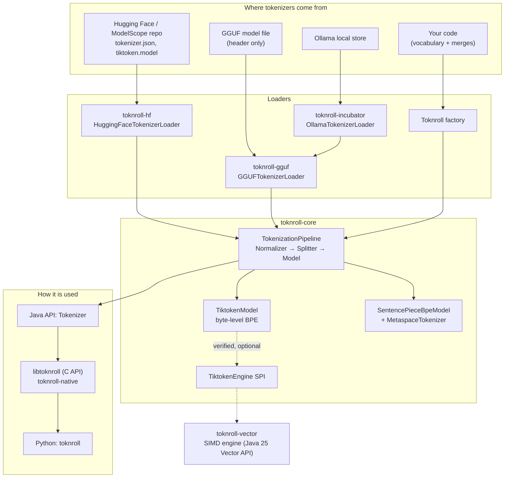
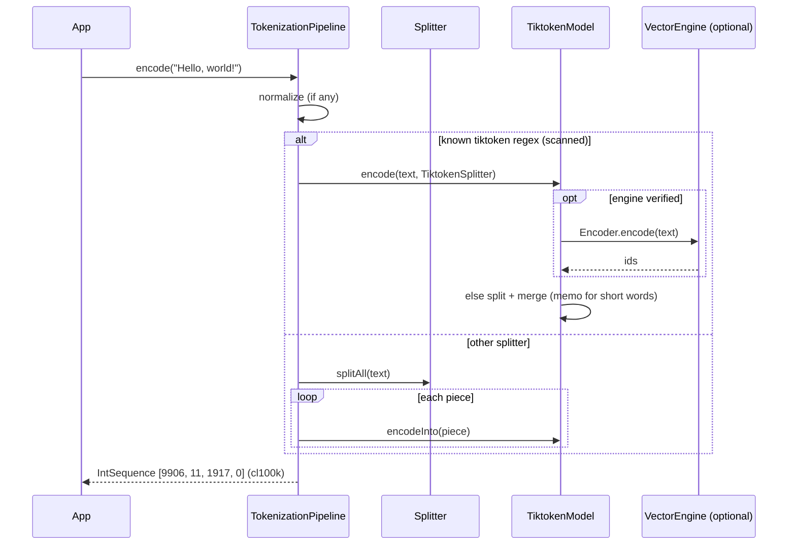

# Tok'n'Roll — High-level overview

## What Tok'n'Roll is

Tok'n'Roll is a **pure-Java LLM tokenizer library**: it turns text into the token ids a given model
expects, and back, **token-for-token identical** to the model's own reference tokenizer (Hugging
Face `tokenizers`, OpenAI `tiktoken`, llama.cpp), with zero runtime dependencies in the core and
Java 11+ / GraalVM native-image compatibility.

```java
Tokenizer t = HuggingFaceTokenizerLoader.fromHuggingFace("google", "gemma-4-e2b-it");
int[] ids   = t.encodeToArray("Hello, world!");
String text = t.decode(ids);
```

It is reachable three ways: as a Java library, as a C library (`libtoknroll`, `toknroll.h`) and
from Python (the `toknroll` package over `libtoknroll`), plus a JBang CLI (`scripts/toknroll.java`).

## Big picture



## The model of a tokenizer

A tokenizer is a **pipeline** of three stages, each a small interface in core:

1. **Normalizer** (optional) — rewrites text (NFC/NFKC, lowercase, replacements).
2. **Splitter** (pre-tokenizer, optional) — cuts text into pieces ("words"), usually with a
   regex such as GPT-2's, cl100k's, o200k's or Qwen's.
3. **TokenizationModel** — turns each piece into ids, with a **Vocabulary** (id ↔ token,
   token types) and **merge rules**.

Two BPE models cover the supported families:

| Model | Families | Key traits |
|---|---|---|
| `TiktokenModel` (byte-level BPE) | GPT-2, GPT-4/4o (cl100k, o200k), gpt-oss, Llama 3, Qwen 2/3/3.5, DeepSeek, Mistral Tekken, SmolLM, … | bytes → lowest-rank merge loop; memo of short words; optional SIMD engine |
| `SentencePieceBpeModel` | Llama 2, Gemma, Mistral (SPM), … | `▁` for spaces, byte fallback `<0xNN>`, merges by rank or score, `O(n log n)` heap for long words |

`Specials` adds matching of special/added tokens (`<|im_start|>`, …) on top of any tokenizer;
plain `encode` treats them as text.

## Design principles

* **Exactness first.** Every supported family is checked against goldens generated by the
  Python reference tokenizers (`toknroll-benchmarks/*.py` → `toknroll-testkit` fixtures), on
  edge cases and on the full enwik8 corpus. Loaders **fail fast** (`UnsupportedTokenizerException`)
  rather than approximate an unsupported feature.
* **Fast without native code.** Known regexes are not run through `java.util.regex` but through a
  hand-written scanner (`TiktokenSplitter`); merge tables are packed (`LongLongMap`); word caches
  are lock-free and shared across threads; APIs are zero-copy (`encodeInto(Builder)`,
  `decodeBytesInto(ByteBuffer)`).
* **Optional acceleration, verified.** `toknroll-vector` plugs in through `ServiceLoader`; core
  compares its output against its own on a covering sample before trusting it.
* **Metadata only.** Remote loads fetch tokenizer files or a GGUF header (one HTTP Range request),
  never weights, and cache them on disk (`TOKNROLL_CACHE_ROOT`, `HF_TOKEN`, offline mode).
* **Small, closed core.** Public API in `com.qxotic.toknroll`, SPI in `.spi`; implementations in
  `.impl`, exported only to the two first-party loaders.

## Modules at a glance

| Module | One-liner |
|---|---|
| `toknroll-core` | API, pipeline, BPE models, splitters, vocabularies, specials, engine SPI. Java 11, no deps. |
| `toknroll-hf` | Load from `tokenizer.json` / `tiktoken.model`, locally or from HF / ModelScope (cached). |
| `toknroll-gguf` | Load from GGUF metadata; pluggable registries for models, normalizers and llama.cpp pre-tokenizer names. |
| `toknroll-vector` | `VectorEngine`: SIMD bitstream pre-tokenization + lock-free word cache + fast merges (Java 25). |
| `toknroll-native` | `libtoknroll` shared library (GraalVM native image) with a 13-function C API, and Python bindings. |
| `toknroll-incubator` | Experimental: Ollama store loader, JTokkit adapter. |
| `toknroll-testkit` | Golden fixtures, parity and invariant harnesses, corpora, cache paths. |
| `toknroll-benchmarks` | JMH benchmarks and the Python scripts that generate ground truth and charts. |

## Lifecycle of an `encode` call



For details, see [ARCHITECTURE.md](ARCHITECTURE.md) and each module's `docs/ARCHITECTURE.md`.
