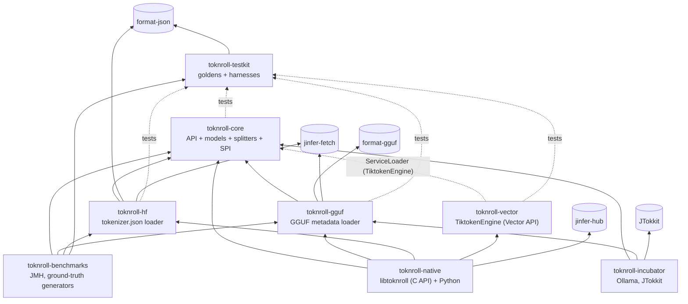
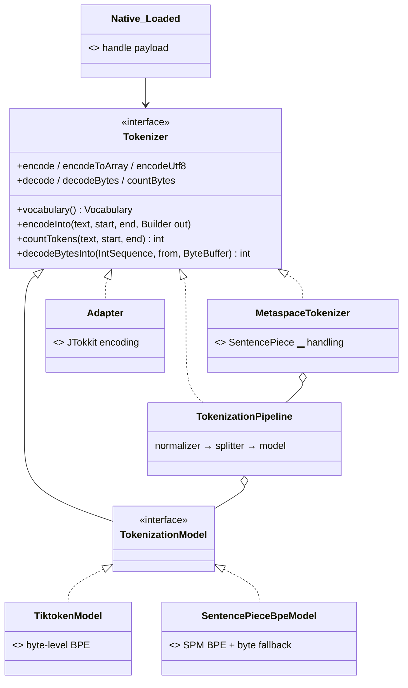
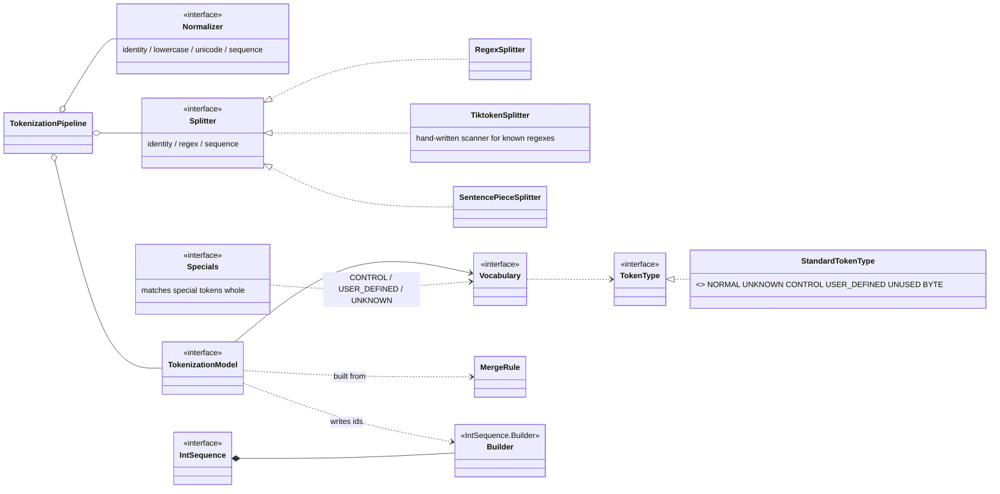
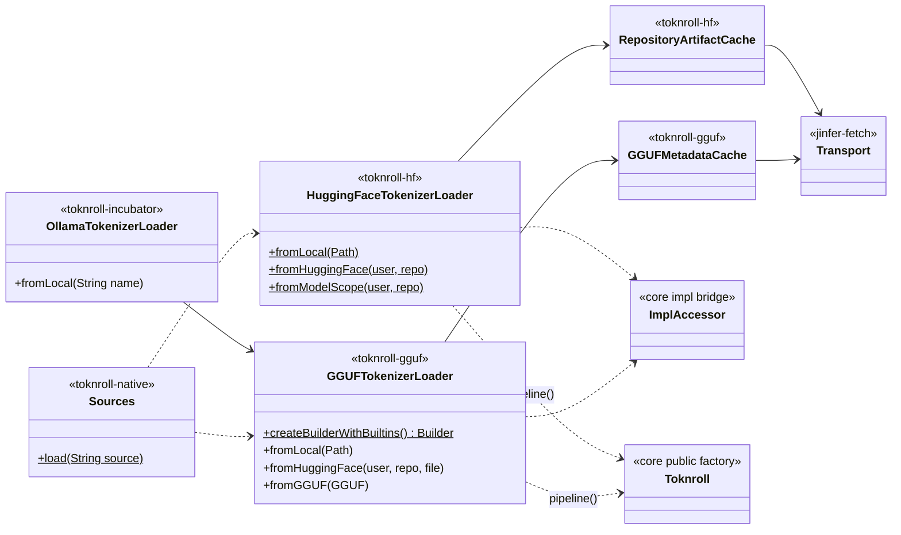
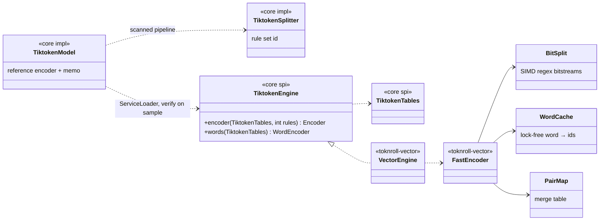
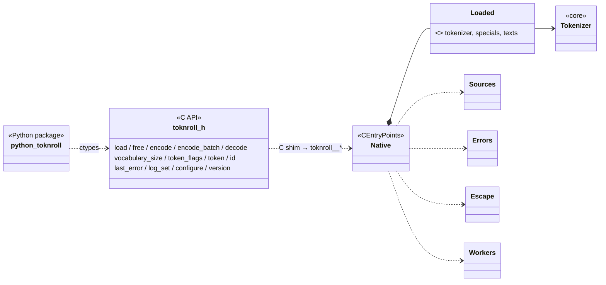
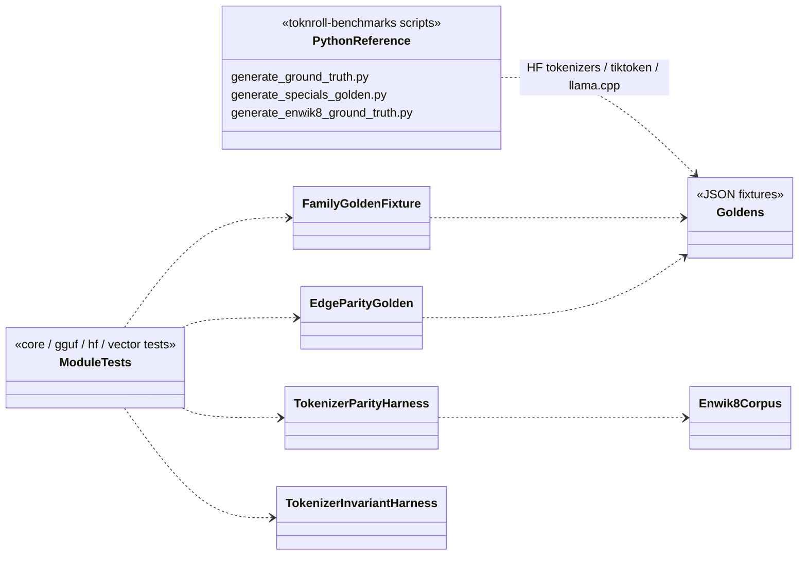

# Tok'n'Roll — Architecture (summary)

This page ties the modules together. Each module has its own detailed page:

| Module | JPMS module | Java | Page |
|---|---|---|---|
| `toknroll-core` | `com.qxotic.toknroll` | 11 | [ARCHITECTURE](../toknroll-core/docs/ARCHITECTURE.md) |
| `toknroll-gguf` | `com.qxotic.toknroll.gguf` | 11 | [ARCHITECTURE](../toknroll-gguf/docs/ARCHITECTURE.md) |
| `toknroll-hf` | `com.qxotic.toknroll.hf` | 11 | [ARCHITECTURE](../toknroll-hf/docs/ARCHITECTURE.md) |
| `toknroll-vector` | (class path, `jdk.incubator.vector`) | 25 | [ARCHITECTURE](../toknroll-vector/docs/ARCHITECTURE.md) |
| `toknroll-native` | (native image → `libtoknroll`) | 25 | [ARCHITECTURE](../toknroll-native/docs/ARCHITECTURE.md) |
| `toknroll-incubator` | — | 11 | [ARCHITECTURE](../toknroll-incubator/docs/ARCHITECTURE.md) |
| `toknroll-testkit` | `com.qxotic.toknroll.testkit` | 11 | [ARCHITECTURE](../toknroll-testkit/docs/ARCHITECTURE.md) |
| `toknroll-benchmarks` | — (JMH + Python scripts, test sources only) | 17 | — |

See also [ARCHITECTURE-overview.md](ARCHITECTURE-overview.md) for the big picture, and
[SPECIALS.md](SPECIALS.md) for special-token handling.

## 1. Module dependencies

`toknroll-core`'s `impl` package is exported **only** to `toknroll-gguf` and `toknroll-hf`
(through `ImplAccessor`); `toknroll-vector` sees only the public `spi` package.

## 2. The central abstraction: `Tokenizer`

All entry points — loaders, the factory, the native library — end up producing a `Tokenizer`.

## 3. Building blocks of a pipeline (core)

## 4. Loaders: from a file format to a pipeline

| Source | Model selection | Splitter selection |
|---|---|---|
| `tokenizer.json` (HF) | `model.type == BPE`; byte-level → `TiktokenModel`, metaspace → `SentencePieceBpeModel` + `MetaspaceTokenizer` | parsed `pre_tokenizer` (Split / ByteLevel / Sequence / Metaspace) |
| `tiktoken.model` (HF) | mergeable ranks → `TiktokenModel` | `pat_str` from `tokenizer_config.json` or the repo's Python module |
| GGUF | `tokenizer.ggml.model`: `gpt2` → tiktoken, `llama`/`gemma4` → SentencePiece | `tokenizer.ggml.pre` name → builtin regex (llama.cpp names), overridable with `-Dtoknroll.gguf.pre.<name>` |
| Ollama | the model layer blob is a GGUF | as GGUF |

## 5. Performance path: the engine SPI

Correctness is never delegated: core checks an engine's output against its own encoder on a
sample covering every kind of piece before using it, and falls back silently otherwise
(`-Dtoknroll.engine=none` disables engines).

## 6. Native face

## 7. Testing architecture

