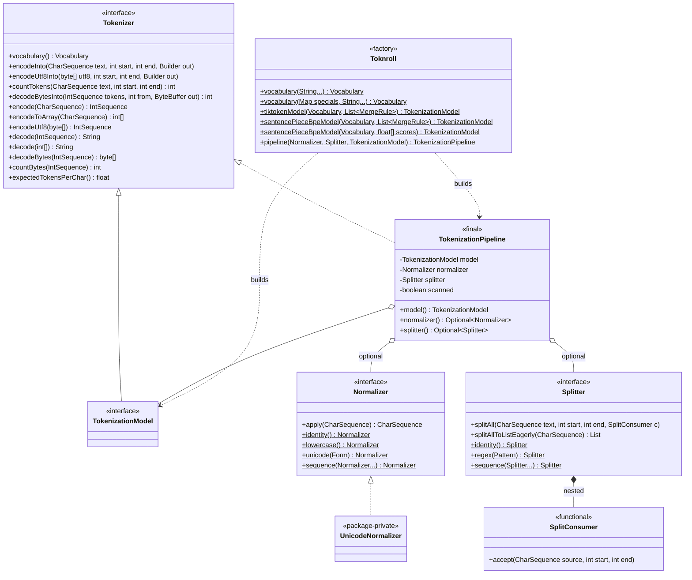
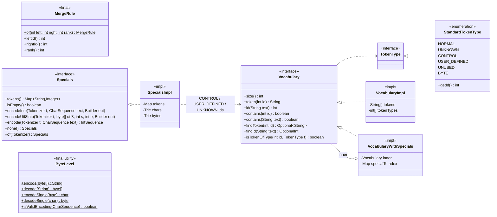
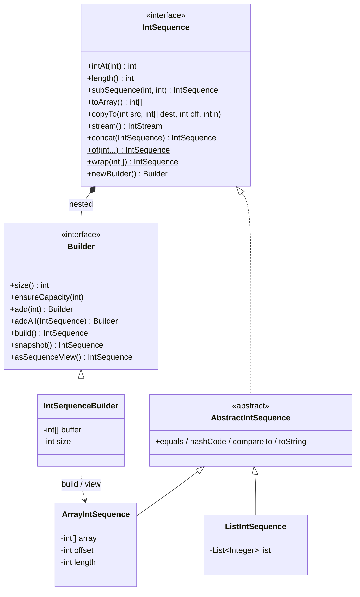
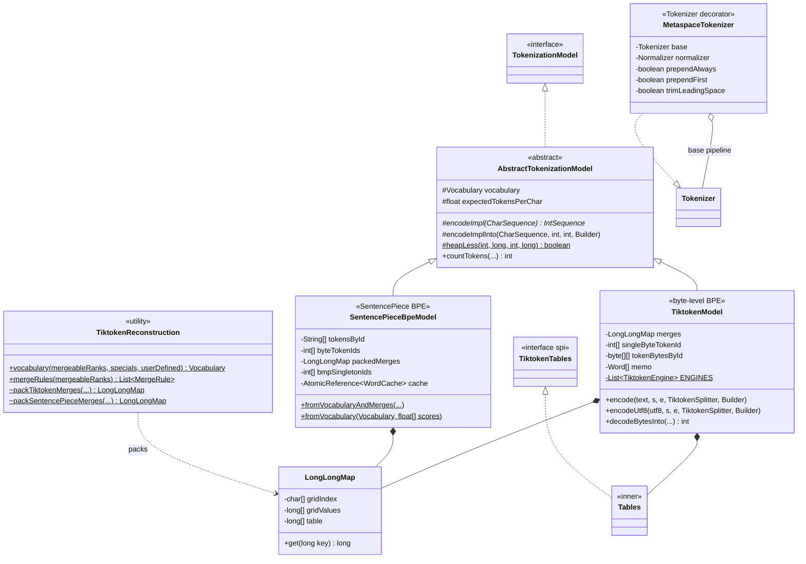
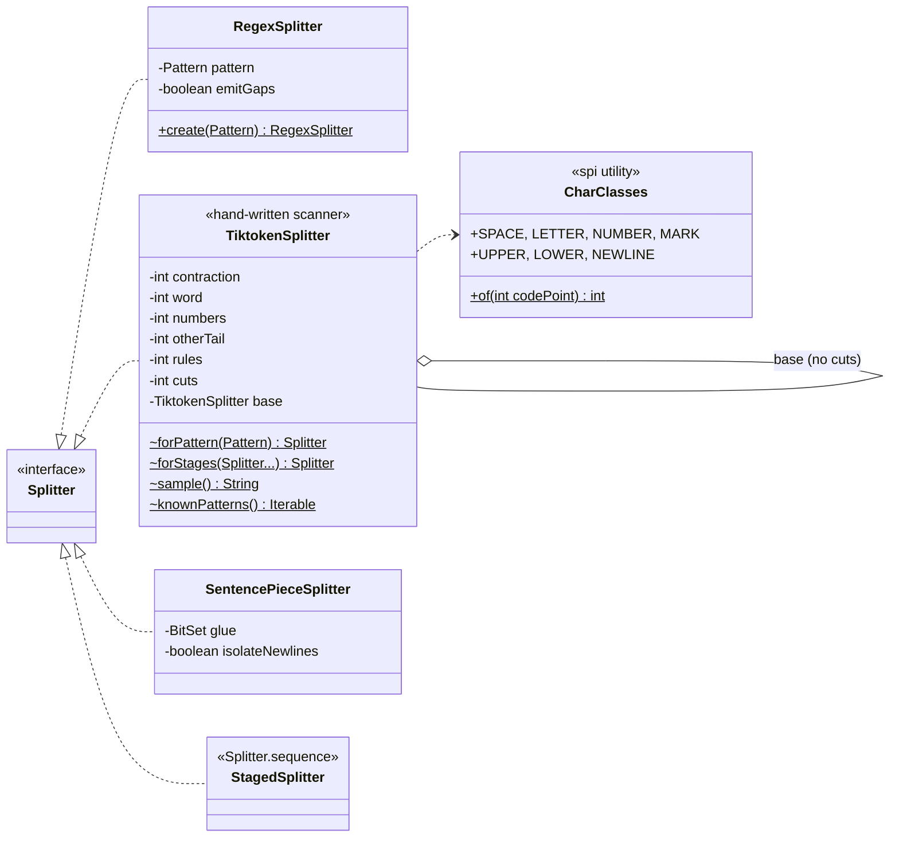
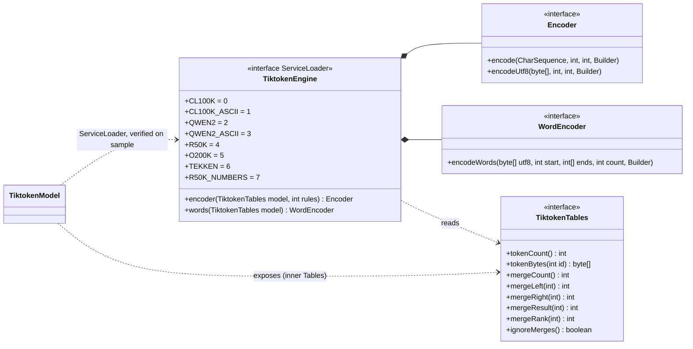
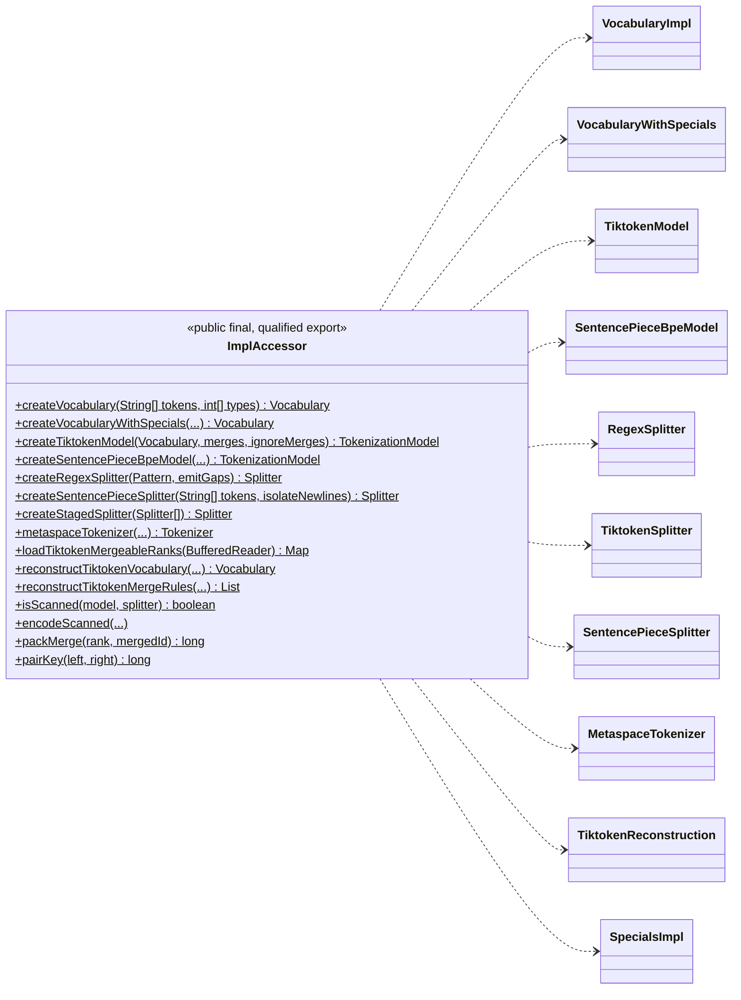
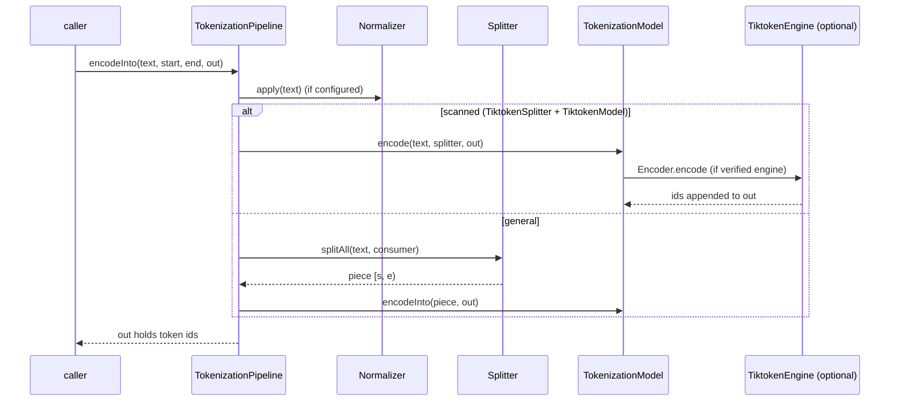

# toknroll-core — Architecture

`toknroll-core` (JPMS module `com.qxotic.toknroll`, Java 11, zero dependencies) is the heart of
Tok'n'Roll: the public tokenizer API, the two BPE models (tiktoken byte-level BPE and
SentencePiece BPE), the pre-tokenizers (splitters), vocabularies, special-token matching and the
SPI through which a faster engine (toknroll-vector) can take over the tiktoken hot path.

| Package | Exported to | Content |
|---|---|---|
| `com.qxotic.toknroll` | everyone | API: `Tokenizer`, `TokenizationModel`, `TokenizationPipeline`, `Normalizer`, `Splitter`, `Vocabulary`, `Specials`, `IntSequence`, `MergeRule`, `TokenType`, `ByteLevel`, `Toknroll` factory, exceptions |
| `com.qxotic.toknroll.spi` | everyone | `TiktokenEngine` (ServiceLoader SPI), `TiktokenTables`, `CharClasses` |
| `com.qxotic.toknroll.impl` | `toknroll.gguf`, `toknroll.hf` only | Implementations: models, splitters, vocabularies, int sequences, `ImplAccessor` bridge |

`module-info` declares `uses com.qxotic.toknroll.spi.TiktokenEngine`.

## 1. The tokenizer contract

Everything that encodes or decodes is a `Tokenizer`. A `TokenizationModel` is a `Tokenizer` that
works on one pre-split piece (a "word"); a `TokenizationPipeline` chains
normalizer → splitter → model and is itself a `Tokenizer`.

`Tokenizer` only has four abstract methods (`vocabulary`, `encodeInto` on a range,
`countTokens` on a range, `decodeBytesInto`); every other method is a `default` built on them.
The zero-copy calls (`encodeInto(..., Builder)`, `decodeBytesInto(..., ByteBuffer)`) are the hot
loop APIs.

## 2. Vocabulary, token types, merges and special tokens

* `Specials.of(tokenizer)` scans the vocabulary once for tokens typed CONTROL, USER_DEFINED or
  UNKNOWN, and builds two tries (chars and UTF-8 bytes). Encoding with it matches special tokens
  whole and hands the text between them to the tokenizer. Plain `Tokenizer.encode` never matches
  specials (`Specials.none()` behaviour).
* `ByteLevel` is GPT-2's bytes ↔ printable-unicode mapping used by byte-level BPE vocabularies.

## 3. Token id sequences

`IntSequence` is the immutable, `Comparable` view of token ids; `Builder` is the append-only sink
every encode writes into (no boxing, no copy until `build()`).

## 4. Models (impl)

* **TiktokenModel** – reference byte-level BPE (GPT-2/cl100k/o200k/Llama 3/Qwen…): a word's bytes
  map to single-byte tokens, then the lowest-rank (leftmost on ties) pair merges until none
  applies. Short words (≤ 32 bytes) are memoized in a lock-free 64K-slot memo. Merge pairs live in
  `LongLongMap` (dense 512×512 grid for early merges + open-addressing table for the rest).
* **SentencePieceBpeModel** – SentencePiece BPE with byte fallback (`<0x00>`…`<0xFF>`), merges by
  rank or by scores; O(n²) scan for short words, heap for words over 128 symbols (worst case
  `O(n log n)`); a 24 MB lock-free seqlock word cache built lazily by one thread.
* **MetaspaceTokenizer** – wraps a SentencePiece pipeline to handle `▁` (U+2581): normalizes,
  prepends `▁` per `prepend_scheme` (`always` / `first` / `never`), and trims the leading space
  on decode.
* **TiktokenReconstruction** – rebuilds vocabulary + merge rules from a `.tiktoken` mergeable-ranks
  file.

## 5. Splitters (pre-tokenizers, impl)

* **TiktokenSplitter** recognizes the known tiktoken-family regexes (r50k/GPT-2, cl100k, Llama 3,
  Qwen2, Qwen3.5, o200k, Tekken, DeepSeek V3, number/newline "cut" stages…) by their *source*
  (`forPattern`) and replaces `java.util.regex` with a hand-written, allocation-free scanner. Unknown
  patterns fall back to `RegexSplitter`.
* When the splitter is a `TiktokenSplitter` and the model a `TiktokenModel`, the pipeline is
  **scanned**: `ImplAccessor.encodeScanned` lets the model split and merge in one pass, and that
  is where a `TiktokenEngine` can take over.
* **SentencePieceSplitter** cuts text on spaces that are not "glued" to a vocabulary token, optionally
  isolating newline runs.

## 6. Engine SPI (`com.qxotic.toknroll.spi`)

On its first encode, `TiktokenModel` asks every engine for an `Encoder` for its rule set,
**verifies it against its own encoder** on `TiktokenSplitter.sample()` (covers every kind of piece),
and only then uses it. An engine that declines, disagrees or throws is skipped.
`-Dtoknroll.engine=none` disables engines.

## 7. The `ImplAccessor` bridge

`impl` is exported only to `toknroll-gguf` and `toknroll-hf`; they never touch the package-private
classes directly but go through `ImplAccessor`:

## 8. Encode flow

Other small types: `TokenizerLoadException` (I/O while loading), `UnsupportedTokenizerException`
(a valid tokenizer that Tok'n'Roll does not implement), `IntPair` / `IteratorCombiner` (internal
helpers).
