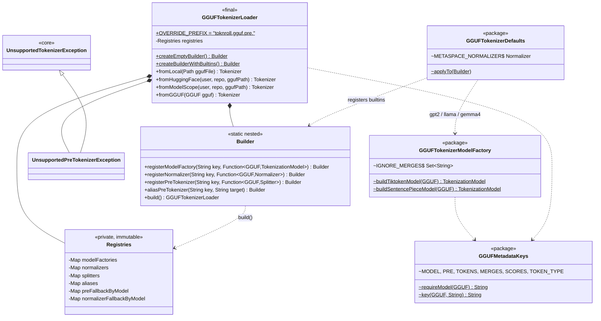
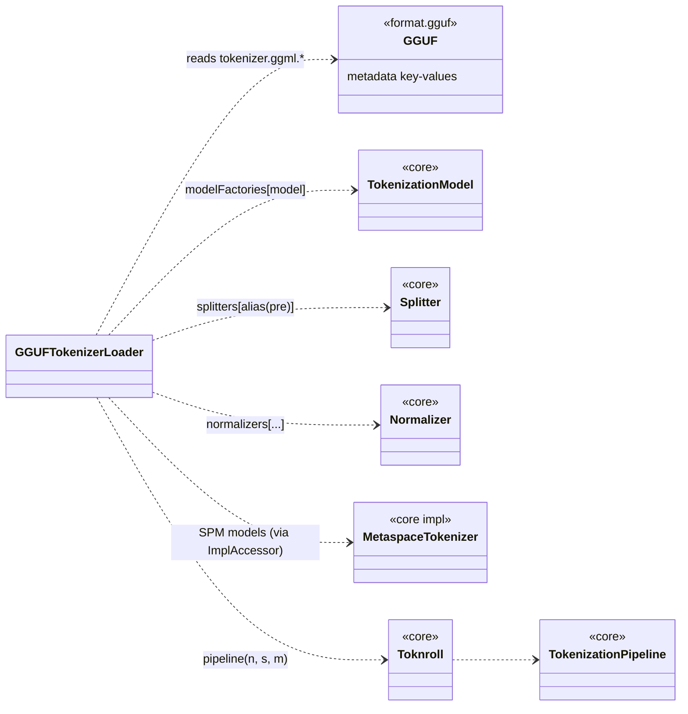
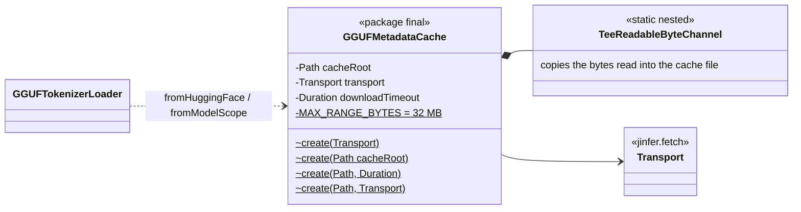

# toknroll-gguf — Architecture

`toknroll-gguf` (JPMS module `com.qxotic.toknroll.gguf`) builds a Tok'n'Roll `Tokenizer` from the
`tokenizer.ggml.*` metadata of a **GGUF** model file (llama.cpp's format), locally or remotely
from Hugging Face / ModelScope. Remotely, only the GGUF **header** is fetched (one bounded HTTP
Range request), never the tensors.

Dependencies: `toknroll-core` (transitive, plus its qualified `impl` export), `com.qxotic.format.gguf`
(GGUF reader, transitive) and `com.qxotic.jinfer.fetch` (HTTP `Transport`).

| Class | Visibility | Role |
|---|---|---|
| `GGUFTokenizerLoader` | public | Entry point: registries of model factories / normalizers / pre-tokenizers, `fromLocal`, `fromHuggingFace`, `fromModelScope`, `fromGGUF` |
| `GGUFTokenizerLoader.Builder` | public | Registers factories, aliases; `build()` applies `-Dtoknroll.gguf.pre.<name>=...` overrides |
| `GGUFTokenizerLoader.UnsupportedPreTokenizerException` | public | Unknown `tokenizer.ggml.pre`, with a fix hint |
| `GGUFTokenizerDefaults` | package | The builtins: model types and the llama.cpp pre-tokenizer names → regexes |
| `GGUFTokenizerModelFactory` | package | Builds the `TokenizationModel` (tiktoken or SentencePiece) from GGUF arrays |
| `GGUFMetadataKeys` | package | `tokenizer.ggml.model / pre / tokens / merges / scores / token_type` |
| `GGUFMetadataCache` | package | On-disk cache of remote GGUF headers, `TeeReadableByteChannel` |

## 1. Loader and its registries

Resolution layers, each outranking the previous one:

1. builtins (`createBuilderWithBuiltins()` → `GGUFTokenizerDefaults.applyTo`),
2. programmatic `register*` / `alias*` calls on the `Builder`,
3. system properties `-Dtoknroll.gguf.pre.<name>=...`, applied in `build()` (fix a deployment
   without a rebuild; replacements are logged).

Builtin model factories: `gpt2` → tiktoken byte-level BPE, `llama` and `gemma4` → SentencePiece
BPE. Pre-tokenizer names are grouped as in llama.cpp's `llama-vocab.cpp` (`gpt-2`, `llama3`/`llama-bpe`,
`qwen2`, `qwen35`, …): names in a group share one splitter factory.

## 2. From GGUF metadata to a Tokenizer

`fromGGUF`:

1. `model = tokenizer.ggml.model` → model factory (else `UnsupportedTokenizerException`),
2. `pre = tokenizer.ggml.pre` (or a per-model fallback) → alias chain → splitter factory (else
   `UnsupportedPreTokenizerException` naming the `-D` override),
3. normalizer key → normalizer factory,
4. `Toknroll.pipeline(normalizer, splitter, model)`, wrapped in a `MetaspaceTokenizer` for
   SentencePiece models that use metaspace normalization.

## 3. Remote headers and the cache

Configuration: `-Dtoknroll.cache.root` / `TOKNROLL_CACHE_ROOT`, `HF_TOKEN` /
`-Dtoknroll.huggingface.token`, `MODELSCOPE_TOKEN` / `-Dtoknroll.modelscope.token`,
`-Dtoknroll.gguf.maxMetadataBytes` (default 32 MB: one Range request, stopped where the header
ends), `-Dtoknroll.downloadTimeoutSeconds` (300).
