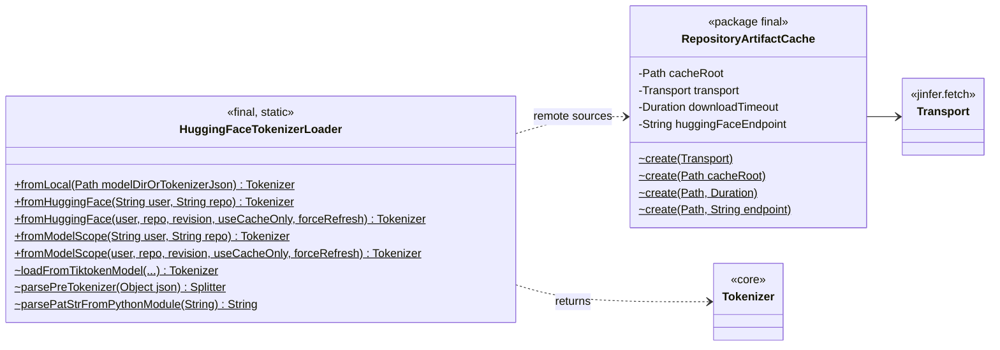
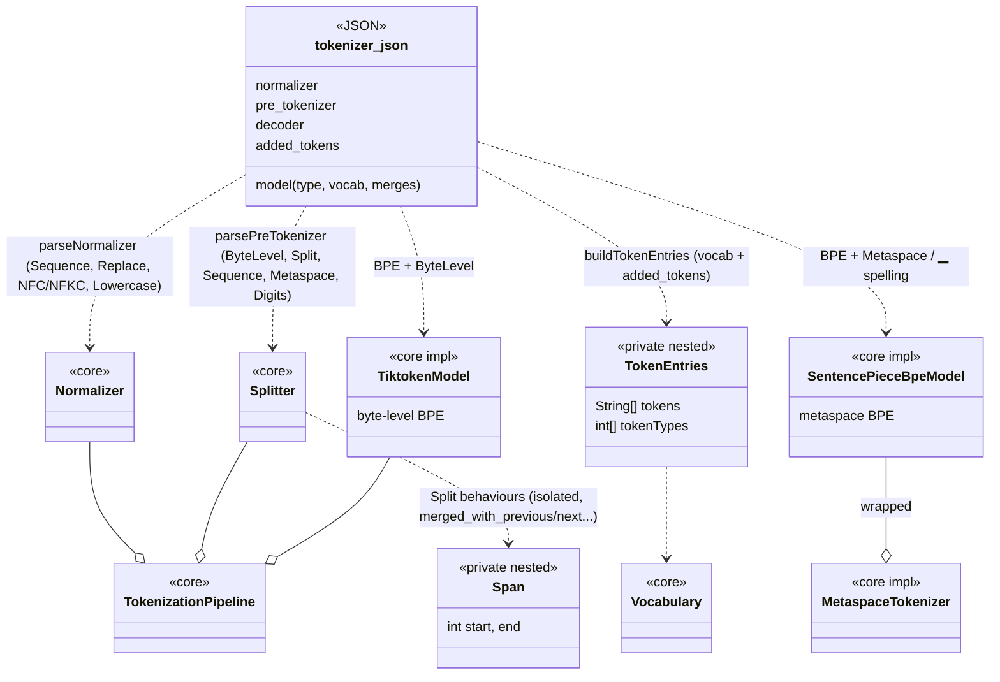

# toknroll-hf — Architecture

`toknroll-hf` (JPMS module `com.qxotic.toknroll.hf`) builds a Tok'n'Roll `Tokenizer` from
**Hugging Face tokenizer assets** (`tokenizer.json`, `tokenizer_config.json`,
`special_tokens_map.json`, `added_tokens.json`, or a `tiktoken.model` + pattern module), from a
local folder or fetched from Hugging Face / ModelScope and cached on disk. It only fetches
tokenizer metadata, never weights.

Dependencies: `toknroll-core` (transitive + qualified `impl` export), `com.qxotic.format.json`
(JSON parser), `com.qxotic.jinfer.fetch` (HTTP `Transport`).

| Class | Visibility | Role |
|---|---|---|
| `HuggingFaceTokenizerLoader` | public | Static entry points + the whole `tokenizer.json` → pipeline translation (≈1.5k lines) |
| `RepositoryArtifactCache` | package | Downloads and caches repository files (revision → commit SHA), HF / ModelScope endpoints, tokens |

## 1. Public API

Cache policy: a cached artifact is reused; `forceRefresh` re-downloads; `useCacheOnly` never
touches the network. Configuration: `-Dtoknroll.cache.root` / `TOKNROLL_CACHE_ROOT`, `HF_TOKEN`,
`MODELSCOPE_TOKEN`, `-Dtoknroll.downloadTimeoutSeconds`.

## 2. Translating `tokenizer.json`

The loader maps each section of `tokenizer.json` onto a core building block, and **fails fast**
(`UnsupportedTokenizerException`) on anything it does not reproduce exactly.

Decision points of `loadUnchecked`:

* `model.type` must be `BPE` (untyped files: merges ⇒ BPE, else Unigram / WordPiece ⇒ unsupported).
* Metaspace pre-tokenizer or `▁`-spelled vocabulary ⇒ **SentencePiece style**:
  `SentencePieceBpeModel` + `SentencePieceSplitter`, wrapped in `MetaspaceTokenizer` with the
  `prepend_scheme` and a decoder-derived `trimLeadingSpace`.
* Otherwise ⇒ **byte-level** (`ByteLevel` pre-tokenizer + decoder required): `TiktokenModel`
  behind the parsed splitter (regexes are recognised by core's `TiktokenSplitter`, so the fast scanned
  path and the vector engine apply).
* No `tokenizer.json` (HTTP 404) but a `tiktoken.model` ⇒ `loadFromTiktokenModel`: mergeable ranks
  + the `pat_str` read from `tokenizer_config.json` or from the repository's Python module
  (`auto_map`).
