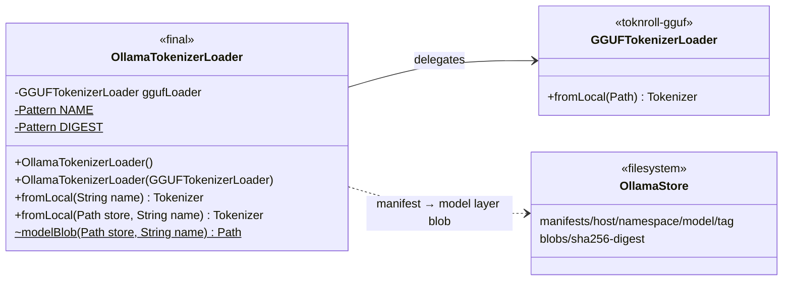
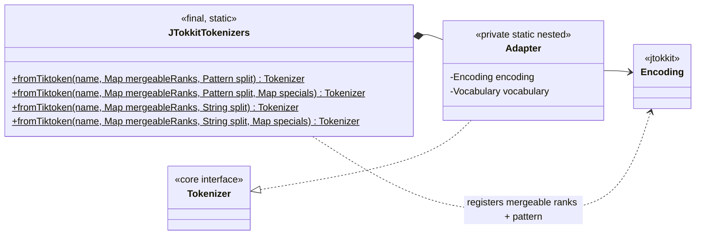

# toknroll-incubator — Architecture

`toknroll-incubator` holds experimental loaders and adapters that are not part of the stable API.
It depends on `toknroll-core`, `toknroll-gguf`, a JSON parser and **JTokkit** (a third-party Java
tiktoken implementation, used for comparisons).

| Package | Class | Role |
|---|---|---|
| `com.qxotic.toknroll.incubator` | `OllamaTokenizerLoader` | Loads the tokenizer of a model pulled by Ollama, from its local store |
| `com.qxotic.toknroll.jtokkit` | `JTokkitTokenizers` | Exposes a JTokkit encoding as a Tok'n'Roll `Tokenizer` |

## 1. Ollama loader

A name as `ollama run` takes it (`[host/][namespace/]model[:tag]`, defaults
`registry.ollama.ai` / `library` / `latest`, case-insensitive) resolves through the manifest to the
blob of the layer `application/vnd.ollama.image.model`, which is a GGUF file handed to
`GGUFTokenizerLoader.fromLocal`. The store is `$OLLAMA_MODELS` or `~/.ollama/models`; nothing is
downloaded.

## 2. JTokkit adapter

Useful as a reference/baseline in benchmarks and parity tests against Tok'n'Roll's own tiktoken
implementation.
