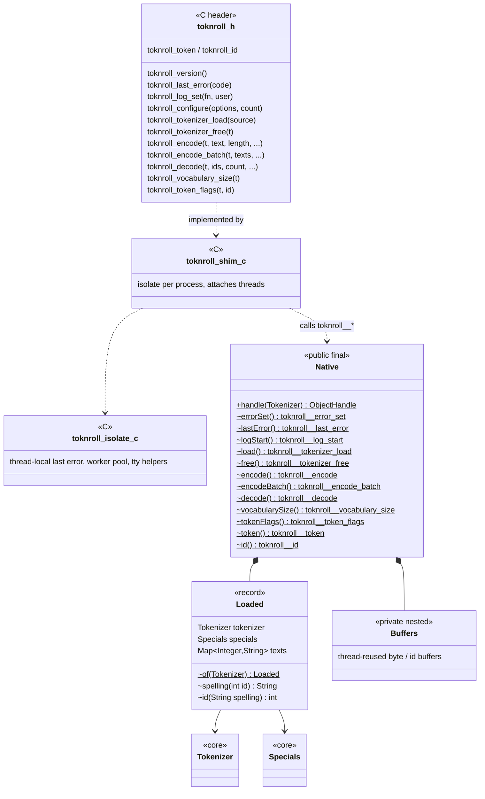
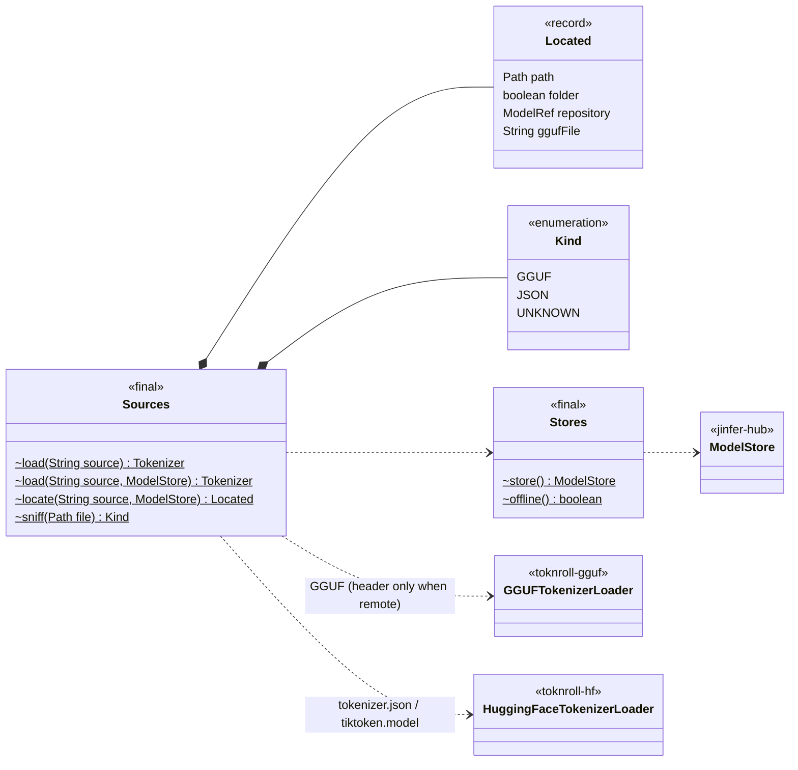
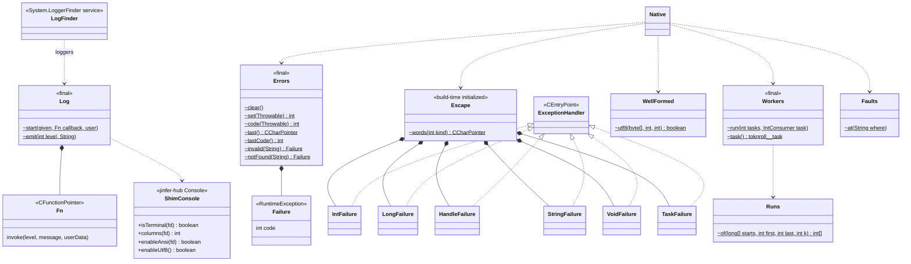

# toknroll-native — Architecture

`toknroll-native` (Java 25, GraalVM Native Image) builds **`libtoknroll`**: Tok'n'Roll as a
shared/static C library with the API of [`include/toknroll.h`](../include/toknroll.h), and the
Python package `toknroll` that binds it. The Java side (`com.qxotic.toknroll.libtoknroll`) is a
set of `@CEntryPoint`s behind a small C shim (`src/main/c`).

Dependencies: `toknroll-core`, `toknroll-gguf`, `toknroll-hf`, `toknroll-vector`, `jinfer-hub`
(source grammar, model store, fetch through curl), GraalVM `nativeimage` / `svm`.

| Class | Role |
|---|---|
| `Native` | The `toknroll__*` entry points (one per header function); handles over `Loaded` |
| `Sources` | `toknroll_tokenizer_load(source)`: resolve → sniff format → load (HF / GGUF / tiktoken) |
| `Stores` | The jinfer `ModelStore` the sources resolve through (cache root, offline mode) |
| `Errors` | Thread's last error (code + message in C thread-local storage) |
| `Escape` | Uninterruptible `CEntryPoint.ExceptionHandler`s for OOM / stack overflow |
| `Workers` / `Runs` | `toknroll_encode_batch` over C worker threads, texts shared out in runs |
| `WellFormed` | UTF-8 validation, so well-formed input is encoded without decoding |
| `Log` / `LogFinder` | `System.LoggerFinder` routing every log line to the host's `toknroll_log_fn` |
| `ShimConsole` | jinfer-hub `Console` through the shim's C helpers (no FFM in the image) |
| `Faults` | `-Dtoknroll.test.escape=<where>:<kind>` fault injection for the C tests |

## 1. Layers: C API → shim → entry points → core

A `toknroll_tokenizer*` is an `ObjectHandles` word over a `Loaded`. Another library hosting
these symbols next to its own (libjinfer) obtains handles via `Native.handle(Tokenizer)`.

## 2. Loading a source

Source grammar is jinfer-hub's (local file/folder, `user/repo`, `user/repo/file.gguf`, …); the
cache is shared with libjinfer. Knobs: `-Dtoknroll.cache.root` / `TOKNROLL_CACHE_ROOT`,
`-Dtoknroll.offline=true` (or `jinfer.offline`).

## 3. Errors, escapes, batches and logging

* Every entry point catches what it can → `Errors.set` (thread's last error in C TLS, no
  allocation) and returns NULL / negative (`TOKNROLL_ERROR`, `EINVAL`, `ENOTFOUND`, `EUNSUPPORTED`).
* What no catch can see (OOM / stack overflow raised by native image) reaches the entry point's
  `Escape.*Failure` handler: uninterruptible, allocation-free, initialized at build time.
* `toknroll_encode_batch` splits the texts into runs (`Runs`) and runs them on C worker threads
  (`Workers`, pool in `toknroll_isolate.c`); in a forked child the batch runs on the calling thread.
* Logging: `<PROGRAM>_LOG` level, host callback or stderr; no `java.util.logging` in the image.
