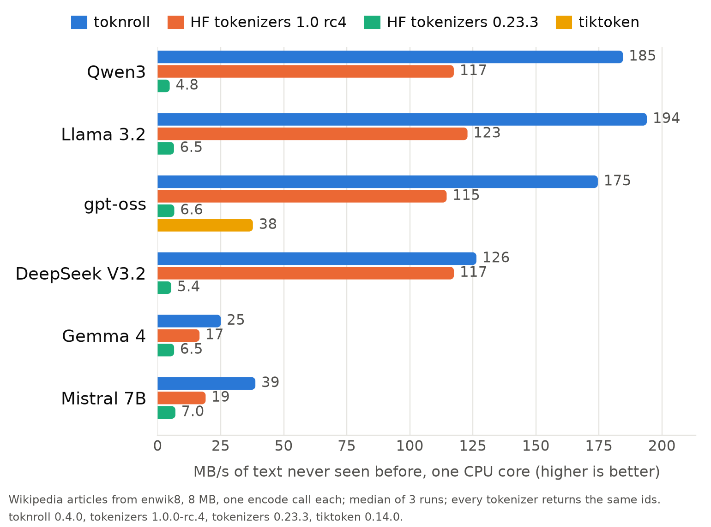

# toknroll

**Token-perfect LLM tokenization for Python.**
Each model's own tokens, id for id, faster than Hugging Face `tokenizers` and tiktoken.

[](https://pypi.org/project/toknroll/)
[](https://pypi.org/project/toknroll/)
[](https://github.com/qxoticai/qxotic/blob/v0.4.0/LICENSE)



```sh
pip install toknroll
```

```python
import toknroll

tokenizer = toknroll.load("Qwen/Qwen3-0.6B")    # fetched once, never the weights
ids = tokenizer.encode("Hello, world!")          # array('i', [9707, 11, 1879, 0])
tokenizer.decode(ids)                            # 'Hello, world!'
tokenizer.count_tokens("Hello, world!")          # 4
tokenizer.encode_batch(["Hello", "world"])       # spread over every core
```

- **Exact.** The same ids as each model's own tokenizer, verified by parity tests against Hugging Face `tokenizers`, llama.cpp and tiktoken.
- **Fast.** 125-195 MB/s of text on one core for Qwen, Llama, gpt-oss and DeepSeek, every core with `encode_batch`, and the GIL released on every call.
- **Light.** One 6 MB wheel with no dependencies: no `torch`, no `transformers`, no compiler.

## What it reads

`toknroll.load` reads a `tokenizer.json` or its folder, a GGUF file (its header only, never the weights), or a tiktoken checkout, on disk or by Hugging Face or ModelScope reference (`owner/repo[@rev][:quant]`), fetched once and cached; a URL is refused, naming the reference to pass.
Parity is tested on the tokenizers of 18 vendors' models, Qwen, Llama, Gemma 4, gpt-oss, DeepSeek, Mistral, Granite, Kimi and [more](https://github.com/qxoticai/qxotic/blob/v0.4.0/toknroll/README.md#tested-implementations); a tokenizer toknroll cannot reproduce exactly is refused at load, never approximated.

## Requirements

- Python 3.10 or later, and no other package.
- Linux x86-64 or aarch64 with glibc 2.28 or later, macOS 14 or later on Apple silicon, or Windows 10 or later on x86-64.
- On x86-64, a CPU with AVX2.
- `curl` on the PATH for Hub sources; a local file needs nothing.

## The API at a glance

| You want | Call |
|---|---|
| ids | `encode(text)`, an `array('i')` numpy reads without a copy; `specials=True` keeps special tokens whole |
| text | `decode(ids)`, or `decode_bytes(ids)` for the exact bytes |
| a count | `count_tokens(text)` |
| many texts | `encode_batch(texts)` |
| the vocabulary | `vocabulary_size`, `token(id)`, `id(token)` |

The [full API reference](https://github.com/qxoticai/qxotic/blob/v0.4.0/toknroll/toknroll-native/python/API.md) covers every call, sources, errors, the cache and the C library.

## License

Apache 2.0, by [Quixotic AI](https://qxotic.ai).
The library in the wheel is built with Oracle GraalVM and carries its runtime under the [GraalVM Free Terms and Conditions](https://www.oracle.com/downloads/licenses/graal-free-license.html): free to use, commercially too, but a product sold for a fee that bundles it is not covered.
