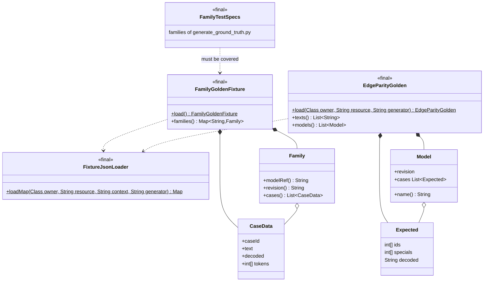
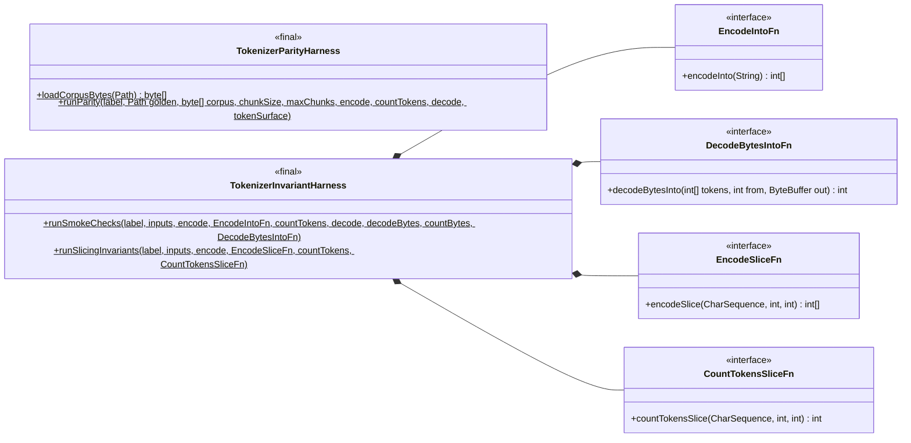
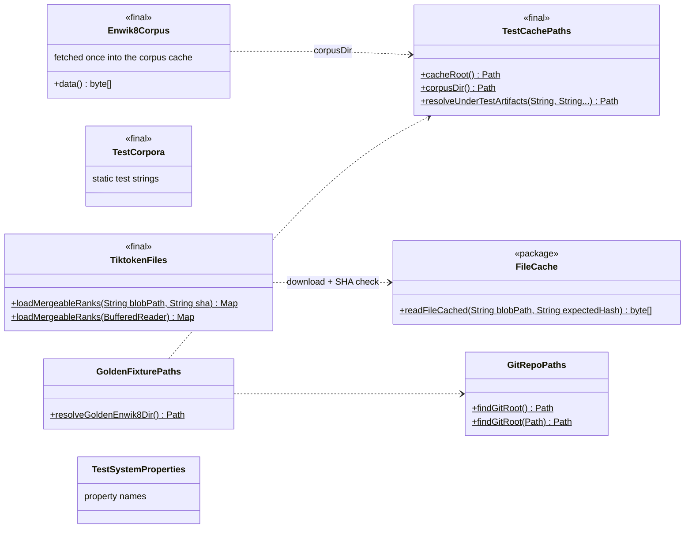

# toknroll-testkit — Architecture

`toknroll-testkit` (JPMS module `com.qxotic.toknroll.testkit`) is the shared **test support**
library of Tok'n'Roll: golden fixtures (ids produced by the Python reference tokenizers),
parity / invariant harnesses, test corpora and cache paths. It is a `main` artifact so that every
module's tests (core, gguf, hf, vector, incubator, benchmarks) can depend on it. It does **not**
depend on `toknroll-core`: harnesses take lambdas (`int[] encode(String)`, …), which keeps them
usable for any implementation (Tok'n'Roll, JTokkit, native).

Dependencies: `com.qxotic.format.json`, `java.net.http`.

## 1. Golden fixtures

* `ground_truth_model_families.json` — per model family, test texts with expected ids and
  decoding (`toknroll-benchmarks/generate_ground_truth.py`).
* `hf_edge_parity.json` / `gguf_edge_parity.json` — edge texts × models, each with plain-encode ids,
  `Specials.encode` ids and (HF) decoded text.
* `FixtureJsonLoader` reads from the test classpath, else from the repository's `test-fixtures`,
  with a "regenerate with …" message when missing.

## 2. Harnesses

* **Parity**: a corpus (enwik8) is cut into chunks identified by hash; each chunk's ids must equal
  the golden row's tokens, `countTokens` must agree and decoding must round-trip.
* **Invariants** (`runSmokeChecks`): determinism, count = length of encode, `encodeInto` /
  `decodeBytes` / `countBytes` / `decodeBytesInto` agreeing with their plain counterparts,
  round-trip on small strings. `runSlicingInvariants` checks the range overloads
  (`encodeInto(text, start, end, out)`, `countTokens(text, start, end)`) on the full range.

## 3. Corpora, tiktoken files and paths

