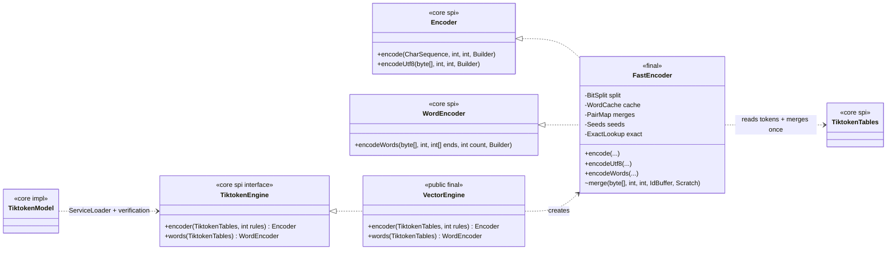
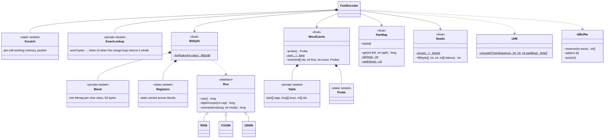
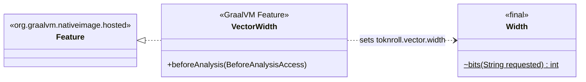

# toknroll-vector — Architecture

`toknroll-vector` (Java 25, `jdk.incubator.vector`) is an optional, faster **engine** for the
tiktoken family (byte-level BPE behind a known pre-tokenization regex). It plugs into core through
the `TiktokenEngine` SPI (`META-INF/services/com.qxotic.toknroll.spi.TiktokenEngine` →
`VectorEngine`) and is only used after core has **verified** that it produces the same ids as its
own encoder. Every class except `VectorEngine` is package-private.

| Class | Role |
|---|---|
| `VectorEngine` | The SPI provider: `encoder(tables, rules)` and `words(tables)` return a `FastEncoder` |
| `FastEncoder` | Encoder: UTF-8 → `BitSplit` pieces → `WordCache` hit or BPE merge |
| `BitSplit` | The tiktoken regexes as SIMD bitstream programs, 64 bytes per step (after HF's `bitcannon`) |
| `WordCache` | Lock-free, shared, Swiss-table-like cache word → token ids |
| `PairMap` | Merge table (left,right) → (merged id, rank): dense grid + open addressing |
| `Seeds` | Per-vocabulary proof of which 2–3 byte characters may start a merge whole |
| `Utf8` | Vectorized `CharSequence` → UTF-8 |
| `IdBuffer` | Growable `int[]` the encoder writes into directly |
| `Width` / `VectorWidth` | Vector width (128/256/512); a GraalVM `Feature` fixing it to the image's target ISA |

## 1. SPI wiring

`words(...)` returns a `FastEncoder` without a splitter (it only merges pre-split words, e.g. for
splitters other than the tiktoken ones); `encoder(..., rules)` returns one with a `BitSplit` for
the rule set (`R50K`, `R50K_NUMBERS`, `CL100K*`, `QWEN2*`, `O200K`, `TEKKEN`) or `null` if it has none.

## 2. Encoder internals

Pipeline for one call:

1. `Utf8.encode` — text to padded UTF-8 (ASCII vectors narrow in one step).
2. `BitSplit` — each 64-byte block becomes per-class bitmaps; every regex rule is boolean algebra
   and carry-propagating adds; output is a bitmap of piece starts (no branch per character).
3. For each piece: `WordCache.run` writes cached ids straight to the output; a miss goes to
   `ExactLookup` (piece is a token), else a merge — by hand ≤ 3 bytes, flat-array scan up to
   `LARGE`, heap beyond — starting from bytes or from `Seeds` characters, looking up pairs in
   `PairMap`.

`WordCache` size: `-Dtoknroll.wordCache=<MB>` (0 disables); it is shared by all threads, lock-free
(tags published after the slot is written), grows by replacement.

## 3. Vector width and native image

`Width` picks 128/256/512 bits (`-Dtoknroll.vector.width`), a constant the JIT bakes in.
`VectorWidth`, registered in the jar's `native-image.properties`, reads the target CPU features
at image build time (AVX-512BW → 512, AVX2 → 256, else 128) and, for x86 targets without AVX,
starts the image with `toknroll.engine=none` so core's scalar encoder is used.
